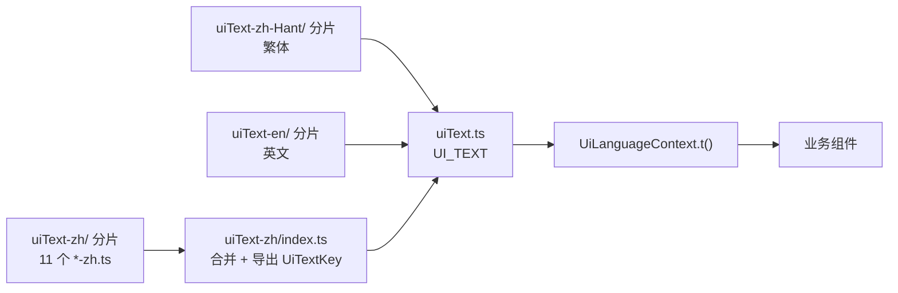
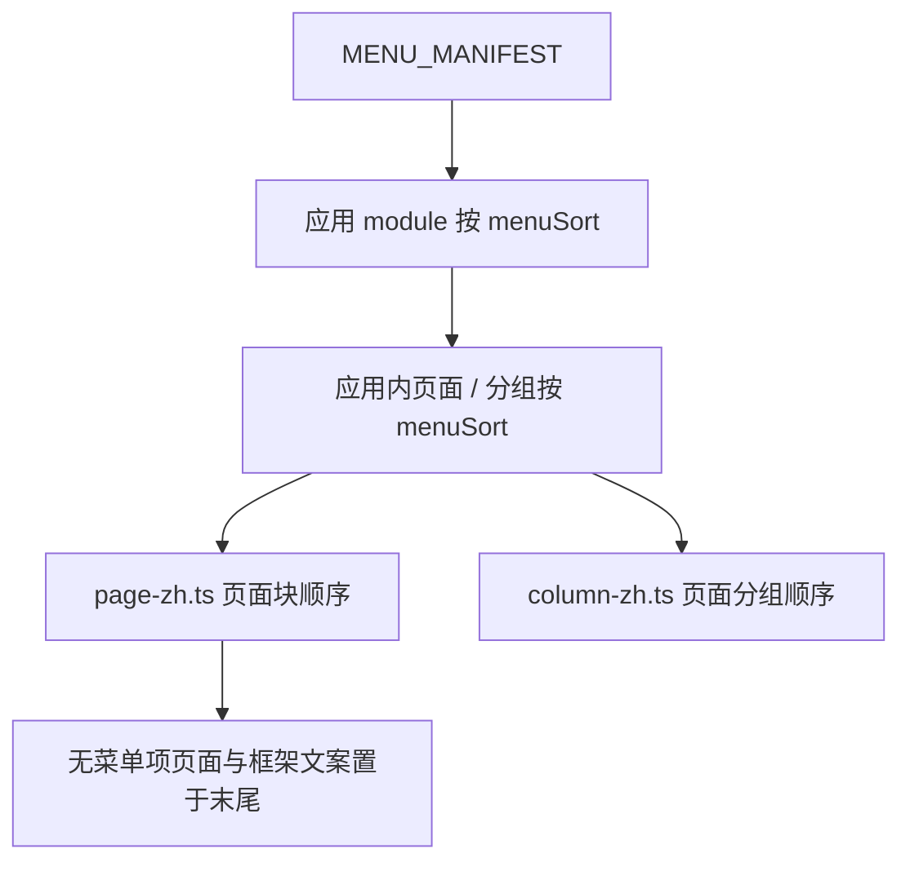
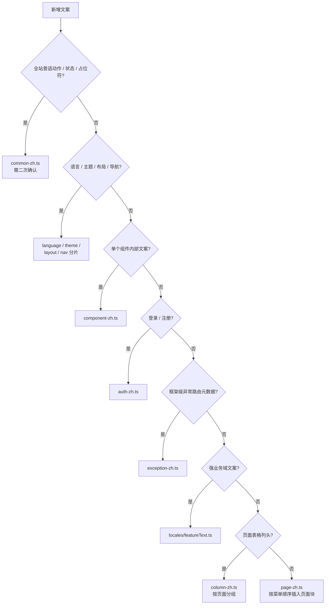
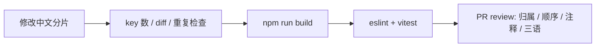

# <a id="top"></a>i18n 多语言管理规范

> 📝 **方案简述**：本规范统一管理 `apps/hrs-web/src/i18n` 下三语主字典的 key 命名、文件分片与维护流程。三语主字典均已按同一结构拆分为 `uiText-zh/`、`uiText-zh-Hant/`、`uiText-en/` 目录（各 11 个分片 + `index.ts` 聚合出口）；`UiTextKey` 由中文分片合并结果推导，类型系统强制三语 key 集合对齐。新增页面表格列头统一进 `column-zh.ts`，`page-zh.ts` 的页面块按 `MENU_MANIFEST` 的应用与菜单顺序排列。规范以表格明确边界、以流程图呈现决策与数据流。
>
> 👤 **方案作者**：Lensgcx (GaoCangxiong) - ArcSeek-X
>
> 🕒 **更新时间**：2026-11-25

> 适用范围：`apps/hrs-web/src/i18n/`（`uiText-zh/`、`uiText-zh-Hant/`、`uiText-en/` 三个同构分片目录，经 `uiText.ts` 聚合为 `UI_TEXT`，由 `UiLanguageContext.t()` 消费）。
>
> 本规范对**新增文案强制生效**；存量 key 不统一改名，通过「登记表 + 渐进迁移」管理。

## <a id="toc"></a>方案目录

- [方案概览](#top)
- [主字典目录与数据流](#dict-files)
- [1. 总则](#sec1)
- [2. 八大类别与 key 前缀契约](#sec2)
- [3. 命名细则](#sec3)
  - [3.1 通用规则](#sec3-1)
  - [3.2 异常页面类别（第 6 类）](#sec3-2)
  - [3.3 页面类别（第 8 类）](#sec3-3)
  - [3.4 组件类别（第 5 类）](#sec3-4)
  - [3.5 登录/注册类别（第 7 类）](#sec3-5)
  - [3.6 布局与菜单类别（第 4 类）子域划分](#sec3-6)
- [4. 字典文件内的排列顺序](#sec4)
  - [4.1 分片之间的展开顺序](#sec4-1)
  - [4.2 大类内部排序依据](#sec4-2)
  - [4.3 命名空间内部](#sec4-3)
  - [4.4 三语 key 集合对齐与顺序](#sec4-4)
  - [4.5 列头分片与页面排序](#sec4-5)
- [5. 字典边界](#sec5)
- [6. 新增文案流程](#sec6)
  - [6.1 归属判定（流程图）](#sec6-1)
  - [6.2 三语同改步骤](#sec6-2)
- [7. 存量登记表](#sec7)
- [8. 验证与守护](#sec8)
- [9. 版本改动记录](#sec9)
- [10. 注释要求](#sec10)

## <a id="dict-files"></a>主字典目录与数据流

全站界面文案的**唯一数据真源**是 `apps/hrs-web/src/i18n/` 下的主字典：三语均已拆分为同构目录：`uiText-zh/`、`uiText-zh-Hant/`、`uiText-en/`。三者经 `uiText.ts` 聚合成 `UI_TEXT`，由 `UiLanguageContext.t()`（业务代码通过 `useUiLanguage()` 取 `t`）消费；类型系统 `Record<UiLanguage, Record<UiTextKey, string>>` 强制三语 key 集合对齐（缺任何一语即编译报错）。



文件角色分工：

| 文件 / 目录 | 语言 | 角色与边界 |
| --- | --- | --- |
| `uiText-zh/*.ts` | 简体中文（zh） | **所有 key 的唯一真源**。新增 / 删除 key 必须先改对应分片；`UiTextKey` 由 `index.ts` 合并结果推导，另两语必须补齐同一 key 集合，否则编译失败。 |
| `uiText-zh/index.ts` | 简体中文（zh） | 对外聚合出口：按固定顺序展开各分片，导出默认 `zh` 与 `UiTextKey`。**不承载文案**。 |
| `uiText-zh-Hant/*.ts` + `index.ts` | 繁体中文（zh-Hant） | 繁体译本，必须是真繁体；分片结构与 zh 一致，key 集合须与 zh 完全相同。 |
| `uiText-en/*.ts` + `index.ts` | 英文（en） | 英文译本；分片结构与 zh 一致，key 集合须与 zh 完全相同。 |
| `uiText.ts` | — | 三语聚合、语言类型与 `formatUiText()` 模板渲染；不含文案。 |

中文分片清单（key 数为 2026-11-25 统计，合计 **1417**；`uiText-en/` 与 `uiText-zh-Hant/` 分片同名、同序、同 key 数）：

| 分片文件 | 承载内容 | key 数 |
| --- | --- | ---: |
| `common-zh.ts` | 全局动作 / 状态 / 占位符 | 31 |
| `language-zh.ts` | 语言切换与语言名称 | 7 |
| `theme-zh.ts` | 主题模式、主色、侧栏风格 | 10 |
| `layout-zh.ts` | 布局直属与 `layout.header.*` | 19 |
| `nav-zh.ts` | `layout.nav.*` 导航项；另有历史遗留的 `emotion.*` / `dashboard.*` 页面文案待迁 | 138 |
| `component-zh.ts` | `component.<组件名>.*` 组件内部文案 | 153 |
| `dataSource-zh.ts` | 数据源名称 | 6 |
| `exception-zh.ts` | 框架级异常路由元数据 | 14 |
| `auth-zh.ts` | 登录 / 注册 | 18 |
| `column-zh.ts` | **页面表格列头**，按所属页面分组（第 8 类 key 的物理子集） | 30 |
| `page-zh.ts` | 其余页面文案，按应用与菜单顺序排列 | 991 |

功能边界要点：

- 所有分片**只承载 `key → 文案` 的纯数据映射，不含逻辑**；聚合、类型推导与语言消费统一在 `uiText.ts`，组件不得绕过 `t()` 直接引用某个语言文件。
- **语义定义权归中文分片**：另两语只做等值翻译，不得新增 / 删减 key 或改变 key 名。
- 业务域文案走业务字典（见 §5），不得与主字典重复定义通用 UI 文案。
- 旧 `uiText-zh.ts` 已删除；外部统一通过无扩展名路径 `i18n/uiText-zh` 解析到 `index.ts`，不要写死到某个分片。

## <a id="sec1"></a>1. 总则

1. 全站界面文案必须走 i18n 字典，**禁止在组件中硬编码用户可见文案**（含 `document.title`、`title` 属性、`alert()` 等）。
2. `uiText-zh/` 分片是 key 的**真源（source of truth）**；新增 / 删除 key 必须先改对应中文分片，再同步 `zh-Hant` / `en`。
3. 繁体必须是**真繁体**，不允许用简体或拼音替代。
4. 每个 key 必须附行尾中文注释说明用途（第 8 类页面 key 另需带标签前缀，见 §10）。
5. 新增 key 前必须先检索现有 key，禁止同义重复（如已有 `common.cancel`，不得再造 `common.cancelBtn`）。
6. 加入全局 `common.` 必须严谨，必要时二次确认，以免污染全局。
7. **页面表格列头进 `column-zh.ts`**，按所属页面分组；组件内部列头仍归 `component-zh.ts`。
8. **页面块顺序以 `MENU_MANIFEST` 为准**（应用 module → 菜单 menuSort），不再按字母序，见 §4.5。

## <a id="sec2"></a>2. 八大类别与 key 前缀契约

| # | 类别 | key 前缀 | 覆盖范围 | 对应中文分片 |
| - | --- | --- | --- | --- |
| 1 | 全局 common | `common.*` | 通用动作 / 状态 / 占位符 | `common-zh.ts` |
| 2 | 语言类别 | `language.*` | 语言切换、语言名称、简写 | `language-zh.ts` |
| 3 | 主题类别 | `theme.*` | 主题模式、主色、侧栏风格 | `theme-zh.ts` |
| 4 | 布局与菜单 | `layout.*` | 布局直属、`layout.header.*`、`layout.nav.*` | `layout-zh.ts` + `nav-zh.ts`（nav / layout 拆开存放） |
| 5 | 组件类别 | `component.<组件名>.<具体内容>` | 基础 / 业务 / 通用组件内部文案 | `component-zh.ts` |
| 6 | 异常页面 | `exception.*` | 框架级异常路由的路由级标题与描述 | `exception-zh.ts` |
| 7 | 登录 / 注册 | `auth.login.*` / `auth.register.*` | 登录页、注册页（注册前缀预留） | `auth-zh.ts` |
| 8 | 页面类别 | `<路由名>.<一级功能>[.<二级>]` | 各页面专属文案，含页面表格列头 | `page-zh.ts` + `column-zh.ts`（列头子集） |

> 数据源 `dataSource.*` 是跨组件领域的独立前缀，归入 `dataSource-zh.ts`，不计入八大类别编号。
>
> 编号沿革：V1.1 调整第 4/5/6 类编号；V1.8 新增第 6 类「异常页面」，原第 6/7 类顺延为第 7/8 类。

## <a id="sec3"></a>3. 命名细则

### <a id="sec3-1"></a>3.1 通用规则

- 分隔符统一为 `.`；每段使用 camelCase（数字 / 缩写保留原样，如 `1m`、`5d`）。
- key 层级上限 **4 段**。
- 末段描述具体语义，推荐使用固定词表：`title` / `description` / `placeholder` / `hint` / `emptyTitle` / `emptyDescription` / `errorTitle` / `loading` / `submit` 等。

### <a id="sec3-2"></a>3.2 异常页面类别（第 6 类）

- 前缀 `exception.*`，覆盖框架级异常路由的**路由级**标题 / 描述。文案以 i18n key 挂在 `AsyncRouteNode.routerName` / `routerDescription` 上，经 `AppContent.tsx` 的 `buildRoute` 注入路由 `handle`，渲染期由 `t()` 解析。
- 当前两项：`exception.404.*`、`exception.redirect.*`。
- 与 `notFound.*` / `routeError.*`（第 8 类页面正文）分工明确，不混用、不重复。

### <a id="sec3-3"></a>3.3 页面类别（第 8 类）

- 路由名 = 路由 path 段的 camelCase；一级 `<路由名>.<一级>`，二级 `<路由名>.<一级>.<二级>`。
- 页面专属文案必须挂页面命名空间，不得散落到 `common.`。
- **表格列头**：key 仍用页面命名空间（如 `orgManagement.field.name`、`stockMetricView.column.code`），但物理上写进 `column-zh.ts`；组件内部列头（如 `component.runFlow.nodeDetails.column.*`）留在 `component-zh.ts`。
- **页面块顺序**按 `MENU_MANIFEST` 的应用与菜单顺序，见 §4.5。

路由 → key 前缀对照（举例）：

| 路由前缀 | 页面 | 备注 |
| --- | --- | --- |
| `home.*` | 首页 | 当前主字典无该命名空间 |
| `review.*` | 复盘（每日选股分析） | 52 key |
| `watchlist.*` | 自选 | 37 key |
| `kline.*` | 个股 K 线 | 54 key |
| `liveNews.*` | 实时财经快讯 | 21 key |
| `usage.*` | 用量 | 37 key |
| `settings.*` | 设置 | 283 key |
| `chat.*` | 问股 | 25 key |
| `decisionSignals.*` | AI 建议 | 197 key |
| `sector.*` | 板块分析 | 9 key；以字典实际 `sector.` 为准 |
| `history.*` | 分析历史 | 19 key |
| `stockTrend.*` | 个股趋势 | 32 key |
| `stockMetricView.*` | 股票度量视图 | 64 key，其中列头在 `column-zh.ts` |
| `orgManagement.*` | 组织管理 | 59 key，系统管理模式 |
| `notFound.*` / `routeError.*` | 404 / 路由错误页面正文 | 5 key；路由级元数据见 `exception.*` |

### <a id="sec3-4"></a>3.4 组件类别（第 5 类）

- 格式：`component.<组件名>.<具体内容>`，新增组件命名空间统一 camelCase。
- 仅被单一组件使用的文案挂组件命名空间；被 ≥2 个页面 / 组件复用的文案上提到 `common.`（普适语义）或独立组件命名空间。上提到 `common.` 需确认审核。
- 组件内部表格列头属于本类，不进 `column-zh.ts`。

### <a id="sec3-5"></a>3.5 登录 / 注册类别（第 7 类）

- 登录：`auth.login.*`（含路由级 `title` / `description`）。
- 注册：`auth.register.*`（当前无实现，前缀预留）。

### <a id="sec3-6"></a>3.6 布局与菜单类别（第 4 类）子域划分

| 子域 | key 前缀 | 说明 | 分片 |
| --- | --- | --- | --- |
| 布局直属 | `layout.<直属>` | 侧边栏折叠 / 展开、登出、兜底标题 | `layout-zh.ts` |
| 头部操作区 | `layout.header.*` | 主题设置、语言、用户设置 | `layout-zh.ts` |
| 导航菜单 | `layout.nav.<项>.title` / `.description` | 侧边栏菜单项，同时作为路由顶栏标题 | `nav-zh.ts` |

`layout.nav.*` 与顶栏标题共用同一套文案：`ShellHeader.tsx` 的 `TITLES` 取 `layout.nav.*`，新增菜单项时须同步登记，否则顶栏回退兜底标题。

## <a id="sec4"></a>4. 字典文件内的排列顺序

新增 / 整理 key 时遵循本节顺序，使各分片结构稳定、便于对照。

### <a id="sec4-1"></a>4.1 分片之间的展开顺序

`uiText-zh/index.ts` 按固定顺序展开分片，**与旧单文件的类别顺序一致**：

| 顺序 | 分片 | 说明 |
| ---: | --- | --- |
| 1 | `commonZh` | 全局通用 |
| 2 | `languageZh` | 语言 |
| 3 | `themeZh` | 主题 |
| 4 | `layoutZh` | 布局直属与头部 |
| 5 | `navZh` | 导航菜单 |
| 6 | `componentZh` | 组件 |
| 7 | `dataSourceZh` | 数据源 |
| 8 | `exceptionZh` | 异常页面 |
| 9 | `authZh` | 登录注册 |
| 10 | `columnZh` | 页面列头（第 8 类子集，紧邻页面块之前） |
| 11 | `pageZh` | 其余页面文案 |

> ⚠️ 分片之间不得出现重复 key，后者会静默覆盖前者；合并前后须做 key 集合与重复检查（见 §8）。

### <a id="sec4-2"></a>4.2 大类内部排序依据

| 类别 | 排序依据 | 理由 |
| --- | --- | --- |
| 第 1–3 类 common / language / theme | 命名空间与 key 字母序 A–Z | 无业务序，查找最快 |
| 第 4 类 布局与菜单 | 布局语义：`layout` 直属 → `layout.header` → `layout.nav` | 由框架到细节 |
| `layout.nav` 子域内 | 按菜单项聚合，项内 `title` 在前、`description` 在后 | 字母序会把 description 排在 title 前 |
| 第 5 类 组件 | 组件注册名 A–Z | 对齐 `component.<注册名>.` 契约 |
| 第 6 / 7 类 exception / auth | 字母序 A–Z | 无业务序 |
| `column-zh.ts` | **按所属页面分组，组间顺序同 `page-zh.ts`** | 列从属于页面，便于与页面文案对照 |
| 第 8 类 `page-zh.ts` | **按 `MENU_MANIFEST` 应用 → 菜单顺序** | 替代原字母序，见 §4.5 |

### <a id="sec4-3"></a>4.3 命名空间内部

同一命名空间下的 key 按字母序 A–Z 排列；存在二级 / 三级分类时，先按分类名聚合，再在分类内按字母序。

### <a id="sec4-4"></a>4.4 三语 key 集合对齐与顺序

| 约束项 | 是否强制 | 保障方式 |
| --- | --- | --- |
| 三语 key 集合完全一致 | ✅ 强制 | `UI_TEXT: Record<UiLanguage, Record<UiTextKey, string>>` 编译期报错 |
| zh 分片内部顺序 | ✅ 强制 | 按 §4.1–§4.5，PR review + key diff 校验 |
| zh-Hant / en 与 zh 的分片结构与 key 顺序 | ✅ 规范强制（人工 review） | 三语现已同构，按同名分片逐一对齐；类型系统仍只强制 key 集合 |

> 类型系统只校验 key 集合，**不校验顺序**；顺序一致性靠规范与 review 保证。

### <a id="sec4-5"></a>4.5 列头分片与页面排序

`column-zh.ts` 只收页面级表格列头，按页面分组；组件内部列头留 `component-zh.ts`。`page-zh.ts` 的页面块按菜单真源 `src/router/manifest.ts` 的 `MENU_MANIFEST` 排序。



当前顺序：

| 分组 | 页面块顺序（menuSort） |
| --- | --- |
| 产品模式 `productModel`（moduleSort 0） | `watchlist` → `kline` → `stockMetricView` → `sector` → `liveNews` → `liveCalendar` → `chat` → `decisionSignals` → `review` → `alerts` → `usage` → `settings` → `eodPicker` → `scanner` |
| 系统管理 `systemMode`（moduleSort 2） | `orgManagement` |
| 无菜单项 / 框架级（末尾） | `history` → `stockBar` → `stockTrend` → `stockUnit` → `report` → `notFound` |

> 菜单顺序调整时，需同步调整这两个分片的分组顺序；文档文件头已注明排序依据。

## <a id="sec5"></a>5. 字典边界

| 字典 | 位置 | 语言 | 适用内容 |
| --- | --- | --- | --- |
| 主字典 `UI_TEXT` | `src/i18n/uiText-zh/*.ts`、`uiText-zh-Hant/*.ts`、`uiText-en/*.ts`（各含 `index.ts`） | zh / zh-Hant / en 三语齐全 | 全站通用 UI 文案（八大类 + `dataSource`） |
| 业务字典 | `src/locales/featureText.ts`、`settingsHelp.ts` 等 | zh / zh-Hant / en | 告警 / 回测 / 组合等业务域文案、配置帮助文本 |

- 业务字典已补齐真繁体，消费方直接用完整 `UiLanguage` 键取值；`toCnOrEn()` 仅用于日期 / `Intl` 等只支持 zh / en 的场景。
- 新增业务字典必须登记在本规范第 7 节。
- `alerts` / `backtest` / `portfolio` 等页面的业务文案走 `featureText.ts`，主字典中没有对应命名空间是符合规范的。

## <a id="sec6"></a>6. 新增文案流程

### <a id="sec6-1"></a>6.1 归属判定（流程图）



查重：全局搜索候选语义后再新增，禁止同义重复。

### <a id="sec6-2"></a>6.2 三语同改步骤

| 步骤 | 操作 | 校验点 |
| ---: | --- | --- |
| 1 | 在对应中文分片新增 key，写行尾用途注释（第 8 类带 §10 标签前缀） | 类别归属、层级上限、所在分片的排序规则 |
| 2 | 在 `uiText-zh-Hant/` 的同名分片补真繁体译文 | 分片对应、key 名与顺序一致 |
| 3 | 在 `uiText-en/` 的同名分片补英文译文 | 分片对应、key 名与顺序一致 |
| 4 | 校验中文分片合并前后 key 数 / diff、无重复 key | 见 §8 |
| 5 | `npm run build` | 三语 key 集合对齐由类型系统兜底 |

**模板参数**：占位符统一 `{name}` 形式（`formatUiText` 契约）；中英文量词 / 单位差异在各自译文内处理（如 `{count}只` vs `{count} stocks`），不得写死在组件里。

## <a id="sec7"></a>7. 存量登记表

统计基线：**2026-11-25，主字典共 1417 key / 31 个一级命名空间**（三语同构拆分并迁入列头后）。

三语分片计数完全一致，见「主字典目录与数据流」表格。命名空间计数（全部分片合并后）：

| 命名空间 | key 数 | 类别 | 合规性 |
| --- | ---: | --- | --- |
| `settings.` | 283 | 8 | 合规，保持菜单顺序 |
| `decisionSignals.` | 197 | 8 | 合规 |
| `component.` | 153 | 5 | 合规 |
| `layout.`（含 `layout.nav.` / `layout.header.`） | 123 | 4 | 合规 |
| `stockMetricView.` | 64 | 8 | 列头 16 key 在 `column-zh.ts` |
| `orgManagement.` | 59 | 8 | 系统管理模式；列头 13 key 在 `column-zh.ts`，存量未带标签 |
| `scanner.` / `kline.` | 54 / 54 | 8 | 合规 |
| `review.` | 52 | 8 | 合规 |
| `eodPicker.` | 45 | 8 | 合规（含页面组件文案） |
| `watchlist.` / `usage.` | 37 / 37 | 8 | 合规 |
| `stockTrend.` | 32 | 8 | 合规 |
| `common.` | 31 | 1 | 合规，改动需审核 |
| `emotion.` / `dashboard.` | 30 / 4 | 8 | **历史遗留：仍在 `nav-zh.ts`，待迁至 `page-zh.ts`** |
| `chat.` | 25 | 8 | 合规 |
| `liveNews.` | 21 | 8 | 合规 |
| `history.` | 19 | 8 | 合规 |
| `auth.` | 18 | 7 | 合规 |
| `exception.` | 14 | 6 | 合规 |
| `liveCalendar.` | 12 | 8 | 合规（组件内部文案已解耦至 `component.LiveCalendar.*`） |
| `theme.` | 10 | 3 | 合规 |
| `sector.` / `language.` | 9 / 7 | 8 / 2 | 合规 |
| `dataSource.` | 6 | — | 合规，独立前缀 |
| `stockBar.` | 5 | 5 | **存量待迁至 `component.stockBar.*`** |
| `notFound.` | 5 | 8 | 合规（页面正文；路由级见 `exception.*`） |
| `stockUnit.` / `alerts.` | 4 / 4 | 8 | 合规 |
| `report.` | 3 | 8 | 合规 |

**渐进迁移约定**：不为改名单独发 PR；当存量文件发生实质性重构时，可顺带迁移并全量替换调用点。

## <a id="sec8"></a>8. 验证与守护



| 检查项 | 当前保障 | 说明 |
| --- | --- | --- |
| 三语 key 集合一致 | ✅ `tsc -b` 类型强制 | 缺任一语直接编译报错 |
| 三语分片 key 无重复 / 无丢失 | ✅ 拆分时人工 key diff | 按同名分片对比三语 key 列表，检查 `uniq -d` |
| 分片内顺序、页面按菜单顺序 | ⚠️ PR review | 类型系统不校验顺序 |
| 未使用 key 检测 | ❌ 未实现 | 计划补进 web-gate |
| 三语物理同序检查 | ❌ 已取消 | zh 已分片，改以 key 集合对齐为准 |

评审约定：检查新增 key 的类别归属、所在分片、层级上限、注释齐全（第 8 类含 §10 标签前缀）、三语齐全、排列顺序符合第 4 节。

## <a id="sec9"></a>9. 版本改动记录

| 版本 | 更新时间 | 更新内容 |
| --- | --- | --- |
| V1.0 | `2026-08-28` | 首次定稿，确立七大类别、页面 / 组件命名契约、存量登记表与渐进迁移约定 |
| V1.1 | `2026-08-29` | 调整第 4/5/6 类编号；新增排序章节；新增 `layout.header.*` 子域与 `header.*` 迁移；更新登记表；禁止硬编码 `document.title` 等 |
| V1.2 | `2026-08-29` | `runFlow.` / `taskPanel.` 迁为 `component.runFlow.*` / `component.taskPanel.*`；修复 `NotFoundPage` 硬编码；`notFound.pageTitle` 品牌统一；新增 `alerts.pageTitle`；繁体文件内部变量更名 |
| V1.3 | `2026-08-29` | `layout.nav.*` 拆 `.title` / `.description`；`component.StockSearch.*` 统一 camelCase；补充大小写改动核查提醒 |
| V1.4 | `2026-08-30` | `ShellHeader.tsx` 的 `TITLES` 改取 `layout.nav.*`；新增 nav 子域排序细则；明确 nav 与 route 分工 |
| V1.5 | `2026-08-30` | 删除零引用的 `layout.route.*` 32 key；同步子域表、排序依据与登记表（回落至 1017 key） |
| V1.6 | `2026-09-06` | `liveCalendar.*` 中 7 个组件内部 key 解耦至 `component.LiveCalendar.*`，三语同步并替换调用点 |
| V1.7 | `2026-09-06` | 继续解耦 5 个组件层 / 共享 key 至 `component.LiveCalendar.*`，`liveCalendar.*` 仅保留页面级 key |
| V1.8 | `2026-09-20` | 新增第 6 类「异常页面」`exception.*`；`auth.login.*` 新增 title / description；明确 exception 与 notFound / routeError 分工 |
| V1.9 | `2026-09-20` | 新增「三语主字典文件」小节；修正 §3.2 对已移除 `routeMeta.ts` 的引用 |
| V1.10 | `2026-10-09` | 删除 59 个零引用 key（三语同步，降至 1133）；保留动态模板引用与预留 key；同步登记表计数 |
| V1.11 | `2026-10-13` | 新增 §10 注释要求，批量补齐第 8 类页面 key 的 `【页面】` / `【页面组件】` 标签注释；新增方案名称、作者、目录锚点 |
| V1.12 | `2026-11-25` | ① 简体中文主字典由单文件 `uiText-zh.ts` 拆为 `uiText-zh/` 目录：11 个分片 + `index.ts` 聚合出口，`UiTextKey` 改由合并结果推导，旧单文件删除；② 新增 `column-zh.ts` 收纳页面表格列头，按所属页面分组，组件内部列头仍留 `component-zh.ts`；③ `page-zh.ts` 页面块改为按 `MENU_MANIFEST` 应用与菜单顺序排列，替代原字母序；④ 三语 key 集合对齐仍由类型强制，取消 zh 与另两语「物理同序」要求；⑤ 更新基线为 1417 key / 31 命名空间，修正业务字典语言说明（featureText 已三语齐全）；⑥ 全文改用表格 + Mermaid 流程图表达归属判定、数据流、排序与验证流程 |
| V1.13 | `2026-11-25` | ① 繁体与英文主字典参照 zh 拆分为 `uiText-zh-Hant/` 与 `uiText-en/`，各 11 个同名分片 + `index.ts` 聚合出口，旧单文件删除；② 三语分片结构、分片内 key 顺序与 key 集合逐一对齐（各语种 1417 key）；③ 更新 `uiText.ts` / `UiLanguageContext.tsx` 路径注释与本规范对应说明，分片同构改为规范强制项 |

> ⚠️ 遗留项：① `nav-zh.ts` 中仍有历史遗留的 `emotion.*` / `dashboard.*` 页面文案待迁；② `stockBar.*` 存量待迁至 `component.stockBar.*`；③ 未使用 key 检测脚本仍待接入 web-gate；④ 三语分片已同构，但尚无自动校验「同名分片 key 列表一致」的脚本，目前靠人工 diff 与 PR review。

## <a id="sec10"></a>10. 注释要求

每个 key 必须附**行尾注释**说明用途（总则第 4 条）。第 8 类页面范围内，行尾注释须进一步带类别标签前缀。

### 10.1 标签前缀格式

| 标签 | 适用对象 | 格式 | 示例 |
| --- | --- | --- | --- |
| `// 【页面】` | 页面级文案，挂在 `<路由名>.` 下，含 `column-zh.ts` 列头 | `// 【页面】<页面中文名>-<用途描述>` | `// 【页面】告警-告警中心页标题` |
| `// 【页面组件】` | 页面下私有组件文案 | `// 【页面组件】<组件名>-<用途描述>` | `// 【页面组件】EodStockCard-价格图例` |

`<页面中文名>` 取页面命名空间对应中文名（见 §3.3），如 `alerts`→告警、`chat`→问股、`kline`→个股 K 线、`eodPicker`→尾盘选股。`<组件名>` 取页面目录下 `components/` 内组件的 PascalCase 名；`src/components` 下的通用组件走第 5 类命名空间。

### 10.2 规则

1. 第 8 类范围内所有 key 的行尾注释应以 `// 【页面】` 或 `// 【页面组件】` 开头；已按此批量补齐 `page-zh.ts` 中绝大部分页面 key。
2. 标签前缀与用途描述之间用半角 `-` 分隔，用途描述沿用原中文描述，不删改语义。
3. **已知存量例外**：`orgManagement.*` 与 `column-zh.ts` 中迁移自它的列头尚未带标签，暂按存量管理，不强制本次迁移；新增相关 key 时按本规则执行。
4. 非第 8 类 key 不强制带标签，保持纯中文用途注释即可。
5. 三语同一 key 的标签前缀**格式一致**（中文标签不受译文语言影响），仅 `<用途描述>` 部分翻译。

### 10.3 反例（禁止）

```text
// 告警中心页标题            ← 缺【页面】标签前缀
// [页面]告警-告警中心页标题   ← 误用半角方括号，须用全角【】
// 【页面】告警中心页标题       ← 缺「页面名-」分隔段
```
