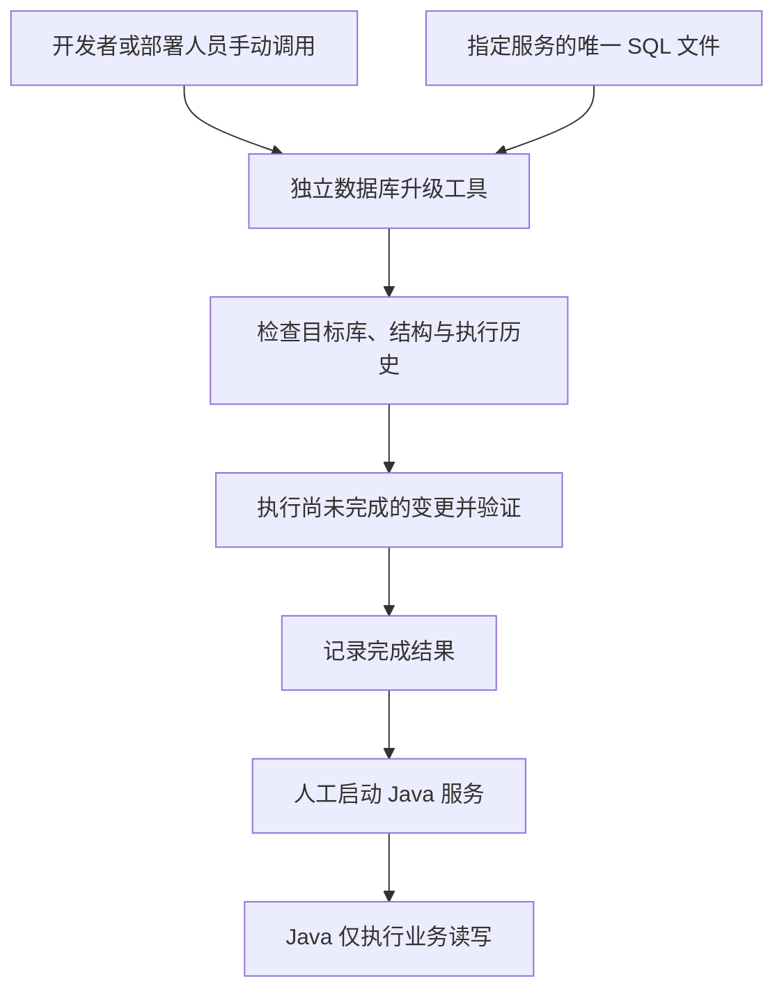
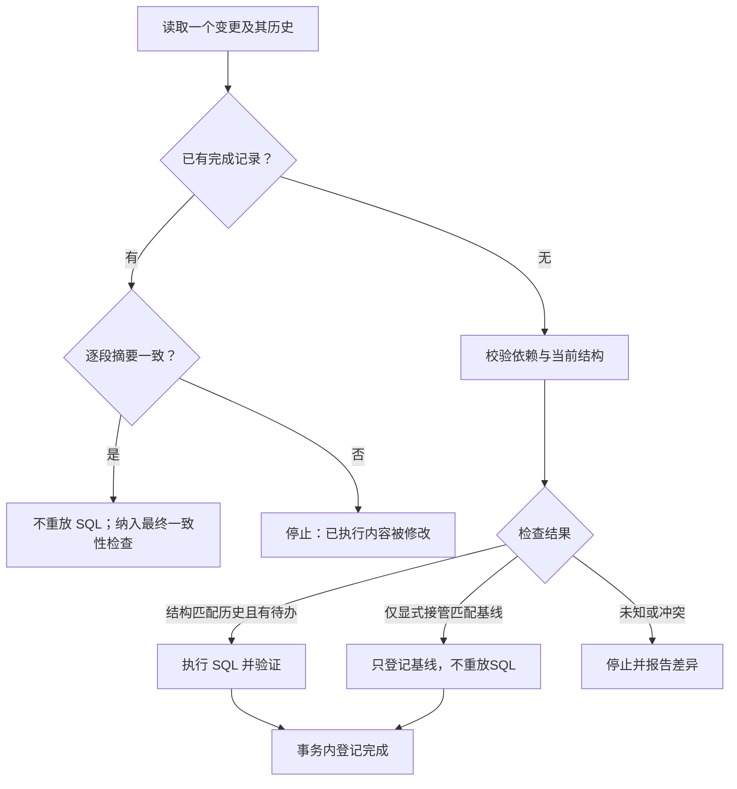
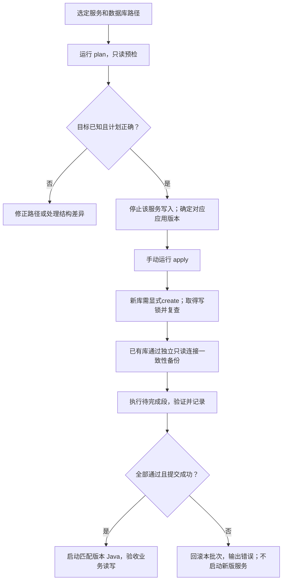
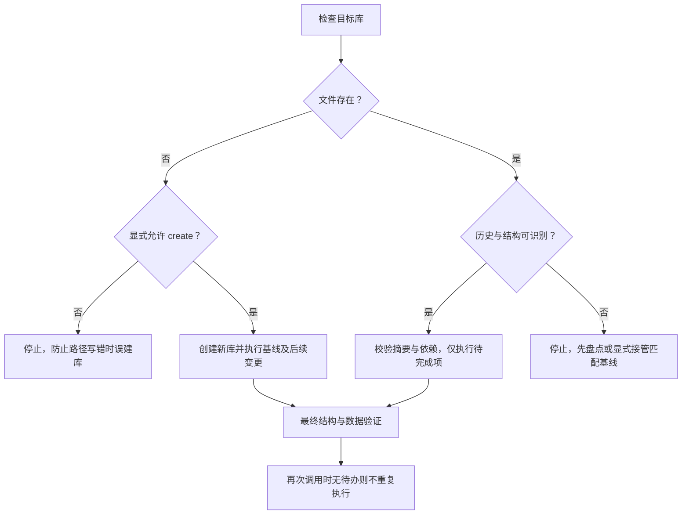
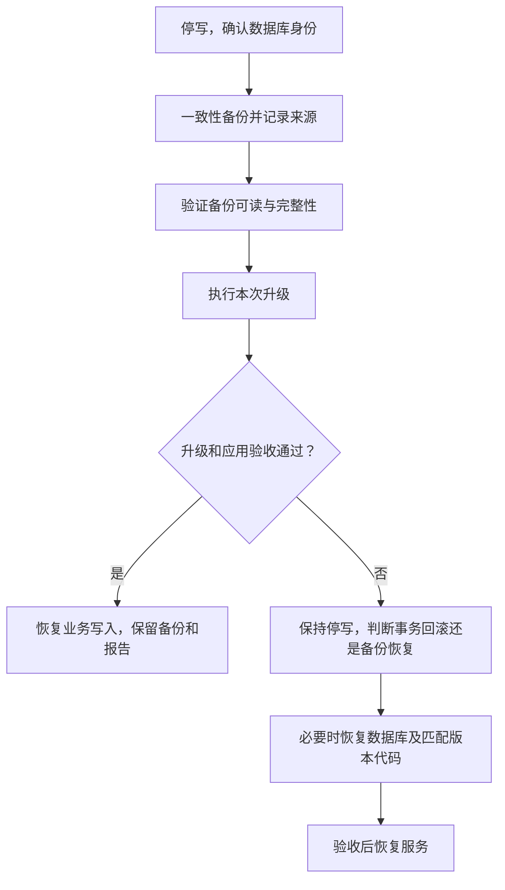
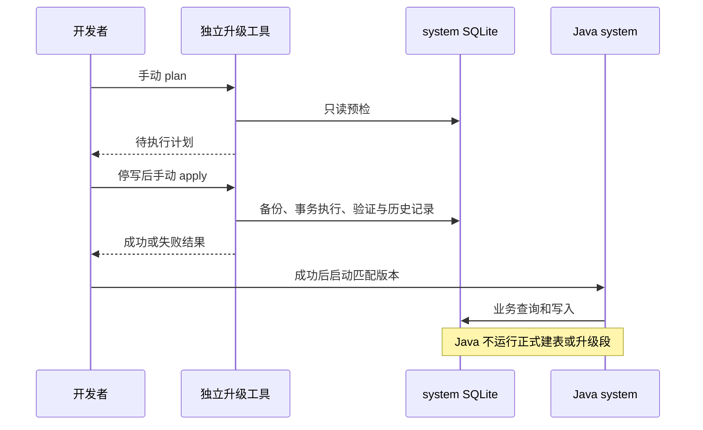
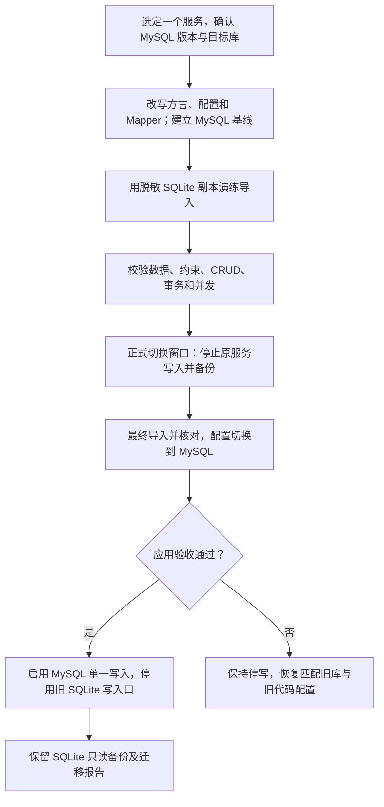

# <a id="sql-management-and-execution-plan"></a>HermesX SQL 管理与数据库升级设计及执行方案

> 更新时间：2026-11-24。依据当前仓库文件和已确认的 SQL 管理方向整理。
> 当前使用 SQLite 过渡，后续按服务迁移 MySQL。目标是：**每个服务一份正式 SQL 文件，由人手动运行独立升级工具，Java 不承担初始化或升级执行逻辑。**
> **实施状态更新**：system SQL 已收敛为 `BASELINE_20261123`；Java已关闭启动初始化并移除旧分段读取，正式SQL仅复制到测试classpath、不进入业务JAR。独立手动工具、历史记录和临时库测试已实现；尚未创建或修改真实业务数据库，MySQL支持仍待后续实施。

## 目录

| 章节 | 内容 |
| --- | --- |
| [一、设计目标与已确认决策](#sec-1) | 手动触发、统一入口、职责边界 |
| [二、当前实现与目标差异](#sec-2) | 已有 SQL、启动行为和未完成项 |
| [三、目录、文件与命名](#sec-3) | 每服务单文件、分支、数据库和备份位置 |
| [四、SQL 内容与变更管理](#sec-4) | 基线、变更编号、条件检查和数据写入 |
| [五、SQLite 升级工具](#sec-5) | 输入、处理职责、历史记录和退出行为 |
| [六、手动执行流程](#sec-6) | 新库、旧库、重复运行和服务启动 |
| [七、事务、备份与恢复](#sec-7) | 一致性、失败处理和回滚边界 |
| [八、Java 与运行环境调整](#sec-8) | 关闭自动执行、构建与测试同步 |
| [九、后续切换 MySQL](#sec-9) | 方言差异、数据迁移、切换和回退 |
| [十、实施批次与交付物](#sec-10) | 按依赖安排执行顺序 |
| [十一、验收矩阵](#sec-11) | 真实数据库验证与交付证据 |
| [十二、关联方案与技术依据](#sec-12) | 文档边界和官方参考 |

<a id="sec-1"></a>

## 一、设计目标与已确认决策

**SQL 放在哪里，与 SQL 什么时候执行，是两件事。** 文件纳入 Git 不代表服务启动、发布或扫描目录时就会自动执行。

| 事项 | 确认后的约定 | 目的 |
| --- | --- | --- |
| 当前数据库 | SQLite，服务各自拥有独立库 | 继续现有学习与开发，控制接入范围 |
| 后续数据库 | 按服务逐步迁移 MySQL | 保持服务边界，验证后再切换 |
| 正式 SQL | 每个 Java 服务在自己的 `sql/` 下维护一份固定名称文件 | 入口明确，不分散到源码和多个目录 |
| 执行时机 | 建库或有数据库变更时，由人手动调用工具 | 与 Java 服务启动解耦 |
| 重复执行 | 同一入口可再次调用；检查已完成变更并跳过 | 无需记忆本次应选择哪些版本 |
| Java 职责 | 业务校验、事务和 Mapper 查询；不选择或执行数据库升级段 | 不在 Java 中追加 `INIT/V4/V5` 列表 |
| 升级工具职责 | 读取文件、检查结构、执行待完成变更、验证并记录 | SQLite 的条件改表由工具衔接 |
| 版本管理 | SQL 内保留可追踪的变更记录，已执行记录与库内历史对应 | 手动触发仍需知道实际执行过什么 |
| 尚未上线 | 先建立正确基线，直接移除过时执行入口 | 不为旧路径长期保留转发、双份 SQL 或 Java 兼容执行器 |

“可以反复运行”指**整个升级入口可安全重跑**，不要求每条 `ALTER TABLE` 裸执行都能重复成功。工具负责判断是否需要执行；一次性数据转换不能因为再次启动工具就重复计算。



<a id="sec-2"></a>

## 二、当前实现与目标差异

以下是编写本文时的**工作区现状**，包含尚未提交的 SQL 目录调整，不能将目标约定当成已经生效的代码。

| 项目 | 当前状态 | 目标处理 |
| --- | --- | --- |
| system 正式 SQL | 已收拢到 `hrs-system-service/sql/hrs-system-service.sql` | 保留唯一入口，重整为工具可检查的变更序列 |
| system 文件内容 | 已收敛为单一 `BASELINE_20261123`，不再保留旧 INIT/V2/V3/V4 | 已声明@service、@dialect和@upgrade，基线在实际库执行登记后冻结 |
| 菜单正式结构 | SQL 已对齐 Java 的 `menu_` 业务列和 `module/group/page` | 正式部署与菜单数据导入仍待后续安排 |
| Java 启动初始化 | 已配置 `spring.sql.init.mode=never`，不执行正式建表或升级 | 使用业务接口前手动准备匹配结构，不以启动成功认定建库完成 |
| Java 分段选择 | `SqlScriptConfig`、`VersionedSqlResource` 及旧分段测试已删除 | Java 不再保留版本列表，后续工具独立管理变更 |
| SQL 打包 | Maven 只将正式SQL复制到测试classpath，业务JAR不含SQL | 后续部署单独交付匹配的SQL和工具 |
| Java 集成测试 | 显式开启测试初始化，使用正式SQL创建临时库；旧菜单DDL夹具已删除 | 持续验证实际目标结构，避免两份DDL漂移 |
| 执行历史 | 工具按服务创建独立技术历史表，并校验逐段SHA-256 | 当前仅在临时库执行；不等于真实业务库已有此表 |
| auth / Java analysis | SQL 仅注释占位，服务尚为骨架 | 暂不创建数据库、不添加无业务用途的表 |
| system 实际库 | 核对时未发现 `data/hrs_system.db` | 不因撰写方案创建；后续由明确的新库初始化操作创建 |
| Python 库 | `data/stock_analysis.db` 已存在，仍有原有运行链路 | 本次不改其结构、ORM 初始化或执行入口 |

**SQL基线、Java启动解耦与手动工具均已完成。** 工具只支持SQLite，严格拒绝未知旧结构；实际业务库、菜单数据导入、MySQL迁移仍未执行。空库上启动Java不会建表，应先由人手动运行本工具。

<a id="sec-3"></a>

## 三、目录、文件与命名

### 3.1 目标目录

```text
HermesX/
├── hrs-system-service/
│   ├── sql/
│   │   └── hrs-system-service.sql       # 本服务唯一正式 SQL
│   ├── pojo/
│   └── rest/
│       └── src/test/resources/db/       # 测试夹具，不是部署入口
├── hrs-auth-service/
│   └── sql/hrs-auth-service.sql         # 当前仅占位
├── hrs-analysis-service/
│   └── sql/hrs-analysis-service.sql     # 当前仅占位
├── scripts/
│   └── db/                             # 独立手动工具及临时库测试
│       ├── manual_db_upgrade.py        # 手动数据库升级入口，不依赖服务启动
│       └── tests/                      # 使用临时 SQLite 的工具测试
├── data/                               # 本地运行数据，不入 Git
│   ├── stock_analysis.db               # Python 自有库，保持现状
│   ├── hrs_system.db                   # system 启用时显式创建
│   ├── hrs_auth.db                     # 未来按需创建
│   ├── hrs_analysis.db                 # 未来按需创建
│   └── backups/                       # 备份目录示例，实际位置由执行参数传入
└── documents/DB/
    ├── database_rules.md                # 库、表、字段及数据边界
    └── sql_management_and_execution_plan.md
```

工具名中 `manual` 表示手动触发，`db` 表示数据库，`upgrade` 表示升级；也承担新库初始化。

`manual_db_upgrade.py` 已实现，运行要求Python 3.9+及其标准库sqlite3，不依赖Java、分析后端或python/requirements.txt。测试使用 `python3 -m unittest discover -s scripts/db/tests -v`，并接入现有ci_gate.sh的deterministic阶段。

### 3.2 文件与分支规则

| 对象 | 规则 | 示例 |
| --- | --- | --- |
| 正式文件 | 固定为完整服务名加 `.sql` | `hrs-system-service.sql` |
| 所在目录 | 服务根目录下的 `sql/` | `hrs-system-service/sql/` |
| Git 分支 | 不写入正式文件名，由 Git 保留各分支内容 | main、开发分支分别维护同一路径 |
| 发布标识 | 写在交付清单或执行日志，记录 Git 提交和文件摘要 | 不通过改名选择本次执行哪个文件 |
| SQL 变更编号 | 文件内唯一、稳定、明确先后依赖 | `BASELINE_20261123`、`SYSTEM_20261124_001`；均为格式示例 |
| 测试 SQL | 当前测试直接复用正式基线，不另维护业务DDL；未来确有专用夹具再按场景命名 | 旧 `menu_target_test_schema.sql` 已删除 |
| 备份 | 服务、时间与目标版本可辨认，禁止覆盖旧备份 | `system_20261123T150000Z_before_SYSTEM_20261124_001.db` |

本方案收敛为固定文件名，**不采用 `main.system.sql` 或按日期、分支堆放多份正式文件**。即使目录意外出现其他 SQL，工具也只读取指定服务的唯一入口，不遍历执行所有文件。合并分支时同时检查变更编号、依赖和 SQL 冲突，不能只依靠 Git 无文本冲突就认定升级序列正确。

### 3.3 数据库位置与所有权

| 所属服务 | SQLite 开发文件 | MySQL 目标库 | 执行边界 |
| --- | --- | --- | --- |
| system | 仓库根 `data/hrs_system.db` | `hrs_system` | 当前优先实施 |
| auth | 仓库根 `data/hrs_auth.db` | `hrs_auth` | 有真实业务后单独接入 |
| Java analysis | 仓库根 `data/hrs_analysis.db` | `hrs_analysis` | 有真实业务后单独接入 |
| Python | 仓库根 `data/stock_analysis.db` | 接入时单独确定 | 保留现状，不纳入本轮 system 升级 |

服务只直接读写自己的库，跨服务通过接口。数据库与备份不能放入 JAR、源码或安装包资源；容器使用持久化卷，桌面安装版使用应用数据目录。工具接收明确的绝对路径，不根据运行时工作目录猜库、不硬编码开发机路径。

<a id="sec-4"></a>

## 四、SQL 内容与变更管理

### 4.1 先收敛基线，再追加变更

项目尚未上线，先核实是否有需要保留的 system 测试或个人数据，再把现有相互重叠的段整理成清晰基线。**未发现仓库默认库不代表其他配置路径一定没有数据。**

| 数据状态 | 实施策略 |
| --- | --- |
| 没有需要保留的 system 数据 | 建立与当前 Java 一致的新库基线；旧 INIT/V2/V3/V4 的演变由 Git 保存，不作为重复运行链路继续堆叠 |
| 已有结构完全等于基线、但没有执行历史 | 默认停止；经完整结构和必要数据核对后，允许专门的手动“接管基线”操作，仅登记，不重建或改写业务表 |
| 已有旧表且需要保留数据 | 先备份、识别准确旧结构，编写针对该结构的一次性转换，验收后接入基线；不盲目套新库 DDL |
| 结构不完整、字段冲突或来源不明 | 停止并报告差异，不能自动删库、重建、改名或清空数据 |

基线一经实际执行并登记便冻结。后续变更向同一文件末尾追加，不能反复改写基线让旧库“自动变成新库”。新库按基线及其后的变更走到最新状态，旧库只执行尚未完成的部分，两者最终结构应一致。

### 4.2 单文件结构与检查约定

沿用清晰的 `-- BEGIN 编号` / `-- END 编号` 边界；内部新增检查元信息，以 SQL 注释承载，不在 Java 中维护编号。

| 内容 | 约定 | 由谁处理 |
| --- | --- | --- |
| 文件头 | 唯一的@service和@dialect sqlite，普通注释说明用途 | 工具校验服务与引擎 |
| 变更边界 | BEGIN / END 编号必须配对、唯一，不嵌套 | 工具解析 |
| 描述 | 说明为什么变更、影响对象和保留数据的要求 | 审查与执行日志 |
| 前置依赖 | 首段requires为空，后续每段requires只包含紧邻前一段编号 | 工具校验线性顺序，不按文件名猜版本 |
| 执行前检查 | 已登记历史及摘要，实际结构等于该历史前缀应有结构 | 工具在内存重放正式SQL自动生成规范结构，不为每列手写Python分支 |
| SQL 正文 | 具体建表、改表或数据变更，不夹带事务控制 | 工具在受控事务中执行 |
| 完成验证 | 字段定义、索引、约束或数据不变量检查 | 工具验证通过才登记完成 |
| 文件级终态断言 | 描述执行到当前文件末尾后应满足的完整结构与必要数据条件，单独声明为只读检查 | 工具最终统一验证，不把已被后续版本替代的旧断言逐个重放 |

**已实现协议如下。** 元信息只使用SQL注释和JSON，不执行任意Python/Shell。SQL正文仍是普通SQLite语句，每条必须以分号结束。以下为协议示例，请勿覆盖实际正式文件：

```sql
-- @service hrs-system-service
-- @dialect sqlite
-- BEGIN BASELINE_EXAMPLE
-- @upgrade {"description":"初始化示例表","kind":"baseline","requires":[],"verify":[]}
CREATE TABLE hrs_system_example (id INTEGER PRIMARY KEY, name TEXT NOT NULL);
-- END BASELINE_EXAMPLE

-- BEGIN SYSTEM_EXAMPLE_001
-- @upgrade {"description":"新增说明字段","kind":"migration","requires":["BASELINE_EXAMPLE"],"verify":[]}
ALTER TABLE hrs_system_example ADD COLUMN note TEXT;
-- END SYSTEM_EXAMPLE_001
-- @final-check SELECT COUNT(*) = 0 FROM hrs_system_example WHERE name IS NULL
```

| 元信息 | 已实现规则 |
| --- | --- |
| `@service` / `@dialect` | 各出现一次，必须匹配选定服务和sqlite；不提供自动方言转换 |
| `@upgrade` | 每段恰好一行JSON；只允许description、kind、requires、verify四类字段 |
| `description` | 非空字符串，最多256字符；同时用于执行日志和历史 |
| `kind` | 首段baseline；以后都是migration，不能再插入第二个基线 |
| `requires` | 首段为空数组；后续恰好包含紧邻前一段编号，避免分支合并后次序不明 |
| `verify` | 可选的只读SELECT/WITH字符串数组，默认空；当前段执行后每条须返回一行一列的整数1 |
| `@final-check` | 可选的文件级只读SQL，每条单独一行；即使无待办也检查，不计入旧段摘要 |

工具在内存从空库重放全部段，生成每个历史位置的表、索引、视图和触发器定义；实际库必须匹配其已登记历史对应的规范结构，然后才执行待办。比较忽略注释、空白与未引用标识符大小写，保留字符串常量；这是保守的结构比较，不会推断所有语义等价DDL。改写约束、同名异构、未知额外对象均报错。结构检查不包含业务行内容；需要验证的数据转换应声明verify或final-check。旧段verify只在执行该段时检查，不在后续版本上强行重放旧断言。

对已登记变更，工具校验其摘要，确认 SQL 与当时执行的内容一致；新增段不会使旧段摘要失效。摘要以每个完整变更段为单位，包含检查元信息和正文，统一换行后计算 SHA-256；其他规范化细节由工具固定，不能随意改变。文件整体摘要仅用于交付追踪，不能用它代替逐段摘要。

### 4.3 各类操作如何做到安全重跑

| 操作 | 执行前检查 | 重跑与异常处理 |
| --- | --- | --- |
| 建表 | 表是否存在；存在时列、索引和约束是否符合预期 | 一致才视为满足；同名异构不能忽略 |
| 添加字段 | 字段是否存在；已有字段定义是否符合目标 | 缺失才添加，定义冲突报错；不只判断字段名 |
| 重命名字段 | 旧列、新列的组合及定义 | 旧有新无才迁移；旧无新有且验证通过才视为完成；两列同时存在或均缺失报错 |
| 调整类型或约束 | 当前定义、数据能否满足目标、关联对象清单 | 必要时显式重建表，复制并验证数据；不默认删表重来 |
| 创建索引 | 名称、列顺序、唯一性、条件表达式 | 同名但定义不同不能被 `IF NOT EXISTS` 掩盖 |
| 插入基础数据 | 稳定业务键、作用范围及现有记录 | 插入缺失项；是否更新已有值必须明确，不能覆盖管理员配置 |
| 一次性数据转换 | 历史状态、输入条件和结果不变量 | 事务成功后记录；不因重复运行再次转换 |

例如 `menu_code` 是菜单业务标识，但初始化前仍需确定其唯一范围和逻辑删除后的冲突规则；不要仅按展示名称匹配。默认不使用 `INSERT OR REPLACE`，避免删除后插入造成 ID 或引用变化；不使用广泛忽略错误的写法掩盖真实数据问题。



当前实现对无历史非空库只开放显式接管初始基线，不自动跳过并登记任意外部手工变更。一次性数据转换不能仅凭结果看似相同就推断执行过。已有完成记录的旧段也不能逐个强制要求旧结构仍存在：后续合法变更可能已替换该结构，应验证当前最终契约。

<a id="sec-5"></a>

## 五、SQLite 升级工具

### 5.1 职责与能力边界

SQLite 能查询表结构，例如 `PRAGMA table_info`，也能执行 ALTER；但缺少 MySQL 存储过程式的条件执行块。工具负责把“检查结果”与“是否执行该段”连接起来。[SQLite 字段查询](https://www.sqlite.org/pragma.html#pragma_table_info)、[SQLite ALTER TABLE](https://www.sqlite.org/lang_altertable.html)

| 组件 | 承担职责 | 不承担职责 |
| --- | --- | --- |
| 服务 SQL | 表结构、数据变更、顺序与检查声明 | 不直接运行 Java，不选择其他服务数据库 |
| `scripts/db/manual_db_upgrade.py` | 参数校验、读取、预检、备份、事务、执行历史和报告 | 不导入业务 Service，不包含按版本写死的升级列表 |
| SQLite 历史表 | 记录本库已完成的变更及摘要 | 不承担业务租户、菜单权限或登录会话 |
| Java 配置 | 配置业务库连接，关闭启动初始化 | 不调用工具，不隐式建表 |
| 部署人员 | 手动预览、执行、验收，再启动服务 | 无需手工截取 INIT/V2/V3 或编辑 Java |

### 5.2 输入与命令约定

**以下为已实现CLI。** 可在任意工作目录通过脚本绝对路径调用；脚本自身定位仓库源码，数据库必须传入绝对路径。

| 参数／模式 | 目标行为 |
| --- | --- |
| `--service hrs-system-service` | 选择服务；定位其固定 SQL 文件并校验文件头，拒绝路径穿越或跨服务对象 |
| `--database <绝对路径>` | 明确数据库文件；不把 JDBC URL 当文件名，不隐式使用 Python 库 |
| `--plan` | 在内存副本模拟，绝不写业务/历史数据、创建目标库或做备份；WAL辅助文件边界见下文 |
| `--apply` | 手动执行；已有库先备份，检查失败即停止 |
| `--create` | 与 apply 配合，明确允许创建不存在的新库；缺省时路径不存在必须报错 |
| `--backup-dir <绝对路径>` | 已有库备份位置，不放入源码或提交 Git |
| `--adopt-baseline` | 仅接管完整匹配初始基线的无历史库，先备份，仅登记基线，不执行后续段 |
| `--timeout <秒>` | 有限正数，默认5；用于等锁和一致性备份的等待上限 |

`--plan`、`--apply` 与 `--adopt-baseline` 三者互斥；不提供默认“运行即写库”。计划中若后续步骤依赖前一步结果，应在临时副本模拟后输出，不能把待建字段误判成真实库异常。不存在的目标库使用内存或临时库模拟，不在正式路径建空文件。计划不保证实际执行一定成功，apply 仍须重新检查。

日常手动操作示例；以下只是说明，本次编写与验证没有对实际库执行这些写入命令：

```bash
# 在仓库根目录设置本次目标，避免写死个人电脑路径。
system_db_path="$(pwd)/data/hrs_system.db"
system_backup_dir="$(pwd)/data/backups/system"

# 只读查看将发生什么。
python3 scripts/db/manual_db_upgrade.py --service hrs-system-service \
  --database "$system_db_path" --plan

# 已有库：停写后，手动执行，工具先做一致性备份。
python3 scripts/db/manual_db_upgrade.py --service hrs-system-service \
  --database "$system_db_path" --backup-dir "$system_backup_dir" --apply

# 新库：仅首次且确认目标文件不存在时使用。
python3 scripts/db/manual_db_upgrade.py --service hrs-system-service \
  --database "$system_db_path" --create --apply
```

如库已由之前手工SQL建成、完全匹配初始基线但没有执行历史，手动接管：

```bash
python3 scripts/db/manual_db_upgrade.py --service hrs-system-service \
  --database "$system_db_path" --backup-dir "$system_backup_dir" --adopt-baseline
```

接管不会重建表、改变业务行或顺带执行后续段；下一次apply才执行新增变更。初次新建前由执行者建立数据库父目录，例如 `mkdir -p data`；工具不根据误写路径自动创建多层数据库目录。重复apply无待办时不写历史、不备份，也不强制提供backup-dir。

`plan`通过SQLite只读连接和内存副本操作。WAL库干净关闭且缺少-wal/-shm时，本机SQLite需要建立辅助文件；工具仅在SQLite只读探测报告无法打开且辅助文件缺失时使用rw连接加query_only，禁止业务写入但允许引擎创建辅助文件，不能承诺目录字节完全不变。它不使用immutable绕过WAL或锁；即使只预览，也应明确目标文件属于本服务。 数据库本体的读取统一经过SQLite，不用普通open/read/close探测文件头，避免释放同进程另一连接持有的POSIX锁；参见[SQLite锁与文件描述符说明](https://www.sqlite.org/howtocorrupt.html)。提交前已补写锁保持回归，并连续30轮验证两个升级进程只执行一次变更、只生成一份备份。

工具与 Java 必须指向同一个文件；启动 Java 时，`HRS_SYSTEM_DB_URL` 对应 `jdbc:sqlite:` 加该绝对路径。工具不自动读取真实 `.env`。以上变量是命令示例中的临时 Shell 变量，不是新增应用配置；若实施引入持久配置，须同步 `.env.example` 和相关文档。

服务名、默认库名和 SQL 文件头还须互相核对；对于使用自定义文件名的数据库，已有历史中的服务身份必须匹配，不能仅凭“这是一个可打开的 SQLite 文件”就执行。发现 Python 存量表或另一服务的历史时立即拒绝。

### 5.3 执行历史与输出

每个已启用服务库各自拥有技术表，例如 `hrs_system_schema_history`；不建立全服务共享迁移库。

| 记录项 | 用途 |
| --- | --- |
| `id` | 历史记录主键 |
| `service_name` | 服务完整名称，防止混用另一服务的历史 |
| `change_id` | 文件内变更编号，唯一 |
| `checksum` | 逐段摘要，发现已执行内容被改写 |
| `description` | 人能理解的变更说明 |
| `completion_kind` | applied表示实际执行；adopted表示显式接管初始基线；不自动登记任意外部手工改表 |
| `completed_at` | UTC 完成时间 |

这是**工具技术元数据表**，不是业务表，不配置逻辑删除或租户归属，不添加 `delete_flag`、`enterprise_id`、`organization_id`；对应例外在[数据库规范](database_rules.md)明确。工具统一创建历史表；不能让服务 SQL 再维护另一套历史表结构。

历史记录与 SQLite 业务结构变更在同一事务提交。失败不能记录为已完成；错误写入执行报告。发现数据库已有本文件未知的变更编号时应停止，避免拿旧发布包操作较新数据库。

| 输出情况 | 约定 |
| --- | --- |
| 预览 | 显示服务、数据库绝对路径、SQL 文件、待执行或跳过项、预计影响 |
| 成功 | 输出新增完成数、跳过数、最终基线/变更状态、备份位置；退出码 0 |
| 无待办 | 明确显示无需升级，业务数据与历史不重复写入；退出码 0 |
| 参数、结构、摘要或 SQL 错误 | 输出失败阶段和变更编号，退出非零，不继续后续段 |
| 占位服务 | 明确报告尚未启用，不创建库；apply 非零结束 |

日志不包含密码、用户敏感数据或连接凭据。升级历史用于审计和幂等判断，不替代 Git。

<a id="sec-6"></a>

## 六、手动执行流程

### 6.1 总体流程



plan 与 apply 之间可能发生变化，因此 apply 取得锁后必须再次检查。锁冲突应在有限等待后报错，不无限重试或绕开失败步骤。

### 6.2 新库、旧库与重跑



| 场景 | 人需要做什么 | 工具应做什么 |
| --- | --- | --- |
| 首次初始化 system | 确认路径、create、预览后执行 | 建立基线、历史及经确认的基础数据 |
| 日常有数据库改动 | 更新同一 SQL 文件，停止写入后 apply | 判断差异，顺序完成待办 |
| 本次只有 Java 代码改动 | 正常测试和启动对应版本 | 不要求每次强制升级；手动执行也应无待办 |
| 服务重复启动 | 直接启动 Java | 不触发 SQL 管理工具 |
| 工具重复运行 | 使用同一入口 | 不重复建表、加字段或转换数据 |
| 多个服务升级 | 分别选择服务并分别执行验收 | 不因为执行 system 而升级 auth/analysis |

手动触发后，工具自动完成检查和执行不属于“服务启动自动升级”。后续部署文档可以列出此步骤，但未经另行安排，不把工具挂入 Java、容器 entrypoint、桌面自动启动或 CI 发布自动写库链路。

<a id="sec-7"></a>

## 七、事务、备份与恢复

### 7.1 SQLite 的事务边界

| 阶段 | 约定 |
| --- | --- |
| 操作前 | 停止目标服务写入；不影响无关 Python 数据库 |
| 备份 | 已有库在写锁及复查后，用另一只读连接执行SQLite备份并校验快照；禁止对持有写事务的同一连接backup |
| 写入锁 | 使用受控写事务，例如 `BEGIN IMMEDIATE`；有限超时，冲突失败即停止 |
| 待完成变更 | 本轮受支持的 DDL、DML 和历史写入在同一事务内完成 |
| 完成检查 | 完整结构、关键数据、`integrity_check`，以及适用时的 `foreign_key_check` |
| 失败 | 显式回滚；报告失败编号，不提交部分历史，不继续下个变更 |
| 成功 | 所有检查通过后提交；核对结果，再启动服务 |

SQLite 的事务与锁行为以[官方事务文档](https://www.sqlite.org/lang_transaction.html)为准。迁移 SQL 内禁止自行 `BEGIN/COMMIT/ROLLBACK`，也不夹带 `VACUUM`、切换 journal 模式、跨库 ATTACH 或会改变事务边界的维护操作；旧 V2/V3 及其内嵌事务已随基线整理移除，后续事务由工具统一控制。

执行器不能按分号简单 `split`，因为字符串、注释或触发器内可能含分号；应使用经过测试的语句边界处理。若采用 Python `sqlite3`，须明确版本及事务模式，不能在外层事务里直接依赖可能先提交事务的 `executescript()`；优先在显式事务中逐语句执行，并以中途失败测试证明结构、数据和历史一起回滚。[Python sqlite3 事务说明](https://docs.python.org/3.11/library/sqlite3.html#transaction-control)

复杂表重建必须清点列、索引、触发器、视图及引用关系，显式列名复制数据，保留 ID 和审计信息。涉及外键设置时在事务外正确配置，不能在事务中切换后就以为生效；重建步骤须独立验证。

### 7.2 备份和恢复流程



SQLite 可能启用 WAL，不能在运行中仅复制 `.db` 就认为备份完整。优先使用[SQLite Backup API](https://www.sqlite.org/backup.html)或 Python 对应备份接口；恢复也应使用数据库工具或在连接关闭、WAL 状态受控的条件下操作，不能把旧 `.db` 与新 `-wal/-shm` 文件混用。

| 失败时机 | 恢复方式 |
| --- | --- |
| 预检或备份失败，尚未写库 | 修复问题后重新预览与执行 |
| SQLite 事务内失败 | 回滚全部待办；查明原因后重跑，不伪造完成记录 |
| 新建库过程中失败 | 报告可能留下的空文件；不能把“文件存在”当作初始化成功，也不能误删非本次创建的库 |
| 提交成功但应用验收失败 | 保持停写，选择前向修复或恢复升级前备份并配套回退代码 |
| 新版本已经接收业务写入 | 先处理新增数据的保留与回放；不能直接覆盖备份恢复 |

SQL 文件不是通用“撤销键”。涉及删列、合并数据或不可逆转换，必须在变更说明中明确恢复依赖的备份和数据范围。

<a id="sec-8"></a>

## 八、Java 与运行环境调整

Java侧解耦、独立工具及临时库验证已完成；实际数据库部署仍待安排。以下逐项区分当前状态。

| 位置 | 目标修改 | 验收 |
| --- | --- | --- |
| system `application.properties` | 已改为 `never`，移除失效的 schema-locations 与旧注释 | 启动不建表、不升级、不插入基础数据 |
| `SqlScriptConfig.java` | 已删除启动 SQL 分段选择配置 | Java 不保留版本列表 |
| `VersionedSqlResource.java` | 已删除启动初始化读取器 | 不维护两套正式段解析器 |
| system `rest/pom.xml` | 已将正式 SQL 复制改为仅供测试 | 业务JAR无SQL，无旧初始化类 |
| 原 Java SQL 分段测试 | 已删除，替换为正式基线及禁止启动初始化验证；工具另有标准库unittest测试 | 验证重复建库保留数据、唯一性与真实应用启动不建表 |
| Java CRUD 与菜单集成测试 | 已使用正式SQL显式准备临时库，移除替换菜单结构的夹具 | 不依赖生产配置 auto-init，不接触真实库 |
| 工具与 Java 的集成验证 | 工具创建临时库后已用打包Java验证用户新增、菜单新增及导航；实际业务库不参与 | 保留Basic认证、Cookie与CSRF契约；Java不改表和历史 |
| 启动、部署与学习案例文档 | 写清手动升级后再启动，移除旧截取版本段教程 | 所有入口语义一致 |
| CI 与发布制品 | CI 只使用临时库验证；部署制品包含匹配的 SQL 和工具 | 不在 CI 中连接开发者或正式业务库 |



尚未上线可以直接调整入口，但必须同步使用者、测试和文档。SQLite 驱动在错误路径上仍可能创建空文件，关闭初始化不等于自动防止误建空库；是否增加只读结构预检或文件存在性校验，在实施时结合 JDBC 能力验证，任何此类检查都不能执行升级。

<a id="sec-9"></a>

## 九、后续切换 MySQL

### 9.1 保持什么，调整什么

| 事项 | SQLite 阶段 | MySQL 阶段 |
| --- | --- | --- |
| 执行原则 | 人手动触发，Java 不升级 | 保持不变 |
| SQL 文件 | 每服务同名唯一入口，SQLite 方言 | 切换批次将同一入口调整为 MySQL 方言，旧版由 Git 保存 |
| 条件改表 | 工具查询结构后决定执行 | 工具查询 INFORMATION_SCHEMA；必要时使用存储过程 |
| 主键 | `INTEGER PRIMARY KEY AUTOINCREMENT` | 按规范使用 `BIGINT AUTO_INCREMENT` 并保留已有 ID |
| 类型与约束 | 亲和类型、长度 CHECK、SQLite 专用表达式 | 严格类型、字符集、排序规则、目标版本支持的约束 |
| 并发与连接 | SQLite 写锁、连接池与 PRAGMA | MySQL 连接池、隔离级别与锁策略，不能照搬 PRAGMA |
| 执行历史 | 服务库独立记录，与变更事务一起提交 | 仍记录，但按 MySQL DDL 提交边界设计失败恢复 |
| 基础数据 | 稳定业务键，避免覆盖人工配置 | 保持业务语义，调整方言 |
| 服务边界 | 每服务独立 `.db` | 可共用实例，各有独立数据库与受限账号 |

“同一文件名”不表示 SQLite 与 MySQL 语法相同，也不表示未来只改 JDBC URL 就能切换。当前不提前维护两份平行方言文件或双写数据库。

MySQL 可以使用 INFORMATION_SCHEMA 查询字段，并在存储过程中执行条件语句，但 **MySQL 8.0 不提供通用的 `ALTER TABLE ... ADD COLUMN IF NOT EXISTS` 写法**；不能照抄 MariaDB 的语法。依据：[字段信息](https://dev.mysql.com/doc/mysql-infoschema-excerpt/8.0/en/information-schema-columns-table.html)、[存储程序 IF](https://dev.mysql.com/doc/refman/8.0/en/if.html)、[ALTER TABLE](https://dev.mysql.com/doc/refman/8.0/en/alter-table.html)。

MySQL 阶段继续保留手动工具作为默认统一入口，避免丢失预检、摘要、历史与执行报告；若以后明确要求直接通过数据库客户端执行 SQL，再单独设计文件内部条件逻辑，不能因为 MySQL 支持存储过程就自动引入第二套执行链路。

### 9.2 方言与数据验证

| 检查项 | 迁移要求 |
| --- | --- |
| 版本与驱动 | 确认实际 MySQL 版本、Connector/J、Spring/MyBatis 组合；不根据 Docker 标签推断所有能力 |
| 服务身份 | 新建本服务专属库与账号，运行账号和升级账号按职责授权；不使用全局 root 跑业务 |
| 表和字段 | 保持 `hrs_<服务简称>_<业务名>`、`id`、业务字段和通用三字段规则 |
| 时间 | 保持 UTC 语义，明确 DATETIME 精度及 JDBC 时间转换 |
| 字符串与唯一性 | 验证大小写、尾部空格、NULL、软删除与重名行为，避免默认排序规则改变账号含义 |
| 条件唯一索引 | 当前测试夹具使用部分唯一索引；MySQL 不直接照搬 WHERE 索引，需确定生成列等方案并验证重复删除行为 |
| Mapper | 检查 `INSERT ... RETURNING`、分页、主键回填、日期函数及所有 SQLite 特定表达式 |
| 数据导入 | 显式列映射，保留 ID、密码哈希、企业组织、逻辑删除、审计和业务树关系 |
| ID 续号 | 导入后验证 AUTO_INCREMENT 大于已分配 ID，不生成重复主键 |
| 历史与基线 | 新 MySQL 库建立自己的 MySQL 基线；保留 SQLite 迁移审计，不原样复制 SQLite 摘要并当成 MySQL 段已执行 |

MySQL 的许多 DDL 会隐式提交，不能承诺把整个升级文件放进一个事务就能全部回滚。MySQL 执行器应按可恢复步骤执行、验证和记录；如果 DDL 已成功而历史未写入，重跑必须识别实际结构，不能盲目重复或直接标成功。[MySQL 隐式提交说明](https://dev.mysql.com/doc/refman/8.0/en/implicit-commit.html)

### 9.3 切换与回退



system、auth、Java analysis 各自独立切换，不因 system 切换就修改 Python 库。未来桌面单机版是否继续使用 SQLite、连接远端 MySQL 或另行部署，须按桌面交付要求单独决定；本方案不默认给单机安装包增加 MySQL 服务器。

<a id="sec-10"></a>

## 十、实施批次与交付物

本文批次使用 **DB-0～DB-5**，不改变原工程计划中 P0/P1/P2 的定义。**DB-1基线与检查元信息、DB-2工具、DB-3的Java侧解耦均已完成；DB-4实际库部署与DB-5 MySQL迁移仍待安排。**

| 批次 | 具体工作 | 交付与结束条件 |
| --- | --- | --- |
| DB-0：盘点与确认 | 盘点 SQL、配置路径、实际库、历史结构与需要保留的数据；确认目标菜单字段 | 当前/目标差异清单，不擅自创建或覆盖真实库 |
| DB-1：收敛正式 SQL | 按当前 Java 契约建立基线，解决 INIT/V2/V3 重叠和旧 V4；确定注释元信息格式 | 每服务唯一入口；system 目标结构明确，auth/analysis 仍占位 |
| DB-2：独立工具 | 实现 plan/apply/create、条件检查、历史摘要、备份、事务及错误报告 | 临时库验证新库、升级、重跑、失败与恢复；无 Java 依赖 |
| DB-3：切断启动执行 | 关闭 Spring 初始化，移除 Java 分段读取与打包配置，同步测试及运行教程 | 工具建库后 Java 可读写，重复启动不改结构和基础数据 |
| DB-4：手动部署验收 | 更新部署步骤和制品清单；仅在明确安排下初始化实际 system 库 | 升级前后对账、业务验收、恢复演练；不触碰 Python 库 |
| DB-5：MySQL 迁移 | 后续按第九节实施 | MySQL 实库验收、单一写入、可说明的回退方案 |

根据本次明确安排，Java侧解耦可以先行实施，但不能因此宣称手动升级链路全部完成。SQL检查协议、工具及运行文档已落地；真实部署仍需明确目标、停写、备份与业务验收；最终发布同时提供匹配的代码、SQL、工具和运行说明。

<a id="sec-11"></a>

## 十一、验收矩阵

| 场景 | 必须验证的结果 |
| --- | --- |
| plan 指向不存在的库 | 不在正式路径创建文件或目录，不修改配置 |
| 新库 apply 未给 create | 非零退出，不误建库 |
| 新库初始化 | 正式 SQL 与真实 SQLite 执行成功，业务表满足字段规范，菜单结构与 Mapper 一致 |
| 已有库升级 | 保留主键、行数、关键业务值、归属、删除及审计信息 |
| 再次执行 | 无待办，历史不重复，业务数据不重复、不覆盖 |
| 字段已存在但定义冲突 | 报错，不将“同名”当作“相同结构” |
| 编号重复、依赖错误或摘要不符 | 写库前停止；不绕过历史检查 |
| 中途 SQL 失败 | 本轮表结构、数据与历史均回滚，错误指出具体段 |
| 并发运行两个工具 | 不同时执行同一升级，取得锁后重新检查历史 |
| SQL 含分号字符串、多行注释等 | 正确识别语句边界，不截断或误执行 |
| 备份与恢复 | WAL 场景快照完整，恢复后能读取和启动匹配版本 |
| Java 重复启动 | 不执行正式建表、升级、菜单导入或历史写入 |
| 正式链路集成 | 工具初始化临时库后，Java 用户/部门 CRUD、菜单管理及导航接口通过；保留 Basic/CSRF 契约 |
| 空 SQL 占位服务 | apply 拒绝执行，不产生 auth/analysis 库 |
| Python 隔离 | 工具不连接、不修改 `stock_analysis.db`，原服务链路保持现状 |
| MySQL 后续迁移 | 在目标 MySQL 实库跑 CRUD、主键回填、约束、并发及 DDL 部分失败恢复，不能以 SQLite 测试代替 |

工具测试使用临时数据库，Java 验证执行当前根 Maven 的 `./mvnw clean verify`，并补充由正式 SQL 经工具建库到 Java HTTP 的完整路径。部署前核对使用者、Docker、桌面与脚本是否存在旧启动初始化依赖；没有覆盖的平台、数据库或在线服务需明确列出。

验证记录：SQL基线先通过内存SQLite3.43.2的47项映射/约束检查；2026-11-24 Java调整后，根 `./mvnw -o clean verify` 的11模块、40项测试通过，覆盖正式SQL下CRUD、菜单、Basic/CSRF和禁止启动初始化。业务JAR不含SQL及旧初始化类，测试SQL与正式文件字节一致。另以临时正式结构库从独立工作目录连续启动打包JAR两次，Basic认证查询成功，每次关闭后结构和业务数据均未变化。工具在Python3.9与3.11下各通过29项真实SQLite测试，覆盖增量升级、摘要/结构冲突、显式接管、两进程竞争、WAL备份和整批回滚，已接入deterministic门禁。另已验证工具CLI预览/建库→打包Java→Basic/CSRF用户新增→菜单新增及导航→工具无待办重跑的完整临时库链路；Java未改写结构和升级历史。真实业务库升级、MySQL、Windows、Docker和远端GitHub Actions尚未执行。当前尚未部署，撤回只涉及本批源码和文档；部署后的数据恢复按第七节执行。

<a id="sec-12"></a>

## 十二、关联方案与技术依据

| 文档 | 维护范围 |
| --- | --- |
| [数据库规范](database_rules.md) | 服务独立库、目录、表名、字段、数据范围与建表要求 |
| 本文 | SQL 的唯一入口、手动执行、工具职责、历史、失败恢复与 MySQL 切换 |
| [整体工程架构](../engineering/engineering_architecture.md) | Java、Python、前端与部署的全仓边界 |
| [工程实施计划](../engineering/engineering_architecture_plan.md) | 原工程迁移记录和后续阶段，不与 DB 批次混用 |
| [Java 工程架构](../engineering/java_engineering_architecture.md) | pojo/rest、分层与资源位置 |
| [用户管理案例](../engineering/java_user_management_case.md) | 用户字段、接口、当前运行教程；工具实施时同步替换旧升级操作 |
| [部门与菜单案例](../engineering/java_organization_menu_management_case.md) | 业务树、关联校验和正式菜单结构尚待部署的边界 |
| [Java 菜单导航](../engineering/java_menu_navigation.md) | Java 菜单字段、管理与导航过滤契约 |
| [前端菜单方案](../authority/frontend/frontend_module_menu.md) | 菜单来源及前端加工；本文参考其表格、流程图与现状/目标区分方式 |

SQLite 技术依据：[CREATE TABLE](https://www.sqlite.org/lang_createtable.html)、[ALTER TABLE](https://www.sqlite.org/lang_altertable.html)、[结构查询](https://www.sqlite.org/pragma.html)、[事务](https://www.sqlite.org/lang_transaction.html)、[一致性备份](https://www.sqlite.org/backup.html)。

MySQL 技术依据：[8.0 ALTER TABLE](https://dev.mysql.com/doc/refman/8.0/en/alter-table.html)、[条件语句](https://dev.mysql.com/doc/refman/8.0/en/if.html)、[隐式提交](https://dev.mysql.com/doc/refman/8.0/en/implicit-commit.html)。

本文暂无英文对应版；不新增平行翻译，避免重复维护。
