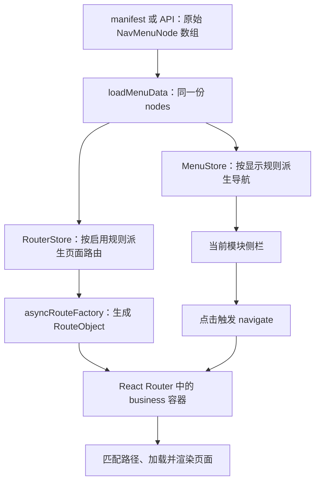
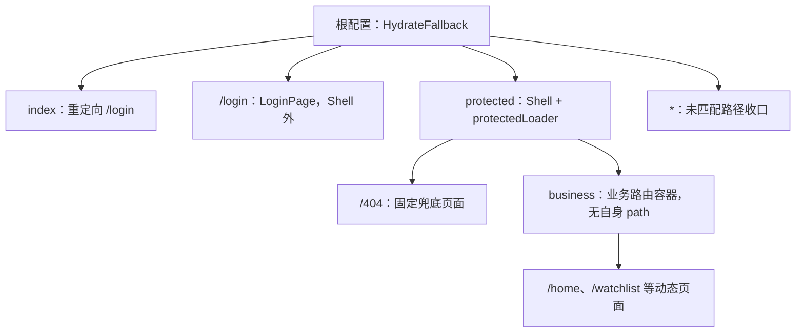
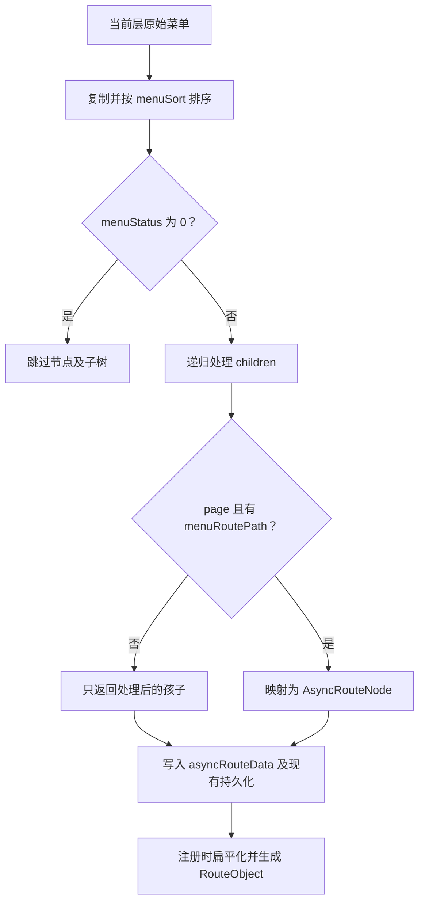
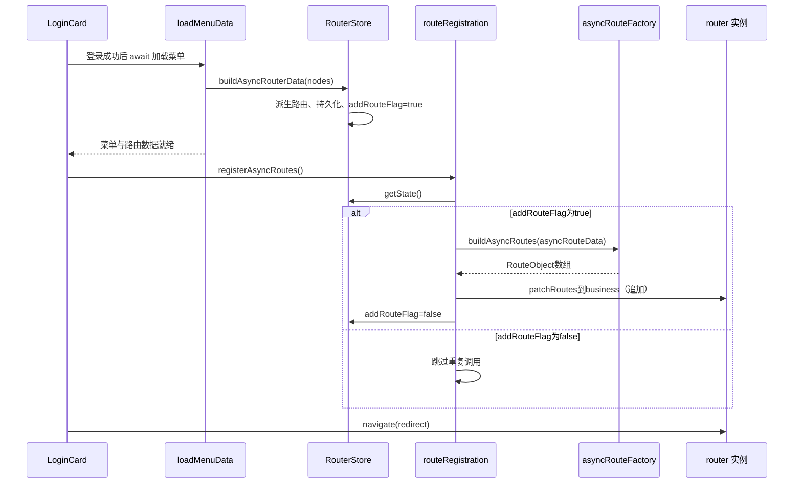
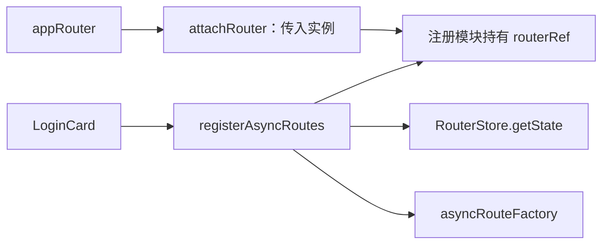
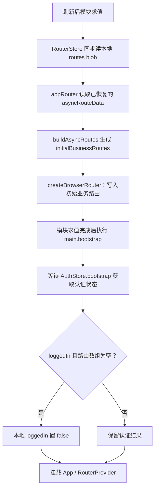
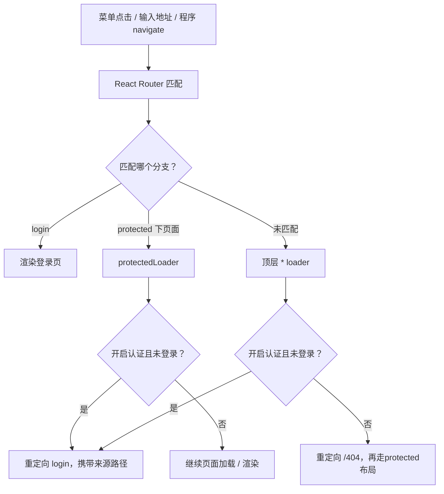
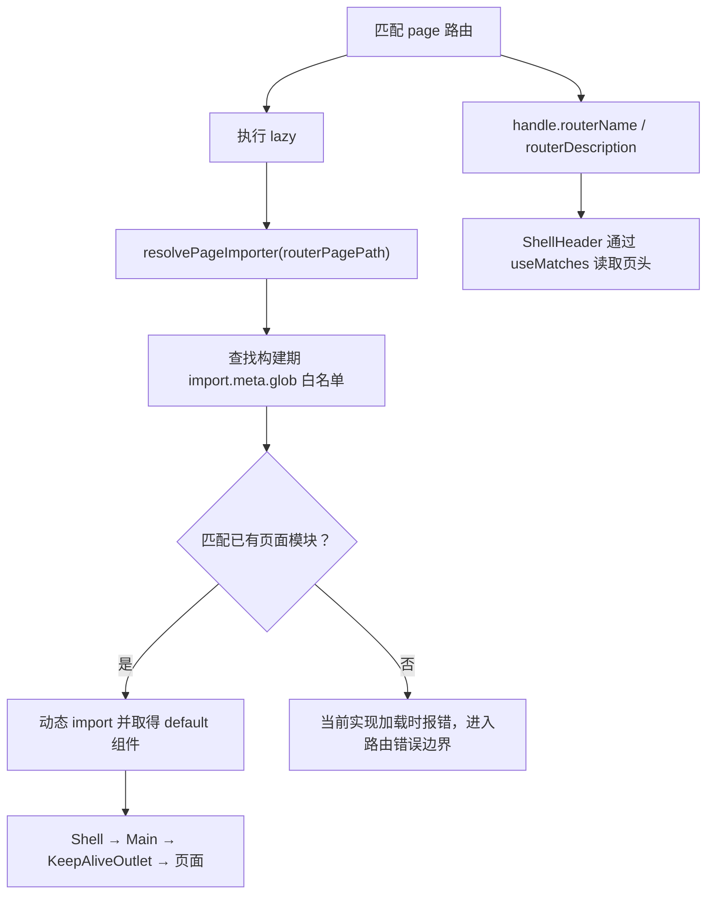

# <a id="frontend-async-router"></a>前端动态路由设计与实现方案

> 更新时间：2026-11-23。以 `apps/hrs-web/src/` 与当前安装的 React Router 实际行为为准。
> 本文专注动态路由：菜单数据如何派生路由、何时注册、刷新如何匹配页面、守卫与懒加载如何执行。菜单来源和展示由[菜单方案](frontend_module_menu.md)维护。

## 最新规则与当前实现的差异

| 规则 | Java状态 | 前端状态 |
| --- | --- | --- |
| page使用完整menuRoutePath，不拼menuCode或父级路径 | 已实现；group可选路径不参与计算 | 现有实现已直接读取page完整路径 |
| 导航过滤menu_status禁用节点及其整棵子树；管理查询保留禁用数据 | 已实现；返回的page均生效 | 尚有旧menuStatus过滤分支，需后续移除 |
| menu_visible只控制显示，父级隐藏则后代入口全部隐藏，路由仍注册 | Java保留原始可见性，不过滤、不级联改写显示标志 | 旧实现隐藏group时透传孩子，尚待调整为隐藏整棵导航子树 |
| 用户—角色—菜单授权 | 字段保留，业务授权逻辑暂缓 | 不以字段存在宣称已完成用户权限路由 |

**以上是最新约定。下文加工流程图和代码行为说明仍如实描述当前前端实现，旧状态过滤、group隐藏透传并非最新规则的最终目标。** 本轮仅完成Java修订，未改动客户端代码。导航响应暂保留menuStatus=1以满足现有类型与API校验，不表示前端继续负责启用状态判定。

## 目录

| 章节 | 内容 |
| --- | --- |
| [一、定位与数据依赖](#sec-1) | 菜单是来源，路由是派生结果 |
| [二、路由容器与分层](#sec-2) | 静态路由、protected、business |
| [三、数据转换](#sec-3) | 菜单节点 → AsyncRouteNode → RouteObject |
| [四、登录注册与刷新恢复](#sec-4) | 两条不同的初始化路径 |
| [五、导航与鉴权](#sec-5) | 地址匹配、共享守卫、404 |
| [六、页面解析与渲染](#sec-6) | lazy、handle、Keep-Alive |
| [七、持久化与生命周期](#sec-7) | 缓存、重新登录、退出 |
| [八、实现文件与变更规范](#sec-8) | 文件职责、测试和关联方案 |
| [九、当前限制与待修项](#sec-9) | 实测事实与后续目标分开 |

<a id="sec-1"></a>

## 一、定位与数据依赖

**动态路由的数据来自原始菜单数组，而不是从侧栏已经筛选出的菜单再生成。** 原始数组只有一个来源选择入口：登录成功后调用 `loadMenuData()`。



| 概念 | 当前职责 | 不应混淆为 |
| --- | --- | --- |
| 原始菜单 `NavMenuNode[]` | 所有模块、分组、页面及元数据 | 当前模块侧栏 |
| `MenuStore.menuData` | 按模块索引的可见导航结果 | 路由注册的唯一输入 |
| `RouterStore.asyncRouteData` | 从完整原始树生成的路由数据 | 原始接口响应或 React 组件 |
| `RouteObject[]` | React Router 可消费的 path/handle/lazy 等配置 | 需要写入 localStorage 的 JSON |
| 页面组件 | 构建产物中的已有 React 模块 | 服务端通过字符串下发的可执行代码 |

| 原始节点 | 菜单展示 | 新生成的路由数据 |
| --- | --- | --- |
| module/group，启用 | 可作为入口/分组 | 自己不注册，递归透传孩子 |
| page，启用且可见 | 展示入口 | 有 menuRoutePath 时生成 page 路由 |
| page，启用但隐藏 | 无入口 | 仍生成路由 |
| 隐藏 module/group 下的启用 page | 导航结果按菜单规则加工 | 不受祖先 menuVisible 影响，仍处理 |
| 任意节点禁用 | 整棵子树不展示 | 整棵子树不生成路由 |

此表描述**新派生的数据**。运行中已经注册到路由器的旧路由能否移除，是另一项生命周期问题，见 §九。

<a id="sec-2"></a>

## 二、路由容器与分层

底座为 React Router 数据路由：`createBrowserRouter` 创建实例，`RouterProvider` 挂载，支持 `loader`、`lazy`、`handle` 和 `useMatches`。



| 配置 | 位置/作用 | 来源 | 是否进入 RouterStore |
| --- | --- | --- | --- |
| 根 index | 统一转 `/login` | appRouter 静态声明 | 否 |
| `/login` | 登录页面，独立于 Shell | appRouter 静态声明 | 否 |
| `protected` | 无 path 的布局、守卫、错误边界 | appRouter 静态声明 | 否 |
| `/404` | Shell 内固定未找到页面 | appRouter 静态声明 | 否 |
| `business` | 无 path 的业务路由容器 | appRouter 静态声明 | 容器本身不保存 |
| 各业务 page | 实际访问的页面 | 菜单派生 | 保存可序列化的路由数据 |
| `*` | 未匹配路径按认证状态收口 | appRouter 静态声明 | 否 |

固定 404 与 business 分开，避免混入菜单数据。动态路由涵盖**所有模块**，切换应用只换侧栏，不为每个模块重新请求或注册路由。

<a id="sec-3"></a>

## 三、数据转换

转换分两步：`RouterStore` 负责数据，`asyncRouteFactory` 负责可执行路由配置。函数和 React 组件不写入 JSON 缓存。



| 原始菜单字段 | 路由数据字段 | React Router 配置/用途 |
| --- | --- | --- |
| menuCode | routerKey | 路由数据的业务键；工厂当前没有把它赋给 RouteObject.id |
| menuName | routerName | handle.routerName，供页头读取 |
| menuDescription | routerDescription | handle.routerDescription |
| menuRoutePath | routerPath | path；注册前去掉前导 `/` |
| menuPagePath | routerPagePath | lazy 页面导入标识 |
| menuType=page | routerType=page | 生成页面路由 |
| auth | auth | 数据透传；当前工厂不据此分流 public/protected |
| children | children | 工厂递归扁平化为同一 business 容器下的路由对象 |
| menuVisible / menuIcon / menuExpanded | 不映射 | 仅属菜单展示语义 |
| exact | 不映射 | 仅影响菜单高亮 |

| 阶段 | 函数 | 结果 |
| --- | --- | --- |
| 菜单转路由数据 | `buildAsyncRouteTree(nodes)` | 只有启用 page 产生可访问路由数据 |
| 保存和标记 | `buildAsyncRouterData(nodes)` | 保存 routes blob，将 addRouteFlag 置 true |
| 扁平化 | `flattenRoutes(nodes)` | 有路径节点与后代分别进入配置列表 |
| 生成配置 | `buildAsyncRoutes(nodes)` | page → path/handle/lazy |

工厂保留 redirect → loader 的能力，但当前统一菜单的构建器只生成 `routerType: 'page'`。不能把类型定义中的 redirect/fallback 预留当作已提供对应菜单节点。

<a id="sec-4"></a>

## 四、登录注册与刷新恢复

### 4.1 登录成功：加载、加工、持久化、注入、导航



当前实例由 `appRouter` 调用 `attachRouter(router)` 注入注册模块。依赖方向如下，注册模块不静态 import appRouter：



| 状态/调用 | 当前含义 |
| --- | --- |
| addRouteFlag=true | 允许下一次注册调用，不等于路由器内部一定没有业务路由 |
| addRouteFlag=false | 注册函数跳过下一次调用 |
| buildAsyncRouterData | 每次重建后把标记设 true |
| attachRouter | 注入已有实例，不创建第二个路由器 |
| routerRef 尚未注入 | 当前实现可选调用跳过 patch，但仍置 false；正常入口依赖先完成 attach |

### 4.2 浏览器刷新：读缓存作为初始路由种子



| 项目 | 当前刷新行为 |
| --- | --- |
| 菜单 API | 不请求；由已有持久化恢复 |
| 页面路由 | 在 createBrowserRouter 时作为 business 初始 children |
| 认证状态 | main.bootstrap 发起现有状态查询后才挂载 React |
| 路由器创建时机 | App 为静态 import，因此模块求值时已经创建，早于 main 的异步 bootstrap 完成 |
| 已登录但路由缓存为空 | 当前只把前端 loggedIn 置 false，沿用现有守卫流程，不重新请求菜单 |

因此不能把当前实现画成“刷新先请求菜单 API，再创建路由器”，也不能宣称所有初始 loader 都晚于认证 bootstrap。初始路由种子用于让深链可匹配；它和认证初始化是不同机制。相关边界见 §九。

<a id="sec-5"></a>

## 五、导航与鉴权



| 名称 | 当前实现 |
| --- | --- |
| guardAuthRedirect(request) | 读取 AuthStore 的 authEnabled/loggedIn；需要登录时返回 redirect Response，否则 null |
| protectedLoader | 复用 guardAuthRedirect；当前是返回 Response，不是 throw redirect |
| 顶层 `*` loader | 复用同一 helper；无登录阻塞时返回 redirect('/404') |
| 来源路径 | pathname + search 写入 redirect 参数 |
| `auth: 'public'` | 当前仅透传数据，业务路由仍处于 protected 布局，不自动绕过守卫 |
| menuPermission | 当前不在路由工厂或 loader 中执行角色权限判断 |

前端守卫控制界面导航，不能代替后端身份与资源授权。当前前端登录是 Python 会话，Java system 的 Basic/CSRF 接入尚未打通，详见[菜单接口契约](menu_api_contract.md)。

<a id="sec-6"></a>

## 六、页面解析与渲染



| 环节 | 实现约束 |
| --- | --- |
| 文件收集 | `../pages/**/*.tsx`，排除 __tests__、tests、test/spec 文件 |
| 标识补全 | `pages/HomePage` → `../pages/HomePage.tsx` |
| 组件导出 | 页面必须 default export React 组件 |
| 服务端数据 | 只能引用前端已发布页面标识，不能下发任意 JS 导入地址 |
| 路径未命中 | resolvePageImporter 返回 undefined；工厂当前使用非空断言调用，实际会在加载时报错 |
| 元数据 | routerName/routerDescription 写入 handle；名称可为国际化键 |
| 页面缓存 | KeepAliveOutlet 保留挂载后的页面实例，不保存菜单定义 |

不能把 TypeScript 非空断言当作运行时页面存在性校验。新增 page 时应核对 menuPagePath 对应文件及 default export；当前 API 校验路径格式，不确认文件存在。

<a id="sec-7"></a>

## 七、持久化与生命周期

| 对象 | 是否持久化 | 形式 |
| --- | --- | --- |
| asyncRouteData | 是 | `{ fingerprint: MENU_MANIFEST_FINGERPRINT, routes: [...] }` |
| addRouteFlag | 否 | 仅当前 Store 内存中的注册标记 |
| RouteObject 的 lazy/loader | 否 | 每次从路由数据重新构造函数 |
| React Router 实例与已注册路由 | 否 | 当前页面运行中的实例状态 |
| 已挂载页面实例 | 不属于此处持久化 | Keep-Alive 的内存缓存 |

逻辑键是 **`router.asyncRouteData`**，实际浏览器键为 `hrs-pref-router.asyncRouteData`。旧文档中的 `router.asyncRouterData` 是拼写错误。

| 时机 | 数据行为 | 路由器行为 |
| --- | --- | --- |
| 登录成功 | 原始菜单派生 routes，覆盖持久化 | registerAsyncRoutes 追加 RouteObject |
| 普通页面导航 | 不重建 routes、不请求菜单 | 按现有路由匹配，按需 lazy |
| 模块切换 | 不重建 routes，只换菜单状态 | 必要时 navigate 到模块落地点 |
| 刷新 | 读取合法 blob；指纹不符/基本形态异常返回空数组 | 由 appRouter 初始 children 注册 |
| 再次登录 | Store 与缓存会覆盖旧 routes | patchRoutes 不保证删除上一次已注册但本次消失的路由 |
| 退出 | 现有入口调用 uninstallAsyncRoutes | 空 patch 不删除旧路由，且当前未统一清理缓存，见 §九 |

缓存没有独立的服务端版本或账号维度，接口模式也沿用静态清单指纹。当前读缓存仅做基本形态检查，不等价于 API 的完整递归契约校验。

<a id="sec-8"></a>

## 八、实现文件与变更规范

| 文件（相对 src） | 职责 |
| --- | --- |
| `router/loadMenuData.ts` | 登录菜单加载协调；将同一原始数组传给 MenuStore、RouterStore |
| `stores/RouterStore.ts` | 节点转换、路由数据持久化与初始化恢复、addRouteFlag |
| `router/asyncRouteFactory.ts` | 页面白名单、页面解析、扁平化、RouteObject 工厂 |
| `router/routeRegistration.ts` | attachRouter、注册调用、当前卸载调用；不反向 import appRouter |
| `router/appRouter.tsx` | 创建唯一实例、初始业务种子、固定路由、共享守卫 |
| `pages/LoginPage/LoginCard.tsx` | 登录后等待菜单加载、注册、跳转，处理加载错误 |
| `main.tsx` | 等待认证状态后挂载；路由数据为空时使用现有会话回退 |
| `stores/AuthStore.ts` | 认证状态与登录/退出请求，不提供 Java 身份兑换 |
| `types/router.ts` | AsyncRouteNode、RouteHandle、类型预留 |
| `components/layout/KeepAliveOutlet.tsx` | 页面实例缓存渲染适配；不负责注册路由 |

| 变更类型 | 操作与核对 |
| --- | --- |
| 新增页面 | 创建 default export 页面，并在选定菜单来源增加 page 节点；不在 appRouter 平行手写业务 Route |
| 修改页面路径 | 同步 menuRoutePath、menuPagePath、数据源和测试；重新登录生成缓存 |
| 修改布局容器 | 保留 protected/business/404 分工、刷新初始种子和 attachRouter 依赖方向 |
| 修改守卫 | 复用共享 helper，验证直接地址、未匹配路径和登录重定向 |
| 修改生命周期 | 用真实 router 验证旧路由移除，不只 mock patchRoutes 调用 |

| 关联方案 | 负责边界 |
| --- | --- |
| [菜单方案](frontend_module_menu.md) | 原始树、数据源、显示、当前模块及菜单持久化 |
| [菜单 API](menu_api_contract.md) | HTTP 请求响应与错误校验 |
| [Keep-Alive](frontend_route_keepalive.md) | 页面实例、失活副作用、滚动位置；不改变路由注册事实 |
| [整体工程](../../engineering/engineering_architecture.md) | Java/Python/Web/桌面职责与目录 |

验证入口：`src/router/__tests__/manifest.test.ts`、`asyncRouteFactory.test.ts`、`appRouter.test.ts`、`routeRegistry.test.ts`，以及 `menuStores.test.ts`、`loadMenuData.test.ts`。注册模块现有测试 mock 了 router，不能单独证明真实路由删除有效。

<a id="sec-9"></a>

## 九、当前限制与待修项

**本节记录代码现状与验证结果，不表示已完成相应代码修复。**

| 问题 | 当前事实/影响 | 后续目标 |
| --- | --- | --- |
| patchRoutes 不是整体替换 | 实测向 business 添加 `/new` 后，旧 `/old` 仍存在 | 设计可验证的完整路由重建/撤销流程 |
| 空 patch 无法卸载 | 实测 `patchRoutes('business', [])` 后旧路由仍在；uninstallAsyncRoutes 目前只重置标记 | 退出时真正撤销业务路由，而非仅传空数组 |
| 退出没有统一清理缓存 | 当前 logout/退出入口未清除两个 Store 的菜单、路由持久化 | 明确账号隔离、退出与重新登录的一致性 |
| 标记不等于路由器状态 | 初始种子已存在时 addRouteFlag 仍为 true，且空 routerRef 也会置 false | 注册状态与真实实例状态一致 |
| 初始路由器早于认证查询完成 | 静态 import App 时已创建 router，不能假设初始 loader 等待 main.bootstrap | 单独验证初始化鉴权顺序，避免依赖默认 auth 状态 |
| 空权限树与缺缓存未区分 | main 把 loggedIn 且 routes 为空当作会话不完整 | 如引入用户级菜单，区分“无权限页面”与缓存缺失 |
| 路径存在性检查靠加载期 | 非空断言不验证真实文件 | 为未知页面标识提供明确校验或错误提示 |
| Java 真实接入暂未完成 | 业务库、种子数据、转发及登录凭据衔接待实施 | 完成后再验收浏览器到 Java 的完整链路 |

2026-11-23 在当前安装的 `react-router-dom` 上以独立 `createMemoryRouter` 验证：

```text
初始业务路径：       ["/old"]
patch 添加 /new 后： ["/old", "/new"]
patch 空数组后：     ["/old", "/new"]
```

所以流程图中的 patch 调用均标为“追加”，不能沿用旧文档的“整体替换”或“空数组清空”。真实后端授权仍必须独立成立，不能依赖前端路由能否隐藏或撤销。

本次只更新文档、核对实现和上述独立行为验证，不修改运行代码，不宣称已解决这些限制。本文为中文专题，无英文对应文件。
