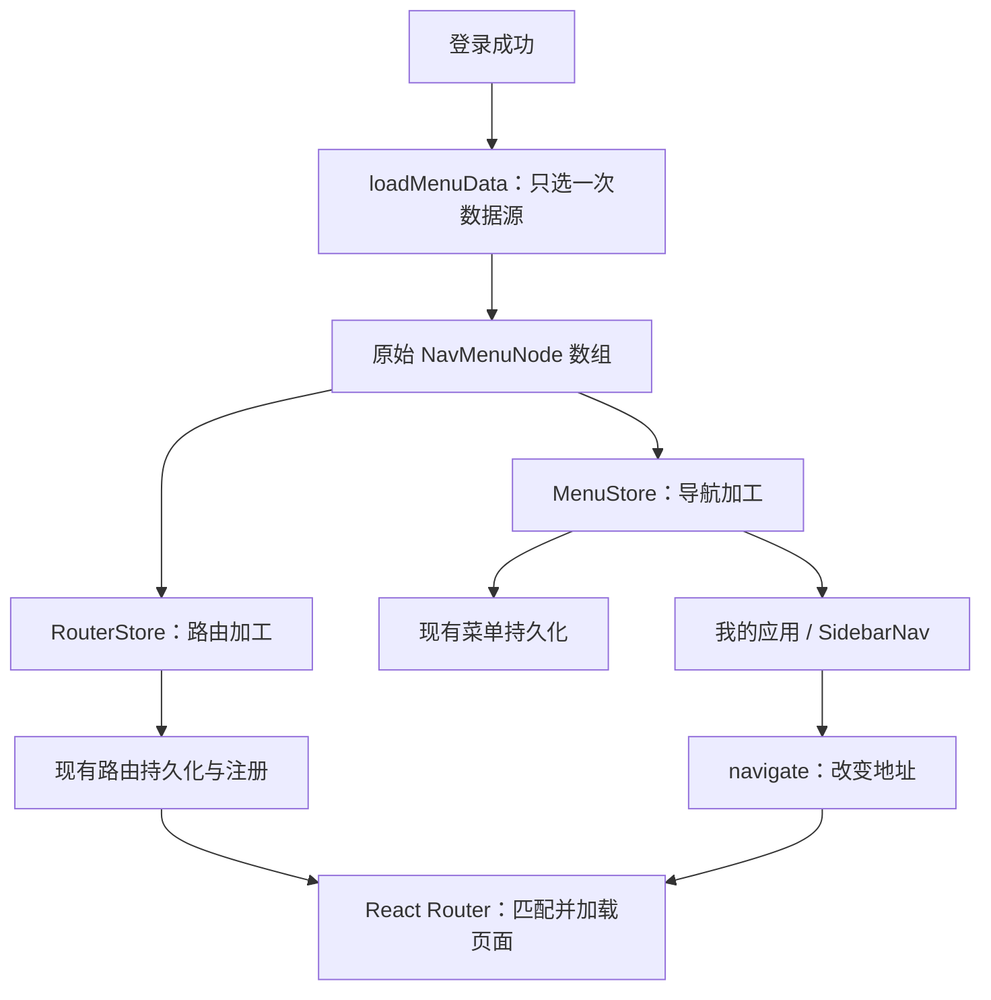
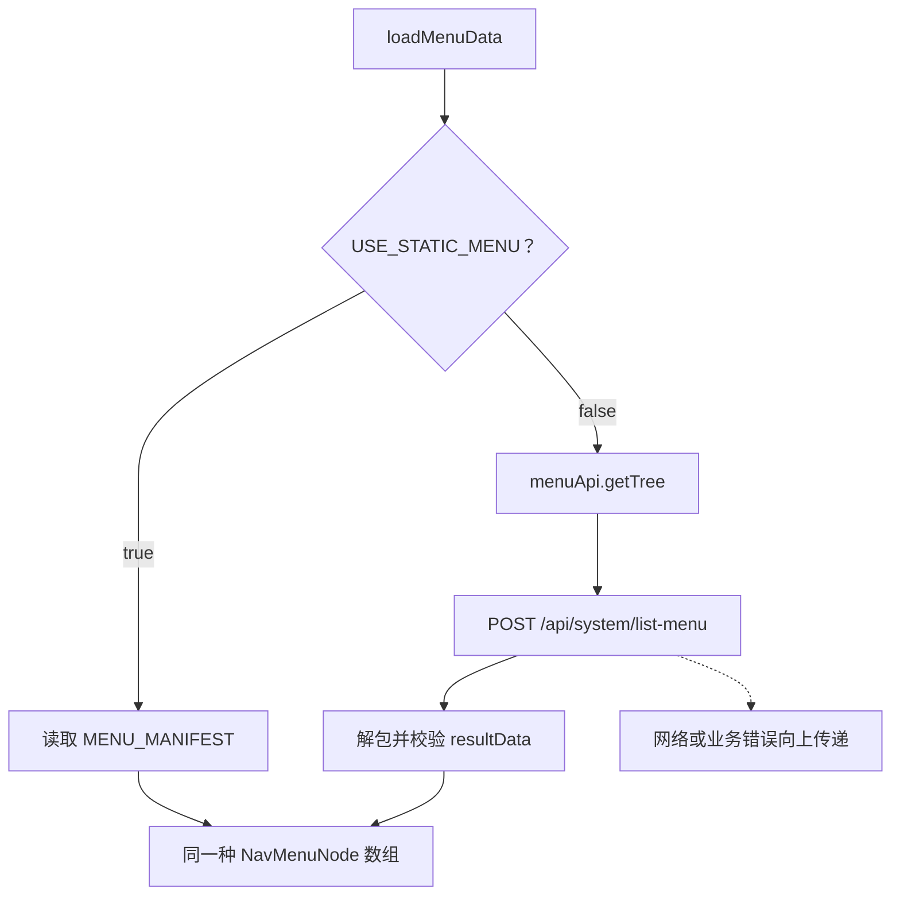
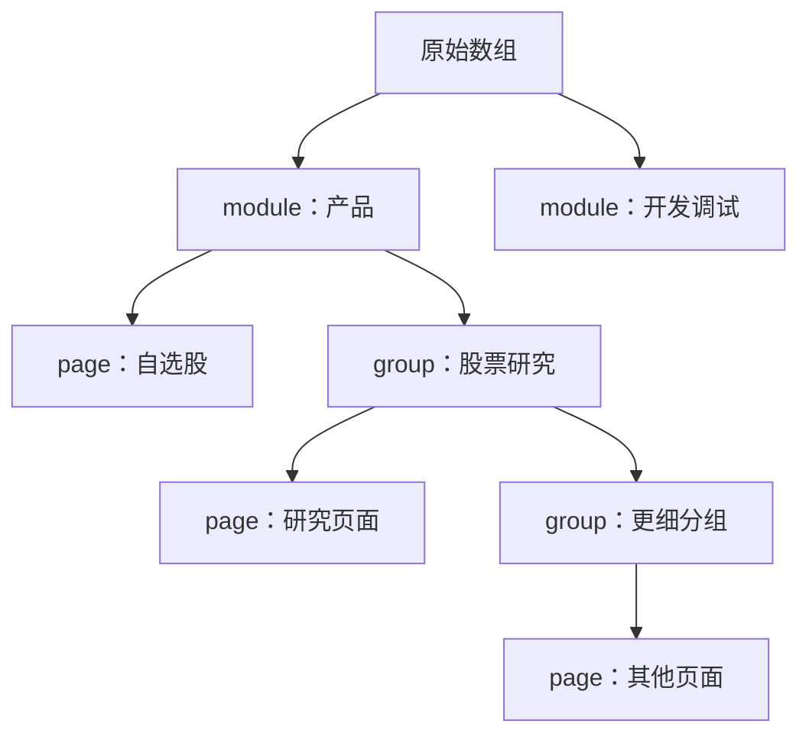
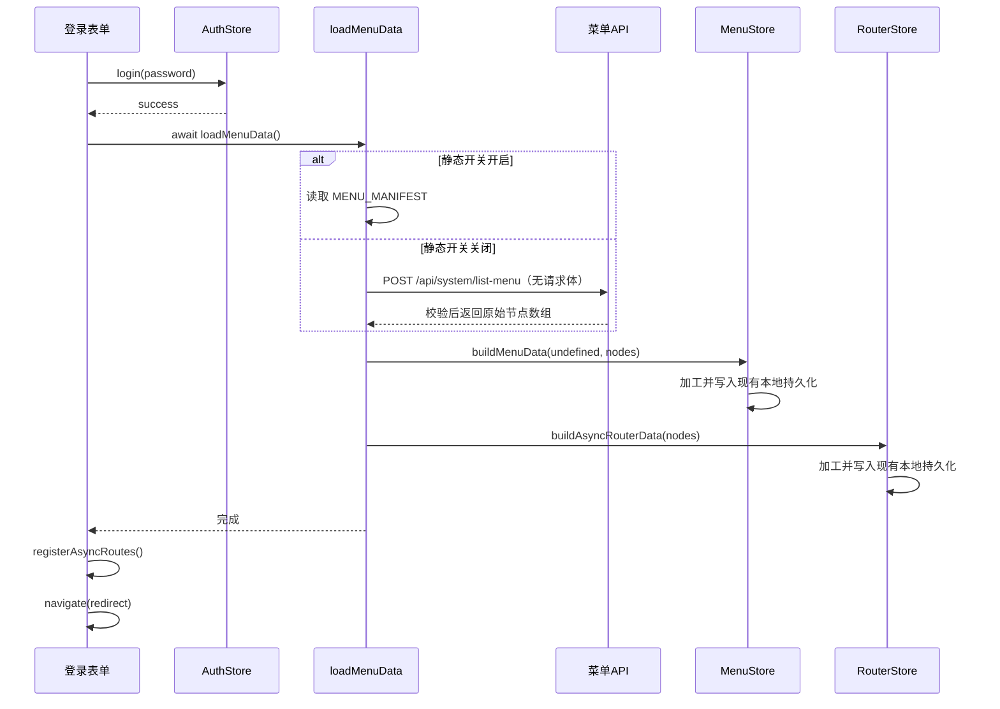
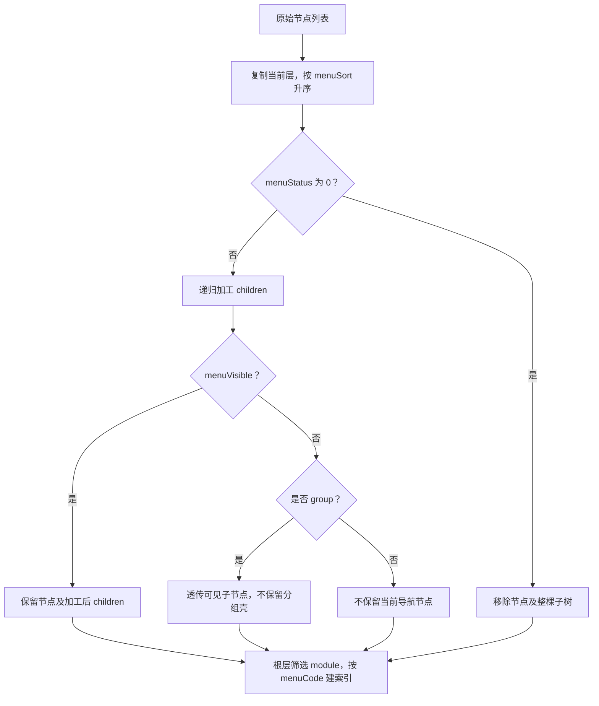
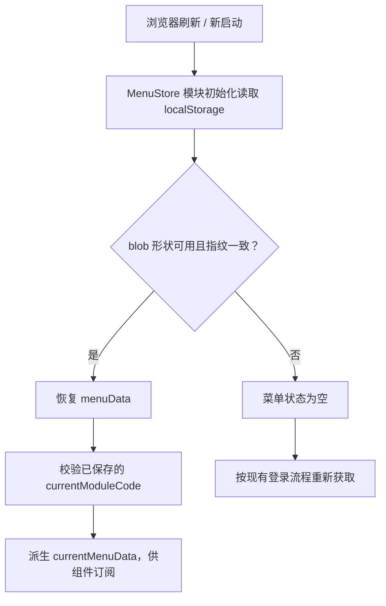
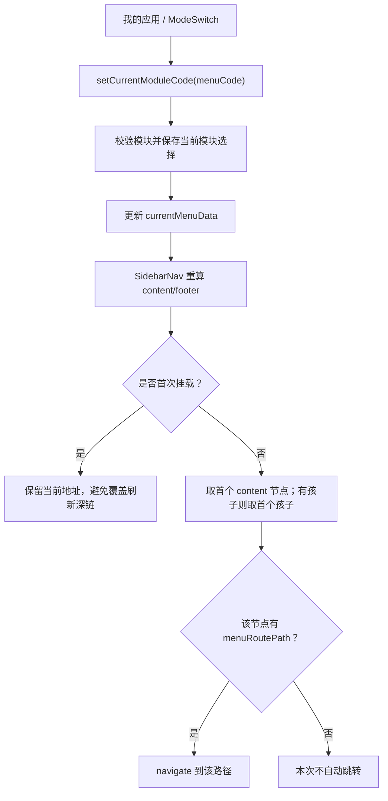

# <a id="frontend-module-menu"></a>前端菜单设计与实现方案

> 更新时间：2026-11-23。以 `apps/hrs-web/src/` 当前代码为准。
> 本文专注菜单：数据来源、统一节点、加载与加工、状态、持久化、应用切换和接口。动态路由的注册、守卫和懒加载由[动态路由方案](frontend_async_router.md)说明。

## 最新规则与当前实现的差异

| 规则 | Java状态 | 前端状态 |
| --- | --- | --- |
| page使用完整menuRoutePath，不拼menuCode或父级路径 | 已实现；group可选路径不参与计算 | 现有实现已直接读取page完整路径 |
| 导航过滤menu_status禁用节点及其整棵子树；管理查询保留禁用数据 | 已实现；返回的page均生效 | 尚有旧menuStatus过滤分支，需后续移除 |
| menu_visible只控制显示，父级隐藏则后代入口全部隐藏，路由仍注册 | Java保留原始可见性，不过滤、不级联改写显示标志 | 旧实现隐藏group时透传孩子，尚待调整为隐藏整棵导航子树 |
| 用户—角色—菜单授权 | 字段保留，业务授权逻辑暂缓 | 不以字段存在宣称已完成用户权限路由 |

**以上是最新约定。下文加工流程图和代码行为说明仍如实描述当前前端实现，旧状态过滤、group隐藏透传并非最新规则的最终目标。** 本轮仅完成Java修订，未改动客户端代码。导航响应暂保留menuStatus=1以满足现有类型与API校验，不表示前端继续负责启用状态判定。

## 目录

| 章节 | 内容 |
| --- | --- |
| [一、职责与关系](#sec-1) | 菜单、路由、页面缓存的分工 |
| [二、数据来源](#sec-2) | manifest / API 开关 |
| [三、统一菜单树](#sec-3) | module / group / page |
| [四、字段契约](#sec-4) | 字段含义、类型、使用者 |
| [五、实现分层](#sec-5) | API、加载入口、Store、组件 |
| [六、登录加载](#sec-6) | 获取、处理、持久化、跳转顺序 |
| [七、菜单加工](#sec-7) | 排序、状态和可见性 |
| [八、持久化与刷新](#sec-8) | 缓存内容、恢复和失效 |
| [九、模块切换与展示](#sec-9) | 我的应用、侧栏、跳转和高亮 |
| [十、接口与安全边界](#sec-10) | 导航查询与管理查询 |
| [十一、异常与生命周期](#sec-11) | 失败、空树、退出登录 |
| [十二、当前交付边界](#sec-12) | 已实现与待接入 |
| [十三、关联方案](#sec-13) | 各文档的维护范围 |
| [十四、核对清单](#sec-14) | 检查入口和行为 |

<a id="sec-1"></a>

## 一、职责与关系

**菜单是导航定义，也是动态路由的数据来源。登录时读取一份原始节点数组，分别交给两个 Store 加工；路由不从已过滤的侧栏菜单反向生成。**

| 对象 | 负责什么 | 不负责什么 |
| --- | --- | --- |
| 原始 `NavMenuNode[]` | 完整模块、分组、页面及路由元数据 | 不直接当作侧栏显示结果 |
| `MenuStore` | 模块索引、可见菜单、当前模块、本地持久化 | 不请求第二份菜单、不注册页面路由 |
| `RouterStore` | 从同一原始数组派生可访问页面路由 | 不按当前侧栏可见性裁剪路由 |
| 菜单组件 | 应用切换、菜单展示、展开、高亮、触发导航 | 不发菜单 HTTP 请求、不重复保存全局菜单 |
| Keep-Alive | 已挂载页面实例的保留 | 不保存菜单树、不决定有哪些路由 |



<a id="sec-2"></a>

## 二、数据来源

开关定义在 [`router/manifest.ts`](../../../apps/hrs-web/src/router/manifest.ts)：

```ts
export const USE_STATIC_MENU = true;
```

| 固定配置 | 原始数据来源 | 菜单 API 请求时机 |
| --- | --- | --- |
| `true`，当前默认 | 同文件的 `MENU_MANIFEST` | 不请求菜单 API |
| `false` | `POST /api/system/list-menu` 的 `resultData` | 登录成功后请求一次；再次登录重新请求 |

这是开发调试用源码常量，修改后刷新并重新登录。不提供运行中切换、自动回退或模式间兼容层。开关判断只放在 `loadMenuData()`，两个 Store 和 `main.tsx` 不判断此开关。



静态清单当前有 **2 个 module、13 个 group、41 个 page**。API 目标结构相同，不要求复制另一套前端字段或为静态节点伪造数据库 ID。

<a id="sec-3"></a>

## 三、统一菜单树

类型定义在 [`types/moduleMenu.ts`](../../../apps/hrs-web/src/types/moduleMenu.ts)。所有层级共用 `NavMenuNode`，用 `children` 表示父子关系，用 `menuType` 区分职责。

| 节点类型 | 含义 | 允许的位置 | 是否直接生成业务路由 |
| --- | --- | --- | --- |
| `module` | 我的应用中的模块入口 | 根节点 | 否 |
| `group` | 菜单分组 | module/group 的 children | 否 |
| `page` | 可导航页面 | module/group 的 children，叶子节点 | 启用且有路径时生成 |



上图说明类型和层级，不是完整清单。模块可以带默认落地路径等元数据，但只有 page 的路径参与业务路由注册。

| 标识 | 含义 | 示例 |
| --- | --- | --- |
| `id` | 数据库数字主键 | `15` |
| `menuParentId` | 数据库父节点主键；根为 0 | `3` |
| `menuCode` | 稳定业务标识，模块索引和页面路由键使用它 | `watchlist` |
| `menuRoutePath` | 浏览器地址 | `/watchlist` |
| `menuPagePath` | 已有页面模块标识 | `pages/WatchlistPage/WatchlistPage` |

`menuCode` 不等于 pathname，也不代替数据库主键。JSON 和前端属性用 camelCase，数据库业务列按约定使用 `menu_` 前缀。

<a id="sec-4"></a>

## 四、字段契约

完整必填性、主键安全范围和错误示例由[菜单接口契约](menu_api_contract.md#4-节点字段)维护，本表侧重前端用途。

| 字段 | 类型 | 在前端的作用 |
| --- | --- | --- |
| `id` / `menuParentId` | 可选 number | API 节点主键和父键，静态清单可省略 |
| `menuCode` | string | 节点唯一业务标识、模块索引、DOM 菜单标识、路由 routerKey |
| `menuName` | string | 模块/菜单名称；page 透传为页头标题 |
| `menuDescription` | string | 描述；page 透传为页头副标题；无描述用空字符串 |
| `menuType` | module/group/page | 模块归类、分组渲染、页面路由生成 |
| `menuRoutePath` | 可选 string，page 必填 | 点击导航、路径高亮、动态路由地址 |
| `menuPagePath` | 可选 string，page 必填 | 动态路由解析已有页面文件 |
| `menuIcon` | 可选 string | 图标白名单键；未知图标不动态执行代码 |
| `menuBadge` | 可选 string | 当前数据契约预留，渲染层尚未读取 |
| `menuPosition` | header/content/footer | SidebarNav 当前分 content/footer；header 是预留值 |
| `menuExpanded` | boolean | 默认展开；当前组件中的用户手动展开值优先 |
| `menuVisible` | boolean | 是否展示导航入口；不等于页面授权 |
| `menuSort` | number | 每层按升序排序 |
| `menuStatus` | 0/1 | 0 时整棵子树不参与菜单或路由加工 |
| `menuPermission` | 可选 string | 权限标识预留，不作为已实现的按钮/角色授权 |
| `children` | 可选同类型数组 | 父子结构，叶子为空或省略；不返回 null |
| `auth` | 可选 public/protected | 向路由数据透传；当前实际由统一受保护布局守卫处理 |
| `exact` | 可选 boolean | 菜单高亮精确/前缀匹配，不控制路由注册 |

<a id="sec-5"></a>

## 五、实现分层

| 层 | 当前文件（相对 src） | 具体职责 |
| --- | --- | --- |
| 类型 | `types/moduleMenu.ts`、`types/restResult.ts` | 节点与响应包装契约 |
| 静态配置 | `router/manifest.ts` | 固定调试开关、静态树、清单指纹 |
| API | `api/system/menu.ts` | 请求、解包、字段/树校验、抛出错误 |
| 协调入口 | `router/loadMenuData.ts` | 选择数据源，将同一原始数组交给两个 Store |
| 状态 | `stores/MenuStore.ts` | 菜单加工、模块索引、当前模块和持久化 |
| 登录触发 | `pages/LoginPage/LoginCard.tsx` | 登录成功后等待菜单加载、注册路由、再跳转 |
| 应用入口 | `components/layout/HeaderComponents/ApplicationMenu.tsx`、`ModeSwitch.tsx` | 从 MenuStore 读取模块并切换 |
| 侧栏 | `components/layout/SideBar/SidebarNav.tsx`、`MenuNode.tsx` | 分区、展开、点击和高亮 |

组件直接通过 `useMenuStore` 选择器订阅。它本身就是 Zustand Hook，不新增 `hooks/useMenu.ts`，也不把菜单 API 再写进每个展示组件。导航模块选择以 MenuStore 为准，不依赖遗留 `AppModeContext` 作为第二份菜单真源。

<a id="sec-6"></a>

## 六、登录加载



| 顺序 | 行为 | 原因 |
| --- | --- | --- |
| 1 | 现有登录成功 | 不在提交表单前请求受保护菜单 |
| 2 | await 加载菜单 | 接口未返回或失败时不继续跳转 |
| 3 | 两个 Store 分别派生、持久化 | 共用原始数据，各自保存用途不同的结果 |
| 4 | 注册业务路由 | 确保目标页面已有路由定义 |
| 5 | 跳转目标地址 | redirect 仅接受以单个 `/` 开头的站内地址，缺省 `/home` |

两次 Store 更新按当前代码顺序执行，不是跨 Store/跨 localStorage 键的原子事务。存储不可用时工具函数会警告并继续保留内存状态，不能宣称任何浏览器环境都一定持久化成功。

<a id="sec-7"></a>

## 七、菜单加工



| 输入情况 | MenuStore 的导航结果 | 路由侧的区别 |
| --- | --- | --- |
| 启用、可见节点 | 保留，递归处理孩子 | page 可生成路由 |
| 禁用的任何节点 | 整棵子树移除 | 路由同样移除整棵子树 |
| 隐藏 group | 移除分组壳，保留其可见孩子 | 路由不受可见性影响 |
| 隐藏 page | 不展示入口 | 启用时仍可注册路由 |
| 隐藏 module | 该模块不出现在应用入口 | 模块下启用 page 仍参与路由生成 |

输出形状是 `ModuleMenuData = Record<MenuCode, NavMenuNode>`，不是原始数组：

```ts
menuData['productModel']     // 该模块节点，仍含 children
currentModuleCode           // 当前模块的 menuCode
currentMenuData              // menuData[currentModuleCode]?.children ?? []
```

`getValidModuleCode()` 优先接受指定且有孩子的模块，否则选第一个有菜单的模块；没有可用模块时返回空字符串。

<a id="sec-8"></a>

## 八、持久化与刷新

两种数据源共用现有流程，不新增 API 专用缓存。原始 API 数组不会另存一份；保存的是菜单加工结果、当前模块和路由加工结果。

| 逻辑缓存键 | 保存内容 | 负责模块 |
| --- | --- | --- |
| `menu.menuData` | `{ fingerprint, modules }`，modules 是模块索引 | MenuStore |
| `menu.currentModuleCode` | 当前模块业务标识 | MenuStore |
| `router.asyncRouteData` | `{ fingerprint, routes }`，细节见路由方案 | RouterStore |

`utils/storage.ts` 自动加 `hrs-pref-` 前缀。例如浏览器中的菜单键为 `hrs-pref-menu.menuData`，不是裸逻辑键。



| 时机 | 是否请求菜单 API | 持久化行为 |
| --- | --- | --- |
| 静态模式登录成功 | 否 | 加工静态树，覆盖现有缓存 |
| 接口模式登录成功 | 是 | 加工接口树，覆盖现有缓存 |
| 刷新页面 | 否 | Store 初始化恢复；不是重新读取 API |
| 切换当前模块 | 否 | 只更新模块选择，不重建整棵树 |
| 再次登录 | 接口模式请求 | 获取新数据，覆盖旧结果 |

当前指纹 `MENU_MANIFEST_FINGERPRINT` 来自静态清单，两种来源沿用该指纹；它不是服务端菜单版本。服务端数据变化不会自动刷新本地缓存，当前通过重新登录更新。指纹/结构不符即丢弃旧缓存，不做字段兼容转换。缓存没有账号维度或 TTL，退出时也尚未统一清空，见 §十一。

<a id="sec-9"></a>

## 九、模块切换与展示



模块切换只改变侧栏范围，不重新请求菜单，也不只注册当前模块的路由；路由来源是完整原始树。

| 展示行为 | 当前实现 |
| --- | --- |
| content/footer | SidebarNav 按 menuPosition 分组 |
| header | 契约预留，侧栏不展示这一分区 |
| 展开 | 用户手动值优先；否则按直接孩子的路径命中和 menuExpanded 判断 |
| 点击 page | MenuNode 使用 menuRoutePath 进行 SPA 导航 |
| 高亮 | 根据 pathname、menuRoutePath 和 exact 匹配；menuCode 用作标识 |
| AlphaSift 选股入口 | 另查 AlphaSift 状态，未启用或查询失败时隐藏 screening；不改变已注册路由 |
| 自动落地 | 当前只选首个 content 节点及其第一个孩子，不是任意深度的页面搜索 |

<a id="sec-10"></a>

## 十、接口与安全边界

| 用途 | 接口 | 参数与返回 |
| --- | --- | --- |
| 登录后加载导航 | `POST /api/system/list-menu` | 无请求体/查询条件；返回完整统一树 |
| 管理树筛选 | `GET /api/system/menus/tree` | keyword/status/enterpriseId/organizationId；保留命中祖先 |
| 新增/详情/修改/删除 | `/api/system/menus`、`/api/system/menus/{id}` | Java 管理 CRUD；本轮没有菜单管理前端页面 |
| 当前前端登录 | `POST /api/v1/auth/login` | 现有 Python 登录流程，不自动获得 Java 身份 |
| Java CSRF token | `GET /api/system/users/csrf` | 现有 Java 管理接口；真实接入需 Basic 身份与会话 Cookie |

导航响应固定为 `RestResult<NavMenuNode[]>`：`resultCode` 为字符串，成功为 `"200"`，`resultMsg` 为提示，`resultData` 为树数组。API 层解包后只返回节点，不把 HTTP 包装存入 MenuStore。

| 安全机制 | 当前职责 |
| --- | --- |
| 前端路径守卫 | 控制界面跳转，详见动态路由方案 |
| Java Basic + SYSTEM_ADMIN | Java 管理身份验证与角色检查 |
| Java CSRF | POST 导航接口同样需要 token，不能因为只查询数据就省略 |
| menuVisible / menuPermission | 展示/元数据，不替代服务端授权 |

详细字段、错误处理与凭据接入约束只在[菜单接口契约](menu_api_contract.md)展开，避免维护多份协议。

<a id="sec-11"></a>

## 十一、异常与生命周期

| 情况 | 当前代码行为 | 边界 |
| --- | --- | --- |
| 登录失败 | 展示错误，不加载菜单 | 不生成新的菜单/路由 |
| API 网络、HTTP、业务失败 | 抛给 LoginCard，留在登录页提示 | 不自动改用 manifest |
| API 返回旧字段或坏树 | 抛 MenuContractError | 不伪装为成功空树 |
| API 返回合法空数组 | 两个 Store 保存空结果 | 当前刷新引导按路由数组为空判定会话不完整，尚无独立“无菜单权限”页 |
| localStorage 不可用 | 读返回 null；写警告，内存状态可继续存在 | 刷新恢复不能保证 |
| 退出登录 | 现有入口调用 logout、uninstallAsyncRoutes 并跳登录页 | 尚未统一清理菜单/路由 Store 与缓存；路由卸载限制见路由方案 |

不要把“本地缓存存在”当作当前账号已认证或有权限的依据。后续若需要按用户菜单授权，应整体完善账号隔离、退出清理和权限更新流程；本次文档更新没有实现这些代码。

<a id="sec-12"></a>

## 十二、当前交付边界

| 部分 | 当前状态 |
| --- | --- |
| 前端静态/API 选择、登录加载、加工、持久化及刷新恢复 | 已实现 |
| Java POST 导航接口及统一字段、Mapper 目标列 | 已实现并用临时测试库验证 |
| 正式 `data/hrs_system.db`、目标建表部署、56 个节点导入 | 按用户要求暂缓；旧 V4 仍不是新 Mapper 的目标结构 |
| 开发转发 | 当前 `/api` 默认代理到 Python，system 转发待接入 |
| Python 登录到 Java 身份、Basic/CSRF 接入 | 待真实联调，不在前端 getTree 中硬编码管理凭据 |
| 退出路由清理与重复登录路由替换 | 当前实现存在限制，见动态路由方案 §九 |

<a id="sec-13"></a>

## 十三、关联方案

| 方案 | 唯一维护范围 |
| --- | --- |
| 本文 | 菜单数据来源、结构、加工、状态、展示和持久化 |
| [动态路由](frontend_async_router.md) | 菜单如何派生路由、注册、刷新种子、守卫、懒加载 |
| [菜单 API 契约](menu_api_contract.md) | 请求响应、字段必填性、运行时校验和错误 |
| [Keep-Alive](frontend_route_keepalive.md) | 页面实例缓存与副作用；与菜单本地持久化不同 |
| [Java 菜单案例](../../engineering/java_menu_navigation.md) | Java 各层与目标 Mapper；数据库暂缓边界 |
| [Java 公共响应](../../../hrs-common/src/main/java/hermesx/common/rest/RestResult.java) | resultCode/resultMsg/resultData 和结果码 |

<a id="sec-14"></a>

## 十四、核对清单

| 变更 | 最少核对内容 |
| --- | --- |
| 改菜单字段 | NavMenuNode、manifest、API 校验、两个 Store、消费者和 Java 契约 |
| 改数据源 | 开关只在加载入口判断，刷新仍恢复缓存，无失败静态兜底 |
| 改显示/禁用规则 | 分别验证导航和路由结果，不把隐藏等同禁用 |
| 改模块切换 | 选择持久化、首屏深链不覆盖、现有落地算法 |
| 改持久化 | 三个现有逻辑键、指纹、空结果和不可用存储 |
| 改登录/退出 | 请求顺序、失败不跳转、账号隔离与路由卸载的已知限制 |

相关测试入口：`src/api/__tests__/menuApi.contract.test.ts`、`src/router/__tests__/loadMenuData.test.ts`、`src/stores/__tests__/menuStores.test.ts`。本文是中文专题，无英文对应文件。
