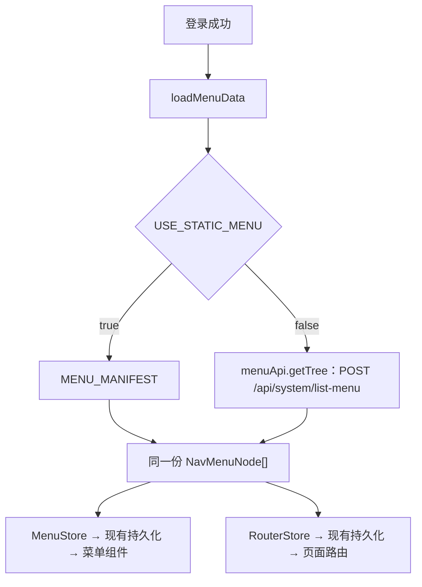

# 菜单树查询接口契约

更新时间：2026-11-23

## 1. 当前交付与接入范围

最新规则：Java导航负责过滤禁用子树；menuVisible仅为前端显示数据，父级隐藏时后代入口也应隐藏，但返回的page仍应生成路由。用户—角色—菜单授权逻辑暂缓，仅保留字段。当前Java已按此调整；前端还保留旧的group隐藏透传及menuStatus判断，需在客户端阶段单独调整，不代表这部分已完成。

前端 API 入口为 `apps/hrs-web/src/api/system/menu.ts`，调用 `menuApi.getTree()`，返回 `Promise<NavMenuNode[]>`。节点类型直接复用 `apps/hrs-web/src/types/moduleMenu.ts`，与 `router/manifest.ts` 的 `MENU_MANIFEST` 共用一套字段、枚举和树结构。

已实现请求、统一响应解包、运行时契约校验和错误传递，并由 `router/loadMenuData.ts` 同时为菜单与路由加载数据。`router/manifest.ts` 中的开发调试开关 `USE_STATIC_MENU` 默认 `true`（静态清单）；设为 `false` 后，在登录成功时使用本接口获取菜单。开关是固定配置，不提供运行中的切换功能。接口失败向调用方抛出，不回退到静态清单或空数组。

Java 已实现 `POST /api/system/list-menu`，`MenuVO` 与 Mapper 已按本契约输出统一节点。`GET /api/system/menus/tree` 保留为带筛选条件的管理查询，导航不调用它。**当前只完成 Java 代码与临时测试库验证：正式 SQLite 文件、目标表结构部署和 manifest 数据导入按用户要求暂缓。** 旧 V4 建表脚本尚未升级，不能把现有表直接当作新 Mapper 的目标表。真实调用还需完成转发、身份凭据与 CSRF 接入；不能据自动化测试宣称真实服务已联调。菜单 CRUD 的字段已统一，管理接口仍为 `/api/system/menus`。

## 2. 请求

| 项目 | 约定 |
| --- | --- |
| 方法 | `POST` |
| 地址 | `/api/system/list-menu` |
| 前端方法 | `menuApi.getTree()` |
| 请求体 | 无，不发送 JSON 数据；Java 接口无需声明必填的请求体 |
| 查询参数 | 当前不传，读取完整菜单树；不传管理搜索的 keyword/status，避免裁剪导航树 |
| 响应格式 | JSON，字段名统一使用 camelCase |
| 请求客户端 | 复用现有 `apiClient`，沿用已有 API 基础地址、超时和凭据设置 |
| 前端请求缓存 | POST 不进入通用 GET 缓存；登录成功时重新请求，返回后由两个 Store 沿用现有 localStorage 持久化 |

接口仍由服务端根据真实认证与授权决定可返回的数据；不以客户端传入企业或组织 ID 代替权限校验。本文不新增认证实现。

目前开发代理仍将 `/api` 指向 Python。真实联调时需安排 system 请求转发或相应部署入口，并确认认证凭据可用；Java 当前启用了 CSRF 防护，POST 接口真实接入时还需对齐 CSRF token 获取与携带方式；本阶段不更改代理、端口、Java 或数据库，不新增环境配置项。

## 3. 成功响应

外层类型为 `RestResult<NavMenuNode[]>`，定义在 `apps/hrs-web/src/types/restResult.ts`。`resultCode` 是字符串业务码，成功固定为 `"200"`；它与 HTTP 状态码属于不同层次。

```json
{
  "resultCode": "200",
  "resultMsg": "操作成功。",
  "resultData": [
    {
      "id": 1,
      "menuParentId": 0,
      "menuCode": "productModel",
      "menuName": "产品",
      "menuDescription": "产品使用模式菜单",
      "menuType": "module",
      "menuRoutePath": "/home",
      "menuIcon": "LayoutDashboard",
      "menuPosition": "content",
      "menuExpanded": false,
      "menuVisible": true,
      "menuSort": 0,
      "menuStatus": 1,
      "children": [
        {
          "id": 2,
          "menuParentId": 1,
          "menuCode": "research",
          "menuName": "股票研究",
          "menuDescription": "股票研究页面分组",
          "menuType": "group",
          "menuPosition": "content",
          "menuExpanded": true,
          "menuVisible": true,
          "menuSort": 0,
          "menuStatus": 1,
          "children": [
            {
              "id": 3,
              "menuParentId": 2,
              "menuCode": "watchlist",
              "menuName": "自选股",
              "menuDescription": "自选股管理",
              "menuType": "page",
              "menuRoutePath": "/watchlist",
              "menuPagePath": "pages/WatchlistPage/WatchlistPage",
              "menuIcon": "Star",
              "menuPosition": "content",
              "menuExpanded": false,
              "menuVisible": true,
              "menuSort": 0,
              "menuStatus": 1,
              "auth": "protected",
              "children": []
            }
          ]
        }
      ]
    }
  ]
}
```

这是三层结构示例，不代表已经写入数据库，也不代表要求增加 manifest 中不存在的分组。实际菜单内容和页面路径以现有 manifest 为迁移依据；示例数字主键由数据库真实生成，不能把数组下标当作持久化 ID。

`resultData` 与 manifest 均为数组；根节点必须是 module，子节点为 group/page。所有节点使用同一种结构，仅 `menuType` 的值不同。

## 4. 节点字段

| 字段 | JSON 类型 | 必填 | 约定 |
| --- | --- | --- | --- |
| `id` | number | 否 | 数据库正整数主键；静态清单不需要。提供时必须在 JavaScript 安全整数范围内且全树唯一 |
| `menuParentId` | number | 否 | 根节点为 0；子节点对应父节点 id。提供时必须与 children 中的实际位置一致 |
| `menuCode` | string | 是 | 非空稳定业务标识，全树唯一；不等同于数字主键 |
| `menuName` | string | 是 | 名称，支持国际化键或直接文案 |
| `menuDescription` | string | 是 | 描述，无描述时返回空字符串 |
| `menuType` | string | 是 | module / group / page |
| `menuRoutePath` | string | page 必填 | 站内路由路径，以单个 `/` 开头；page 路由全树唯一；使用完整路径，不拼接父级或menuCode |
| `menuPagePath` | string | page 必填 | `pages/` 开头的前端页面模块路径；必须能由现有页面导入白名单解析 |
| `menuIcon` | string | 否 | 现有图标名称 |
| `menuBadge` | string | 否 | 预留徽标文本 |
| `menuPosition` | string | 是 | header / content / footer |
| `menuExpanded` | boolean | 是 | 默认是否展开，使用 true/false |
| `menuVisible` | boolean | 是 | 是否显示导航入口；隐藏不代表禁止路由访问 |
| `menuSort` | number | 是 | 同级升序排序值 |
| `menuStatus` | number | 当前保留 | 管理状态0/1；Java导航已排除禁用子树，所以本接口返回节点均为1。现有前端类型仍要求该字段，后续可单独收敛导航契约；前端不承担启用状态业务判断 |
| `menuPermission` | string | 否 | 权限标识预留，不能替代服务端授权 |
| `children` | array | 否 | 同一类型的子节点数组；叶子省略或返回 []，不能返回 null；page 不含子节点 |
| `auth` | string | 否 | public / protected，保留当前 manifest 的路由扩展语义 |
| `exact` | boolean | 否 | 前端高亮扩展，是否精确匹配路径 |

可选字段无值时省略；字符串可选字段也可返回空字符串，page 必需的路径除外。不要为兼容旧 Java 响应同时返回 name/menuName、type/menuType 等双字段；数据库和 Java 调整时直接按目标契约输出。

Java导航查询先排除禁用节点及其子树，不过滤隐藏节点；前端API方法只校验并保留实际返回字段及顺序，不负责再次筛选业务启用状态。菜单管理接口仍可查询禁用记录。页面文件的可解析性由前端路由层验证；远端数据不能提供可直接执行的组件代码或任意导入地址。实际页面仍需要随前端构建发布。

## 5. 失败与空数据

```json
{
  "resultCode": "403",
  "resultMsg": "无权访问菜单。",
  "resultData": null
}
```

| 情况 | 前端方法行为 |
| --- | --- |
| HTTP 成功且 resultCode 为 "200"、resultData 为合法树 | 返回 resultData |
| HTTP 成功且 resultCode 为 "200"、resultData 为 [] | 返回 []，表示没有菜单，不回退到 manifest |
| HTTP 成功但 resultCode 非 "200" | 抛出 MenuApiError，保留 resultCode/resultMsg |
| 缺少包装、旧字段、错误类型、重复业务码、错误父子关系等 | 抛出 MenuContractError，指出不符契约的位置 |
| 网络失败或 HTTP 4xx/5xx | 沿用现有 apiClient 的错误处理并向上传递，保留 HTTP 状态与响应 |

错误业务码最终以 Java 的结果码枚举为准，示例不意味着新增了一套枚举。API 不自行吞错、重试或切换数据源。

## 6. 开发调试开关

在 `apps/hrs-web/src/router/manifest.ts` 中修改：

```ts
export const USE_STATIC_MENU = true;
```

| 值 | 菜单来源 | 行为 |
| --- | --- | --- |
| `true`（当前默认） | 同文件的 `MENU_MANIFEST` | 不请求菜单 API，保留现有静态清单和指纹缓存流程 |
| `false` | `POST /api/system/list-menu` 的 `resultData` | 登录成功后查询；菜单和路由共用同一次返回结果，并沿用现有持久化；刷新时从本地恢复 |

这是开发调试时修改的源码常量，修改后重新登录获取所选数据源的菜单。不设计运行中热切换或模式切换兼容层，也不增加环境变量。开关只在 `loadMenuData()` 内选择数据源；两个 Store 和应用启动入口不判断开关。两种模式共用现有缓存键、清单指纹及 localStorage 读写逻辑，不新增另一套持久化实现。

接口失败时，登录页显示错误并允许重新提交，不用静态清单兜底。刷新时直接恢复已有菜单与路由，不再请求菜单接口；缓存缺失或失效时沿用原有重新登录流程。后续真实接入仍需完成目标数据库建表及数据初始化、服务转发和认证（含 CSRF）联调；Java 字段与请求地址已对齐，目前未验证真实业务数据库和浏览器直连接入。

## 7. API、Store 与组件如何分层

本文只维护 HTTP/JSON 协议，不重复维护两份实现方案。

| 主题 | 对应方案 |
| --- | --- |
| 原始数据来源、节点结构、导航加工和持久化 | [菜单设计](frontend_module_menu.md) |
| 菜单派生页面路由、注册、刷新、守卫和懒加载 | [动态路由设计](frontend_async_router.md) |
| 页面实例缓存与失活副作用 | [Keep-Alive](frontend_route_keepalive.md) |


| 层 | 文件/位置 | 职责 |
| --- | --- | --- |
| 类型契约 | `types/moduleMenu.ts`、`types/restResult.ts` | 定义统一节点和响应包装 |
| 静态配置 | `router/manifest.ts` | 提供调试开关与静态清单 |
| API | `api/system/menu.ts` | 请求、解包、校验字段和树结构、传递错误 |
| 加载入口 | `router/loadMenuData.ts` | 按固定开关选择数据源，将同一份节点交给两个 Store |
| 菜单状态 | `stores/MenuStore.ts` | 派生菜单、维护当前模块，供组件订阅 |
| 路由状态 | `stores/RouterStore.ts` | 从同一份节点派生页面路由 |
| 组件 | `ApplicationMenu.tsx`、`SidebarNav.tsx` 等 | 使用 `useMenuStore` 订阅状态，不直接请求菜单 API |

`useMenuStore` 已是全局菜单状态的 Hook，不再新增 `hooks/useMenu.ts`。两个 Store 分别消费同一原始数组；RouterStore 不从已经过滤的 MenuStore 侧栏结果生成路由，隐藏入口仍可有路由。登录页调用统一加载入口，两个 Store 分别加工、持久化菜单和路由，然后注册路由。刷新时，Store 初始化从 localStorage 恢复状态，路由器使用恢复后的路由数据；不额外请求菜单 API。再次登录获取最新菜单并覆盖现有缓存。



路由注册的真实生命周期限制（追加不等于替换、空 patch 不会清除旧路由）见[动态路由方案 §九](frontend_async_router.md#sec-9)；本接口校验和数据持久化不等于已经完成路由撤销或账号缓存隔离。
