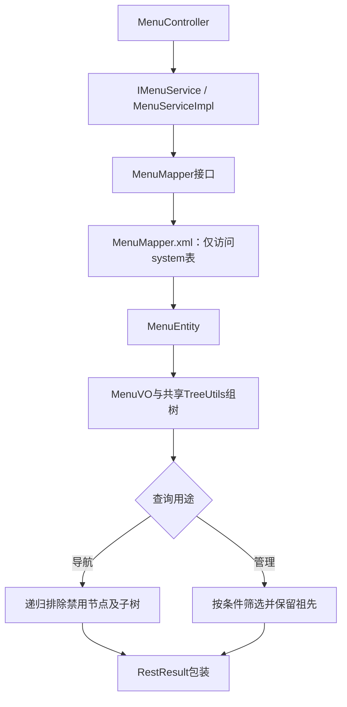

# Java 菜单管理与导航查询

更新时间：2026-11-23。本专题只覆盖菜单及其必需的公共响应、树工具和接口保护。部门管理、Nacos分别见关联专题，不把这些能力或完整用户授权混入菜单协议。

## 接口与职责

| 用途 | 接口 | 规则 |
| --- | --- | --- |
| 登录后导航 | POST /api/system/list-menu | 无请求体，返回已启用的module/group/page树 |
| 管理查询 | GET /api/system/menus/tree | keyword/status/enterpriseId/organizationId筛选，保留祖先，包括禁用祖先 |
| 管理CRUD | POST /api/system/menus；GET/PUT/DELETE /api/system/menus/{id} | 新增201及Location、详情/修改200、逻辑删除200及true |

响应由hrs-common公共JAR的RestResult提供：resultCode/resultMsg/resultData；它不是独立运行的服务。成功码是字符串"200"。

## 分层与数据流

| 位置（相对hrs-system-service） | 职责 |
| --- | --- |
| pojo/dto/MenuWriteDTO | 输入约束，拒绝审计和逻辑删除等内部字段 |
| pojo/entity/MenuEntity | 数据库行，含内部字段 |
| pojo/vo/MenuVO | 统一camelCase输出；可选null字段省略，children为数组 |
| rest/controller/MenuController | 路由、格式校验和HTTP响应 |
| rest/service/IMenuService | 用例接口；不允许Controller直接访问Mapper |
| rest/service/impl/MenuServiceImpl | 默认值、管理身份、唯一性、父子关系和事务 |
| rest/dao/MenuMapper及resources/mapper/MenuMapper.xml | 参数绑定、record构造映射和SQL |
| pojo/base/TreeNode及rest/utils/TreeUtils | 共用树结构与纯内存组树，不访问数据库或会话 |

上表简写了包路径，实际Java源码都位于各模块的src/main/java/hermesx/system下。

## 字段和树规则

| 项目 | 规则 |
| --- | --- |
| id / menuParentId | 数字主键与父键，根父键0 |
| menuCode | 稳定业务标识，trim后在未删除节点中唯一 |
| menuName / menuDescription | 名称必填，未提供描述时补空字符串 |
| menuType | module/group/page；根只能module，module/group下只能group/page，page为叶子 |
| menuRoutePath | page必填完整站内地址，以单个/开头，page路由唯一；不拼menuCode或父级路径 |
| group路径 | 可选元数据，可为相对分组标识，不参与page地址计算 |
| menuPagePath | page必填，pages/开头，前端必须已有对应默认导出的组件 |
| menuVisible | 只控制前端入口显示；Java保留原值，不过滤或级联改写子节点 |
| menuStatus | 0禁用/1启用；导航排除禁用节点及其整棵子树，管理查询保留 |
| menuExpanded / menuPosition / menuSort | 默认false/content/0 |
| menuIcon / menuBadge / menuPermission | 可选图标、徽标及权限标识 |
| auth / exact | 保留前端路由扩展字段，不据此授予后端权限 |
| enterpriseId / organizationId | 可空正整数；父子归属一致，已有记录不直接修改归属 |
| 审计与deleteFlag | 服务端维护；删除是逻辑删除，有未删除孩子时拒绝 |

菜单最多64层，禁止循环、孤立父节点及非法类型。移动子树时检查子孙深度和现有孩子类型。新增/修改是事务操作；PUT为完整更新，省略可选字段使用默认值或清空。

导航不能直接调用管理筛选status=1来代替禁用过滤：管理筛选会补齐祖先，可能带回禁用父节点。导航先验证完整树，再移除禁用子树，不提升孩子、不自动启用父节点，也不改数据库记录。

导航与管理当前共用MenuVO，导航仍带menuStatus且均为1，以满足已有前端接口校验；前端不再承担业务启用判断是最新目标。现有前端旧状态判断和隐藏group透传孩子的逻辑尚待下一轮调整，见[菜单方案](../authority/frontend/frontend_module_menu.md)。

## 公共保护和结果码

| 范围 | 当前实现 |
| --- | --- |
| 身份 | 现有配置管理账号，Basic认证与SYSTEM_ADMIN角色；不读取用户表进行登录 |
| CSRF | POST/PUT/DELETE继续校验token；导航POST同样需要token |
| 业务失败 | ManagementException经GlobalExceptionHandler包装为统一响应 |
| 安全失败 | RestSecurityHandler返回统一401/403响应 |
| 重复业务码/路由 | MENU_CODE_EXISTS / MENU_ROUTE_EXISTS，409 |
| 其他菜单失败 | MENU_NOT_FOUND、INVALID_PARENT、INVALID_MENU_TYPE、INVALID_TREE等 |
| 用户权限 | 暂不实现用户—角色—菜单关联；menuPermission仅预留 |

公共错误边界与安全处理器是菜单依赖的共享设施，用户业务成功响应已由后续独立提交统一，见[公共响应方案](java_common_response_design.md)；它不改变菜单协议的职责边界。

## 数据库与真实接入暂缓

**没有创建或修改data/hrs_system.db，没有执行正式建表或菜单种子导入。** Mapper引用的是目标menu_业务列，正式目标建表资源尚未交付；不能直接用旧表运行新Mapper。测试SQL位于src/test/resources，只在自动化测试自己的临时数据库使用，不是生产迁移。

数据库列使用menu_业务前缀，id、enterprise_id、organization_id、delete_flag与审计字段按既有约定保留；auth/exact映射为menu_auth/menu_exact。实际部署数据库、索引/约束与56个manifest节点导入在数据库阶段完成。

当前前端登录仍走Python，Java管理身份、CSRF和代理转发尚未接入前端。测试成功不等于浏览器到Java及业务数据库的真实联调完成。

## 验证与回滚

独立菜单测试：rest/src/test/java/hermesx/system/MenuApiIntegrationTest.java，覆盖真实Controller→Service→Mapper/XML→临时SQLite链路、菜单CRUD、管理筛选、禁用子树、隐藏节点、路径独立性、字段、认证和CSRF。

执行`mvn -o -pl hrs-system-service/rest -am verify`，验证以本次Git暂存内容导出的独立目录，避免依赖工作区未提交的部门、Nacos或用户功能改动。

回滚菜单代码不涉及业务库回滚。本文为中文专题，无英文对应文件。关联：[菜单](../authority/frontend/frontend_module_menu.md)、[动态路由](../authority/frontend/frontend_async_router.md)、[API契约](../authority/frontend/menu_api_contract.md)。

关联专题：[部门与菜单案例](java_organization_menu_management_case.md)、[可选Nacos](java_nacos_discovery.md)。
