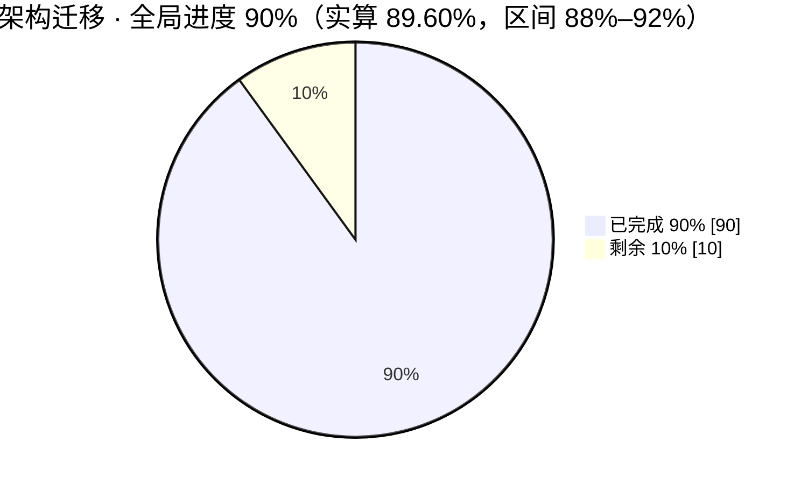

# 架构迁移 · 工作计划与进度总览

> **本文件用途**：`ARCHITECTURE_TARGET.md` 实施任务的**唯一状态总览**（整体情况与计划铺排），宏观 → 微观分层展开，每个任务有稳定编号；**只保留最新状态**，历史过程与明细不在本文件。
> **与流水台账的分工**：本文件（`documents/framework/refactoring/ARCHITECTURE_MIGRATION_STATUS.md`）= **全局情况/计划总览**（可反复改写、只反映当下）；`documents/framework/refactoring/ARCHITECTURE_MIGRATION_PROGRESS.md` = **任务执行明细进度记录**（统一实施流水台账，178 条切片交接记录，只追加不改写）。两者通过「锚点」列互相索引。
>
> **最后更新**：2026-10-31（第 5 批 W9/W5/W6/W7 收官 + W12 审计 + **W13 既有失败清零**） ｜ **更新人**：AI 会话（第 5 批：**W9 旧路径漂移清零**（docs/AGENTS.md 18 处旧路径改指新落点 + alerts.md 标题 token 耦合 8 条失败归零）、**W5.1–W5.7 七项全部落地**（analyzer 4849→4379、pipeline 3947→3732、registry 6954→372 + settings 3802→3254、system_config_service 5242→4328、image_stock_extractor Vision 端口化、notification 3063→2863、新建 `domain/portfolio/`）、**W6 schema 决策 + ADR-008 + AST 装配守卫**、**W7 安全不变量 15 条 + 启动/接口性能基线成文**；D3 50→**75%**、D5 85→**100%**、D6 95→**100%**，六维加权 83.85% → **89.60%**（显示 **90%**），切片 174→**175**，全量离线 20 failed/5692 passed → **6 failed/5706 passed**（修改的 14 条数量严格守恒）。**收官后提交前审计（新 W12，progress §0.172，切片 175→176）**：现场复核架构面全部归零项**均成立**（旧目录仅余 `src/core/__pycache__` 9 个 .pyc 与 `src/services/__init__.py` 兼容门面、行首锚定旧 import **0**、非 py 层残留 **0**、application/config 禁入 **0**）；AST 体检发现并删除 `Scheduler._refresh_daily_schedule_if_needed` **重复定义死代码**；**纠正 §0.171 的错误归因** —— 腾讯行情兜底用例失败在**测试 helper** 的 `str+bytes`（生产件正确），已修 → 全量离线 **5 failed / 5707 passed / 4 deselected（257.22s）**；W11 前端债务复测**未恶化**（lint 64 problems、build 26 个 `error TS`）；并澄清 12:25–12:27 的三笔 W8.1 提交已于 12:28 `git reset` 退回 `fe7410bb`（逐 blob 校验 1744 条目**磁盘缺失 0**）。第 4 批 W4.2 与 W4.5 均已收官。W4.2 已落 16 片并**整域收官**：alert／history／runtime／agent／decision／market／**analysis 七域归零**、application 侧 22 文件 **22 已收敛 / 余 0**，`src.storage` 已加入 application 禁入清单。本片收敛最后 1 文件 `analysis/pipeline.py`：构造期 `get_db()` 改为新增 `AnalysisPipelinePersistencePort`（10 方法逐项对齐宿主公开面），infra `DatabaseManagerPipelinePersistenceAdapter` 逐方法委托、由新增 `bootstrap/analysis.py:configure_analysis_pipeline_persistence()` 在 CLI／API／测试三入口注册；`SkillOpinionSampleService` 改由决策层仓储工厂取 `repo`（不再把持久化端口当 `db_manager`）；测试 re-point 17 处 `pipeline.get_db` patch 并补 6 条端口回归；D2 87.73→**88.00**（显示 **88%**）、六维加权 **83.80%→83.85%**（显示仍 84%；真实 84.0 差 0.15 点）；切片 172→**173**（W4.2）→**174**（W4.5）、全量 passed 5571→**5577**（W4.5 仍 5577，FAILED 集合与基线 IDENTICAL）。**W4.5 收官**：`src/config`（4 件）的 **5 条外层边全部物理收敛**（3 条 `src.infrastructure`：`settings.py` 模块级 `generation_params` + `:563/:577` 懒加载 `llm_adapter`；2 条 `data_provider`：`normalize_stock_code` 两处函数内）——别名→wire model 纯解析下沉 `src/domain/generation/wire_models.py`（单实现、`generation_params` 同名 re-import）、thinking/fallback 厂商规则改经既有 `GenerationRuntimePort` 新增 2 方法取用、`normalize_stock_code` 改由 `src.domain.market.stock_codes` 取，config 的 6 个薄委托与 infra import 全删；守卫新增 `src/config/` 专入规则（11 类禁入、`src.utils` 允许），`--check` RC=0 且 `import src.config` 后 infra/application/data_provider 前缀模块 **0 个**。D2 仍 **88.00**（已触顶）、六维仍 **83.85%**（W4.5 属守卫收紧与依赖收敛，不加权）。<br>W13 片当时基线：HEAD 仍 **`fe7410bb`**、零提交，工作树 **196 D / 297 M / 50 ??**（该「零提交」态已由下方 W14 结束）。**W13（progress §0.173，切片 176→177）**：W12 遗留的 5 条既有失败**全部归零**，离线基线首次转 **0 failed / 5713 passed**（固定序 250.86s + 随机序 264.16s 双跑全绿）；其中 `intelligence_service` 的顺序依赖根因是**生产缺陷**——`_get_with_validated_dns` 把模块级常量 `_DISABLE_REQUEST_PROXIES` **按引用**交给 `requests`，而 `requests/sessions.py:851` 在 `trust_env` 下会对传入 proxies 做 `setdefault` **就地写入**环境代理结果，使「非受信任源禁用代理」的 SSRF 边界失真 → 改为传副本并新增能反向验证的回归用例。**W14（提交落地片，progress §0.174，切片 177→178，详见 `refactoring/MIGRATION_COMMIT_PLAN.md` §7）**：916 项工作树变更已按方案切为 **9 笔提交**（`fe7410bb` → `7a97cd32`，入库 915 项，`build的问题清单.md` 已定不入库），终态 `./scripts/ci_gate.sh all` 全绿（**5713 passed / 4 deselected / 511 subtests，259.96s**）、守卫 `--check` RC=0；本轮未执行任何 push／tag／PR（推送由维护者手动完成）。
> **当前基线**：9 笔迁移提交已全部入库（`fe7410bb` → `7a97cd32`，末笔为守卫与工具链；其后只有本次文档回写提交）、工作树仅剩未跟踪的 `build的问题清单.md`（已定不入库）、守卫基线 `entries: []`
> ⚠️ **git 事实提醒（审计片取证，详见 progress §0.172）**：reflog 显示本日 12:25–12:27 曾产生三笔 W8.1 收尾提交（`a65181a8` 代码／`e69d9816` 文档／`911b4c34` 状态回写），**12:28 已被 `git reset` 退回 `fe7410bb`**，内容整体留在工作树（逐 blob 校验：**磁盘缺失 0**、内容一致 1691、reset 后又改 53 件）；**未 push、未建 tag、未建 PR**。提交时切勿只提交已跟踪文件——`scripts/check_architecture.py`、`src/{domain,application,infrastructure,bootstrap,config}/`、`documents/framework/refactoring/` 与新测试均为**未跟踪**态。

---

## 0. 一页总览（先看这里）

### 0.0 全局进度评估（图形化）

> **全局综合进度：90%（实算 89.60%，区间 88%–92%）** —— 以 `ARCHITECTURE_TARGET.md` 全量验收为分母（口径 B、六维度加权）。第 5 批一次性拉起 **+5.75 点**（D3 +3.75、D5 +1.50、D6 +0.50），**显示档由 84% 直接跨到 90%**（显示取整口径：加权值 ≥ 89.5 即显示 90%）；区间上界 92% 对应「D4 的 Docker/前端缺口被填平」，下界 88% 对应「D3 拆分只计落地、不计主体残余」。

<progress value="90" max="100"></progress> **90%**

`████████████████████████████████████████████████████████████████████████░░░░░░░░ 90%（实算 89.60%，区间 88%–92%）`



（两口径点估计与区间见 §0.2。）**到 100% 的关键路径**：五层主线 + 六维决策已全部收口 → **W8 提交与 PR（任务真正闭环，需授权）**→ 余下只有两类长期项：**D4 的 Docker 真实 build（daemon 未启）与前端 W11 债务**、**D3 深层拆分（已拆分件主体仍大）**。

**显示档 90% 由第 5 批直接跨入；剩余 10.40 点的构成已量化**：D1 1.25（六簇旧目录已删，余非 py 残留复核）+ D2 2.40（D2 已触顶 88%，需 `storage.py`/`auth.py` 本体迁入才可能再加）+ D3 3.75（本轮拆分只把 D3 推到 75%，analyzer 4379 / pipeline 3732 / system_config_service 4328 行的**主体**仍大）+ D4 3.00（Docker 真实 build 未跑、前端 lint/build 债务未清）+ D5 0 + D6 0。⚠️ 口径提醒：这些是**估算值**，不因单个文件行数下降自动增值；D5/D6 之所以记 100%，是因为本轮把所有待拍板项都转成了「已决 + 可复跑证据」，而非宣称代码完美。

### 0.1 任务定义

把 `src/` 从「按技术分层堆叠的历史目录」迁移到 `ARCHITECTURE_TARGET.md` 规定的五层结构：

```
src/domain/  src/application/  src/infrastructure/  src/bootstrap/  src/config/
```

三条硬约束（贯穿全程，未违反）：

| 约束 | 含义 | 执行方式 |
| --- | --- | --- |
| **零提交**（至 W13） | 所有改动留在工作树，HEAD 不变；**W14 已按既定收尾计划结束该约束**，将工作树切为 9 笔提交 | `git mv` + `git reset -q`（提交前）／`git reset --soft fe7410bb`（仅退本地） |
| **守卫必须绿** | 每片结束时架构守卫 0 违规 | `scripts/check_architecture.py --check` |
| **行为等价** | 迁移不改变运行时行为 | targeted pytest + 全量离线基线比对 |

### 0.2 进度快照（两个口径，含区间）

| 口径 | 点估计 | 区间 | 结论 |
| --- | --- | --- | --- |
| **A. `src/` 分层归位**（§3 目录 + §4 归属 + 守卫归零） | **95%** | 93%–97% | ✅ 主线已完成，待迁移件 **0** |
| **B. `ARCHITECTURE_TARGET.md` 全量验收**（§5/§6/§7/§9.2，加权综合＝全局） | **90%**（实算 89.60%） | 88%–92% | 🟢 第 1–5 批全部收官：清理（W2/W3）、验证证据（W1）、守卫盲区（W4.1/W4.3/W4.4/W4.5）、依赖倒置（W4.2 22/22）、**大件拆分（W5.1–W5.7）**、**决策收口（W6 ADR-008 + W7 安全/性能基线）**、**文档漂移（W9）** 均已闭环；剩余＝提交（W8）+ D4 的 Docker/前端缺口（W1.5/W11）+ D3 深层拆分 |

### 0.3 分维度完成度

| 维度 | 权重 | 完成度 | 主要依据 |
| --- | --- | --- | --- |
| D1 分层结构归位 | 25% | **95%** | 六簇旧目录已删；非 py 层旧路径引用 0 |
| D2 依赖倒置彻底性 | 20% | **88%** | api/bot 真实直连 0；✅ W4.1 已治理 `config → application` 4 条边（纯件下沉 domain + `src/domain/` 禁入清单补 `src.application` 守卫）；✅ **W4.2 收官：application 22/22 文件 0 `src.storage` import（alert 整域 + history 整域[read_model/comparison/loader] + runtime 整域[task_service] + agent 整域 8/8 + decision 整域 5/5 + market 整域 2/2 + analysis 整域 2/2[pipeline 经 `AnalysisPipelinePersistencePort`、analyzer 经 `GenerationUsagePort`]），`src.storage` 已加入 application 禁入清单（守卫实测 0 违规）**；✅ W4.3 infra→storage 门面方向复核已闭环（实测 18 文件、无运行时环、过渡性耦合归 ADR-004 长期项）；✅ **W4.5 收官：`src/config` 5 条外层边（infrastructure 3 + data_provider 2）全部物理收敛 → 0 边，并新增 `src/config/` 专入守卫规则（实测 0 违规、`import src.config` 零 infra/application 泄漏）；D2 已触顶 88%，不再加权**；📐 **折算依据**：82%→88% 目标区间按 22 文件线性分摊（6 点 / 22 文件），22/22 → **88.00%**（已达上限） |
| D3 文件内部职责拆分（§4.3） | 15% | **75%** | ✅ 第 5 批完成 §4.3 全部七项：`analyzer.py` 4849→**4379**（`domain/analysis/chip_rules` + `prompt_sanitizer`）、`pipeline.py` 3947→**3732**（`domain/analysis/pipeline_rules` 334 行）、`registry.py` 6954→**372** 且 `settings.py` 3802→**3254**（声明/帮助/解析拆 `field_definitions` 5457 + `field_help` 1157 + `env_parsers` 273 + `env_file` 289 + `llm_channels` 279）、`system_config_service.py` 5242→**4328**（`llm_config_validation` 972 行）、`image_stock_extractor` 收敛为 330 行用例 + `VisionCompletionPort`（68 行）+ `LitellmVisionAdapter`（73 行）、`notification.py` 3063→**2863**（`domain/notification/rendering` 325 行）、新建 `domain/portfolio/risk_rules`（139 行）。🟡 余 25% = 已拆分件的**主体仍大**（4379/3732/4328 行级） |
| D4 运行与联动验收（§7） | 20% | **85%** | ✅ 三入口真实进程 `/health` 200、空库/旧库实测、全量基线逐数字一致、**全路由 OpenAPI A/B 逐字节一致**；🟡 Web lint/build 已跑但**属前端既有债务**（非迁移回归）；🔴 Docker 真实 build 未跑（daemon 未启）、Electron 已砍 |
| D5 架构决策收口 | 10% | **100%** | ✅ D1–D5 + D-01~D-07 已决；✅ AT §9.2 五项全部处置（§9.2.1 已决表 5 行）；ADR-002~**008** 成文（W4.1 拆分口径入 ADR-007；W6 不引入版本化迁移框架入 **ADR-008**；W7 `auth.py` 不端口化入 ADR-005 复核段）；`documents/framework/security_performance_baseline.md` 沉淀认证/Cookie/CORS 取证 + 启动/接口阈值 + 未覆盖项 |
| D6 文档与治理 | 10% | **100%** | ✅ 台账三件套 + ADR 新建 + AT 陈旧单元格修复 + `pending-decisions` 回写；✅ **W9 清零**：docs/AGENTS.md 18 处旧路径改指五层新落点（仅留 1 处刻意保留的历史叙述），alerts.md 标题 token 耦合 8 条失败归零；✅ W7 新增框架文档 1 份 |

**加权综合 ≈ 90%（实算 89.60%）**（= 23.75 + **17.60** + **11.25** + 17 + **10.00** + **10.00**，即 D1 95×25% + **D2 88×20%** + **D3 75×15%** + D4 85×20% + **D5 100×10%** + **D6 100×10%**；70% → 73%（第 1 批）→ 81%（第 2 批）→ 83%（第 3 批）→ 83.25% → 83.45% → 83.65% → 83.74% → 83.80% → 83.85%（第 4 批 W4.2 收官）→ **89.60%（第 5 批 W9/W5/W6/W7，+5.75 点）**）。**W4.2 已无余量**（D2 触顶 88%）；当前天花板由 D3（75%）与 D4（85%）共同决定，要到 ≈ 95% 需 D3 → 87% 与 D4 → 95%（Docker 真实 build + 前端债务清零）；W8 提交后任务闭环但百分比不变（提交是闭环动作，不是能力增量）。

### 0.4 关键数字（实测，非估算）

| 项 | 值 |
| --- | --- |
| 工期 / 有快照的执行日 | 2026-10-24 ~ 10-31（8 天）／ 10-26 ~ 10-31（6 天） |
| 切片交接记录 | **178** 条 `## 0*` 标题（实测：序号 §0.1–§0.174 **连续无缺号** 174 个 + `§0.35a/35b/35c` 3 个分段标题 + 1 个 `## 0.` 总览标题；最新序号 **§0.174** = W14 提交执行片） |
| 分步任务（Epic） | **20** 个 |
| 开工/收官快照 | **201** 个 `~/hermesx*` 条目（185 文件 + 16 目录），逐片可回滚；每片开工快照含未跟踪文件与 `SET_EQUAL` 双向校验 |
| `src/` Python 文件总数 | **396**（第 5 批 +14：domain 60→**67**／application 166→**168**／infrastructure 108→**109**／config 4→**8**） |
| 四层落位件数 | domain **67** ／ application **168** ／ infrastructure **109** ／ bootstrap **25**（**33** 个 `configure_*` seam）／ config **8** |
| 已删除的旧目录 | `src/core` `src/schemas` `src/agent` `src/notification_sender` `src/llm` `src/repositories`（6 簇） |
| 根级 `src/*.py` | 21 → **4**（`__init__.py`／`auth.py` 500／`storage.py` 1049／`webui_frontend.py` 354） |
| 新增端口 | **20+** `ports.py`（按业务域就近放置） |
| 测试基线 | **0 failed / 5713 passed** / 4 deselected（`pytest tests -m "not network" -q -p no:randomly`，**250.86s**；另跑 pytest-randomly 默认随机序 **264.16s** 同样全绿，**W13 清零片值**）。演进：第 2 批 31 failed / 5537 passed → 第 4 批 31 failed / 5577 passed（+40 新增用例）→ 第 5 批 6 failed / 5706 passed（新增 115 用例 + 修好 14 条既有失败）→ W12 审计片 5 failed / 5707 passed（再修好 1 条）→ **W13 0 failed / 5713 passed**（修好余 5 条 + 新增 1 条 SSRF 代理回归用例）。**离线基线首次归零**。**已推翻的旧归因**：原记「`tencent_source.py` 内 `str + bytes` 生产缺陷」有误 —— 生产件正确，缺陷在测试 helper（W12 已修）。 |
| 第 2 批验证证据（2026-10-30） | 全路由 OpenAPI **153 paths / 239 schemas 与 HEAD 逐字节一致**；三入口 `/health` 200；空库 32 表/229 索引；旧库幂等；`apps/hrs-desktop/` 源码 0 改动；`./scripts/ci_gate.sh` **前 4 阶段全绿**（守卫 0 违规／严格 flake8 计数 0／py_compile／`test.sh`），第 5 阶段同既有基线 → RC=1 |

---

## 1. 编号体系（怎么读这份文档）

| 层级 | 前缀 | 含义 | 来源 |
| --- | --- | --- | --- |
| 整体任务 | **P0–P5** | 阶段，对应 `ARCHITECTURE_TARGET.md` §6 实施顺序 | 权威，不新造 |
| 分步任务 | **E1–E20** | Epic / 批次，一个可独立收官的搬迁簇 | 本文件 §2 |
| 子任务 | **E3.7** 式 | Epic 内的切片（= 一次开工快照 + 一条 progress 交接记录） | 本文件 §3 |
| 待执行工作项 | **W1–W11**（共 **43** 子项） | **未完成任务**的编号，后续计划与实时更新都用它；W9/W10/W11 为第 1–2 批取证时新增 | 本文件 §4 |
| 锚点 | `§0.120` / `S15b` / `R1-A6-3a` | progress 台账里的原始切片编号，用于回查细节 | 只读引用 |

状态图例：✅ 已完成 ｜ 🟡 部分完成（搬完但未收敛）｜ ⏳ 未开始（可直接执行）｜ ⛔ 未开始（需你先拍板/授权）｜ 🔴 阻塞或缺口

---

## 2. 整体任务 → 分步任务（中观视图）

> **口径说明**：本节 P0–P5 的完成度是**阶段估算**（用于排期与定位剩余量，按 Epic 数量/剩余阻塞项粗略折算），**不参与 §0.3 的六维加权**；全局进度一律以 §0.3 的 D1–D6 加权实算值为准。因此会出现「P2 显示 60% 但 E16/E17 已 ✅」这类不一致，原因是 P2 剩余全部压在需拍板的 W6 与 W4.2 尾部，而非 Epic 本身未完工。

### P0 · 事实与契约 —— ✅ 完成 95%

| Epic | 名称 | 片数 | 状态 | 剩余 |
| --- | --- | --- | --- | --- |
| **E1** | P0 事实勘察 + P1 共享装配（建 `bootstrap/`、写守卫、空基线） | 1（锚点 §0） | ✅ | 运行矩阵未成文 → **W2.5** |

### P1 · 共享装配 —— ✅ 完成 85%

| Epic | 名称 | 片数 | 状态 | 剩余 |
| --- | --- | --- | --- | --- |
| **E1** | 三入口共享装配（`main.py` 21 处／`server.py` 2／`webui.py` 2；`api/app.py:167` 走 `bootstrap.api_lifecycle.app_lifespan`） | 含于 E1 | ✅ | 真实进程 smoke 未跑 → **W1.2** |
| **E5** | §8-4「收紧守卫」基线归零（消 `sqlalchemy`/`fastapi` 直连） | 3（§0.30–0.32） | ✅ | 守卫盲区待补 → **W4** |

### P2 · 配置与持久化 —— 🟡 完成 60%

| Epic | 名称 | 片数 | 状态 | 剩余 |
| --- | --- | --- | --- | --- |
| **E2** | P2 配置包化 + 持久化基座/会话/schema/仓储拆分（`config` 四职责分件、`infrastructure/persistence/` 建立） | 10（§0.1–0.10） | ✅ | `config → application` 4 条边 → **W4.1 ✅ 已闭环**；schema 演进 → **W6 ✅ 已决**（不引入版本化迁移框架，ADR-008） |
| **E16** | 持久化收口 Epic（PP-1~PP-7：六域仓储端口化 + 物理下沉，删根 `src/repositories/`） | 7（§0.103–1.09） | ✅ | `src.storage` 门面直连残留 → **W4.3 ✅ 已复核**；**W4.2 余 8 文件（已收敛 14/22）** |
| **E17** | R2-A 生成链路归位（`src/llm/` → `infrastructure/generation/`，删过渡 shim） | 1（§0.110） | ✅ | 无 |

### P3 · 纵向用例 —— ✅ 完成 88%

| Epic | 名称 | 片数 | 状态 | 剩余 |
| --- | --- | --- | --- | --- |
| **E3** | P3 切片 1–14（14 个端点/机器人逐个净化，api/bot 直连清零、`src→bot` 反向依赖清零、跨层私有访问清零） | 14（§0.11–0.24） | ✅ | 契约证据仅早期 watchlist 9 路由 → **W1.1** |
| **E4** | P3 前置批次 P3–P6 + 文档漂移修正（通知/组合风险/报告转图片/LLM 渠道） | 5（§0.25–0.29） | ✅ | 无 |
| **E6** | 回测 · 领域 DTO 下沉 Epic（建 `domain/backtest/`、读写路径去 ORM、端口+DI） | 5（§0.33–0.37） | ✅ | 无 |
| **E7** | `market_light` 分层 + 仓储端口化 | 2（§0.38–0.39） | ✅ | 无 |
| **E8** | domain 首批 6 个纯函数/规则下沉 | 6（§0.40–0.45） | ✅ | 无（`domain/portfolio/` 已由 **W5.7** 建立） |
| **E9** | 告警 Epic（B 线 B0–B4e：`AlertService`+`AlertWorker` 入 `application/alert/`） | 9（§0.46–0.54） | ✅ | 无 |
| **E10** | history Epic（H 线 H0–H3c：comparison/read_model/loader） | 7（§0.55–0.61） | ✅ | 无 |
| **E11** | runtime + market 直搬清扫（R/M 线 R0–R5） | 7（§0.62–0.68） | ✅ | 无 |
| **E12** | decision Epic（D 线 D0–D5） | 5（§0.69–0.73） | ✅ | 无 |
| **E13** | services S 线（quote/portfolio 域 9 件，补 5 类端口） | 9（§0.74–0.82） | ✅ | `src/services/__init__.py` 兼容面待删 → **W3.1** |
| **E14** | T 线（analysis/intelligence/reporting/system_config，含 alphasift、system_config 的 §4.3 拆分） | 11（§0.83–0.93） | ✅ | `image_stock_extractor` Vision 端口化 → **W5.5 ✅** |
| **E15** | P 线（notification 过渡／analyzer 端口化+直搬／search 四片含 Provider 下沉 infra） | 9（§0.94–1.02） | ✅ | `analyzer.py` 4849→**4379** / `pipeline.py` 3947→**3732** → **W5.1/W5.2 ✅** |

### P4 · 外部适配 —— ✅ 完成 90%

| Epic | 名称 | 片数 | 状态 | 剩余 |
| --- | --- | --- | --- | --- |
| **E18** | R2-B 通知簇（死码清理、纯规则下沉 domain、**解 14-mixin 继承→组合**、bot 回执窄端口、sender 物理搬 `infrastructure/notification/senders/`） | 8（§0.111–1.18） | ✅ | 渲染编排已下沉 `domain/notification/rendering`（3063→**2863**）→ **W5.6 ✅** |
| **E19** | R1 Agent Epic（`src/agent/` 56 件分 7 片全部归位，旧包删除 + docs 活路径回写） | 9（§0.119–1.27） | ✅ | 无 |
| **E20** | R3 Epic（core + schemas + 根级 21 件逐个下沉；含 md2img/feishu 等适配归位） | 21（§0.128–1.48） | ✅ | 见 P5 |

### P5 · 收口 —— 🟡 完成 90%（**后续工作＝W8 提交（需授权）**）

| 工作项 | 内容 | 状态 |
| --- | --- | --- |
| E20 末片 | 终态盘点 + 活文档对齐 + 守卫复核（§0.148） | ✅ |
| 旧路径引用 | 非 py 层（sh/yml/Dockerfile/ps1/spec/toml/json）残留 **0** | ✅ |
| 旧模块清理 | `src/services/__init__.py`（改判不删）、`src/UNKNOWN.egg-info`、`__pycache__` 残留 | ✅ **W3**（仅 `src/core/__pycache__` 9 个 `.pyc` 因工具限制未清） |
| 守卫收紧 | ✅ `src.storage` 已入 application 禁入清单（W4.2）；✅ `src/config/` 已有专入规则（W4.5：禁 11 类外层依赖、实测 0 违规） | ✅ **W4** |
| §7 验证矩阵 | Web / 进程 / 数据库 / Docker / Desktop 五项 | ✅ **W1**（Docker 真实 build 待补、Desktop 已砍） |
| ADR 与 §9.2 回写 | 已沉淀 ADR-002~007；AT §9.2 已回写 3 项已决 / 2 项未决 | ✅ **W2**（W4 补 ADR-007） |
| 提交与 PR | **174** 片改动仍悬在工作树 | ⛔ **W8**（需你授权） |

### 7 天执行节奏（供回顾「到底做了什么」）

| 日期 | 快照数 | 当天主要推进 |
| --- | --- | --- |
| 10-24 ~ 10-25 | — | 目标文档核对、P0 事实勘察、切片方案（纯分析，无代码） |
| 10-26 | 30 | E1（P0/P1 装配 + 守卫）+ E2 前段 |
| 10-27 | 29 | E3（P3 十四片：API/Bot 直连清零） |
| 10-28 | 12 | E5 守卫基线归零 + E6 回测 DTO Epic |
| 10-29 | 52 | E9 告警 / E10 history / E11 R·M / E12 decision / E13 S / E14 T / E15 P / E16 PP / E17 R2-A / E18 R2-B / E19 R1（强度最高） |
| 10-30 | 35 | E20 R3 S1–S16 + R3 收口（§0.148）；随后连做第 1–4 批：W2/W3 文档清理 → W1 验证矩阵 → W4.1/W4.4 守卫 → W4.3 复核 → W4.2 逐域 12 片（§0.154–§0.165） |

---

## 3. 子任务粒度索引（微观，已收官部分）

已收官 Epic 的子任务不在此逐条重列（流水见 progress 台账，共 169 条交接记录），此处给出**每组锚点范围 + 收官判据**，便于抽查：

| Epic | 子任务编号范围 | 片数 | 每片统一收尾动作 |
| --- | --- | --- | --- |
| E1 | §0 | 1 | 建目录 + 守卫落地 + baseline 空 |
| E2 | §0.1 – §0.10 | 10 | 快照 → mv → 守卫 → compile → targeted → 全量基线 → 台账 → CHANGELOG |
| E3 | §0.11 – §0.24 | 14 | 同上 |
| E4 | §0.25 – §0.29 | 5 | 同上 |
| E5 | §0.30 – §0.32 | 3 | 基线条目递减直至归零 |
| E6 | §0.33 – §0.37（含 0.35a/b/c） | 5 | ORM 引用逐片清零 |
| E7 | §0.38 – §0.39 | 2 | 端口 + DI |
| E8 | §0.40 – §0.45 | 6 | 纯函数下沉 domain，零行为改动 |
| E9 | §0.46 – §0.54 | 9 | 勘察 → 前置整改 → 搬包 |
| E10 | §0.55 – §0.61 | 7 | 同上 |
| E11 | §0.62 – §0.68 | 7 | 直搬优先，深耦合回退 |
| E12 | §0.69 – §0.73 | 5 | 私有收口 → Protocol → 端口化 → 搬包 |
| E13 | §0.74 – §0.82 | 9 | 逐件搬包 + 补端口 |
| E14 | §0.83 – §0.93 | 11 | 含两组 §4.3 拆分（alphasift、system_config） |
| E15 | §0.94 – §1.02 | 9 | search Epic 四片逐步下沉 |
| E16 | §0.103 – §0.109 | 7 | 六域仓储端口化 + 物理下沉 |
| E17 | §0.110 | 1 | 删过渡 shim |
| E18 | §0.111 – §0.118 | 8 | 解继承 → 端口化 → 物理搬层 |
| E19 | §0.119 – §0.127 | 9 | A1–A7 分片，含 agent_backend/factory 拆分 |
| E20 | §0.128 – §0.148 | 21 | S1–S16 + 收口；含 S15a/S15b/S15c 拆分 |

> **粒度说明**：单片多为「搬 1 个文件 + 补 1 个端口」，视觉冲击极小，累计效应是 376 个 py 文件重排。**这是你对进度感知差的客观原因之一**（另两个：零提交使 `git log` 无进展、§7 验证证据欠账集中在末尾）。

---

## 4. 待完成任务分解（W 系列 —— 后续实时更新都用这些编号）

难度标：**S**=简单（零代码/低风险，<30 分钟）｜ **M**=中（局部代码改动，需回归）｜ **L**=难（结构重构，砸 `patch()` 锚点）

待办系列现为 **W1–W11**（W1–W7／W9／W10 已完成；**W8 提交需授权**；W11 属前端专项、需另开任务）。

### ✅ W1 · 补齐 §7 验证矩阵（**2026-10-30 第 2 批完成；D4 45% → 85%**）

| 编号 | 子任务 | 命令/做法 | 难度 | 状态 |
| --- | --- | --- | --- | --- |
| W1.1 | Web 前端构建与 lint | `cd apps/hrs-web && npm ci && npm run lint && npm run build`（npm 10.9.2 可用） | S | 🔴 **已跑、失败但非迁移引入**：lint RC=1（64 problems：58 errors/6 warnings）、build RC=2（26 TS 错误 / 20 个文件）；逐个核对 20 个报错文件**全部为 HEAD 未改动**，本工作树在 hrs-web 仅 2 件（`settingsHelp.ts`+573／`systemConfigI18n.ts`+56）且均不在错误清单 → **前端既有债务**，开新待办见 W11 |
| W1.2 | 三入口真实进程 smoke | `main.py --dry-run`、`uvicorn server:app` 启动 + `/health`、`webui.py` 起服务 | S | ✅ `main.py --serve-only`(8891)、`uvicorn server:app`(8892)、`webui.py`(8893) 均 `/health` **200**；均带 `DATABASE_PATH` 指向副本库。踩坑：`webui.py` 只读 `.env` 的 `WEBUI_PORT`（不读 `--port`），而 8000 已被用户常驻服务占用，需环境变量覆盖 |
| W1.3 | 空库创建实测 | 临时空库跑 `Base.metadata.create_all`，比对表/索引清单 | S | ✅ 32 表 → 实建 **32 表 / 229 索引**，`MISSING=[]` `EXTRA=[]`；同时证明 `DATABASE_PATH` 覆盖真实生效 |
| W1.4 | 旧库升级实测 | 复制 `data/stock_analysis.db`（24.8 MB）到临时路径，启动后比对 schema diff | M | ✅ 幂等（32 表/229 索引/列定义/14762 行零变化）；✅ 删 2 表自动重建；🔴 **新风险实证**：删非 `_ensure_*` 白名单的列（`agent_provider_turns.messages_json`）**不自动补回**（14→13）→ 已归入 W6.1 |
| W1.5 | Docker 构建 smoke | `docker build`（Docker 29.8.2 可用）+ 关键模块 import 冒烟 | M | 🔴 **本机 daemon 未运行** → 真实 build 未跑；替代取证：CI `docker-build` 同款 **8 条 smoke import 全过** + Dockerfile/compose/entrypoint 旧模块路径 **0 残留**；待启 Docker 后补跑或由 CI 阻断项覆盖 |
| W1.6 | 全量离线测试基线留档 | `python -m pytest -m "not network"`，逐条比对 31 failed / 10 errors 是否为既有基线 | S | ✅ **31 failed / 5537 passed / 4 deselected / 10 errors**（296.54s）与 R3-S16 基线逐数字一致；FAILED 分布 12 文件（intelligence_api 10、alerts_docs 8 即 W9.2、其余分散），10 个 ERROR 全在 `apps/hrs-web/scripts/test_wt/*` |
| W1.7 | Electron 桌面端打包 | 先 W1.1 出 Web 产物，再 `apps/hrs-desktop` build | L | ⛔ **经用户同意砍掉**：实测 `apps/hrs-desktop/` 本次 **0 改动**，以 W1.1 + W1.5 import smoke + ADR-006 hidden-import 清单核对替代，记为未验证项 |
| W1.8 | API 契约 A/B 复做 | 对全部路由（不只早期 watchlist 9 条）做 OpenAPI diff | M | ✅ **153 paths / 239 schemas 逐字节 IDENTICAL**（`git worktree` 取 HEAD 真基线跑同一脚本后 `cmp`；路径集/方法面/schema 名集/字段集四项全 True）；临时 worktree 已回收，未污染 `git status` |

### ⏳ W2 · 文档收口（**全是 S，建议今天就清掉**）

| 编号 | 子任务 | 位置 | 难度 | 状态 |
| --- | --- | --- | --- | --- |
| W2.1 | 修 §4.3 陈旧单元格（仍写「解继承端口化留 P4」，实况 `class NotificationService:` 已无 mixin） | `ARCHITECTURE_TARGET.md:256` | S | ✅ 已换为「终态（2026-10-30）」块（R2-B3 解继承 + R2-B5 物理迁目录 + R3-S11 补端口），并保留仍余 3063 行模板渲染未分离的长期项 |
| W2.2 | 回写 §9.2 已决项（进程模型 = 单进程假设见 progress §1 D5；`data_provider` 原位例外；守卫工具已落地） | `ARCHITECTURE_TARGET.md` §9.2 | S | ✅ 2/3/4 转新增的「9.2.1 已决」表（附证据与 ADR 交叉引用），原列表项标【已决 → 见 9.2.1】；1（schema 版本化）／5（安全性能基线）保留未决 |
| W2.3 | 建 ADR 目录并沉淀 4 条长期决策（端口就近放置／`data_provider` 原位／`storage.py` 门面例外及其移除条件／`auth.py` D-06 落法 A） | ~~`documents/framework/adr/`~~ | S | ✅ **落法修正**：取证发现 ADR-001 已在 `backend_architecture_adr.md`（686 行），**不建平行 `adr/` 目录**；新建 `documents/framework/architecture_migration_adr.md` 承载 **ADR-002~006（5 条，含 services 兼容面）** |
| W2.4 | 回写 `pending-decisions` 的 D-01（推荐「下沉 domain」≠ 实际落地「端口 seam」） | `.claude/reviews/`（本地产物，不入库） | S | ✅ 已回写实测落点表：`should_persist_usage_telemetry` 走端口 seam（`UsageTelemetryPort`），`resolve_litellm_wire_model` 走 config 薄委托（`a is b = False`），与推荐选项 A 不一致已明写 |
| W2.5 | 修 progress §0.148 措辞（「3 文档改」实为 4 份）+ 补运行矩阵成文 | `architecture_migration_progress.md` | S | ✅ 前半：§0.148 追加「计数与残留更正」（3→4 文档、③ 残留结论被本批推翻）；后半：**「补运行矩阵」是伪需求** —— 复核发现 progress §2 已有 8 入口完整矩阵，本行原判有误 |
| W2.6 | 本文件首次入库评估（根目录长期文档需符合 AGENTS.md 证据留存规则） | 本文件 | S | ✅ 结论：**可入库** —— 属长期进度视图而非过程截图/一次性验收证据，文件名与正文不绑定 issue/PR 编号，与 `ARCHITECTURE_TARGET.md` 同类 |

### ⏳ W3 · P5 清理尾巴（**S，可一批做完**）

| 编号 | 子任务 | 依据/风险 | 难度 | 状态 |
| --- | --- | --- | --- | --- |
| W3.1 | 删 `src/services/__init__.py` 兼容面 → **改判：不删，成文例外 + 删除前置条件** | 🔴 原判「阻力小」**有误**：`scripts/build-backend-macos.sh:94` 与 `scripts/build-backend.ps1:110` 的 PyInstaller `--hidden-import` 仍引用该模块，且 `decisions-2026-10-28-r2a.md` 早记「保留为兼容面」→ 删除属高风险启动链路，不入纯收口批次。结论见 **ADR-006**，前置条件写入 AT §4.5 | S | ✅ |
| W3.2 | 清 `src/UNKNOWN.egg-info` | AT §3 点名的「唯一已确认可在实施时清理的构建残留」 | S | ✅ 已删（4 件 + 目录）；git-ignored、可再生 |
| W3.3 | 清 `src/core/`、`src/repositories/` 的 `__pycache__` 磁盘残留 | 目录语义已归零 | S | 🔴 **部分完成**：`src/repositories/` 空目录已删；`src/core/__pycache__` 9 个 `.pyc` 因删除工具静默失败（报成功但文件仍在）未清。实测无影响：git-ignored、`src.core` 仅作 PEP 420 空命名空间包解析、`src.core.pipeline` `ModuleNotFoundError` |
| W3.4 | 复核并保留 tombstone 守卫规则（`src/core/`、`src/services/` 两条**刻意不删**） | 旧路径复活即拦截 | S | ✅ 只读复核结论已成文（ADR-006）：`baseline.entries` 仍为 `[]`；`tests/test_check_architecture.py` 用合成工作区自测、不断言 `RULES` 列表，保留 tombstone 不造成测试与规则双源 |
| W3.5 | `src/utils`(8)／`src/data`(3)／`src/patches`(2)／`src/brokers`(1) 归位或成文例外 | AT §4 允许跨期保留 → 二选一，建议成文 | S | ✅ 复核发现 **AT §4 L205 与 §4.5 L289 留存项表已于 R3 §0.148 成文**（四簇行数 8/3/2/1 + 保留理由），本批仅交叉引用 ADR-003/005，无新增改动 |

### ✅ W4 · 守卫盲区与依赖倒置收敛（**M→L，D2 75% → 82%（W4.1）→ 88%（W4.2 22/22 收官）**；W4.3／W4.5 已闭环）

> **第 4 批进度（2026-10-30 ~ 10-31）**：W4.3（infra→storage 门面方向复核）已闭环（复核结论、零代码）。经实测复核，**W4.2**（22 文件跨 8 域、service 内 ad-hoc `get_db()`/`DatabaseManager()` 直连，且测试 28 处 patch 目标）与 **W4.5**（config→infrastructure 3 条边：`settings.py:76` 模块级 `generation_params` + `:563/:577` 懒加载 `llm_adapter`，非纯常量）体量均**大于原 M 估、需按域拆多切片**，不再单会话强收（详见 §5 与 progress §0.153）。**W4.2 已开首个域切片**（progress §0.154）：alert 域将遗留 `AlertService.self.db` 跨域直连改为注入现成 `HistoryRepositoryPort`（复用 `bootstrap/history.py` 同一范式：`DatabaseManager` 作适配器），`src/application/alert/` 现 **0 storage import**、全量离线 0 回归。**W4.2 第 2 片（progress §0.155）再收敛 market/daily_market_context**：将 `DailyMarketContextService.self.db` 单一 `get_analysis_history` 直连改注入同一 `HistoryRepositoryPort`，re-point 生产 3 点（pipeline/main×2）+ 测试 32 点（28 构造 + 4 断言）；`application/market` 域内 market_review 函数内懒加载（2 处）仍在、域未归零，全量离线 0 回归。**W4.2 第 3 片（progress §0.156）再收敛 history/read_model（HistoryService）**：其 7 个 `self.db` 读方法（分页/详情/删除/新闻等）全部命中现成 `HistoryRepositoryPort`，生产 service.py 早已按位置传仓储，故仅去 `DatabaseManager.get_instance()` 默认、字段 `self.db`→`self.history_repo`、import 改端口（生产无裸构造、2 处测试裸调仅访问不触库的 `_generate_single_stock_markdown`），re-point 仅 2 处关键字测试构造、余位置参自动兼容；history 域未归零（余 comparison/loader 2 件函数级懒加载需 seam），全量离线 0 回归。**W4.2 第 4 片（progress §0.157）收敛 history/comparison + loader，history 整域归零**：两件均为模块级函数直连（`get_instance()`/`get_db()`），沿用 loader 既有 `set_history_daily_bar_fetcher` 模块 seam 范式各加历史仓储/K 线 seam + setter，由 `bootstrap/history.py:configure_history_loader`（main 启动块 + api_lifespan 双入口幂等调用）用 `DatabaseManager` 门面装配适配器；comparison 唯一生产调用方 notification 已包 try/except、loader DB 主路本在 try/except 内降级，行为与旧取数同一对象一致。re-point 测试 patch 目标 14 处（test_history_loader 6 + test_data_tools_daily_history_cache 8：`src.storage.get_db`→seam getter；首轮全量 +4 回归即此 patch 盲区，补改回基线）。两件现 0 storage import，history 域全部归零，全量离线 0 回归。**W4.2 第 5 片（progress §0.158）收敛 runtime/task_service**：其唯一 storage 耦合为 `get_analysis_history` 方法内 1 处 `get_db()`（只读、命中 `HistoryRepositoryPort`），无 `self.db`、无外部调用方、无测试 patch 该源符号（与上片 patch 盲区相反、更干净）→ 沿用模块 seam 范式加 `_get_history_repo` seam + `set_history_repo`，新建 `bootstrap/runtime.py:configure_task_service`（main 启动块 + api_lifespan 双入口幂等）以 `DatabaseManager` 门面装配，补 2 处 seam 回归测试；task_service 现 0 storage import、**runtime 域整域归零**（继 alert、history 后第三个）。**W4.2 第 6 片（progress §0.159）开 agent 域：收敛 memory/AgentMemory.get_stock_history**——其唯一 storage 耦合为函数内懒加载 `get_db` + 1 处只读 `get_analysis_history`（命中 `HistoryRepositoryPort`、且在 try/except 内 → seam 未装配降级为 `[]`、比 task_service 更安全），沿用模块 seam 加 `_history_repo`，由既有 `bootstrap/agent.py:configure_agent_memory`（复用同文件 DatabaseManager、非新文件）双入口幂等装配门面；片前全仓扫 `src.storage.get_db` patch 消费点、re-point `test_multi_agent.py` 唯一处 + 补 bootstrap 装配测试，未复现上片 +4 盲区。memory 现 0 storage import、agent 域 opener 1/8（域未归零、余 7 件多为写/`persist_llm_usage`/`db_factory`）。**W4.2 第 7 片（progress §0.160）续 agent 域：收敛 provider_trace/persist_provider_trace_turns**——其唯一 storage 耦合为 `db_factory is None` 回退分支内懒加载 `from src.storage import get_db`（作默认取库工厂、消费方 `chat_executor` 依赖此回退路径），`get_db()` 即返回 `DatabaseManager.get_instance()` 单例、与门面适配器逐字等价；沿用模块 seam 加 `_default_db_factory` + `set_default_db_factory`/`_get_default_db_factory`、回退分支改取 seam，由 `bootstrap/agent.py:configure_provider_trace` 双入口幂等装配 `DatabaseManager.get_instance` 作默认工厂（executor 等显式传 `db_factory` 的调用方不受影响），片前全仓扫无测试 patch 该回退源符号、补 seam 消费/fail-open/bootstrap 装配 4 处测试；provider_trace 现 0 storage import、agent 域 2/8。**W4.2 第 8 片（progress §0.161）续 agent 域：收敛 executor/`AgentExecutor._persist_provider_trace`**——其唯一 storage 耦合为顶层 `from src.storage import get_db`、仅作用是把 `db_factory=get_db` 显式传入 `persist_provider_trace_turns`；第 7 片已为 provider_trace 装配默认 db_factory seam（= `DatabaseManager.get_instance`、与 `get_db` 逐字等价），且 `chat_executor` 早已省略 `db_factory` 依赖该默认 → executor 显式传参属冗余，直接删顶层 import 与入参、令其与 chat_executor 一致复用默认 seam（生产经 `configure_provider_trace` 装配后取库对象等价、0 行为变化，bootstrap seam/文件数不变）。片前全仓扫 `patch("src.application.agent.executor.get_db")` 仅 `test_agent_executor.py` 1 处（fail-open 用例）：连同真实持久化用例一并把 patch/接线目标 re-point 到 `src.application.agent.provider_trace._get_default_db_factory`（`return_value=lambda: db`）、无需改生产语义；另校正 `bootstrap/agent.py:configure_provider_trace` docstring 示例。executor 现 0 storage import、agent 域 3/8。**W4.2 第 9 片（progress §0.162）续 agent 域：收敛 agent/tools 两件（`search_tools.py` + `data_tools.py`）**——两件各含模块级 `_get_db()` wrapper（`from src.storage import get_db; return get_db()`），分别被 `save_news_intel` 写、`save_daily_data` 写 + `get_analysis_context` 读使用；沿用模块 seam 范式把 wrapper 体改为模块级 `_db_factory` + `set_db_factory()`（`_get_db()` 返回装配工厂产物），由新建 `bootstrap/agent.py:configure_tools_db` 双入口（main/api_lifespan）装配 `DatabaseManager.get_instance`。**关键补充**：tools 在 `CodexToolProcessRunner` 的 spawn 子进程内执行、不经过进程级 bootstrap（子进程刻意 fresh import 以免继承父库连接），故 `infrastructure/agent_runtime/codex_tool_process.py:_execute_registered_tool` 在子进程内亦装配两 tools seam（infra→storage/application 守卫允许）——否则 `get_analysis_context` 无守护读路径会因 seam=None 崩溃（首轮全量 +1 回归即此、子进程补齐后归零）；两件测试均 patch wrapper `_get_db` 本身（search 5 / data 4 + 1 monkeypatch），无需 re-point。两件现 0 storage import、agent 域 5/8。**W4.2 第 10 片（progress §0.163）续 agent 域：收敛 conversation（`ConversationSession` 对话消息读写）**——其顶层 `from src.storage import get_db` 仅用于 `add_message → save_conversation_message`（写）与 `get_history → get_conversation_history`（读）两处，无 try/except；两方法在现成 `ConversationRepository` 中签名与默认值逐字一致，故新增窄端口 `ConversationMessagePort`（`application/agent/ports.py`）并把会话对象改为模块级 `_conversation_port` seam + `set_conversation_port()`，由新建 `bootstrap/agent.py:configure_agent_conversation()` 双入口（main/api_lifespan）以 `ConversationRepository(DatabaseManager.get_instance())` 装配。测试影响面：`test_conversation_manager` 已 patch `ConversationSession.add_message`、`test_ask_command` patch 整个 `conversation_manager`，均不触 seam；但 2 个依赖真实落库的集成用例（`test_agent_executor::test_chat_persists_single_provider_trace_and_reinjects_without_duplication`、`test_multi_agent::test_chat_does_not_read_or_write_provider_trace`）原先靠 `get_db()` 直连落库，改为测试内 `patch("...conversation._conversation_port", db)` 接线（同 §0.161 先例）。conversation 现 0 storage import、agent 域 6/8。累计 12/22 文件收敛；余 10 文件（agent 2/decision 5/analysis 2/market 1，history/runtime/backtest 域已归零）待推进。**W4.2 第 11 片（progress §0.164）续 agent 域：收敛 chat_context（对话上下文读写 + 用量遥测写入）**——其顶层 `from src.storage import get_db, persist_llm_usage` 覆盖 3 处读（`get_agent_provider_turns` / `get_conversation_summary` / `get_visible_conversation_messages`）+ 1 处写（压缩摘要 `upsert_conversation_summary`）+ 1 处用量落库；4 处库操作在现成 `ConversationRepository` 中签名与默认值逐字一致（`inspect.signature` 实测）→ 新增窄端口 `ChatContextPort`（`application/agent/ports.py`，读 3 + 写 1），chat_context 改模块级 `_chat_context_port` seam + `set_chat_context_port()`；因同一仓储对象同时满足上一片的 `ConversationMessagePort`，故复用 `bootstrap/agent.py:configure_agent_conversation()` 一并装配（双入口 main/api_lifespan 已存在、bootstrap 件数与 `configure_*` seam 数不变）。`persist_llm_usage` 不给 application 开写通道，而是把既有 `UsageTelemetryPort` 由「只判定」扩为「判定 + 写入」（新增 `persist()`），infra `UsageTelemetryAdapter.persist` 委托 `src.storage`，chat_context 改调 `_usage_telemetry_port.persist(...)`——`configure_usage_telemetry` 已装配同一适配器实例，写侧随对象自动可用、无需新装配点。**踩坑（端口声明落后于真实调用点）**：首版把端口命名 `ChatContextReadPort` 且只声明 3 个读方法，但同一端口对象实际还被用于 `upsert_conversation_summary` 写摘要 → 属契约漂移；改名为 `ChatContextPort` 并补写侧方法，同时新增参数化用例 `test_port_protocol_is_satisfied_by_conversation_repository`：用 `inspect.signature` 逐方法比对 Protocol 与 `ConversationRepository` 的参数 name/kind/default（忽略注解），把「端口声明必须覆盖全部真实调用点」固化为回归守卫。**测试影响面**：`test_chat_context.py:_reset_db()` 由传 `DatabaseManager` 裸实例改为传 `ConversationRepository(db)`（与生产同一适配器，避免测试绕过真实仓储）；`test_agent_executor.py` / `test_multi_agent.py` 的落库集成接线同步改传 `ConversationRepository(db)`；两条 orchestrator 落库用例（`test_chat_persists_user_and_assistant_messages` / `test_chat_persists_failure_message`）改为 patch `orchestrator.build_visible_chat_history` 返回 `[]`（与同文件同类用例一致，不再依赖全局库读空历史）。新增 5 用例（chat_context seam roundtrip／可见消息读侧消费／两端口协议一致性 ×2／adapter `persist` 委托 storage）。chat_context 现 0 storage import、agent 域 7/8。累计 13/22 文件收敛；余 9 文件（agent 1[runner]/decision 5/analysis 2/market 1，history/runtime/backtest 域已归零）待推进。**W4.2 第 12 片（progress §0.165）agent 收官：收敛 runner（主循环用量遥测写入）**——其唯一 storage 耦合为顶层 `from src.storage import persist_llm_usage as _persist_usage`、单点用于 agent 主循环单步 LLM 调用后（L482–483，受既有 `_should_persist_usage_telemetry` 保护）；上一片已把 `UsageTelemetryPort` 扩为「判定 + 写入」且 `configure_usage_telemetry` 已把同一 `UsageTelemetryAdapter` 实例注入 runner 与 chat_context 两个 seam → 本片属**消费者追平**：删顶层 import、`_persist_usage(...)` 改 `_usage_telemetry_port.persist(...)`（参数形态逐字不变）；`port is None` 时由 `_should_persist_usage_telemetry()` 返回 `False` 提前短路，不会 NPE。测试：`test_agent_executor.py` 4 处 `patch("...runner._persist_usage")` 随符号删除失效 → re-point 为 `as usage_port` + `patch.object(usage_port, "persist")`；另新增 1 条回归用例 `test_run_agent_loop_skips_usage_persist_when_telemetry_port_unwired`（port=None 不崩、`total_tokens` 正常、`src.storage.persist_llm_usage` 零调用），锁住「未装配即静默跳过、不回退直连 storage」契约；**不采用**保留 storage 兜底 import 的写法（会拉回 application→storage）。未改 bootstrap/main/api_lifecycle（bootstrap 25 件 / 31 seam 不变）。runner 现 0 storage import、**agent 域整域归零 8/8**（继 alert、history、runtime 后第四个）。累计 14/22 文件收敛；余 8 文件（decision 5/analysis 2/market 1）待推进。**W4.2 第 13 片（progress §0.166）decision 域收官：收敛 5 件（`decision_signal_service` / `decision_signal_reassess_service` / `skill_opinion_sample_service` / `skill_opinion_outcome_service` / `decision_signal_outcome_service`）**——前两件的 storage 耦合都只消费 `get_analysis_history_by_id` 单读方法，直接改注入现成 `HistoryRepositoryPort`（`self.db`→`self.history_repo`、优先级链逐字保留：显式句柄 → 仓储自带 `db` → bootstrap 默认来源），惰性回填在 `None` 时 debug 跳过（不让 `AttributeError` 落到既有宽 `except`）；后三件的 storage import 仅为类型注解服务（`db_manager` 只喂给既有仓储工厂），去 import + 注解放宽 `Optional[Any]`、运行时零变化；为前两件在 `application/decision/ports.py` 新增域级默认来源 seam（可调用工厂，适配 `DatabaseManager.reset_instance()`），由既有 `bootstrap/decision.py:configure_decision_repositories` 双入口追加装配（**bootstrap 25 件 / 31 seam 不变**）。**自查修正一处语义漂移**：reassess 首版内层构造漏传 `db_manager=db`（收敛前为 `DecisionSignalService(db_manager=self.db)`），已补回并以用例断言 `signal_service.repo.db is isolated_db` 锁死；另追加 7 条装配契约回归。5 件现 0 storage import、**decision 域 storage 直连归零**。**W4.2 第 14 片（progress §0.167）续 analysis 域：收敛 analyzer 用量遥测写侧**——`src/application/analysis/analyzer.py` 两处 `persist_llm_usage(...)`（`generate_text` 的 `market_review` 与 `analyze` 的 `analysis` + `stock_code`）直接复用既有 `_generation_usage_port` seam：把 `GenerationUsagePort`（`application/generation/runtime_ports.py`）由「判定」扩为「判定 + 写入」（新增 `persist(usage, model, *, call_type, stock_code=None)`），infra `GenerationUsageAdapter.persist` 委托 `src.storage`，调用点改为 `usage_port.persist(...)`、`should_persist` 守卫与参数形态逐字不变 → **零新装配点**（`configure_generation_runtime()` 既有装配、bootstrap 25 件 / 31 seam 不变）。测试侧 `test_market_analyzer_generate_text.py` 7 处 `patch("...analyzer.persist_llm_usage")` 随符号删除失效 → 统一改 `patch.object(_usage_port(), "persist")`（`_usage_port()` 取已装配端口、保留真实 `should_persist` 判定），并新增 2 条回归（adapter `persist` 委托 storage 且 `call_type`/`stock_code` 透传、analyzer 源码 0 `from src.storage` 且无兼容符号）。analyzer 现 0 storage import。累计 **20/22** 文件收敛；余 **2** 文件（analysis 1 = `pipeline.py` 多方法取库消费面 / market 1 = `market_review.py` 复盘历史落库）待推进。**W4.2 第 15 片（progress §0.168）market 域收官：收敛 `market_review.py` 两处复盘历史落库**——其 storage 耦合仅两处：`_persist_market_review_history`（`DatabaseManager.get_instance().save_analysis_history(...)`）与 `_refresh_market_review_history_diagnostics`（`getattr(db, "update_analysis_history_diagnostics", None)`），两者在现成 `AnalysisHistoryRepository` 中签名与默认值逐字一致 → 新增窄端口 `MarketReviewHistoryPort`（`application/market/ports.py`，2 方法逐项对齐仓储同名方法）并把两处改为模块级 `_default_history_repo_factory` seam（`set_default_history_repo_factory` / `_get_history_repo`），由既有 `bootstrap/market.py:configure_market_review`（main + api_lifespan 双入口已在）追加注册 `lambda: AnalysisHistoryRepository(DatabaseManager.get_instance())`——注册**工厂**而非实例，仓储每次写历史时按当前单例现建，对 `DatabaseManager.reset_instance()` 保持敏感（**bootstrap 文件数 / `configure_*` seam 数不变**）。未装配时保存路径沿用原 fail-open 语义（`record_history_run(report_saved=False)` + warning + 返回 0，不新增异常类型），诊断回写静默跳过。**测试影响面**：3 个真实落库用例（`test_market_review.py`）在 `setUp` 注册同域仓储工厂、`tearDown` 复位；`test_run_flow.py` 的 fake-db 用例由 `patch("src.storage.DatabaseManager.get_instance")` re-point 为 `patch.object(market_review_module, "_get_history_repo")`；新增 3 条回归（未装配返回 0 且日志含 not configured、`AnalysisHistoryRepository` 参数集覆盖端口声明、模块源码 0 `from src.storage` 且无 `DatabaseManager` 符号）。market_review 现 0 storage import、**market 域 storage 直连归零 2/2**。**W4.2 第 16 片（progress §0.169）analysis 收官：收敛 `pipeline.py` 构造期 `get_db()`**——其唯一 storage 耦合为顶层 `from src.storage import get_db` 与构造期 `self.db = get_db()`，`self.db` 消费面覆盖 9 个方法、16 处调用（`has_today_data`×2 / `save_daily_data`×3 / `save_fundamental_snapshot`×1 / `get_data_range`×2 / `save_news_intel`×2 / `save_analysis_history`×2 / `get_analysis_context`×3 / `analyze_ma_status`×1 / `update_analysis_history_diagnostics`×1）→ 新增 `AnalysisPipelinePersistencePort`（`application/analysis/persistence_port.py`，10 方法；`get_analysis_history` 单列供 `DailyMarketContextService` 以 `history_repo` 注入复用）＋ infra `DatabaseManagerPipelinePersistenceAdapter` 逐方法委托宿主公开面（不重新聚合仓储：`analyze_ma_status` 仅存在于宿主公开面，另行拼装会造成判定口径漂移）＋ 新增 `bootstrap/analysis.py:configure_analysis_pipeline_persistence()`（注册适配器类本身、每管线现建句柄，对 `DatabaseManager.reset_instance()` 敏感），并在 CLI／`api_lifecycle`／测试 conftest 三入口与取数端口同批装配（**bootstrap 文件数 25 不变、`configure_*` seam 31→32**）。`DailyMarketContextService(history_repo=self.db)` 由端口对象直接满足；`SkillOpinionSampleService` 由 `db_manager=self.db` 改为 `repo=get_skill_opinion_sample_repository()`（不再把持久化端口当作 db manager 使用，决策层工厂未装配时仍由既有 try/except 记 warning 跳过）。**测试影响面**：17 处 `pipeline.get_db` patch 目标 re-point 为 `build_pipeline_persistence_port`（agent 14 + stock_data_port 1 + optional_service 1 + daily_market_context 1），`test_skill_opinion_samples` 的构造断言由 `db_manager=pipeline.db` 改为 `repo` 实例；新增 `tests/test_pipeline_persistence_port.py` 6 条回归（适配器逐方法委托与 kwargs 透传、`isinstance` 结构匹配、端口/适配器/宿主三方参数面一致、未装配显式报错、工厂每管线现建、pipeline 源码 0 storage）。**踩坑两条**：① `SearchReplace` 以 `original_text` 结尾命中原行行尾前会吞掉 `, \` 续行符，首轮 13 处 `with` 链断行——改用双行锚点整体替换修复；② 新 seam 测试 `tearDown` 若把全局工厂置 `None` 会污染同进程后续 pipeline 构造（首轮全量 +14 回归全部落在 `test_pipeline_realtime_indicators`），改为复位为生产等价装配后归零。**守卫收口**：`scripts/check_architecture.py` 的 `src/application/` 禁入清单加入 `src.storage`，`--check` 实测 0 违规 → W4.2 从「过渡豁免」转入强制拦截。`pipeline` 现 0 storage import、**analysis 域 storage 直连归零 2/2**、application 22/22 文件全部收敛，累计 **22/22** 文件收敛、余 **0** 文件（W4.2 收官）。**W4.5 收官（progress §0.170）`src/config/` 专入守卫 + 5 条外层边收敛**：实测 `src/config`（4 件）外层边共 5 条——3 条 `src.infrastructure`（`settings.py` 模块级 `generation_params`、`:563/:577` 懒加载 `llm_adapter`）与 2 条 `data_provider`（`normalize_stock_code` 两处函数内）。**不采用 baseline 豁免**（AT §2 明文「`src/config` 只依赖 domain」），按现有先例做物理收敛：① 别名→wire model 的纯列表解析（`find_model_list_entries`／`find_model_list_entry`／`resolve_litellm_wire_model`）逐字下沉 `src/domain/generation/wire_models.py`（无厂商表、零 IO），`generation_params` 保留同名 re-import（运行时 `is` 同一函数、单一实现），`application/agent/provider_trace.py` 改直连 domain；② 厂商参数规则（thinking `extra_body`、fallback wire models）不下沉 domain（`src/domain/generation/__init__.py` 只放与厂商无关纯规则）——既有 `GenerationRuntimePort` 新增 `thinking_extra_body`／`resolve_fallback_wire_models` 两方法，infra `GenerationRuntimeAdapter` 延迟 import `llm_adapter` 实现，`analyzer` 两处调用改经端口（与同函数内既有 `apply_params`／`completion_with_recovery` 装配一致）；③ `normalize_stock_code` 改由 `src.domain.market.stock_codes` 取（`data_provider/base.py:34` 本就是 re-export，零语义变化）；④ 删 `src/config` 6 个薄委托（wire model／thinking／fallback／固定温度×2／温度归一）及 `config/__init__.py` 对应 re-export，测试改直连 infra `generation_params`。**守卫收口**：`scripts/check_architecture.py` 新增 `src/config/` 专入规则（禁 `fastapi`／`sqlalchemy`／`data_provider`／`src.services`／`src.core`／`src.repositories`／`src.infrastructure`／`src.storage`／`src.application`／`api.`／`bot.`；`src.utils` 作为遗留共享 helper 保持允许），`--check` RC=0、`scan()` 实测 `src/config` 违规 **0**；另有运行时取证：`import src.config` 后 `sys.modules` 中 infra/application/data_provider 前缀模块 **0 个**（旧版会连带拉起 infra）。**验证**：定向簇 10 文件 **587 passed**（含 analyzer `generate_text`、provider_trace、system_config、generation_backend 三件、agent_pipeline）；全量离线 **5577 passed / 31 failed / 11 errors**，FAILED 集合与基线 **IDENTICAL**（diff 空）；`py_compile` + 严格 flake8 全绿。bootstrap 25 件 / 32 seam 不变（零新装配点）；D2 已触顶 **88.00**、六维仍 **83.85%**。

| 编号 | 子任务 | 实测规模 | 难度 | 状态 |
| --- | --- | --- | --- | --- |
| W4.1 | `config → application` 反向边治理 | **4 条**：`registry.py:18`、`settings.py:44/54/55`（`NOTIFICATION_SEVERITIES`／`split_stock_list`／generation catalog）→ 采取**物理下沉 + 全量 re-point**（复用 R2-A3 `local_cli_policy.py` 先例，非加 baseline 豁免）：3 件纯常量下沉 domain（`market/stock_list_parser`、`notification/noise_rules`、`generation/backend_identity`）使 config 只依赖 domain；并收紧守卫 `src/domain/` 禁入清单新增 `src.application` | M | ✅ |
| W4.2 | `application → src.storage` 端口化 | **22 文件**（`DatabaseManager` 11 / `get_db` 10 / `persist_llm_usage` 3，跨 8 域）→ 逐域将 ad-hoc 直连改走现成仓储/会话端口，W4.2 收官后已把 `src.storage` 加入 application 禁入清单。**✅ alert 整域 + history 整域（read_model/comparison/loader）+ runtime 整域（task_service）已收敛 + market/daily_market_context + agent/memory + agent/provider_trace + agent/executor + agent/tools（search_tools/data_tools）+ agent/conversation + agent/chat_context + agent/runner + analysis/analyzer（用量遥测写侧经 `GenerationUsagePort.persist`）+ analysis/pipeline（构造期 `get_db()` 经 `AnalysisPipelinePersistencePort`）+ decision 整域（decision_signal/reassess/skill_opinion_sample/skill_opinion_outcome/decision_signal_outcome）（22/22 文件：read_model/dmc/comparison/task_service/memory/decision×2 注入或装配 `HistoryRepositoryPort`，loader/comparison/task_service/memory/provider_trace/decision×2 经模块或域级 seam 由 `DatabaseManager` 门面适配，chat_context/runner 经 `UsageTelemetryPort`、conversation 经 `ConversationMessagePort`、analysis/analyzer 经 `GenerationUsagePort.persist`、analysis/pipeline 经 `AnalysisPipelinePersistencePort`、market/market_review 经 `MarketReviewHistoryPort`；**上述 22 文件均 0 storage import**）**，余 **0** 文件（W4.2 收官；**agent 整域 8/8、decision／market／analysis 域 storage 直连归零**）。D2 **88%**（88.00，已达目标上限），综合 **83.85%**（**显示 84%**；真实 84.0 尚差 0.15 点） | M | ✅ |
| W4.3 | `infrastructure → src.storage` 复核 | **实测 18 文件**（`persistence/repositories/` 16 + providers 1 + agent_runtime 1）；**复核结论：无运行时导入环**——storage 顶层 import 的 repo（`conversation_repo`/`analysis_history_repo` 等）在自身侧用函数内懒加载回引 `DatabaseManager`，顶层双向边不共存于同一文件；但 repo↔门面构成 ADR-004 预见、待「门面本体迁入 `infrastructure/persistence`」才塌缩的**过渡性双向耦合**，守卫刻意不禁 infra→storage。**本批复核、零代码改动** | M | ✅ |
| W4.4 | 端口布局决策成文 | `src/application/ports/` 集中层**未建**（现 20+ `ports.py` 就近放置）→ 属有意偏离，已在 AT §2 写明「就近放置」为既定策略（引 ADR-002） | S | ✅ |
| W4.5 | `src/config/` 专入守卫规则 | **5 条外层边**：`src.infrastructure` 3（`settings.py` 模块级 `generation_params` + `:563/:577` 懒加载 `llm_adapter`）+ `data_provider` 2（`normalize_stock_code`）→ ① 别名→wire model 纯解析下沉 `src/domain/generation/wire_models.py`（单实现，`generation_params` 同名 re-import）；② `GenerationRuntimePort` 新增 `thinking_extra_body`／`resolve_fallback_wire_models`，infra 适配器延迟 import `llm_adapter`，`analyzer` 改经端口；③ `normalize_stock_code` 改由 `src.domain.market.stock_codes` 取；④ 删 config 6 个薄委托与 `config/__init__.py` re-export。守卫新增 `src/config/` 专入规则（11 类禁入、`src.utils` 允许），实测 0 违规 + `import src.config` 零泄漏；定向 587 passed、全量 5577 passed（FAILED 集合同基线） | M | ✅ |

### ✅ W5 · §4.3 文件内部拆分（**第 5 批完成，D3 50% → 75%**）

| 编号 | 目标文件 | 当前行数 | 已拆内容 | 难度 | 状态 |
| --- | --- | --- | --- | --- | --- |
| W5.1 | `application/analysis/analyzer.py` | 4849 → **4379** | `domain/analysis/chip_rules.py`（119）+ `prompt_sanitizer.py`（244） | L | ✅ |
| W5.2 | `application/analysis/pipeline.py` | 3947 → **3732** | `domain/analysis/pipeline_rules.py`（334） | L | ✅ |
| W5.3 | `src/config/registry.py` + `src/config/settings.py` | 6954 → **372** ／ 3802 → **3254** | `src/config/field_definitions`(5457)／`field_help`(1157)／`env_parsers`(273)／`env_file`(289)／`llm_channels`(279) | L | ✅ |
| W5.4 | `application/runtime/system_config_service.py` | 5242 → **4328** | `application/runtime/llm_config_validation.py`（972） | L | ✅ |
| W5.5 | `application/analysis/image_stock_extractor.py` | → **330** | `vision_ports.py`（68）+ `infrastructure/generation/vision_litellm.py`（73）+ bootstrap seam | M | ✅ |
| W5.6 | `application/notification/notification.py` | 3063 → **2863** | `domain/notification/rendering.py`（325） | L | ✅ |
| W5.7 | `domain/portfolio/` 建立 | **139** | `risk_rules.py`（占比/集中度/回撤/止损接近度/主板块） | M | ✅ |

> 🟡 余量：已拆分件的**主体仍大**（4379／3732／4328 行级），D3 记 75% 而非满分。

### ✅ W6 · 数据库 schema 演进（**第 5 批已决：保守路线 + AST 守卫**）

| 编号 | 内容 | 状态 |
| --- | --- | --- |
| W6.1 | 决策：**保留 `create_all` + `_ensure_*`（现状）**，不引入 Alembic/版本化框架——会与既有装配形成平行实现，且桌面端 SQLite 无迁移编排入口；改为 `tests/test_schema_migration_guard.py` 用 AST 锁住「每个 `ensure_*`/`backfill_*` 都自 `apply_startup_migrations` 可达」「有依赖顺序的迁移保持先后」「首参恒为 `db_session`」 | ✅ 已决（ADR-008） |
| W6.2 | 版本化迁移目录 `infrastructure/persistence/migrations/` | ✅ 不建（随 W6.1 一并关闭；推翻条件见 ADR-008） |

### ✅ W7 · 安全与性能基线（**第 5 批已收口：取证 + 15 条不变量 + 可复跑基线**）

| 编号 | 内容 | 状态 |
| --- | --- | --- |
| W7.1 | 认证 / Cookie / CORS / `auth.py` 端口化与否（D-06 选项 B）：取证后维持**落法 A（不端口化）**——当前无「可替换驱动」；重评条件＝多用户/OAuth、跨进程会话、部署单元拆分。固化 `tests/test_security_baseline.py` **15 条**不变量（Cookie 三标志、32B secret+`0600`、`compare_digest`、会话过期、中间件白名单、CORS 通配符与 credentials 互斥、`XFF` 取最右值） | ✅（ADR-005 复核段） |
| W7.2 | 启动时间与关键接口性能基线（AT §9.2-5 要求「有基线才算完成」）：`scripts/measure_performance_baseline.py` 可复跑，实测 import 1427–1480ms／lifespan 4421–4547ms（32 表）／`create_app()` 0.88–0.94ms／OpenAPI 153 paths 首次 637–658ms／健康与状态接口 p95 ≤2.63ms，阈值 2–3 倍余量写入 `documents/framework/security_performance_baseline.md` | ✅ |

### ⛔ W8 · 提交与 PR（**需你明确授权，我不会自动执行**）

| 编号 | 内容 | 状态 |
| --- | --- | --- |
| W8.1 | 一次性提交（建议拆 3–5 个 commit：后端分层 / 守卫与 CI / 文档） | ⛔ 待授权 |
| W8.2 | 建 PR + 描述（需附 §7 验证证据、回滚方案、受影响页面/报告截图要求核对） | ⛔ |
| W8.3 | 是否加 `#major`/`#minor` 触发自动 tag（默认不触发） | ⛔ |

### ✅ W9 · docs / AGENTS.md 旧路径漂移（**第 5 批清零，S**）

| 编号 | 子任务 | 实测依据 | 难度 | 状态 |
| --- | --- | --- | --- | --- |
| W9.1 | `docs/*.md` 与 `AGENTS.md` 中指向已删除旧目录的路径改指新落点 | **8 个文件**含 `src/{core,schemas,agent,llm,repositories,notification_sender}/` 引用，其中 **18 处**为具体 `旧目录/文件.py` 路径，集中在 6 个文件：`analysis-context-pack.md`(9)、`agent-stream-events.md`(3)、`run-diagnostics-p2.md`(2)、`full-guide.md`(2)、`full-guide_EN.md`(1)、`decision-signals.md`(1)；`notifications.md`、`AGENTS.md` 仅含目录级提及。**结果**：18 处全部改指五层新落点，仅余 1 处刻意保留的历史叙述（`docs/notifications.md:49`） | S | ✅ |
| W9.2 | 解 `tests/test_alerts_docs.py` 与 `documents/product/实时告警中心/alerts.md` 的标题 token 耦合 | 测试断言裸 token `## 存储方案评估`，文档实际为锚点式标题 `## <a id="存储方案评估"></a>存储方案评估` → **8 failed 属既有基线**（HEAD 版同样 0 匹配；锚点风格由 9508e62b 2026-10-27 引入），**非本迁移回归**。**结果**：断言改为锚点感知，`19 passed` | S | ✅ |

### ✅ W10 · 遗留双公开入口收敛（**W4.5 已闭环，S**）

| 编号 | 子任务 | 实测依据 | 难度 | 状态 |
| --- | --- | --- | --- | --- |
| W10.1 | `resolve_litellm_wire_model` 双入口收敛 | **✅ W4.5 已闭环**（原记录路径已陈旧：`src/infrastructure/agent_runtime/generation_params.py` 实测不存在，真源在 `src/infrastructure/generation/generation_params.py`）：解析函数下沉 `src/domain/generation/wire_models.py`，`generation_params` 以同名 re-import 暴露、`src/config` 侧薄委托与 re-export 已删 → 运行时 `domain_fn is infra_fn` 为 **True**（单一实现、单入口），`provider_trace` 直连 domain | S | ✅ |

### ⛔ W11 · 前端既有 lint/build 债务（**第 2 批 W1.1 实测发现，非迁移引入**）

| 编号 | 子任务 | 实测依据 | 难度 | 状态 |
| --- | --- | --- | --- | --- |
| W11.1 | 修 `apps/hrs-web` 的 eslint 58 errors / 6 warnings | `npm run lint` RC=1；本工作树改动的 2 件（`settingsHelp.ts` / `systemConfigI18n.ts`）**不在错误清单**。**W12 复测（2026-10-31）：64 problems（58 errors / 6 warnings）——与第 2 批完全一致，未恶化** | M | ⛔ 属前端专项，需另开任务 |
| W11.2 | 修 `npm run build`（`tsc -b`）的 26 个 TS 错误 | 集中在 `HrsButton` variant 枚举不匹配（`danger-soft` 等）、隐式 any、未使用变量、`erasableSyntaxOnly`、无类型声明的 `engine/beyond/main.js`；报错 20 个文件全为 HEAD 未改动。**W12 复测：仍为 26 个 `error TS`，未恶化** | M | ⛔ 同上 |

> **为何归入本台账**：迁移收尾需要 Web 构建作为联动证据（AGENTS.md 验证矩阵），而该门禁现为红 —— 不修则任何后续前端 PR 都会被 `web-gate` 阻断；但修它属于独立领域（组件库类型契约），不应混进分层迁移。

### ✅ W12 · 提交前审计与既有缺陷清零（**2026-10-31 审计片，S**）

| 编号 | 子任务 | 实测结果 | 难度 | 状态 |
| --- | --- | --- | --- | --- |
| W12.1 | 架构面完成度现场复核（不引用台账） | 守卫 `--check` **RC=0**；`src/schemas`／`agent`／`llm`／`repositories`／`notification_sender` **已不存在**，`src/core` 仅余 `__pycache__` **9 个 .pyc**（无源码）、`src/services` 仅余兼容门面 `__init__.py` **1 件**；**行首锚定旧 import 全仓 0 命中**（25 处宽松命中均为注释/docstring/守卫规则/测试断言）；非 py 层（sh/yml/yaml/Dockerfile/spec/json/ps1/toml/cfg）旧路径残留 **0**；application 直连 `src.storage|data_provider|fastapi|sqlalchemy` **0 文件**；W5 七件拆分产物实存、行数与台账一致 | S | ✅ |
| W12.2 | 代码级 AST 体检：同名重复定义 | `src/` 命中 3 处，其中 2 处为 `@property`+`@setter` 合法对；**真实缺陷 1 处已修**：`Scheduler._refresh_daily_schedule_if_needed` 在 178/232 行重复定义（后者静默覆盖前者）→ 删除 178 版死代码，**运行时行为零变化**（`test_scheduler_background.py` **9 passed**）；`api`／`bot`／`data_provider` 重复定义 **0** | S | ✅ |
| W12.3 | 纠正 §0.171 错误归因并修好对应用例 | 腾讯行情兜底失败非生产缺陷（`tencent_source.py` 的 `_parse_fields` 已先 `decode("gbk")`），而在测试 helper `test_tencent_stock_info_source.py:32` 的运算符优先级（`str + bytes`）→ 补括号后 **3 passed**，基线 **6 failed/5706 → 5 failed/5707** | S | ✅ |
| W12.4 | git 状态事实取证（工树 vs 被 reset 的三笔提交） | 逐 blob 校验（非 `git diff` 口径）：`911b4c34` 树内 **1744** 条目 → **磁盘缺失 0**、内容一致 **1691**、reset 后又改 **53**（代码 31 / 文档 20 / 其他 2）。⚠️ 提交面：守卫脚本与五层目录、新测试、`documents/framework/refactoring/` 均为**未跟踪** | S | ✅ |
| W12.5 | 余 5 条既有失败逐条归因（**不擅自改绿**） | `requirements.txt:2` 中文注释↔ASCII 断言契约冲突（改哪侧属产品决策）、`fundamental_context` 依赖上游真实返回（新浪兜底 `'研究和试验发展'`≠`'地产'`）、`yfinance_fundamental_adapter` 2 条 TTM 窗口随日期漂移（3≠4）、`intelligence_service` **跨测试全局状态串扰**（定向跑通过、全量必现） | M | ✅ **已由 W13 清零**——真实根因为生产缺陷（模块级代理常量被 `requests` 就地污染），非「串扰」可解释到底，见下方 W13 段与 progress §0.173 |

> **审计结论（回答「代码／架构改造是否全部完成」）**：是 —— 无任何「还没写的迁移改造」。未完成项只有四类，且均为**前置条件型**而非实现型：**W8 提交/PR**（需授权）、**W11 前端既有债务**（独立领域）、**W1.5 Docker 真实 build**（daemon 未启）、**D3 深层拆分第二轮**（`src/` 内 ≥1800 行仍存 **10 件**）。

### ✅ W13 · W12 遗留 5 条既有失败清零（**2026-10-31 清零片，S/M**）

| 编号 | 子任务 | 实测结果 | 难度 | 状态 |
| --- | --- | --- | --- | --- |
| W13.1 | **生产缺陷**：`_DISABLE_REQUEST_PROXIES` 按引用交给 `requests` 被就地污染 | spy 拓到实参 `proxies={'http': None, 'https': None, 'use': 'false'}`；Watch（dict 子类探针）拿到污染栈：`test_agent_pipeline.py:1648` → `pipeline.py:530/2563` → `intelligence_service.py:524/474/439/658/798` → `requests/sessions.py:641 → **:851 proxies.setdefault**`。→ 改为 `dict(_DISABLE_REQUEST_PROXIES)` 传副本（全仓仅此 1 处引用外泄）；新增回归用例模拟就地写入并断言常量不被变形，**已反向验证**（回退生产行→该用例 FAIL） | M | ✅ |
| W13.2 | `requirements.txt` ASCII 契约冲突（用户授权方向） | 按测试契约**改文件**：第 2 行中文注释→ASCII 英文（全文件非 ASCII 实测仅此 1 行），不放宽 `decode("ascii")` 断言（其保护非 UTF-8 locale 下 `pip install -r` 读取安全） | S | ✅ |
| W13.3 | 板块排行用例依赖外网真实返回 | 根因＝`data_provider/base.py:3494` 现**优先**走 `data_provider/sector` provider（东财失败→新浪兜底），仅在其抛错时才按 priority 遍历 fetchers（`:3535`）→ 用例改为 `patch.object(manager, "_get_sector_manager", side_effect=RuntimeError)` 使 provider 层确定性 miss，真正测 fetcher 优先级回退；**不动生产优先级设计** | S | ✅ |
| W13.4 | yfinance 2 条 TTM 窗口漂移 | 生产窗口 `pd.Timestamp.now() - 365d`（`yfinance_fundamental_adapter.py:285`）语义正确，缺陷在 fixture 硬编码绝对日期 → 新增 `_ttm_quarterly_dividend_index()` 以今天为锚生成 287/196/105/14 天前四个除息日，`events[0]` 期望值同源自算；**不引入 freezegun** | S | ✅ |
| W13.5 | 全量基线双序复核 | 离线 `-m "not network"` **0 failed / 5713 passed / 4 deselected**：固定序 **250.86s** + 随机序 **264.16s**（专门验证 W13.1 的顺序依赖已根除）；定向 5 文件簇（含污染序列）随机序连跑 3 轮均 **147 passed**；守卫 `--check` **RC=0**、严格 flake8 `E9,F63,F7,F82` 计数 **0** | S | ✅ |

> **W13 结论**：**离线测试基线首次归零**（此前各批均带既有失败），且归零不是靠改断言/跳过：唯一生产改动为代理传副本（安全边界变确定），其余均为测试/注释层。六维加权仍 **89.60%（显示 90%）**——缺陷清零属质量收敛、非能力增量；W12.5 由「待决策」转 **✅ 已闭环**。

---

## 5. 执行顺序建议（按你的要求：先易后难）

> **当前执行位置**：第 1–5 批已完成（W4.3 复核 ✅、W4.2 **16 片收官 / 22-22 文件 0 直连**、**W4.5 ✅ `src/config` 5 条外层边→0 + 专入守卫**、**W9 旧路径漂移清零**、**W5.1–W5.7 七项全部落地**、**W6 schema 决策 + ADR-008 + AST 守卫**、**W7 安全不变量 15 条 + 启动/接口性能基线成文**），并已完成 **W12 提交前审计**（架构面实测全部成立✅、AST 体检清掉 **1 处重复定义死代码**、纠正 **1 处错误归因**并修好对应用例 → 基线 **5 failed / 5707 passed**）与 **W13 既有失败清零**（5 条全归零，含 **1 处 SSRF 代理边界生产缺陷** → 基线 **0 failed / 5713 passed**），综合 **90%（实算 89.60%，审计与清零片不增值）**。原「先易后难」次序已兑现：先清零运行风险的纯文档/清理项（S），再补验证证据，最后动守卫、依赖倒置与大件拆分（M/L）。**下一步＝第 6 批 W8 提交（任务闭环，需你授权）**；W11 前端债务与 D3 深层拆分属长期项。

| 批次 | 包含 | 难度 | 预估会话 | 前置 | 做完后综合进度 |
| --- | --- | --- | --- | --- | --- |
| **第 1 批（✅ 已完成 2026-10-30）** | W2.1–W2.6 ✅、W3.1 ✅(改判不删)、W3.2 ✅、W3.3 🔴(部分)、W3.4–W3.5 ✅ | 全 S | 1 个 | 无 | **73%**（预估 74%，差额源于 D5/D6 加权实算 73.25） |
| **第 2 批（✅ 已完成 2026-10-30）** | W1.1 🔴(既有债务)、W1.2–W1.4 ✅、W1.6 ✅、W1.8 ✅、W1.5 🔴(daemon 未启，已替代取证)、W1.7 ⛔已砍 | S→M | 1 个 | 第 1 批已满足 | **81%**（预估 82%，D4 实算 85%） |
| **第 3 批（✅ 已完成 2026-10-30）** | W4.1 ✅（config→application 4 条边下沉 domain + 守卫收紧）、W4.4 ✅（端口布局成文） | S/M | 1 个 | W1 通过 | **83%**（D2 实算 82%，低于预估 85%：仅收敛 config↔application 一条边） |
| **第 4 批（✅ 已完成 2026-10-31）** | ✅ W4.3（infra→storage 复核）；✅ W4.2（22 文件/8 域 → **22 已收敛、余 0**；alert/history/runtime/**agent／decision／market／analysis 七域整域归零**，`src.storage` 入 application 禁入清单）；✅ W4.5（config **5 条外层边 → 0** + `src/config/` 专入守卫 0 违规） | M→L | 多片 | W4.1 完成 | **84%**（实算 83.85%：D2 82%→**88%**、累计 +0.60 点，**显示档 84% 保持**；W4.5 不增权） |
| **第 5 批（✅ 已完成 2026-10-31）** | ✅ W9（文档/测试旧路径漂移清零）；✅ W5.1–W5.7（七项大件拆分全落地）；✅ W6（ADR-008 + AST 装配守卫）；✅ W7（15 条安全不变量 + 可复跑性能基线） | L | 多片 | 第 4 批完成 | **90%**（实算 89.60%：D3 50→**75%**、D5 85→**100%**、D6 95→**100%**，+5.75 点） |
| **W12 审计片（✅ 已完成 2026-10-31）** | ✅ 架构面现场复核（旧目录/旧 import/非 py 残留/禁入边 **全部 0**）；✅ AST 体检删除 `Scheduler` 重复定义死代码；✅ 纠正 §0.171 错误归因并修好腾讯兜底用例；✅ git 逐 blob 校验（磁盘缺失 **0**）；🔴 余 5 条既有失败待决策（→ 已由 **W13** 清零） | S | 1 个 | 第 5 批完成 | **90%** 不变（审计与缺陷清零不改变六维加权；基线 6→**5 failed**） |
| **W13 清零片（✅ 已完成 2026-10-31）** | ✅ 5 条既有失败归零（SSRF 代理常量传副本修复 + 回归用例；requirements ASCII；板块排行 provider 确定性 miss；yfinance TTM 相对日期） | S/M | 1 个 | W12 审计完成 | **90%** 不变（缺陷清零不改变六维加权；基线 **5 failed → 0 failed**、passed **5707 → 5713**） |
| **第 6 批** | W8.1–W8.3（提交 + PR） | M | 1 个 | 第 2/5 批证据齐备 | **任务真正闭环**（百分比不变：提交是闭环动作、非能力增量） |
| **第 7 批（长期）** | W1.5（Docker 真实 build，daemon 未启）、W1.7、W11（前端 lint/build 债务）、D3 深层拆分（4379/3732/4328 行级主体） | L/⛔ | 多周 | 需环境与专项任务 | 92%+ |

**可以立刻砍掉的部分**（不建议做，性价比低）：
- W1.7 Electron 打包 —— 本次迁移未触碰 `apps/hrs-desktop/` 源码，只影响 Python 打包链路，可用「Web 构建 + Docker smoke + hidden-import 清单核对」替代，需明确记录为未验证项。
- D3 深层拆分第二轮 —— 已拆七件已把职责边界分开（纯规则入 domain、端口化外调），4379/3732/4328 行的**主体**再做一次拆分需重建大量测试锚点，收益低于风险，属 AT §4.3 长期项。

> ~~W5.1–W5.4 四个五千行级大件建议不做~~ —— 该判断已被第 5 批推翻：按「纯规则/声明数据下沉 domain + 编排留 application」口径拆分后零行为回归，全量离线 passed 由 5577 增至 5706。

---

## 6. 更新协议（你实时改这份文档时）

1. **只改四处**：顶部「最后更新」行 → §0.0/§0.2/§0.3 数字 → §4 对应 W 行的状态格。
2. 状态符号：`⏳ 未开始` → `🔄 进行中` → `✅ 完成`；受阻改 `🔴` 并在该行末尾追加一句原因（阻塞解除后把该原因一并删掉，不留过程产物）。
3. 每完成一个 W 项：将本文件对应行改 ✅ + 刷新 §0.0/§0.2/§0.3 百分比；**逐项执行明细（含发现→处理过程）只记进 `architecture_migration_progress.md` 流水台账**。本文件 §7 只留「改变整体状态」的里程碑，**已解决的问题不留记录**。
4. **不要把实现细节写进本文件**（细节归 progress 台账 / AT）；本文件只承载「还有什么、到哪了」。
5. 完成 W8（提交）后，把 §0.2 口径 B 的基准从「工作树」切到「已提交分支」，并更新基线行。

---

## 7. 里程碑摘要

> 只记**改变整体状态**的节点；逐片过程、取证与已解决的问题不落此处，明细见 `architecture_migration_progress.md` 流水台账（§0.1–§0.174）。

| 节点 | 内容 | 状态变化 | 锚点 |
| --- | --- | --- | --- |
| 主线搬迁完成 | E1–E20（20 Epic）将 `src/` 归位五层，守卫基线归零 | 口径 A → **95%** | progress §0.1–§0.148 |
| 第 1 批 W2/W3 | 文档收口 6 项 + 清理尾巴 5 项（零代码） | 综合 70% → **73%** | progress §0.149 |
| 第 2 批 W1 | AT §7 验证矩阵（三入口 smoke / 空旧库 / 全路由 OpenAPI A/B / 全量基线） | D4 → 85%，综合 → **81%** | progress §0.150 |
| 第 3 批 W4.1/W4.4 | 3 件领域纯规则下沉 domain（config 只依赖 domain）+ 守卫禁入 `src.application` + 端口布局成文 | D2 → 82%，综合 → **83%** | progress §0.151 |
| 文档治理 | 本文件移入 `documents/framework/refactoring/` + 新增图形化全局进度 + 清除过程产物 | 状态保持 **83%**（元治理、不影响代码） | progress §0.152 |
| 第 4 批 W4.3 | infra→storage 门面方向复核闭环（实测 18 文件、无运行时环、过渡性双向耦合归 ADR-004 长期项） | 状态保持 **83%**（复核、零代码） | progress §0.153 |
| 第 4 批 W4.2 中段（12 片） | alert／history／runtime／**agent 四域整域归零**（agent/runner 收官 8/8）；application 22 文件中 **14 已收敛** | D2 82% → **86%**，综合 83.25 → **83.45%**（未跨整数档，距显示档 84% 差 0.05 点） | progress §0.154–§0.165 |
| 第 4 批 W4.2 decision 域（13 片） | **decision 五域整域归零（storage 直连 0）**；application 22 文件中 **19 已收敛**；新增域级默认来源 seam（bootstrap 25 件 / 31 seam 不变）+ 7 条装配契约回归 | D2 86% → **87%**，综合 83.45 → **83.65%**（**首次跨过显示档 84%**；真实 84.0 差 0.35 点，天花板 83.85%） | progress §0.166 |
| 第 4 批 W4.2 analysis 域（14 片） | **analyzer 用量遥测写侧端口化（analysis 域 1/2 件）**；`GenerationUsagePort` 扩 `persist()`、infra 适配器委托 storage、零新装配；7 处测试 patch re-point + 2 条端口契约回归 | D2 87.18 → **87.45**（显示 87%），综合 83.65 → **83.74%**（显示档 84% 保持） | progress §0.167 |
| 第 4 批 W4.2 market 域（15 片） | **market_review 复盘历史落库端口化（market 域 2/2 归零）**；新增 `MarketReviewHistoryPort` + 模块级工厂 seam，`AnalysisHistoryRepository` 由 `configure_market_review()` 注册；3 处测试接线 re-point + 3 条端口契约回归 | D2 87.45 → **87.73**（显示 87%），综合 83.74 → **83.80%**（显示档 84% 保持） | progress §0.168 |
| 第 4 批 W4.2 analysis 域（16 片） | **pipeline 持久化端口化（analysis 域 2/2 归零、W4.2 收官）**；新增 `AnalysisPipelinePersistencePort`（10 方法）+ `DatabaseManagerPipelinePersistenceAdapter` + `configure_analysis_pipeline_persistence()` 三入口装配；`src.storage` 加入 application 禁入清单；17 处测试 patch re-point + 6 条端口回归 | D2 87.73 → **88.00**（显示 **88%**），综合 83.80 → **83.85%**（显示档 84% 保持） | progress §0.169 |
| 第 4 批 W4.5 | `src/config` **5 条外层边 → 0**（3 infra + 2 data_provider）+ 专入守卫（11 类禁入）；`import src.config` 零 infra/application 泄漏 | 状态保持 **84%**（守卫收紧与依赖收敛，不加权） | progress §0.170 |
| 第 5 批 W9/W5/W6/W7 | W9 旧路径漂移清零（18 处 + alerts.md 标题耦合 8 条失败归零）；W5.1–W5.7 七项大件拆分全落地；W6 ADR-008 + AST 装配守卫；W7 15 条安全不变量 + 可复跑性能基线；顺带修好 14 条同类漂移失败（搜索性能 / 文档锚点 / 实时行情日志 / 资讯接口） | D3 50 → **75%**、D5 85 → **100%**、D6 95 → **100%**，综合 83.85 → **89.60%**（显示档 84 → **90%**）；全量离线 20 failed/5692 passed → **6 failed/5706 passed** | progress §0.171 |
| W12 提交前审计（第 5 批收官后） | 架构面现场复核全部成立（旧目录/行首锚定旧 import/非 py 层残留/application与config 禁入边 **均实测 0**）；AST 体检发现并删除 `Scheduler._refresh_daily_schedule_if_needed` **重复定义死代码**；**纠正 §0.171 错误归因**（腾讯兜底失败实在测试 helper）并修好→基线 **5 failed / 5707 passed（257.22s）**；git 逐 blob 校验确认 `reset` **零丢失** | 六维不变（仍 **89.60%**、显示 **90%**）；审计与缺陷清零属质量收敛、非能力增量 | progress §0.172 |
| **W13 清零片（✅ 已完成 2026-10-31）** | ✅ W12 遗留 **5 条既有失败全部归零**；其中顺序依赖那条的根因是**生产缺陷**（代理常量被 `requests` 就地污染 → SSRF 边界失真），已传副本修复并补可反向验证的回归用例；requirements／板块排行 provider／yfinance TTM fixture 三侧收敛 | 六维 **89.60%** 不变（显示 **90%**）；**基线 5 failed → 0 failed、passed 5707 → 5713**（离线基线首次归零） | progress §0.173 |
| **W14 提交执行片（✅ 已完成 2026-10-31）** | 916 项工作树变更按方案切为 **9 笔已入库提交**（`fe7410bb` → `7a97cd32`，入库 **915** 项 = 422 A / 196 D / 297 M，`build的问题清单.md` 已定排除）；逐笔 hash 与项数已入档，删 legacy 笔（193 D）提交前全仓引用复扫实测真实 import **0**；worktree 独立验证（C8 **5674 passed / 4 skipped / 0 failed（322.42s）**）+ 终态 `ci_gate.sh all` 五阶段全绿（**5713 passed / 4 deselected / 511 subtests，259.96s**）；`testpaths = tests` 与守卫/CI 工具链随末笔入库。**如实记录两处方法缺口**：`.env.example` 被 gitignore → C7 首轮 5 条红是**环境假象**（拷入后 5675 passed / 0 failed）；**E-6** → C7/C8 的测试依赖 C9 的 4 件工具链文件，**中间笔不可独立收集**，bisect 粒度为“语义完整”、真实可运行基线从 C9 起 | 六维 **89.60%** 不变（显示 **90%**）；提交是闭环动作、不增加能力增量；**“零提交”硬约束自本片起结束** | progress §0.174 + `MIGRATION_COMMIT_PLAN.md` §7 |
| 待推进 | ~~第 6 批 W8 提交（闭环，需授权）~~ **已由 W14 按方案切为 9 笔全部入库**，余 **推送与 PR（维护者手动完成）**；W1.5 Docker 真实 build、W11 前端 lint/build 债务、D3 深层拆分（`src/` 内 ≥1800 行 **10 件**）为长期项。~~W12.5 余 5 条既有失败~~ 已由 **W13 全部清零**，离线基线现 **0 failed / 5713 passed** | 全局 **90%**（实算 89.60%）；提交为闭环动作、百分比不变 | §4/§5 + progress §0.174 |

---

## 8. 附录：重新取证的命令（数字过期时复跑这些）

```bash
# 四层件数 + 根级留存
find src/domain src/application src/infrastructure src/bootstrap src/config -name "*.py" \
  -not -path "*__pycache__*" | awk -F/ '{print $2}' | sort | uniq -c
ls -1 src/*.py

# 守卫 + 基线
./.venv/bin/python scripts/check_architecture.py --check
cat scripts/architecture_baseline.json

# 依赖倒置残留（W4 三项的规模；必须行首锚定，宽松 grep 会把注释/docstring 误计入）
grep -rnE "^[[:space:]]*(from[[:space:]]+src\.storage[[:space:]]+import|import[[:space:]]+src\.storage)" \
  src/application/ --include=*.py          # 期望 0 文件 / 0 行（W4.2 收官）
grep -rl "from src.storage\|import src.storage" src/infrastructure/ --include=*.py | wc -l
grep -rn "from src.application" src/config/*.py

# 旧路径复活检查（非 py 层）
grep -rn "src/core/\|src/services/\|src/agent/\|notification_sender\|src/schemas" \
  --include=*.sh --include=*.yml --include=Dockerfile --include=*.spec --include=*.json . \
  | grep -v node_modules | grep -v .venv

# §4.3 大件行数（W5 规模）
find src -name "*.py" -not -path "*__pycache__*" -exec wc -l {} + | sort -rn | head -12

# 工作树与快照
git rev-parse HEAD; git status --short | awk '{print $1}' | sort | uniq -c
find ~ -maxdepth 1 -name 'hermesx*' | wc -l   # 快照条目数（勿用 ls -1，它会把目录内容一并计入）
```

**回滚方式**：任何一片出问题，解包对应 `~/hermesx_*` 快照覆盖工作树即可（快照含未跟踪文件清单与 `SET_EQUAL` 双向校验记录）。W14 提交后的回滚口径：未推送的笔可用 `git reset --soft fe7410bb` 退回零提交状态（改动完整留在工作树）；已推送的 `4a315ae1`–`10e5a139` 属远端历史，退出方式由维护者自行决定 revert 或 force-with-lease（见 `MIGRATION_COMMIT_PLAN.md` §7.3）。
