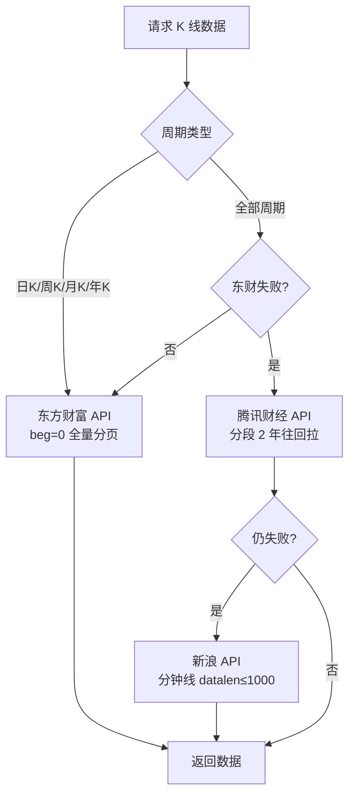

# <a id="个股k线功能设计方案"></a>个股 K 线功能设计方案

> 📝 **方案简述**：本方案设计 HermesX 个股 K 线功能——支持按代码/名称/拼音/简拼搜索股票，查看分时、日 K、5 日、周 K、月 K、年 K 及 5/15/30/60/120 分钟等多周期 K 线，并展示个股基本信息与 MA/MACD/成交量等技术指标。文档给出后端 K 线数据 API 的三级降级数据源、东方财富与腾讯财经的接口参数与 secid/klt 映射、前端 API 客户端、K 线图组件布局与时间轴/坐标轴策略、辅助组件、主页面结构与状态持久化。当前实现状态以代码为准，本文档描述已落地设计。
>
> 👤 **方案作者**：Lensgcx (GaoCangxiong) - ArcSeek-X
>
> 🕒 **更新时间**：2026-11-12

## 目录

- [一、Context（背景与目标）](#sec-1)
- [二、后端：K 线数据 API](#sec-2)
  - [2.1 周期定义对照表](#sec-2-1)
  - [2.2 数据源优先级（三级降级）](#sec-2-2)
  - [2.3 东方财富分页拉取](#sec-2-3)
  - [2.4 腾讯财经 API](#sec-2-4)
  - [2.5 新浪 API 限制](#sec-2-5)
  - [2.6 接口参数](#sec-2-6)
  - [2.7 分时数据特殊处理](#sec-2-7)
  - [2.8 secid 映射规则](#sec-2-8)
  - [2.9 klt 周期参数映射](#sec-2-9)
- [三、前端：API 客户端](#sec-3)
- [四、前端：K 线图组件](#sec-4)
  - [4.1 网格布局](#sec-4-1)
  - [4.2 时间轴刻度（按周期自适应）](#sec-4-2)
  - [4.3 dataZoom 与滑块](#sec-4-3)
  - [4.4 Y 轴与成交量轴](#sec-4-4)
  - [4.5 交易时段分割线](#sec-4-5)
  - [4.6 Tooltip 显示与格式](#sec-4-6)
- [五、前端：辅助组件](#sec-5)
  - [5.1 StockInfoHeader](#sec-5-1)
  - [5.2 StockAutocomplete](#sec-5-2)
  - [5.3 PeriodSelector](#sec-5-3)
- [六、前端：主页面与状态持久化](#sec-6)
  - [6.1 页面结构](#sec-6-1)
  - [6.2 搜索输入框](#sec-6-2)
  - [6.3 中文名称搜索](#sec-6-3)
  - [6.4 状态持久化与缓存](#sec-6-4)
- [七、响应式布局](#sec-7)
- [八、已知问题与修复](#sec-8)
- [九、文件变更清单](#sec-9)
- [十、验证](#sec-10)

<a id="sec-1"></a>

## 一、Context（背景与目标）

"个股 K 线"查询功能，支持通过股票代码/名称/拼音/简拼搜索股票，查看多周期 K 线图（分时、日 K、5 日、周 K、月 K、年 K、5/15/30/60/120 分钟），并展示个股基本信息和技术指标（MA、MACD、成交量）。

搜索层面需求：

- 输入框显示"名称（代码）"格式（如"中科曙光（603019）"）。
- 支持清除按钮快速重置搜索状态。

风格与界面需求：

- 界面风格与现有系统一致，保持统一性。

<a id="sec-2"></a>

## 二、后端：K 线数据 API

**文件**：`api/v1/endpoints/kline.py`

支持查看股票上市以来全部历史 K 线数据（不限制最近 2 年）。

<a id="sec-2-1"></a>

### 2.1 周期定义对照表

> 说明：国内通达信、同花顺、东方财富等主流行情软件统一遵循下述统计规则；交易所无强制成文标准，但全市场行情服务商通用这套口径，可直接作为系统开发规范。

| 周期名称 | 标准专业定义 | 单根 K 线统计口径（开/高/低/收） | 适用场景 | 重要开发备注 |
| --- | --- | --- | --- | --- |
| **分时** | 分时走势图（非 K 线蜡烛图） | 以 1 分钟快照连续绘制价格曲线；展示单个交易日实时价格走势，附带均价线、昨收基准线；不生成 K 线 Bar | 日内交易、盘中实时盯盘 | 分时≠1 分钟 K 线；无蜡烛形态；仅展示当日；午休 11:30–13:00 断档 |
| **日 K** | 日 K 线（日线） | 1 根 K 线=1 个完整交易日；开盘：当日集合竞价开盘价；收盘：当日收盘价；最高/最低：全天价格极值 | 短线、波段核心分析周期 | 停牌、节假日无 K 线数据 |
| **五日** | 5 日分时叠加图（多日分时） | 叠加近 5 个交易日分时曲线，对比多日盘中走势，不属于 K 线周期 | 短期盘口强弱对比 | 行业俗称，并非 5 日 K 线，不可与日线周期混淆 |
| **周 K** | 周 K 线（周线） | 1 根 K 线=完整交易周(周一至周五)；开盘：周一开盘价；收盘：周五收盘价；极值：全周所有交易日高低点 | 中期趋势判断，过滤单日波动杂波 | 短交易周仍取当周首个、最后一个交易日作为开收基准 |
| **月 K** | 月 K 线（月线） | 1 根 K 线=完整交易月；开盘：当月首个交易日开盘价；收盘：当月最后一日收盘价；极值：全月高低点 | 中长期趋势、大级别顶底研判 | 跨自然月停牌需特殊边界处理 |
| **年 K** | 年 K 线（年线） | 1 根 K 线=完整自然交易年；开盘：当年首个交易日开盘价；收盘：年末最后一日收盘价；极值：全年价格区间 | 长线价值投资、年度级别周期分析 | 统计区间为每年 1.1–12.31 全部交易日 |
| **120 分** | 120 分钟 K 线（2 小时 K 线） | 单根 K 线=连续 120 分钟交易；早盘 09:30–11:30、下午 13:00–15:00 各生成 1 根 | 日内波段、超短线趋势分析 | A 股天然适配，全天仅 2 根，不存在跨午休拼接 |
| **60 分** | 60 分钟 K 线（小时线） | 单根 K 线=连续 60 分钟交易切片，按 09:30/10:30/11:30、13:00/14:00/15:00 切割分段 | 日内短线、模拟 T+0 交易 | 午休断开，不合并上午尾盘与下午开盘数据 |
| **30 分** | 30 分钟 K 线 | 单根 K 线=连续 30 分钟交易切片生成标准 K 线 Bar | 短线日内买卖点位捕捉 | 短线交易高频使用周期 |
| **15 分** | 15 分钟 K 线 | 单根 K 线=连续 15 分钟交易切片生成标准 K 线 Bar | 超短线精细支撑压力判断 | 震荡行情精细化择时使用 |
| **5 分** | 5 分钟 K 线 | 单根 K 线=连续 5 分钟交易切片生成标准 K 线 Bar | 日内超短、盘口脉冲跟踪 | 数据噪音大，适合极精细日内分析 |

| 序号 | 核心区分点 | 规范说明 |
| --- | --- | --- |
| 1 | 分时 vs 分钟 K 线 | 分时为折线面积图，无 OHLC 蜡烛数据；5/15/30/60/120 分为离散蜡烛 K 线，两套独立渲染逻辑 |
| 2 | 五日周期误区 | 五日是多日分时叠加，不是 5 根日线合并的 5 日 K 线，接口与渲染完全独立 |
| 3 | 分钟线午休规则 | 全部分钟周期禁止跨 11:30–13:00 午休拼接 K 线，午休自动截断分段 |

**分时数据范围补充**：

- 分时图表展示标的**当日全部完整交易时段行情轨迹**，包含盘中已成交价格走势，直至当日收盘节点终止展示，无盘后/次交易日延伸数据。
- 若当前系统时间 13:45，图表完整展示 09:30–11:30 和 13:00–13:45 区间全部真实成交分时轨迹；13:45 至 15:00 尚未发生的交易无实际行情数据源，不预生成、不占位绘制空白/虚拟 K 线走势，但需留出未绘制区域空间。

<a id="sec-2-2"></a>

### 2.2 数据源优先级（三级降级）



| 优先级 | 数据源 | 适用周期 | 说明 |
| --- | --- | --- | --- |
| 1 | 东方财富 API | 日 K/周 K/月 K/年 K | 支持 beg=0 从上市开始拉取，分页获取全量数据 |
| 2 | 腾讯财经 API | 全部周期 | 分段日期拉取（每次 2 年），从最新往回拉取 |
| 3 | 新浪 API | 分钟线 | datalen 限制为 1000（避免触发反爬） |

<a id="sec-2-3"></a>

### 2.3 东方财富分页拉取

```python
beg = "0"          # 从最早日期开始
end = "20500101"   # 到未来日期

# 循环请求，每次 1000 条
while 还有数据:
    请求 beg → end 的 1000 条
    去重并追加到结果集
    更新 beg = 最后一条日期 + 1 天
    如果返回不足 1000 条 → 已到最新日期，停止
```

- 单次请求 1000 条，最多 20 次（共 20000 条）。
- 日 K 线 2000 条 ≈ 约 8 年数据，覆盖大多数股票上市以来的全部数据。

<a id="sec-2-4"></a>

### 2.4 腾讯财经 API

```python
def _fetch_kline_from_tencent(stock_code, period, limit, fqt):
    # 从最新日期往回分段拉取（每次 2 年）
    end_dt = datetime.now()
    start_dt = end_dt - timedelta(days=730)
    for _page in range(30):
        # 请求该时间段数据
        param = f"{symbol},{tx_period},{start_str},{end_str},{SINGLE_MAX},{fqt_str}"
        # ... parse response, deduplicate, collect
        if len(all_items) >= total_limit:
            break
        end_dt = start_dt - timedelta(days=1)
        start_dt = end_dt - timedelta(days=730)
    all_items.sort(key=lambda x: x["date"])
    return all_items[-total_limit:]
```

<a id="sec-2-5"></a>

### 2.5 新浪 API 限制

```python
sina_limit = min(limit, 1000)  # 避免 datalen 超过 1000 触发反爬
```

<a id="sec-2-6"></a>

### 2.6 接口参数

| 接口 | 方法 | 说明 |
| --- | --- | --- |
| `/api/v1/kline/search?q=xxx` | GET | 股票搜索（代码/名称/拼音/简拼） |
| `/api/v1/kline/{code}/kline?period=daily&limit=10000` | GET | K 线数据（limit 上限 10000） |
| `/api/v1/kline/{code}/info` | GET | 实时行情（直接返回 `StockQuoteCore` camelCase） |

<a id="sec-2-7"></a>

### 2.7 分时数据特殊处理

**数据范围**：

- 分时（period=1m）只返回最新一个交易日的分钟数据。
- 如果查询日不是交易日，则返回上一个交易日的完整分时数据。

**新增返回字段**：

- `prev_close`：昨收价（用于前端计算涨跌幅百分比和绘制基准线）。

**前端计算**：

- 涨跌幅百分比 = `(当前价 - 昨收价) / 昨收价 × 100%`。
- 均价线 = `累计成交金额 / 累计成交量`。

<a id="sec-2-8"></a>

### 2.8 secid 映射规则

| 市场 | 代码特征 | secid 格式 |
| --- | --- | --- |
| 上海 | 6 开头（主板、科创板） | `1.{code}` |
| 深圳 | 0/3 开头（主板、创业板） | `0.{code}` |
| 北京 | 8/4 开头（北交所） | `0.{code}` |

<a id="sec-2-9"></a>

### 2.9 klt 周期参数映射

| 周期 | klt 值 | 周期 | klt 值 |
| --- | --- | --- | --- |
| 分时(1m) | 1 | 日 K | 101 |
| 5 分钟 | 5 | 5 日 | 101 |
| 15 分钟 | 15 | 周 K | 102 |
| 30 分钟 | 30 | 月 K | 103 |
| 60 分钟 | 60 | 年 K | 104 |
| 120 分钟 | 120 | | |

<a id="sec-3"></a>

## 三、前端：API 客户端

**文件**：`apps/hrs-web/src/api/kline.ts`

遵循 `sectorData.ts` 的模式，封装 3 个 API 调用（`searchStocks` / `fetchKline` / `fetchStockInfo`）。

**默认 limit**：10000（覆盖上市以来全部数据）。

**类型契约**：`fetchStockInfo` 直接返回 `StockQuoteCore`（`apps/hrs-web/src/types/stock.ts`）形态的 camelCase 行情，页面无需再经 `toStockSnapshot` 之类适配归一——服务端 `/kline/{code}/info` 已按规范 camelCase 输出。

<a id="sec-4"></a>

## 四、前端：K 线图组件

**文件**：`apps/hrs-web/src/components/kline/KLineChart.tsx`

### <a id="sec-4-1"></a>4.1 网格布局

#### 4.1.1 分时模式（三区块）

分为 3 个区块，依次排列：`[0] K 线主图`、`[1] 成交量`、`[2] 时间轴`。

- 无 MA 均线、无 MACD 指标、**无滑块**。
- 时间轴显示在底部，格式为 `HH:mm`（如 `09:30` `10:00` `10:30` `11:30/13:00` `13:30` `14:00` `14:30` `15:00`）。
- 分时图采用**折线面积图**（蓝色渐变填充），非蜡烛图；均价线（橙）显示当天平均成交价；昨收价基准线（水平虚线，0.00% 位置）；午休分界线（11:30/13:00，有且只有一条）；盘口极值标注当日真实最高/最低价。
- 分时图与量能图联动显示标签，但时间轴不参与联动：K 线图联动标签为时间，量能联动标签为成交额（带单位格式）。
- 绘制时 09:30–11:30 与 13:00–当前 区间段须连续，不断开。

```
┌─────────────────────────────────────────┐
│  [0] 分时主图      top: 2%,    height: 70%  │  折线面积图 + 均价线 + 双Y轴
│                                          │  左Y轴：绝对价格 / 右Y轴：涨跌幅%
│                                          │  昨收价基准线（0.00%）
│                                          │  交易时段标记（11:30/13:00）
├─────────────────────────────────────────┤  ← 0.2% 间隙
│  [1] 成交量       top: 75%,   height: 20%  │  成交量柱状图（红涨绿跌）
├─────────────────────────────────────────┤
│  [2] 时间轴          top: 96%,   height: 4%   │  时间刻度（HH:mm 格式）
└──────────────────────────────────────────┘
```

#### 4.1.2 非分时模式（五区块）

分为 5 个区块，依次排列：`[0] K 线主图`、`[1] 成交量`、`[2] MACD`、`[3] 时间轴`、`[4] 滑块`。

- `[2] MACD` 与 `[3] 时间轴` 间距仅 0.2%；`[3] 时间轴` 和 `[4] 滑块` 无缝衔接。
- K 线图、量能图和 MACD 图联动显示标签：K 线图标签为时间，量能联动标签为成交额（带单位），MACD 图不显示标签。

```
┌─────────────────────────────────────────┐
│  [0] K线主图      top: 2%,    height: 44%  │  K线蜡烛图 + MA5/MA10/MA30/MA60
─────────────────────────────────────────┤
│  [1] 成交量       top: 59%,   height: 13%  │  成交量柱状图（红涨绿跌）
├─────────────────────────────────────────┤  ← 0.2% 间隙
│  [2] MACD        top: 75%,   height: 11%  │  DIF/DEA 线 + MACD 柱
├─────────────────────────────────────────┤  ← 无缝衔接
│  [3] 时间轴      top: 86.2%, height: 6%   │  时间轴刻度标签
├─────────────────────────────────────────┤  ← 无缝衔接
│  [4] 滑块        top: 92.2%, height: 32px │  紧贴时间轴下方
└─────────────────────────────────────────┘
```

### <a id="sec-4-2"></a>4.2 时间轴刻度（按周期自适应）

参考主流股票软件（同花顺/东方财富）的时间轴显示逻辑：**标签数量固定约 5–6 个，均匀分布在整个时间轴上，始终显示完整日期**。

**核心设计原则**：

1. **标签数量固定**：始终显示约 5–6 个标签（小屏幕 3–4 个），不随数据量变化。
2. **均匀分布**：标签在整个时间轴上均匀分布，非"每月第一个"规则。
3. **完整日期**：始终显示 `YYYY-MM-DD`（日 K/周 K/月 K/年 K）或 `YYYY-MM-DD HH:mm`（分钟线）。
4. **ECharts 自动均分**：利用 ECharts 的 `interval` 函数，按数据索引等间距选取标签。

**各周期刻度策略**：

| 周期 | 数据粒度 | 时间轴标签格式 | 标签数量 | 说明 |
| --- | --- | --- | --- | --- |
| **分时 (1m)** | 分钟级（单日） | `HH:mm` | ~6 个 | 两行布局（主图+成交量），底部时间轴显示 `HH:mm`，无滑块 |
| **5/15/30/60/120 分** | 分钟级（多日） | `YYYY-MM-DD HH:mm` | ~5 个 | 等间距选取；120 分显示完整日期+时间，其余大屏 `MM-DD HH:mm`、小屏 `MM-DD` |
| **日 K (daily)** | 日级 | `YYYY-MM-DD` | ~6 个 | 等间距选取 |
| **5 日** | 5 日级 | `YYYY-MM-DD` | ~5 个 | 等间距选取 |
| **周 K (weekly)** | 周级 | `YYYY-MM-DD` | ~5 个 | 等间距选取 |
| **月 K (monthly)** | 月级 | `YYYY-MM-DD` | ~5 个 | 等间距选取 |
| **年 K (yearly)** | 年级 | `YYYY-MM-DD` | ~5 个 | 等间距选取 |

**响应式补充规则**：

| 屏幕宽度 | 标签数量 | 格式调整 |
| --- | --- | --- |
| **≥1000px** | 5–6 个 | 按上表正常显示 |
| **<1000px** | 3–4 个 | 分钟线省略时间部分（只显示 `YYYY-MM-DD`）；日 K/周 K/月 K/年 K 不变 |

**缩放后刻度自适应（dataZoom 联动）**：当用户通过底部滑块放大 K 线图后，可见数据点减少，时间轴刻度自动变密，使每个烛图下方都有对应刻度标签。

| 缩放状态 | 可见数据点数 | 刻度策略 | 效果 |
| --- | --- | --- | --- |
| **全量显示**（未缩放） | 全部数据 | 等间距 5–6 个标签 | 概览时间跨度 |
| **轻度缩放** | 50~200 根 | 每 N 根显示一个（N = 可见数/10） | 中等密度 |
| **深度缩放** | ≤30 根（小屏 ≤20 根） | **每根烛图都显示刻度** | 一一对应，精确查看 |

实现逻辑：监听 ECharts `dataZoom` 事件获取 `{ start, end }` → 计算 `visibleCount = total * (end - start) / 100` → 低于阈值（小屏 20 / 大屏 30）时 `interval` 返回 `true` 显示全部标签，否则用预计算等间距索引。

### <a id="sec-4-3"></a>4.3 dataZoom 与滑块

- 默认显示全部数据（`start: 0, end: 100`），支持鼠标滚轮缩放和滑块拖动。
- 滑块样式：高度 32px（增大可点击区域）；手柄宽 10px、高 26px、边框 2px；颜色 `#00d4ff`（cyan）；定位 `top: '92.2%'`（紧贴时间轴 grid 下方，无缝衔接）。

### <a id="sec-4-4"></a>4.4 Y 轴与成交量轴

**分时图 Y 轴（双轴）**：

- 左侧绝对价格，右侧涨跌幅百分比（以昨收价为基准 0.00%）。
- Y 轴对称：以昨收价为 0 轴，上下对称扩展。
- 刻度优化：使用 "Nice Number" 算法，将偏差向上取整到干净数值（1/2/5/10 的倍数），目标 7 个刻度（0 轴 + 上下各 3 个），间隔一致。
- 刻度颜色：正数红色（`#ef5350`）、负数绿色（`#26a69a`）、零轴灰色（`#999999`），均加粗。
- 极值标记：左侧 Y 轴顶部 `最高 XX.XX`（红）、底部 `最低 XX.XX`（绿）；右侧 Y 轴顶部 `+X.XX%`（红）、底部 `-X.XX%`（绿）。

**成交量 Y 轴（单位：万）**：分时与非分时模式均在成交量柱状图区域左侧显示纵向刻度，单位万。

- 显示约 3 个刻度：0、X/2、X（X 为最大成交量）。
- 格式：`0`、`XX万`、`XXX万`，使用 ECharts `yAxis.axisLabel.formatter` 格式化。

### <a id="sec-4-5"></a>4.5 交易时段分割线（11:30/13:00）

**适用范围**：分钟线（5m/15m/30m/60m/120m）+ 分时（1m）。

**规则**：

- 在数据中查找时间为 `11:30` 和 `13:00` 的数据点（或最接近的）。
- 在 K 线主图、成交量、MACD 三个区域分别绘制垂直分割线。
- 分割线样式：虚线（dashed），颜色浅灰（`#ccc`）。
- 在 K 线主图的分割线上显示标签：`11:30`、`13:00`；多个数据点有多个标签时，只在第一个出现的位置显示。

### <a id="sec-4-6"></a>4.6 Tooltip 显示与格式

**通用格式规则**：成交量的单位万手；成交额单位"小于一亿为万、大于一亿为亿"；涨跌幅正红负绿；所有数字保留 2 位小数。

**分时模式**（时间 `YYYY-MM-DD HH:mm:ss`）：显示时间、当前价格、涨跌幅、均价、成交量、成交金额。

| 位置 | 显示内容（顺序） | 格式要求 | 显示要求 |
| --- | --- | --- | --- |
| 分时主图 | 时间、当前价格、涨跌幅、均价、成交量、成交金额 | 时间 `YYYY-MM-DD HH:mm:ss`；成交量万手；成交额按亿/万；数字 2 位小数 | 涨跌幅正红负绿 |

**非分时模式**（时间 `YYYY-MM-DD HH:mm:ss`）：显示日期、涨跌幅、开盘价、收盘价、最高价、最低价、成交量、成交额、换手率、MA5、MA10、MA30、MA60、MACD、DIF、DEA。

| 位置 | 显示内容（顺序） | 格式要求 | 显示要求 |
| --- | --- | --- | --- |
| 蜡烛图 | 日期、涨跌幅、开盘、收盘、最高、最低、成交量、成交额、换手率、MA5/10/30/60、MACD、DIF、DEA | 时间 `YYYY-MM-DD HH:mm:ss`；成交量万手；成交额按亿/万；数字 2 位小数 | 涨跌幅正红负绿；最高价红、最低价绿 |

<a id="sec-5"></a>

## 五、前端：辅助组件

### <a id="sec-5-1"></a>5.1 StockInfoHeader

**文件**：`apps/hrs-web/src/components/kline/StockInfoHeader.tsx`

- 股票名称（不显示股票代码，避免与输入框重复）。
- 当前价格、涨跌幅。
- 关键指标网格：今开、昨收、最高、最低、成交量、成交额、换手率、市盈率、总市值。
- 网格布局：`grid-cols-3 sm:grid-cols-5 lg:grid-cols-5`（9 个指标分两行，左右对称，末项不顶边）。

### <a id="sec-5-2"></a>5.2 StockAutocomplete

**文件**：`apps/hrs-web/src/components/StockAutocomplete/StockAutocomplete.tsx`

**新增属性**：

- `displayValue?: string` — 显示值（如"中科曙光（603019）"），与搜索值分离。
- `onClear?: () => void` — 清除按钮回调。

**清除按钮**：有内容时显示 X 删除图标，点击后清除所有相关状态（stockCode、stockName、stockInfo、klineData）。

### <a id="sec-5-3"></a>5.3 PeriodSelector

**文件**：`apps/hrs-web/src/components/kline/PeriodSelector.tsx`

- 单行按钮组：分时/日 K/5 日/周 K/月 K/年 K/120 分/60 分/30 分/15 分/5 分。
- 激活态使用 cyan 高亮。
- 靠右对齐布局（`justify-end`），按钮间距 `gap-2`，字体大小 14px。

<a id="sec-6"></a>

## 六、前端：主页面与状态持久化

**文件**：`apps/hrs-web/src/pages/Stock/StockKLinePage/StockKLinePage.tsx`

### <a id="sec-6-1"></a>6.1 页面结构

1. 搜索框（支持代码/名称/拼音搜索 + 自动补全 + 清除按钮）。
2. 股票信息头部（选股后显示）。
3. K 线图 + 周期选择器（选股后显示）。

### <a id="sec-6-2"></a>6.2 搜索输入框

- **显示值**：`名称（代码）` 格式（如"中科曙光（603019）"）。
- **搜索值**：纯代码（如"603019"）。
- **清除按钮**：有内容时显示 X 图标，一键清除所有状态。

### <a id="sec-6-3"></a>6.3 中文名称搜索

输入中文名称时，先通过后端 `searchStocks` API 解析为股票代码，再用解析后的代码加载 K 线数据。

### <a id="sec-6-4"></a>6.4 状态持久化与缓存

**规定**：K 线页的全部页面状态收敛于 `PageStateStore` 的 `kline` 切片，该切片只含 `stockInfo` 与 `klineInfo` 两个键；页面在浏览器中只占用 `hrs-state-pageState` 一个对象键。

**Why**：此前状态分散在多处（`hrs-state-pageState` 扁平字段、页面自写的 `hrs-state-kline.stockCode`/`displayValue`、`hrs-pref-kline.period`），股票代码存在双写、展示标签需跳转方预写，易产生"搜索框与行情头不一致"的缺陷；收口为单一对象后真源唯一，可整对象恢复。

**How to apply**：状态读写统一经 `usePageState()`；接口返回的 `StockQuoteCore` 直接入状态，不再需要 `toStockSnapshot` 之类的蛇形→驼峰适配（服务端已按规范 camelCase 输出）。

**状态结构**（`stores/PageStateStore.tsx` 的 `KLinePageState`）：

```ts
interface KLinePageState {
  /** 个股行情快照（含标识 + 行情核心），类型取自 types/stock.ts */
  stockInfo: StockQuoteCore | null;
  /** K 线数据相关 */
  klineInfo: {
    period: KLinePeriod;        // 当前周期
    klineData: KLinePoint[];    // K 线数据点
    klineSource: string | null; // 数据来源
  };
}
```

| 字段 | 含义 | 说明 |
| --- | --- | --- |
| `stockInfo` | 个股行情快照 | 驼峰领域类型 `StockQuoteCore`，含 `code`/`name`/`price`/`change`/`changePct`/`amount`/`volume`/`turnoverRate`/`prevClose`/`open`/`high`/`low`/`amplitude`/`peRatioTTM`/`totalMarketCap` 及标识字段 |
| `klineInfo.period` | 当前 K 线周期 | 随会话恢复，关标签页后重置为 `daily` |
| `klineInfo.klineData` | K 线数据点数组 | 刷新后先由该值即时渲染，再重新拉取最新数据 |
| `klineInfo.klineSource` | 数据来源 | 取自 K 线响应 `source` |

**派生值（不落盘）**：

| 派生值 | 来源 | 说明 |
| --- | --- | --- |
| 当前股票代码 | `stockInfo.code` | 刷新后由恢复的 `stockInfo` 派生 |
| 搜索框展示标签「名称（规范代码）」 | `stockInfo` + 本地股票索引 | 由页面 effect 重算，索引后到自动补市场后缀 |

**类型归一（边界适配）**：

- 【强制】UI 组件消费驼峰领域类型：`StockInfoHeader` 的 props 为 `StockQuoteCore`；接口已直接返回该形态，禁止在页面层再做蛇形→驼峰转换。
- 【强制】`stockInfo` 为 `null` 时页面回退到"未选股"态（最近搜索列表等引导 UI）。

**接口缓存（L1，见《前端缓存方案设计》）**：

| 缓存项 | TTL | 说明 |
| --- | --- | --- |
| K 线接口（`/api/v1/kline/*`） | 30s | 实时行情与 K 线数据同前缀统一 30s，价格实时性优先 |
| 股票搜索（`/api/v1/kline/search`） | 300s | 名称变动少 |

**正反清单**：

- ✅ 状态只写 `pageState.kline` 的 `stockInfo` + `klineInfo` 两键。
- ✅ 接口数据直接以 `StockQuoteCore` 入状态，不再 `toStockSnapshot`。
- ✅ 派生值（当前代码、搜索框展示标签）由 `stockInfo` 重算，不落盘。
- ❌ 新增 `kline.*` 之类的独立存储键。
- ❌ 把接口蛇形类型直接存入页面状态。
- ❌ 持久化可从 `stockInfo` 推导出的值。

**已接受的取舍**：

- **周期为会话级**：周期随 `pageState` 走 sessionStorage，关标签页后重置为 `daily`（不再是永久偏好）。
- **加载失败不自动重试**：上次加载失败时 `stockInfo` 为 `null`，刷新后派生的股票代码为空，需手动重新搜索。
- **跨页复用**：`StockDataViewPage` 仍读取同一 `pageState.kline` 切片复用已加载数据，结构变更时须同步该页。

<a id="sec-7"></a>

## 七、响应式布局

**文件**：`apps/hrs-web/src/hooks/useWindowWidth.ts`

```typescript
export function useWindowWidth(debounceMs = 150): number {
  // 监听窗口宽度变化，防抖 150ms
}
```

| 屏幕宽度 | 时间轴刻度 | 说明 |
| --- | --- | --- |
| ≥1000px | 显示月份标签（每月第一个交易日），年份加粗 | 完整显示 |
| <1000px | 只显示年份文字（如"2026"），月度刻度保留但不显示文字 | 避免拥挤 |

<a id="sec-8"></a>

## 八、已知问题与修复

| 序号 | 问题描述 | 影响范围 | 修复方案 | 修复日期 |
| --- | --- | --- | --- | --- |
| 1 | 新浪 API datalen 超过 1000 触发反爬返回 null | kline.py | 限制 `sina_limit = min(limit, 1000)` | 2026-08-01 |
| 2 | 中文股票名称搜索失败（本地索引不含中文名） | StockKLinePage.tsx | 添加后端 `searchStocks` API 解析 | 2026-08-01 |
| 3 | ECharts 时间轴刻度 interval 函数使用闭包 Set，滑块移动后刻度消失 | KLineChart.tsx | 预计算 monthLabelIndices Set | 2026-08-01 |
| 4 | `useCachedState` 未将 null 视为无值，输入框显示 "null" | useCachedState.ts | 增加 `nested !== null` 判断 | 2026-08-01 |
| 5 | onClear 中 `setStockCode('')` 和 `setPageState({ stockCode: null })` 冲突 | StockKLinePage.tsx | 统一使用空字符串 `''` | 2026-08-01 |
| 6 | displayValue 条件只检查 stockName，未检查 stockCode | StockKLinePage.tsx | 改为 `stockCode && stockName` | 2026-08-01 |

<a id="sec-9"></a>

## 九、文件变更清单

| 类型 | 文件路径 | 说明 |
| --- | --- | --- |
| 新建 | `api/v1/endpoints/kline.py` | K 线数据 API（三级数据源） |
| 新建 | `api/v1/schemas/kline.py` | Pydantic 响应模型（规范 camelCase） |
| 新建 | `apps/hrs-web/src/api/kline.ts` | 前端 API 客户端（直接返回 `StockQuoteCore`） |
| 新建 | `apps/hrs-web/src/components/kline/KLineChart.tsx` | K 线图组件（网格布局 + 时间轴 + 坐标轴） |
| 新建 | `apps/hrs-web/src/components/kline/StockInfoHeader.tsx` | 股票信息头部 |
| 新建 | `apps/hrs-web/src/components/kline/PeriodSelector.tsx` | 周期选择器 |
| 新建 | `apps/hrs-web/src/pages/Stock/StockKLinePage/StockKLinePage.tsx` | 主页面 |
| 新建 | `apps/hrs-web/src/hooks/useWindowWidth.ts` | 窗口宽度监听 Hook |
| 修改 | `api/v1/router.py` | 注册 kline 路由 |
| 修改 | `apps/hrs-web/src/App.tsx` | 添加路由 `/stock/kline` |
| 修改 | `apps/hrs-web/src/components/layout/SidebarNav.tsx` | 添加菜单项 |
| 修改 | `apps/hrs-web/src/i18n/uiText.ts` | 添加中英文 i18n key |
| 修改 | `apps/hrs-web/src/components/StockAutocomplete/StockAutocomplete.tsx` | 新增 `displayValue`、`onClear` |
| 修改 | `apps/hrs-web/src/hooks/useCachedState.ts` | 修复空值判断 |

<a id="sec-10"></a>

## 十、验证

1. 后端：`python -m py_compile api/v1/endpoints/kline.py` + `curl` 测试 3 个接口。
2. 前端：`cd apps/hrs-web && npx tsc --noEmit`。
3. 浏览器访问 `/stock/kline`，搜索股票，切换周期，验证图表渲染。
4. 验证中文名称搜索（如"中科曙光"）。
5. 验证清除按钮功能。
6. 验证响应式布局（缩小窗口宽度到 1000px 以下）。
7. 验证路由切换后状态保持。
8. 验证"时间轴+滑块"无缝衔接，与 MACD 间距小。
9. 验证 `StockInfoHeader` 指标网格左右对称。
10. 验证刷新后从 `hrs-state-pageState` 恢复：股票、周期、K 线与搜索框展示标签上下一致。
