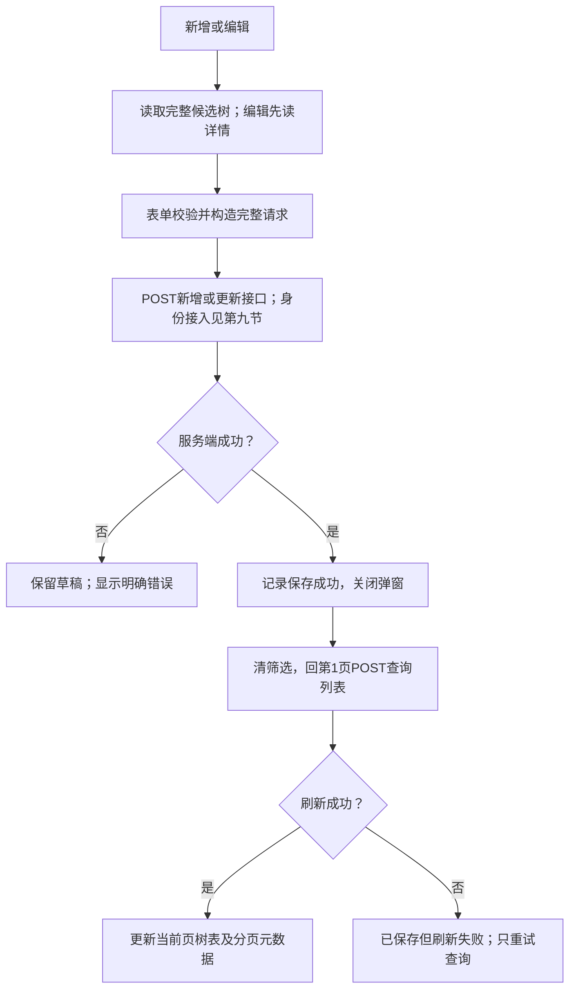
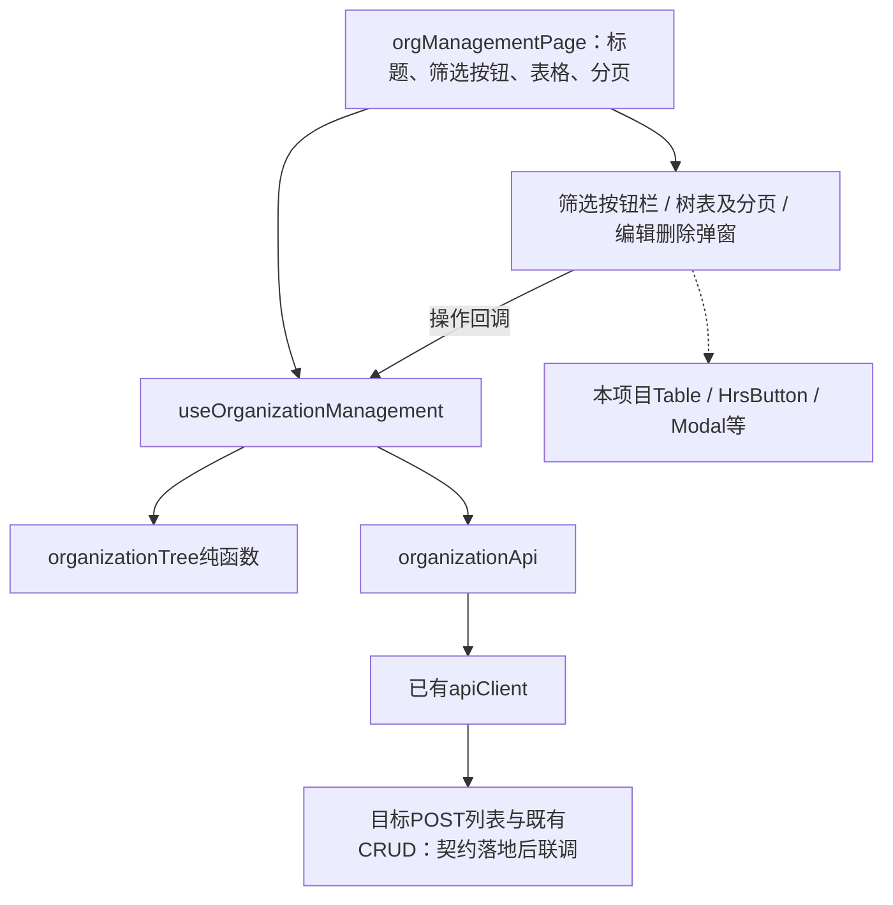
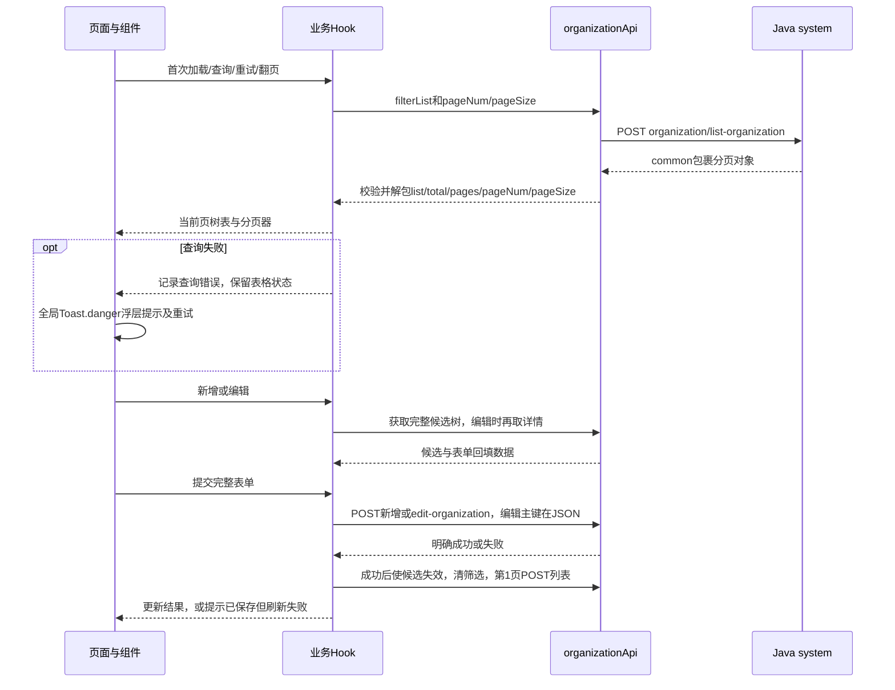
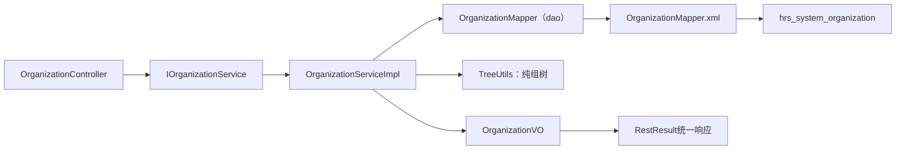
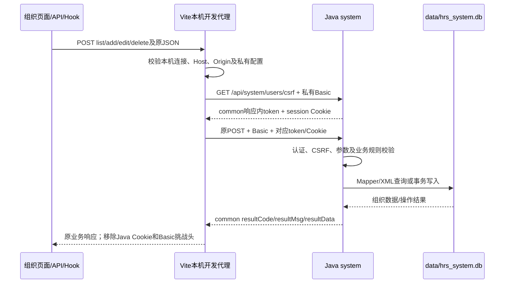

# <a id="system-org-management"></a>HermesX 组织管理页面设计与实施方案

> 更新时间：2026-11-24。
> 状态：2026-11-24已实现页面、组织Java接口及正式SQL升级段；system独立SQLite库已初始化并导入组织验证数据，HermesX system已启动；浏览器已通过本机开发代理接通Java，代理代传现有Basic/CSRF校验信息；正式登录、Token及网关认证仍暂缓。
> 目标页面：`/system/orgManagement`；本地开发示例地址为 `http://localhost:1022/system/orgManagement`，服务地址及端口不写死到业务代码。
> 本期范围：仅截图所示的树形表格页及编辑/删除弹窗；画布节点、视图切换、成员和统计面板暂缓。
> 参考：`scaffold-master-main` 的 `/system/dept` 页面布局与交互，**全部界面控件使用 HermesX 自有组件封装**。以当前源码为依据，不把参考工程的接口、权限或数据能力当成 HermesX 已有能力。

## 目录

| 章节 | 内容 |
| --- | --- |
| [一、目标、现状与业务边界](#sec-1) | 组织与部门的含义、已完成与待开发 |
| [二、参考页面与组件复用](#sec-2) | 截图表格页与组件替换 |
| [三、数据库表与字段枚举](#sec-3) | 完整字段、索引、约束及 Java 映射 |
| [四、页面结构与交互](#sec-4) | 四层布局、字段映射、筛选、根组织分页 |
| [五、编辑表单与业务规则](#sec-5) | 新增、修改、移动、启停、删除 |
| [六、服务端接口契约](#sec-6) | POST列表、JSON分页入参、common响应与错误 |
| [七、前端代码分层](#sec-7) | 页面、Hook、业务组件、API、类型与纯函数 |
| [八、system 服务分层](#sec-8) | pojo/rest、Controller/Service/Mapper/XML |
| [九、本机开发接入与正式认证边界](#sec-9) | 私有配置、代理代传及请求流程 |
| [十、状态、异常与可访问性](#sec-10) | 异步竞争、刷新、空态及三语 |
| [十一、实施批次与验收](#sec-11) | 开发顺序、测试和交付边界 |
| [十二、关联文件与方案](#sec-12) | 已有代码及规范入口 |

<a id="sec-1"></a>

## 一、目标、现状与业务边界

**本期前端只实现用户截图中的树形表格页面。画布节点功能暂不开发**：不做节点与连线、平移缩放、画布/表格切换、四角面板，也不提前创建画布组件、布局算法、视图开关或偏好持久化。

页面由页面标题、筛选条件和按钮、组织架构树表、底部分页器四层组成，并通过弹窗完成新增/编辑/删除。组织详情仅用于编辑回填，不另做详情卡片、成员预览或统计面板。截图用于参考布局和操作位置，视觉样式遵循HermesX组件与主题，不复制示例项目样式。

**本期页面中的“组织节点”对应现有Java的部门模型**，由`hrs-system-service`管理，表为`hrs_system_organization`，不另建一套与部门并行的组织实体。本文保留数据库、接口及服务分层说明，并记录最新目标字段。字段、DTO/VO和Mapper已同步实现；SQL已通过临时库验证，本机独立库和开发代理已接通；正式认证与生产部署独立安排。

| 事项 | 当前实际情况 | 本方案安排 |
| --- | --- | --- |
| 路由与入口 | manifest沿用既有登记，orgManagementPage.tsx已实现页面组合 | 保留现有入口，实现表格页 |
| 前端组织API / Hook | organizationApi与useOrganizationManagement已实现 | 按目标POST列表与既有CRUD设计API、Hook和页面组件 |
| Java组织管理 | CRUD保护、POST列表、新接口映射、common查询/分页类型及20列映射已实现 | 在原pojo/rest分层内调整，不另建一套服务 |
| Table树形能力 | 当前组件支持children、treeColumnKey和展开状态 | 直接复用，不重写基础表格 |
| 参考页面 | 包含画布与表格两种视图 | 仅参考用户截图中的表格部分 |
| 成员人数 | OrganizationVO没有memberCount | 本期不展示人数列，不以0冒充真实人数 |
| 身份与数据库接入 | 本机独立库已初始化，开发代理代传现有Basic/CSRF，组织页面已接通 | 仅本机联调；正式登录/Token/网关认证继续暂缓 |
| 租户和数据权限 | enterpriseId为企业归属元数据，organizationId为组织主键 | 保留现有校验，不宣称已实现数据权限 |

### 1.1 本期交付与暂缓内容

| 本期页面范围 | 暂缓或后续另行安排 |
| --- | --- |
| 页面标题、筛选与操作按钮区 | 画布节点、连线、平移缩放及视图切换 |
| 组织名称、性质、类型、状态筛选，统一filterList、查询与重置 | 四角面板、独立详情卡片、统计卡片 |
| 树形表格、按根组织分页、逐行展开/收起 | 成员预览、人数汇总和人数列 |
| 新增根组织、新增下级、编辑、删除确认 | 导出/导入、批量操作、拖拽排序 |
| 编辑表单中的上级调整、启用/停用 | 企业主数据、正式负责人用户关联 |
| 页面API/Hook分层、加载/错误/空态、三语与主题；本机开发代理接通组织接口 | 正式登录/Token/网关认证、生产数据库部署与MySQL迁移 |

组织树与菜单树是不同的业务树。本页不改MenuStore/RouterStore，不因组织启停生成菜单权限；USE_STATIC_MENU不控制组织数据来源。

<a id="sec-2"></a>

## 二、参考页面与组件复用

参考用户提供的表格页截图，以及[`Depts.vue`](../../../vibe-template/scaffold-master-main/scaffold-vue/src/views/system/Depts.vue)、[`ListPage.vue`](../../../vibe-template/scaffold-master-main/scaffold-vue/src/components/business/ListPage.vue)。仅借鉴页面布局和操作结构，不复制Vue组件、样式、权限文案或未实现的数据能力。

| 截图元素 | HermesX对应设计 | 本期取舍 |
| --- | --- | --- |
| 标题与说明 | AppPage、PageHeader | 第一层只放标题/说明；新增按钮移至第二层 |
| 画布/表格切换 | 暂不实现 | 页面固定树表，不显示无效画布入口 |
| 筛选和操作按钮 | HrsInput、HrsSelect、HrsButton | 组织名称、性质、类型、状态；全部条件放filterList，按钮均在第二层 |
| 组织数量与分页 | 计数文本、现有Table底部分页 | 使用接口根总数与本页节点数，不虚构全量节点计数 |
| 树行展开/收起 | Table自有行内按钮 | 只保留逐行操作，不提供全部展开、全部收起或刷新按钮；暂不导出 |
| 树形表格与右侧操作 | 现有Table | 列与第四节一致；不显示无来源的人数列 |
| 行内＋、编辑、删除 | HrsButton | 新增下级、编辑、删除确认 |
| 编辑弹窗及上级选择 | Modal、HrsSelect等 | 排除自身/后代、限制相同企业归属 |
| 负责人选择 | HrsInput | 当前leader为文本，暂不做用户选择器 |

### 2.1 组件使用清单

| 用途 | 本项目组件/位置 | 约束 |
| --- | --- | --- |
| 页面外壳 | components/layout/AppPage.tsx、PageLayout/PageHeader.tsx | 通过子路径引入布局组件 |
| 树表及分页 | components/basic/Table、components/basic/Pagination | 复用Table的pagination受控接口，底部只渲染一个分页器，隐藏统计和说明文字 |
| 按钮 | HrsButton | 新增、查询、重置、行内操作和表格工具栏 |
| 表单 | HrsInput、HrsNumberField、HrsSelect、Switch、TextArea | 备注复用TextArea；原生form仅承担提交语义，不引入另一套表单UI |
| 弹窗 | Modal | 编辑、删除及未保存关闭确认，不用window.confirm |
| 展示反馈 | Card、Chip/Badge、Loading、EmptyState、InlineToast、showToast | 按实际导出路径使用 |
| 图标 | 已有lucide-react图标 | 图标按钮提供可访问名称，不新增依赖 |

当前Table未从basic总桶导出时，从`@components/basic/Table`直接引入。页面业务组件只组合本项目控件，不创建CSS/SCSS文件，不修改node_modules；使用Tailwind和现有主题token，不复刻截图中的玻璃、阴影等独立样式体系。

<a id="sec-3"></a>

## 三、数据库表与字段枚举

### 3.1 所属数据库与目标字段

本节以最新要求为目标设计，**不表示正式SQL或Java已经调整**。用户确认的是9个业务字段的数据库名称；以下长度、可空及接口映射为本方案建议，具体枚举和编码规则需在落地前确定。

| 项目 | 约定 |
| --- | --- |
| 唯一所属服务 | `hrs-system-service` |
| SQLite开发位置 | 仓库根`data/hrs_system.db`，通过实际配置传绝对路径 |
| 正式表名 | `hrs_system_organization` |
| 现有正式SQL | `hrs-system-service/sql/hrs-system-service.sql`包含冻结的BASELINE_20261123与新增ORGANIZATION_20261124 |
| 执行方式 | 手动调用`scripts/db/manual_db_upgrade.py`，Java不执行建表或升级 |
| 本次操作 | 已手动初始化data/hrs_system.db，执行2个正式变更段并导入组织开发验证数据；未操作Python库 |

目标表共20个字段，organization_id是唯一主键，不再设置id，也不另设组织归属列。保留9个指定业务字段、父子层级、所属企业、排序状态及审计字段；parent_id与审计等字段继续使用表中约定名称。

| 目标数据库字段 | 字段解释 | SQLite声明 | 可空 / 默认值 | 约束规则 | 建议Java / JSON映射 |
| --- | --- | --- | --- | --- | --- |
| `organization_id` | 组织节点主键 | INTEGER PRIMARY KEY AUTOINCREMENT | 非空，数据库分配 | 正整数、本表内唯一，Java Long；不是跨服务全局ID | Entity / DTO / VO `organizationId` |
| `parent_id` | 上级组织节点主键 | BIGINT | 非空，0 | 父节点ID，整数≥0，不得等于自身；0为根 | `parentId` |
| `ancestors` | 从根到父级的祖先ID路径 | VARCHAR(500) | 非空，空串 | 祖先ID逗号路径，Service计算 | `ancestors` |
| `organization_name` | 组织完整名称 | VARCHAR(100) | 非空，无默认 | 组织名称，trim后1～100字符 | Entity / DTO / VO `name`（Mapper显式映射） |
| `organization_short_name` | 组织简称 | VARCHAR(64) | 可空，NULL | 组织简称，最长64字符 | `shortName` |
| `organization_code` | 组织业务编码 | VARCHAR(64) | 可空，NULL（建议） | 组织业务编码；不同于节点主键或所属企业ID | `code` |
| `organization_email` | 组织联系邮箱 | VARCHAR(128) | 可空，NULL | 邮箱，最长128，DTO校验格式 | `email` |
| `organization_phone` | 组织联系电话 | VARCHAR(32) | 可空，NULL | 联系电话文本，保留+号与前导0 | `phone` |
| `organization_leader` | 组织负责人姓名/文本 | VARCHAR(64) | 可空，NULL | 负责人文本，当前不关联用户主键 | `leader` |
| `organization_nature` | 组织性质分类 | VARCHAR(32) | 可空，NULL（建议） | 组织性质字典编码，最长32字符 | `nature` |
| `organization_type` | 组织类型分类 | VARCHAR(32) | 可空，NULL（建议） | 组织类型字典编码，最长32字符 | `type` |
| `remark` | 组织补充说明与备注 | VARCHAR(500) | 可空，NULL | 备注，最长500字符 | `remark` |
| `sort` | 同级显示顺序 | INT | 非空，0 | 非负整数，Java Integer，前端≤2147483647 | `sort` |
| `status` | 组织启用状态 | TINYINT | 非空，1 | 仅0/1，启用状态 | `status` |
| `enterprise_id` | 数据所属企业标识 | BIGINT | 可空，NULL | 所属企业，非空为正整数 | `enterpriseId` |
| `delete_flag` | 逻辑删除标志 | TINYINT | 非空，0 | 仅0/1，逻辑删除 | Entity `deleteFlag`，VO不返回 |
| `create_by` | 记录创建人 | VARCHAR(64) | 非空，无默认 | 创建人，1～64且trim非空，服务端提供 | `createBy` |
| `update_by` | 最后更新人 | VARCHAR(64) | 非空，无默认 | 更新人，约束同create_by，服务端维护 | `updateBy` |
| `create_time` | 记录创建时间 | DATETIME | 非空，CURRENT_TIMESTAMP | UTC时间文本 | `createTime` |
| `update_time` | 最后更新时间 | DATETIME | 非空，CURRENT_TIMESTAMP | 更新SQL显式维护UTC时间 | `updateTime` |

目标落地包括业务列重命名/新增，以及主键切换：以organization_id承接原主键id的节点身份，移除原id列和原organization_id的独立归属语义，不把两种旧值直接混在一起。MyBatis需显式映射列与属性，例如`organization_name → Entity.name → VO.name`、`organization_email → email`；**数据库前缀变化不强制将现有接口name/leader/phone/email改名**。shortName/code/nature/type/remark已同步至DTO、VO、Entity与Mapper，旧组织接口已移除。

SQLite的VARCHAR(n)声明本身不强制长度，正式SQL已按既有规范补CHECK，DTO与前端校验保持一致。可选文本空输入规范为NULL，name必填；性质/类型不使用0、未知数字或空串伪造默认枚举。

**组织主键统一约定：** 数据库organization_id、Java organizationId与组织接口organizationId均表示当前组织节点主键。主键非空且在本表内唯一；新增由数据库生成，编辑/删除使用请求体中的organizationId定位。

| 含义 | 数据库字段 | 组织接口字段 | 唯一性与用途 |
| --- | --- | --- | --- |
| 当前组织节点 | organization_id | organizationId | 本表内唯一；详情、编辑、删除与前端行标识 |
| 上级组织节点 | parent_id | parentId | 引用本表organization_id；0为根，多个下级可指向同一父级 |
| 所属企业 | enterprise_id | enterpriseId | 归属元数据，可空、可重复；同一父子链保持企业一致 |
| 用户所属部门 | 用户表dept_id | 用户接口现有deptId | 目标引用组织表organization_id；本次不改用户字段名称 |

组织表不再设置独立的所属组织字段，也不采用上一版scopeOrganizationId；组织层级由parent_id/ancestors表达，企业归属由enterprise_id表达。组织表的organization_id不再是可重复的归属列。这是本组织主数据表的明确特例，不自动改变用户/菜单等表organization_id的含义，不把所有表主键批量改名。

Java Entity与VO均使用organizationId。为复用现有TreeUtils，组织VO可通过内部TreeNode.id()方法返回organizationId，并确保该桥接不额外序列化出id字段；不为组织主键改名破坏菜单TreeNode契约。新增请求不接收organizationId，编辑/删除必须接收；列表、详情、候选树和写入结果都返回organizationId。

**实施时不能直接丢弃身份：** 若旧结构已有数据，应将旧id值保留为新organization_id，维持parent_id、ancestors和用户dept_id的引用；旧organization_id值属于旧归属语义，可能重复，不可直接改成主键。若实际库尚未创建，直接按目标结构建表。正式文件保留已冻结基线并追加ORGANIZATION_20261124，手动工具按历史只执行待执行段；已在临时库及本机system开发库验证，实际库执行历史已登记2个正式变更段。

### 3.2 枚举、特殊值与待确认规则

| 字段 / 值 | 含义 | 页面表现 / 业务规则 |
| --- | --- | --- |
| `organization_nature` | 组织性质字典编码，枚举待确认 | 不自行约定国企/民企等值，不把显示中文作为稳定编码 |
| `organization_type` | 组织类型字典编码，枚举待确认 | 不自行约定集团/部门等值，不根据parentId猜测类型 |
| `status=1` | 启用 | 显示“启用”；新增默认选中 |
| `status=0` | 停用 | 显示“停用”；仍能查详情、编辑及重新启用 |
| `delete_flag=0` | 正常数据 | 普通查询包含 |
| `delete_flag=1` | 逻辑删除 | 普通查询排除；本期无恢复入口 |
| `parent_id=0` | 根节点 | 上级选项“无上级（根组织）”；不是某条 organization_id=0 记录 |
| `ancestors=''` | 根节点无祖先 | 子节点示例为“1,8”，不由前端维护 |
| enterprise_id为NULL | 未分配企业归属 | UI显示“未分配”，不填0、-1或虚构企业；organization_id主键不能为NULL |
| 筛选“全部状态” | 仅UI状态 | 不等于数据库的第三个枚举值，不写库 |
| 画布/表格视图模式 | 本期不实现 | 不新增canvas/table开关或偏好持久化 |

组织性质与组织类型是不同业务维度；具体可选项、编码、必填性由后续业务规则确定，当前不编造枚举或新增已生效的CHECK约束。组织编码建议作为稳定业务标识，是否必填、能否修改、全局或归属内唯一、删除后能否复用均待确认；当前不新增唯一索引或“编码重复”的虚构结果码。

以下为目标索引，不继续复用包含旧id与旧组织归属语义的复合索引定义：

| 索引 | 列 | 用途 |
| --- | --- | --- |
| `idx_hrs_system_organization_parent` | parent_id、delete_flag | 查未删除下级、删除前保护 |
| `idx_hrs_system_organization_enterprise` | enterprise_id、delete_flag、sort、organization_id | 企业范围查询和稳定顺序；替代旧scope索引 |

当前未建立父节点/用户部门的数据库外键，关联存在性与归属由 Service 校验。**没有组织名称唯一约束**，不在前端擅自增加“同名必定冲突”的规则。完整树排序为 sort 升序，再按 organization_id 升序；本期不做破坏层级的全局列排序。

<a id="sec-4"></a>

## 四、页面结构与交互

### 4.1 四层布局

页面从上到下固定为：**页面标题 → 筛选条件和按钮 → 树形表格 → 分页器**。四个筛选条件与操作按钮在第二层同一行排列；按钮组统一靠最右侧，从左到右固定为查询、重置、新增组织；标题层仅放标题及说明，不再在标题右侧放新增按钮。新增/编辑/删除弹窗由操作触发，不占常驻布局层级。工具栏不提供全部展开、全部收起或手动刷新；查询失败用全局Toast浮层承载提示和重试，不插入占高的错误横条；保留保存/删除成功后的自动更新。

```text
┌ ① 页面标题 ─────────────────────────────────────────────────────────────┐
│ 组织管理                                                               │
│ 维护组织层级、基础资料与启用状态                                         │
├ ② 筛选条件和按钮 ───────────────────────────────────────────────────────┤
│ 组织名称                 组织性质       组织类型       状态             │
│ [名称输入]   [性质 ▼]   [类型 ▼]   [状态 ▼]    [查询] [重置] [＋新增组织] │
├ ③ 树形表格 ─────────────────────────────────────────────────────────────┤
│ 组织架构                  符合条件根组织 R 个；本页组织 N 个             │
│ 组织名称/简称│编码│性质│类型│负责人│电话│邮箱│排序│状态│操作             │
│ ▾ 总部       │…   │…   │…   │…     │…   │…   │0   │启用│＋ 编辑 删除    │
│   研发中心   │…   │…   │…   │…     │…   │…   │10  │启用│＋ 编辑 删除    │
│   平台组     │…   │…   │…   │…     │…   │…   │20  │停用│＋ 编辑 删除    │
│                                         表格内部纵向/横向滚动          │
├ ④ 分页器 ───────────────────────────────────────────────────────────────┤
│                                            [上一页] [1] [2] [下一页]   │
└──────────────────────────────────────────────────────────────────────────┘
```

四个筛选条件保持单行，输入控件与最右侧按钮组底部对齐；窄屏时只让筛选条件区域横向滚动，按钮组不换行，避免增加页面纵向占用。分页器位于表格内容下面，不随表格内部滚动消失；不新增第五层详情、成员或统计卡片。多根组织合法，不生成虚构根节点；画布与切换入口继续暂缓。

### 4.2 树表列头与数据库字段对应

以下为**目标字段落地后**的列设计，新增业务属性不能当作当前Java已有返回。名称和编码用于识别组织；性质/类型用于分类；联系字段用于日常维护；排序/状态用于管理。

| 列头 | 目标数据库字段 | 接口字段 | 展示与产品取舍 |
| --- | --- | --- | --- |
| 组织名称 | organization_name、organization_short_name | name、shortName | 主行名称，次行简称；不为简称再占独立列，简称为空时不显示次行；树形缩进与展开按钮放此列 |
| 组织编码 | organization_code | code | 稳定业务标识；保留文本及前导0，空值显示“—” |
| 组织性质 | organization_nature | nature | 显示字典名称，保存编码；选项待确认，不伪造枚举 |
| 组织类型 | organization_type | type | 显示字典名称，与性质分列，避免混淆维度 |
| 负责人 | organization_leader | leader | 当前为负责人文本，不假装用户关联 |
| 联系电话 | organization_phone | phone | 保留+号、空格及前导0，不转数值 |
| 邮箱 | organization_email | email | 过长省略，提供完整内容查看方式 |
| 显示排序 | sort | sort | 非负整数，通过编辑修改，不做全局列排序 |
| 状态 | status | status | 启用/停用文字与标签，不做行内开关 |
| 操作 | 非数据库字段 | 无 | 新增下级、编辑、删除，保持可用 |

| 未单列字段 | 裁剪原因 | 查看/维护位置 |
| --- | --- | --- |
| remark | 长文本占宽，降低组织树浏览效率 | 新增/编辑弹窗中的备注 |
| organization_id、parent_id、ancestors | 技术标识与层级路径，普通用户不需直接读数 | 通过树形缩进与上级选择呈现，不允许手改ancestors |
| enterprise_id | 企业归属元数据，本期无企业主数据选择器 | 表单高级归属区，不加入日常筛选；organization_id仅用于主键定位 |
| delete_flag | 内部软删除状态，普通查询已排除删除记录 | 不展示、不作为常规筛选项 |
| create_by、update_by、create_time、update_time | 非本页日常识别组织的核心信息 | 编辑弹窗底部只读审计信息，更新时间从原默认列移出 |

九个指定业务字段全部有去向：名称/简称合并展示，编码、性质、类型、负责人、电话、邮箱直接列出，备注在表单维护。人数不在组织表及VO中，不展示虚构人数列。

Table每列提供minWidth/defaultWidth，名称为isRowHeader，treeColumnKey="name"、rowKey="organizationId"。保持名称及操作易于触达，宽屏优先展示全列，窄屏内部横向滚动，不通过堆叠十列挤压文字。无需增加列设置基础设施。

传入rows=当前页根组织及其子树，pagination=受控根组织分页配置；复用Table已有底部分页器，**不再重复渲染第二个分页器**。不手工展平后再传支持children的Table，不增加行选择或详情面板。

Table保留行标识的数字类型，expandedKeys/onExpandedChange使用organizationId。每次查询成功后，普通列表默认展开根节点，有筛选条件时展开结果路径；用户可逐行展开/收起，不提供批量展开/收起功能。行内编辑/删除直接读取该行organizationId，放入JSON请求体。

审计时间仍先把YYYY-MM-DD HH:mm:ss UTC文本规范化为带Z的ISO时间，再复用utils/format.ts展示；不改变Python时间语义。

### 4.3 筛选条件统一使用filterList

**所有页面筛选条件统一放进filterList，不设置顶层keyword或mainSearch，也不把nature/type/status放在请求顶层。** 输入框搜索组织名称与下拉框筛选一样，都是一条明确的筛选条件。默认四项，位于第二层，不另设综合搜索入口。

| 筛选项 | 目标数据库字段 | fieldName | comparison | fieldValue与页面控件 |
| --- | --- | --- | --- | --- |
| 组织名称 | organization_name | name | LIKE | HrsInput，trim后1～100字符的字符串；按名称包含匹配，区分大小写 |
| 组织性质 | organization_nature | nature | EQUAL | HrsSelect单选，字符串字典编码，最长32；未选不提交条件 |
| 组织类型 | organization_type | type | IN | HrsSelect多选，非空字符串数组；即使仅选一项也传数组 |
| 状态 | status | status | EQUAL | HrsSelect单选，数值0或1；全部状态不提交条件 |

例如名称框输入“研发”，形成`{ "fieldName": "name", "comparison": "LIKE", "fieldValue": "研发" }`。LIKE在本契约表示字面文字的包含匹配，用户不需要输入百分号；百分号、下划线也不作为通配符解释。不同条件之间为AND，多选IN内部为OR。

API字段name/type等由system服务白名单映射到固定数据库列，不让前端提供fieldUnderLineName或SQL表达式。简称、编码保留在展示与表单中，本期不增加隐藏的跨三字段综合搜索；后续若增设简称/编码筛选，再明确扩充字段白名单与页面控件。

性质/类型字典值尚未确定，不伪造已生效的枚举；多选结构使用数组，不使用“1,2,3”逗号字符串。未填写的名称、未选择的性质/类型及全部状态都不生成筛选项；正式请求中的空字符串、空IN数组或不合法类型返回参数错误，不静默扩大查询范围。

POST列表已实现，候选树已去掉keyword、status及旧组织归属筛选。新列表从filterList读取条件，由服务端过滤和分页，前端不再对分页结果二次筛选。

筛选在服务端分页前执行，保留命中节点祖先；路径节点保持真实状态，可按条件标记“上级路径”。命中父级不自动纳入未命中后代；当前页不承担完整后代与关联保护判断。

| 按钮 | 位置 | 行为 |
| --- | --- | --- |
| 新增组织 | 第二层最右侧按钮组，第3个 | 新增根节点，parentId=0 |
| 查询 / Enter | 第二层最右侧按钮组，第1个 | 将表单条件转为filterList，回第1页请求 |
| 重置 | 第二层最右侧按钮组，第2个 | 清空表单条件，filterList=[]，回第1页及默认展开 |
| 新增下级 | 行内＋ | 该行为默认父级，继承归属 |
| 编辑 | 行内 | 先读取最新详情，回填完整表单 |
| 删除 | 行内 | 确认后软删除，尊重服务端关联保护 |

### 4.4 POST服务端分页与树结构

组织表格目标接口为`POST /api/system/organization/list-organization`，借鉴自选股get_items_list的JSON分页入参与分页字段，外层由Java common包装。**替代上一版前端切片方案**：查询、刷新和翻页都请求服务端，前端不再拉全树后自行分页。

| 项目 | 目标约定 |
| --- | --- |
| 分页单位 | 服务端筛选并保留祖先后的根组织，下级随根组织返回；不把展平行截断 |
| 树数据加载 | 当前页根组织及其本次查询结果子树通过children递归一次性返回，本期不做节点懒加载 |
| 请求 | JSON body仅包含pageNum/pageSize/filterList，所有筛选条件都在filterList |
| 默认每页 | 页面显式传10；服务端pageSize默认20，与参考接口一致，范围1～100 |
| 返回分页数据 | resultData包含list、total、pages、pageNum、pageSize |
| total | 符合条件的根组织总数，不是含所有下级的节点数 |
| pages | ceil(total/pageSize)，total=0时为0，沿用参考接口语义 |
| 翻页 | 按新pageNum重新POST，Table.rows直接使用返回list；不能再次slice |
| 查询/重置 | pageNum=1后请求；重置清空名称/性质/类型/状态，发送filterList=[] |
| 保存成功 | 清空筛选并回第1页刷新，不保证新节点一定在第1页；提示保存成功，不自动扫全量页定位 |
| 删除后自动更新 / 查询失败后重试 | 若删除导致当前页超出pages，页码校正后重新请求一次；零结果停留空态，禁止反复请求 |
| 计数展示 | 显示“符合条件根组织R个 / 本页组织N个（含路径与下级）”；不假装已有全量节点及命中节点计数接口 |

服务端对同一节点应用filterList全部条件AND，类型IN内部为OR；然后保留祖先、按sort/organization_id稳定排序、按根分页。某个不命中的祖先仅承担路径展示，前端保留原值展示上下文（本期不额外标记“上级路径”）；不把它算成匹配节点。只命中父级不会自动带出未命中后代。

示例：12个匹配根组织，第1页返回前10个根的匹配子树，total=12、pages=2、pageNum=1、pageSize=10。仅1个根、100个下级仍为1页，用展开与表格内部滚动浏览；根分页不保证每页最多10个可见行，超大单树懒加载另行设计。

编辑上级需要完整候选集，复用已有候选树业务并调整到目标地址`GET /api/system/organization/get-organization-tree`，用途仅为上级选择、排除自身/后代，不驱动表格分页。分页结果与只读候选快照各有职责，不能把某一页当成完整树判断可删除或可移动。写入成功使候选快照失效；后端仍最终校验父级及关联保护。

复用Table内置分页器，绑定服务端total/pageSize/pages/pageNum；total明确为根数，沿用通用分页器原有统计文字与翻页控件，不提供统计显隐开关；移除额外的分页说明段落。空结果list=[]、total=0、pages=0；界面展示空态和禁用翻页区域，分页统计显示“暂无数据”，不把服务端pages改写为1。


Java已按第八节实现POST分页列表。画布节点、连线、平移缩放和视图切换继续暂缓。

### 4.5 树节点加载方式与后续优化

**当前采用“当前页结果树一次返回”，没有树节点懒加载。** 一次list-organization请求返回该页根组织及其嵌套children；点击展开不会再按parentId请求下级。这里的“一次返回”针对当前页，不取消根组织分页，也不表示首次请求加载整个数据库的所有组织。

| 页面动作 | 是否请求表格接口 | 数据行为 |
| --- | --- | --- |
| 首次加载 | 是 | 一次返回第1页根组织及其查询结果子树 |
| 逐行展开/收起节点 | 否 | 使用已返回children，只改变展开状态 |
| 翻页 | 是 | 一次返回新页根组织及其查询结果子树 |
| 查询/重置/刷新 | 是 | 按filterList和页码重新获取结果树 |
| 新增/编辑/删除成功后的列表刷新 | 是 | 按既定刷新规则重新取页，避免使用过期children |

无筛选时，当前页根组织的全部未删除下级随根返回；有筛选时，返回命中节点及保留层级所需祖先。列表children=[]表示当前查询结果中无下级，不触发补充加载，也不能据此断定数据库中没有被筛选掉的下级或一定允许删除。表单的完整上级候选树是单独用途，不是表格展开触发的懒加载。

**后续数据量较大时可以考虑节点懒加载。** 根据实际查询耗时、响应体积和页面渲染表现评估；若采用，再设计下级查询接口、节点是否有下级的标识、展开加载/失败重试、缓存失效，以及全树筛选/祖先保留和上级候选策略。届时同步调整接口、前端状态和验收约定，不假定根分页已解决超大单树问题。

本期不新增懒加载接口、开关、占位字段或节点请求状态，不为未来可能采用的方案提前编写功能代码。

<a id="sec-5"></a>

## 五、编辑表单与业务规则

```text
┌ 新增组织 / 编辑组织 ────────────────────────────────────────┐
│ 上级组织 * [无上级 / 总部 / 总部 > 研发中心              ▼] │
│ 组织名称 * [________________________]                      │
│ 组织简称   [________________________]                      │
│ 组织编码   [________________________]                      │
│ 组织性质   [字典选项待确认         ▼]                       │
│ 组织类型   [字典选项待确认         ▼]                       │
│ 负责人     [________________________]                      │
│ 联系电话   [________________________]                      │
│ 邮箱       [________________________]                      │
│ 备注       [________________________________]             │
│ 显示排序   [ 0                  － ＋]                      │
│ 组织状态   [启用开关]                                       │
│ ▸ 高级归属：所属企业ID（未分配 / 继承 / 只读）              │
│                                      [取消] [保存]         │
└────────────────────────────────────────────────────────────┘
```

下方表单字段已与DTO/VO对齐。性质与类型保留下拉框：未配置选项时禁用，显示“字典选项待配置”；编辑保留原编码，新增默认为NULL，后续接入字典后再启用。表格暂显示已有编码。

| 字段 | UI校验与默认 | 与后端对齐的规则 |
| --- | --- | --- |
| parentId | 必选逻辑值，根选项为0 | 编辑时排除自己和全部后代；同企业候选；后端最终校验循环 |
| name | 必填，trim后1～100 | API使用name，目标列organization_name；不虚构同名唯一规则 |
| shortName | 可选，≤64 | 新增，对应organization_short_name |
| code | 暂建议可选，≤64 | 新增，对应organization_code；不自行做唯一性假校验 |
| nature | 可选字典编码，≤32 | 新增，对应organization_nature，具体选项待确认 |
| type | 可选字典编码，≤32 | 新增，对应organization_type，具体选项待确认 |
| remark | 可选，≤500 | 新增，使用components/basic/TextArea封装 |
| leader | 可选，≤64 | 负责人文本，不提交userId或用户对象 |
| phone | 可选，≤32 | 不套用示例项目可能只适用本地手机号的正则 |
| email | 可选，≤128且格式合法 | 空输入规范化为null，后端@Email兜底 |
| sort | 默认0，非负整数，≤2147483647 | 与Java Integer保持一致，不照搬示例默认10 |
| status | 默认1，Switch映射1/0 | 不能直接发送true/false |
| enterpriseId | 根新增可选，空为null，非空为安全正整数 | 子节点从父级继承；编辑只读，必须回传原值 |

企业主数据选择器尚未实现，本期不伪造下拉字典。根新增时可选填enterpriseId并附清晰含义；普通使用默认未分配。选择父级后继承企业归属，变成根时不擅自清空企业；编辑中不允许改变既有企业归属。所有ID须Number.isSafeInteger，发现超出JS无损范围的响应明确报契约错误，不能静默四舍五入；全链路字符串ID迁移另行设计。

| 操作 / 情况 | 处理规则 |
| --- | --- |
| 编辑上级 | 打开编辑弹窗时获取完整候选树，排除自己和所有后代；不能仅看当前页children |
| 选择停用父级 | 当前服务允许，不在前端另加禁止规则；显示其停用状态 |
| 停用节点 | 只改本节点status；不级联子节点，不撤销用户登录，不改变菜单权限 |
| 保存 | 新增和更新均使用各自POST地址；更新仍提交完整字段，启停不能只发送status |
| 保存成功 | 关闭弹窗，清空筛选并回第1页POST查询；不宣称保存节点必然在第1页 |
| 保存成功但刷新失败 | 明确“已保存，列表刷新失败”，只提供刷新重试，不能误导再次提交 |
| 保存时取消 / 重复点击 | 防重入；提交中禁用写操作和关闭回调，不自动重复POST |
| 保存失败 | 保留草稿及错误；400不捏造服务端fieldErrors数组，先做本地字段校验 |
| 网络超时，结果不明 | 提示刷新核对后再决定是否重试；不自动重发创建请求，不以同名推断操作是否成功 |
| 关闭未保存表单 | 有改动才二次确认；无改动直接关闭，焦点回到触发按钮 |

删除保护以服务端为准，表格分页/筛选结果不承担全量关联判断：有未删除下级（包括停用下级）拒绝，有未删除关联用户（包括停用用户）也拒绝。只读详情接口的children通常为空，**不能据此认定节点没有下级**。本期不查询成员，不用前端人数判断是否可删除，直接处理服务端保护结果。



<a id="sec-6"></a>

## 六、服务端接口契约

### 6.1 最终确认的接口清单与实现状态

以下7个接口的方法、路径为已确认的目标约定，前端API、Java Controller和接口测试已按本表实现；真实环境接入状态见第九节。

**本表7个Java接口全部使用common的RestResult响应外壳，顶层固定包含resultCode、resultMsg、resultData。** 最后一列描述的是resultData内部的数据及实现状态，不表示接口可以直接返回裸数组、分页对象、布尔值或CSRF对象。成功和服务端生成的失败响应均遵守此约定，HTTP方法改为POST不改变响应外壳。

| 接口名称 | 方法与路径 | 入参位置 | 成功HTTP | resultData / 实现状态 |
| --- | --- | --- | --- | --- |
| 查询组织分页列表 | **POST `/api/system/organization/list-organization`** | JSON common PageQueryDTO | 200 | ListPageVO&lt;OrganizationVO&gt;；已实现 |
| 获取上级候选组织树 | GET `/api/system/organization/get-organization-tree` | 本页无表格筛选query；按需支持enterpriseId | 200 | OrganizationVO数组；已实现新路径、主键及企业规则 |
| 获取组织详情 | GET `/api/system/organization/detail-organization/{organizationId}` | path为节点主键的正整数 | 200 | OrganizationVO；已实现新路径及字段 |
| 新增组织 | POST `/api/system/organization/add-organization` | JSON OrganizationWriteDTO | 201及Location | OrganizationVO；已实现新路径及字段 |
| 编辑组织（含调整上级、启停） | **POST `/api/system/organization/edit-organization`** | JSON OrganizationEditDTO：organizationId及完整组织字段 | 200 | OrganizationVO；已实现POST映射及完整字段 |
| 删除组织 | **POST `/api/system/organization/delete-organization`** | JSON OrganizationDeleteDTO：organizationId | 200 | true，逻辑删除；已实现POST映射 |
| 获取CSRF | GET `/api/system/users/csrf` | 无body | 200 | token/headerName/parameterName；已有，本机开发代理在POST前调用，页面不直接调用 |

本表为统一后的目标接口清单：组织业务分组固定为单数/api/system/organization，操作名称使用全小写单词和连字符“-”，不使用下划线、驼峰路径或复数organizations分组。详情保留路径参数organizationId；编辑与删除的organizationId仅放JSON请求体，URL不带ID。CSRF沿用已有/api/system/users/csrf，不纳入组织业务分组。目标接口中，**表格查询、新增、修改/调整上级/启停、删除均使用POST**；完整候选树和详情仍为GET。更新与删除采用独立操作路径，避免与已有POST新增地址冲突。当前组织代码已替换为上述POST映射；项目未上线，不保留旧组织路径或长期双入口。菜单和用户接口不在本次路径调整范围。

新增成功仍返回HTTP201，Location应指向GET /api/system/organization/detail-organization/{organizationId}详情地址。前端API、Controller和接口测试已统一到此地址。

### 6.2 POST表格查询：完整请求与分页字段

本节记录已实现的查询契约；性质/类型的具体字典枚举仍待确定，页面当前禁用这两个筛选器，后端保留对应过滤能力。

分页格式参考自选股get_items_list，筛选结构借鉴Newsee SearchVo/filterList并裁剪。**新组织列表请求顶层固定为pageNum、pageSize、filterList，不再设置keyword/mainSearch等独立搜索参数。** 请求直接绑定JSON查询DTO；common的resultCode/resultMsg/resultData只用于响应，不用于包裹请求。

| 顶层入参 | 类型 | 必填 / 默认 | 约束与用途 |
| --- | --- | --- | --- |
| pageNum | integer | 可省略，默认1；页面显式传 | ≥1，页码 |
| pageSize | integer | 可省略，默认20；页面显式传10 | 1～100，每页根组织数 |
| filterList | FilterConditionDTO[] | 可省略，默认[]；页面显式传 | 所有页面筛选条件；空数组表示无页面筛选，不取消认证/归属等服务端约束 |

| 筛选项属性 | 类型 | 必填 | 约定 |
| --- | --- | --- | --- |
| fieldName | string | 是 | 接口字段标识，仅允许name/nature/type/status，不能传任意数据库字段 |
| comparison | string | 是 | 仅允许与该字段对应的LIKE/EQUAL/IN；不开放SQL表达式 |
| fieldValue | JSON字符串、整数或字符串数组 | 是 | name为字符串，nature为字符串，type为非空字符串数组，status为整数0/1；不接受null或类型混用 |

名称搜索与启用状态示例：

```json
{
  "pageNum": 1,
  "pageSize": 10,
  "filterList": [
    {
      "fieldName": "name",
      "comparison": "LIKE",
      "fieldValue": "研发"
    },
    {
      "fieldName": "status",
      "comparison": "EQUAL",
      "fieldValue": 1
    }
  ]
}
```

四个筛选项同时存在的完整结构如下。**NATURE_A与类型编码1/2/3仅用于演示JSON结构，不代表已确定或已部署的字典枚举。**

```json
{
  "pageNum": 1,
  "pageSize": 10,
  "filterList": [
    {
      "fieldName": "name",
      "comparison": "LIKE",
      "fieldValue": "研发"
    },
    {
      "fieldName": "nature",
      "comparison": "EQUAL",
      "fieldValue": "NATURE_A"
    },
    {
      "fieldName": "type",
      "comparison": "IN",
      "fieldValue": [
        "1",
        "2",
        "3"
      ]
    },
    {
      "fieldName": "status",
      "comparison": "EQUAL",
      "fieldValue": 1
    }
  ]
}
```

无筛选时发送pageNum/pageSize及filterList=[]。未选择的控件不生成条件；不同时传顶层name/nature/type/status或keyword/mainSearch。请求Content-Type为application/json，POST列表也携带现有认证和CSRF信息。

```json
{
  "pageNum": 1,
  "pageSize": 10,
  "filterList": []
}
```

服务端明确校验未知顶层字段、未知筛选字段、非法比较符、字段与操作符不匹配、fieldValue类型/长度/枚举、空IN数组、pageNum<1及pageSize不在1～100内，失败返回400/INVALID_REQUEST及common外壳；不忽略不认识的条件返回更宽结果。每个fieldName本期最多一条条件，多选使用IN数组；同字段重复条件返回参数错误。

| resultData字段 | 类型 | 含义 |
| --- | --- | --- |
| list | OrganizationVO[] | 当前页根组织及匹配子树，递归children一次性返回；展开不追加请求 |
| total | integer | 匹配根组织总数，不是全部节点数或list.length |
| pages | integer | ceil(total/pageSize)，total=0时为0 |
| pageNum | integer | 当前请求页码，从1开始 |
| pageSize | integer | 本次有效每页根组织数量 |

超过末页的正页码返回空list、真实total/pages及请求pageNum；前端校正后仅重取一次。total=0时list=[]、pages=0。服务端基于同一查询快照计算列表与总数，先应用filterList并保留祖先，再按根分页，不先对全部节点LIMIT后组树。

### 6.3 新增和完整更新请求

新增统一使用POST /api/system/organization/add-organization；编辑/调整上级/启停使用POST /api/system/organization/edit-organization，不在URL中带ID。新增OrganizationWriteDTO包含下表13个字段；OrganizationEditDTO在此基础上增加必填的organizationId，共14个字段。organizationId直接对应数据库主键organization_id，不再包含独立组织归属参数。Java DTO与接口映射已同步实现。

| JSON字段 | Java类型 | 新增与更新规则 |
| --- | --- | --- |
| parentId | Long | 可空，后端默认0；前端明确发送选定父级 |
| name | String | 必填、非空、≤100，服务端trim；映射organization_name |
| shortName | String | 新增，可空，≤64 |
| code | String | 新增，暂建议可空、≤64；编码与唯一规则待确认 |
| nature | String | 新增，可空，≤32；合法字典编码待确认 |
| type | String | 新增，可空，≤32；合法字典编码待确认 |
| remark | String | 新增，可空，≤500 |
| leader | String | 可空，≤64 |
| phone | String | 可空，≤32 |
| email | String | 可空，合法邮箱、≤128 |
| sort | Integer | 可空默认0；非负 |
| status | Integer | 可空默认1；只允许0/1；完整更新明确发送 |
| enterpriseId | Long | 可空，非空为正数；更新必须保持原归属 |

新增请求不能包含节点organizationId；新增和编辑都不接受已取消的id/独立组织归属参数，也不能提交ancestors、children、deleteFlag、审计人或时间。当前配置拒绝未知JSON字段，因此需先完成DTO扩展再接收新增属性。以下是扩展后的目标请求示例，并非当前接口验收样例：

```json
{
  "parentId": 0,
  "name": "研发中心",
  "shortName": "研发",
  "code": "RND",
  "nature": null,
  "type": null,
  "remark": "负责研发工作",
  "leader": "张三",
  "phone": "+86 010 12345678",
  "email": "engineering@example.com",
  "sort": 10,
  "status": 1,
  "enterpriseId": null
}
```

新增下级时parentId引用真实父节点的organizationId并继承归属。更新/调整上级/启停均使用完整表单；漏传可选字段可能清空内容或采用默认值，不将POST当作只更新单个status的接口。

#### 6.3.1 编辑与删除：organizationId放在JSON中

| 操作 | 方法与路径 | JSON body | 成功结果 |
| --- | --- | --- | --- |
| 编辑/调整上级/启停 | POST `/api/system/organization/edit-organization` | organizationId必填，连同完整组织字段；URL不带ID | HTTP200，RestResult包裹OrganizationVO |
| 删除组织 | POST `/api/system/organization/delete-organization` | 仅organizationId必填；URL不带ID | HTTP200，RestResult包裹true |

organizationId映射数据库主键organization_id，须为安全正整数。空值、非正数、非整数或额外未知字段按请求格式规则返回400；主键未找到或已删除返回404。它在本服务组织表内唯一，不宣称跨服务或跨数据库全局唯一。

完整编辑请求示例，organizationId=8表示要编辑的组织节点：

```json
{
  "organizationId": 8,
  "parentId": 0,
  "name": "研发中心",
  "shortName": "研发",
  "code": "RND",
  "nature": null,
  "type": null,
  "remark": "负责研发工作",
  "leader": "张三",
  "phone": "+86 010 12345678",
  "email": "engineering@example.com",
  "sort": 10,
  "status": 1,
  "enterpriseId": 100
}
```

删除请求示例：

```json
{
  "organizationId": 8
}
```

编辑/删除均携带认证和CSRF信息，403/404/409等错误仍由common包装。编辑与删除均以organizationId定位数据库organization_id主键；编辑校验父级与企业一致性后提交完整更新，删除检查下级与关联用户后逻辑删除。不得再按已经移除的id或不存在的组织归属参数定位。删除后刷新当前页，编辑后按保存流程刷新；不新增单独启停接口。

### 6.4 common统一响应与完整分页示例

Java外层继续复用[`RestResult<T>`](../../../hrs-common/src/main/java/hermesx/common/rest/RestResult.java)，字段准确拼写为**resultCode、resultMsg、resultData**，不是resaultMsg。业务成功码为字符串200；创建HTTP201也仍使用业务码200。

| 外层字段 | 类型 | 含义 |
| --- | --- | --- |
| resultCode | string | 200成功，失败使用稳定结果码 |
| resultMsg | string | 操作提示，默认成功文案“操作成功。” |
| resultData | T或null | 列表时为分页对象，详情/新增/更新时为节点，删除时为true；失败一般为null |

common现有[`PageVO<T>`](../../../hrs-common/src/main/java/hermesx/common/vo/PageVO.java)字段为rows/total/page/pageSize，**与自选股分页格式不同**。目标在common的vo包增加通用`ListPageVO<T>(list,total,pages,pageNum,pageSize)`，供本POST列表使用，由RestResult&lt;ListPageVO&lt;OrganizationVO&gt;&gt;包裹。不得只在文档把现有PageVO说成已支持；本次不连带修改用户列表已使用的分页契约。

成功响应示例（所有目标业务字段均示出，对应第6.2节四条件请求；NATURE_A与类型编码1仍是演示值，不代表已确定的字典枚举）：

```json
{
  "resultCode": "200",
  "resultMsg": "操作成功。",
  "resultData": {
    "list": [
      {
        "organizationId": 8,
        "parentId": 0,
        "ancestors": "",
        "name": "研发中心",
        "shortName": "研发",
        "code": "RND",
        "nature": "NATURE_A",
        "type": "1",
        "remark": "负责研发工作",
        "leader": "张三",
        "phone": "+86 010 12345678",
        "email": "engineering@example.com",
        "sort": 10,
        "status": 1,
        "enterpriseId": null,
        "createBy": "operator",
        "updateBy": "operator",
        "createTime": "2026-11-24 00:00:00",
        "updateTime": "2026-11-24 00:00:00",
        "children": []
      }
    ],
    "total": 1,
    "pages": 1,
    "pageNum": 1,
    "pageSize": 10
  }
}
```

| 场景 | common响应结构 |
| --- | --- |
| 成功空列表 | resultCode=200，resultData为list=[]、total=0、pages=0、pageNum=请求值、pageSize=有效值 |
| GET完整候选树 | RestResult&lt;List&lt;OrganizationVO&gt;&gt;，数组不作分页 |
| GET详情、POST新增、POST更新 | RestResult&lt;OrganizationVO&gt;，children=[]不证明没有后代 |
| POST删除 | RestResult&lt;Boolean&gt;，resultData=true，不返回204空体 |
| CSRF | RestResult包裹token/headerName/parameterName |
| 失败 | HTTP对应错误状态，RestResult给出resultCode/resultMsg，resultData=null |

成功空列表的完整响应（HTTP200）：

```json
{
  "resultCode": "200",
  "resultMsg": "操作成功。",
  "resultData": {
    "list": [],
    "total": 0,
    "pages": 0,
    "pageNum": 1,
    "pageSize": 10
  }
}
```

逐接口验收时，列表、候选树、详情、新增、修改/调整上级/启停、删除、CSRF均检查三个顶层字段。业务校验异常、未认证、无权限、CSRF校验失败和数据库异常也检查同一外壳；不能只覆盖Controller成功分支。新增HTTP201不取消响应体，删除不使用204空体。

请求参数错误的完整响应（HTTP400）：

```json
{
  "resultCode": "INVALID_REQUEST",
  "resultMsg": "请求参数格式、长度或取值不正确。",
  "resultData": null
}
```

API层校验外层结果包及内层分页对象、节点、ID安全整数、0/1状态和children数组，解包后给Hook；不把错误当作空list，不把resultMsg拼错，也不对Java驼峰字段再做snake_case转换。自选股Python接口本身没有这层RestResult，此处只借鉴其分页结构，不修改Python接口。

### 6.5 失败契约与处理

| HTTP / resultCode | 当前原因 | 页面动作 |
| --- | --- | --- |
| 400 / INVALID_REQUEST | 格式、长度、邮箱、ID或参数不合法 | 保留表单，显示校验提示 |
| 401 / UNAUTHENTICATED | Java认证未提供或失效 | 显示服务认证未就绪；不循环跳到不解决Java身份的Python登录页 |
| 403 / FORBIDDEN | 非SYSTEM_ADMIN | 禁止管理操作，不把前端按钮隐藏当作授权 |
| 403 / CSRF_INVALID | token缺失、过期或Cookie不匹配 | 保留草稿，重新获取token后由用户重试，不自动重复创建 |
| 404 / ORGANIZATION_NOT_FOUND | 节点已删除或不存在 | 清除失效编辑目标，刷新树 |
| 409 / INVALID_PARENT | 父级无效、已删、自己或后代 | 刷新完整上级候选，提示重新选择 |
| 409 / SCOPE_MISMATCH | 父子企业不同或试图改变既有企业归属 | 保留表单，恢复可信归属，不绕过校验 |
| 409 / HAS_CHILDREN | 有未删除下级 | 提示先调整或删除下级，包括停用节点 |
| 409 / DEPARTMENT_IN_USE | 有未删除关联用户 | 提示先调整用户归属；不能在前端强制删除 |
| 409 / TREE_TOO_DEEP | 超过64层 | 提示调整层级 |
| 409 / ANCESTORS_TOO_LONG | 祖先ID路径超过500字符 | 提示缩短路径；即使未到64层也可能触发 |
| 500 / INVALID_TREE | 循环、孤立父级等坏数据 | 显示失败，不伪装空组织树 |
| 503 / DATABASE_UNAVAILABLE | 当前服务数据库访问失败 | 显示服务不可用；查询可重试，写入先核对结果 |
| 网络错误 / 5xx其他 | 连接失败或服务异常 | 查询提供重试；写入结果不明时先核对，不自动重放 |

<a id="sec-7"></a>

## 七、前端代码分层

### 7.1 本期文件组织（待开发路径）

```text
apps/hrs-web/src/
├── pages/System/
│   ├── orgManagementPage.tsx              # 保留manifest入口，组合页面与Hook
│   └── orgManagement/
│       ├── components/
│       │   ├── OrganizationToolbar.tsx    # 筛选条件、查询/重置和新增按钮
│       │   ├── OrganizationTable.tsx      # 树表业务列、展开、行内操作和底部分页绑定
│       │   ├── OrganizationEditor.tsx     # 新增/编辑完整表单
│       │   └── OrganizationDeleteDialog.tsx # 删除确认
│       ├── organizationMessages.ts       # 稳定业务码到三语文案
│       └── __tests__/OrganizationTable.test.tsx # 首次加载/错误/成功空态
├── hooks/
│   └── useOrganizationManagement.ts      # POST筛选分页、上级候选、展开、CRUD及刷新
├── api/system/
│   └── organization.ts                   # POST列表及已有CRUD、候选树接口
├── types/
│   └── systemOrganization.ts             # NodeDef/WriteDef/QueryDef/PageDef及筛选类型
├── utils/
│   └── organizationTree.ts               # 候选路径/后代、当前页计数和filterList纯函数
└── i18n/
    ├── uiText-zh.ts
    ├── uiText-zh-Hant.ts
    └── uiText-en.ts
```

本期不创建OrganizationCanvas、OrganizationDetails、OrganizationMembers、useOrganizationMembers、用户列表API、画布布局函数或viewMode持久化。组织API继续复用apiClient；本机身份代传位于Vite开发代理，不为组织页另建客户端或在页面加入管理凭据。

| 层 | 负责 | 不负责 |
| --- | --- | --- |
| 页面入口 | AppPage、PageHeader及四层布局，组合Hook与组件 | 不直接写axios、不计算ancestors |
| useOrganizationManagement | 当前页与服务端分页元数据、筛选请求、只读上级候选、编辑与CRUD刷新 | 不拼凭证、不实现数据库规则 |
| 页面组件 | 项目组件库组合、表单与事件回调 | 不各自请求另一份组织树 |
| organizationApi | 地址、参数、边界校验和结果包解包，复用apiClient | 不弹窗、不改页面状态、不吞失败 |
| types | POST的pageNum/pageSize/filterList与响应/写入契约；类型区分标量与多选数组；组件入参Props | 不依赖Hook、Store和组件 |
| organizationTree | 纯函数派生候选路径/后代、页内计数和祖先路径标记，不做客户端分页 | 不做IO、不维护画布坐标 |

不新增OrganizationStore，不把组织数据放进MenuStore或localStorage。完整候选仅服务于编辑，不再维护完整树驱动表格的平行分页流程。



### 7.2 Hook状态与请求流程

| 状态 | 来源 / 生命周期 |
| --- | --- |
| list、total、pages、pageNum、pageSize | POST返回的当前页及元数据；直接驱动Table，不再自行截取list |
| draftQuery、appliedFilters | 名称/性质/类型/状态表单草稿与已应用filterList分开；查询构造数组并带pageNum/pageSize POST |
| parentTree、parentById | 打开表单时按需获取的完整只读候选，不作为表格数据真源，写入成功后失效 |
| expandedKeys | 逐行展开交互；查询成功后按当前结果设置初始展开，不影响分页元数据 |
| editorMode、editingId、formDraft | 编辑先取详情，不用空children覆盖候选子树 |
| isLoading、isSaving、deletingId | 查询、保存、删除状态，避免重复提交和错误覆盖 |



查询使用请求代次防止快速筛选或翻页时旧响应覆盖新结果；旧响应不能改写新页码。列表POST语义为只读，Java仍要求CSRF；页面不负责获取Java校验信息，本机开发代理按第九节代传。绕过代理直连Java时仍须提供有效Basic/CSRF。测试替身只用于测试，正式页面不注入默认假数据；页面完成与真实接口联调通过分别记录。

<a id="sec-8"></a>

## 八、system 服务分层

### 8.1 当前已有文件与职责

组织CRUD、POST分页列表和新字段均在原Java服务内实现，**不另建一套组织服务**。保留pojo/rest结构、`hermesx.system`包及当前逐层调用。

```text
hrs-system-service/
├── pojo/src/main/java/hermesx/system/
│   ├── dto/OrganizationWriteDTO.java
│   ├── dto/OrganizationEditDTO.java
│   ├── dto/OrganizationDeleteDTO.java
│   ├── entity/OrganizationEntity.java
│   ├── vo/OrganizationVO.java
│   ├── base/TreeNode.java
│   └── enums/SystemResultCodeEnum.java
├── rest/src/main/java/hermesx/system/
│   ├── controller/OrganizationController.java
│   ├── service/IOrganizationService.java
│   ├── service/impl/OrganizationServiceImpl.java
│   ├── dao/OrganizationMapper.java
│   ├── utils/TreeUtils.java
│   ├── exception/GlobalExceptionHandler.java
│   ├── security/CurrentUser.java
│   └── config/SecurityConfig.java
├── rest/src/main/resources/
│   ├── mapper/OrganizationMapper.xml
│   └── application.properties
├── rest/src/test/java/hermesx/system/TreeManagementApiIntegrationTest.java
└── sql/hrs-system-service.sql
```

| 层 / 文件 | 输入与输出 | 当前责任 |
| --- | --- | --- |
| DTO | JSON→OrganizationWriteDTO | 必填、长度、邮箱、正数、0/1校验；不收审计/祖先路径 |
| Controller | HTTP→Service→RestResult/HTTP状态 | 路由、格式边界和响应；新增201及Location |
| Service接口 | 组织用例契约 | create/get/tree/queryOrganizations/update/delete；对外不暴露Mapper |
| ServiceImpl | DTO→业务校验→Mapper→VO | 管理身份、归属一致、父级存在、循环/深度/路径限制、删除保护、事务 |
| Mapper接口（dao包） | 方法与参数声明 | 本库查询/写入契约；不决定操作者权限 |
| Mapper XML | SQL→Entity | 精确列映射、稳定排序、delete_flag过滤、审计更新和参数绑定 |
| Entity | 数据库完整一行 | 包含deleteFlag；organization_name显式映射name，其余业务列同样在XML中映射 |
| VO | 返回白名单与children | 仅以organizationId表达主键，覆盖列表、候选树、详情与写入结果；无旧id或独立组织归属字段，不返回deleteFlag |
| TreeUtils | 有序节点→树 | 检查孤立父级和循环，筛选保留祖先；零IO |
| Security/Exception/common | 身份、HTTP异常→统一响应 | 现有Basic/CSRF、SYSTEM_ADMIN、稳定结果码与RestResult |

当前DAO职责由OrganizationMapper及XML承担，不再加一层只转发的OrganizationDao/Repository。组织读取自己的库，不需要client/remote；如将来跨服务查企业信息，应走service/remote的接口适配，不能在Mapper查另一服务库。Python不参与本页组织CRUD。



### 8.2 POST列表与common查询/分页类型（已实现）

| 目标文件/层 | 需要补充的职责 |
| --- | --- |
| Controller直接接收common PageQueryDTO | 没有组织专属查询字段，不增加空的OrganizationListQueryDTO；system负责筛选字段、值及操作符白名单 |
| hrs-common/src/main/java/hermesx/common/dto/PageQueryDTO.java | 通用分页查询结构：pageNum/pageSize/filterList与默认值；当前分页范围由system Service校验 |
| hrs-common/src/main/java/hermesx/common/dto/FilterConditionDTO.java | 通用fieldName/comparison/fieldValue请求条件结构，不是数据库实体 |
| hrs-common/src/main/java/hermesx/common/enums/FilterOperatorEnum.java | LIKE/EQUAL/IN公共操作符，具体字段允许哪些操作由各服务决定 |
| OrganizationController | 统一@RequestMapping("/api/system/organization")；方法路径为list-organization、get-organization-tree、detail-organization/{organizationId}、add-organization、edit-organization、delete-organization；编辑/删除@RequestBody绑定DTO，URL不带ID；复用common及原业务逻辑 |
| pojo/dto/OrganizationEditDTO.java | organizationId节点主键必填，连同13个完整写入字段；不包含独立组织归属字段 |
| pojo/dto/OrganizationDeleteDTO.java | 仅接收必填的节点organizationId，不接收归属或其他字段 |
| IOrganizationService / Impl | 增加分页查询用例；查询自己的库，过滤、保留祖先、稳定排序，再按根分页；统一生成total/pages |
| OrganizationMapper / XML | 配合目标字段读取；不先对所有节点LIMIT后组树，不访问其他服务数据库 |
| hrs-common/src/main/java/hermesx/common/vo/ListPageVO.java | 新增通用list/total/pages/pageNum/pageSize分页类型，与已有RestResult组合 |
| TreeUtils | 复用既有检查/保留祖先能力，Service以校验后的filterList构造匹配谓词；分页逻辑放Service |
| 接口与服务测试 | POST编辑/删除URL不带ID，JSON organizationId为必填主键，映射数据库organization_id；VO/Table行标识统一，无重复id或组织归属列；完整编辑字段、common、分页/删除保护、权限和CSRF；移除旧映射 |

以上common查询类均已实现。common是Maven公共依赖包，不单独启动或注册为服务；其他Java服务通过依赖复用条件结构，各自维护字段映射、值校验及授权。fieldName不直接拼SQL，FilterConditionDTO不放组织业务规则或表字段名映射。

请求直接绑定查询DTO，不套resultData外壳。现有GET树业务继续供候选使用，目标路径统一为get-organization-tree；旧keyword及旧映射已移除；新POST列表不影响菜单或Python接口。organization_id主键约定仅应用于本组织主数据表；不能批量重命名用户/菜单的主键，或未经业务设计重定义其organization_id。

### 8.3 移动、删除与用户关联的目标调整

| 用例 | 现有能力与主键调整后的目标 | 前端需配合 |
| --- | --- | --- |
| 新增 | 复用默认值与ancestors计算；按parent_id关联organization_id并验证同企业，返回新主键 | 使用父节点organizationId作为parentId，继承enterpriseId |
| 修改 | 按organization_id检查原节点，禁止改变enterpriseId，验证同企业新父链后更新 | POST更新地址提交全量字段；不携带客户端ancestors |
| 移动子树 | 同一@Transactional中更新本节点及所有后代ancestors | 保存后刷新POST分页并使完整候选失效，不能只替换一行 |
| 层级限制 | 最多64层，ancestors最长500，后代路径失败则整体回滚 | 上级候选预筛，失败保留草稿 |
| 删除 | 检查未删除下级和关联用户，再更新delete_flag与审计 | 不根据可见筛选树或详情children判断可删除 |
| 用户关联 | 用户dept_id改为关联组织表organization_id；校验节点存在、未删除、同企业；移除拿旧组织归属字段作相等比较的逻辑，不能将用户organization_id与部门主键强制相等来冒充原归属校验 | 不扩展用户页面，但主键落地时必须同步相关后端关联路径与测试 |

POST分页、更新/删除映射及字段调整已在原有层内实现：正式SQL追加组织迁移段；Entity、DTO/VO与Mapper/XML同步20列结构；插入返回值、排序、父链、删除保护及用户dept_id关联统一使用organization_id；企业一致性与移动事务保留。人员汇总、负责人用户关联和生产权限仍独立设计。

<a id="sec-9"></a>

## 九、本机开发接入与正式认证边界

**组织页面已通过本机开发代理接通Java和独立SQLite；正式登录、Token和网关认证继续暂缓。** 代理使用现有管理身份完成联调，Java的Basic、CSRF及SYSTEM_ADMIN保护保持开启；这不是用户身份或角色权限的最终方案。

| 环节 | 当前实现 | 边界 |
| --- | --- | --- |
| 路径分流 | Vite将/api/system转到Java，其余/api仍转Python | Python登录不等于Java身份，原有Python请求和Cookie不变 |
| Java地址 | HRS_WEB_SYSTEM_API_TARGET显式配置优先，否则读local/hrs-system-service/runtime.json的base_url | 缺失时返回503，不误转Python；手动重启Java后需同步记录并重启Vite |
| 开发代传 | HRS_WEB_SYSTEM_DEV_AUTH默认false；本机私有runtime.env已启用true | 只在Vite serve生效，不用于生产、桌面打包或正式登录 |
| 私有凭据 | Vite服务端读取runtime.env内已有HRS_SYSTEM_ADMIN_USERNAME/PASSWORD | 不写入页面、VITE变量、响应或静态产物；本机操作统一按该管理身份审计 |
| 请求校验 | 每次POST等非只读HTTP方法先获取独立CSRF token及对应session，再转发原请求 | 校验获取失败返回503；不重放、不自动重试业务请求 |
| 本机限制 | 实际连接IP必须为回环地址，Host为localhost或回环IP；有Origin时必须与前端同源，拒绝cross-site | 不信任X-Forwarded-For；代传目标也只允许localhost或回环IP，不供局域网使用 |
| 会话隔离 | 发往Java前移除浏览器Cookie和旧CSRF头；Java的Set-Cookie和Basic挑战头不返回浏览器 | CSRF session仅供代理请求使用，不覆盖Python登录Cookie，不弹出Java登录框 |
| 页面错误 | API复用apiClient、handleErrorLocally与common响应；候选和详情用skipCache | 查询/打开表单失败使用Toast，提交失败保留在弹窗；不回退假数据 |
| 后续工作 | 统一登录、Bearer Token、网关鉴权与用户授权关系 | 落地后替换本机代传，不把开发管理员身份用于正式环境；CSRF策略届时按认证方式设计 |

### 9.1 配置位置与启停

| 文件 | 内容 | 是否入库 |
| --- | --- | --- |
| .env.example | HRS_WEB_SYSTEM_API_TARGET地址示例、HRS_WEB_SYSTEM_DEV_AUTH=false及说明 | 是；没有账号口令 |
| local/hrs-system-service/runtime.json | 当前Java服务base_url等启动记录 | 否 |
| local/hrs-system-service/runtime.env | 已有Java管理配置及HRS_WEB_SYSTEM_DEV_AUTH=true | 否；目录700、文件600，不能复制到前端源码 |
| apps/hrs-web/scripts/systemDevProxy.ts | 地址解析、本机请求限制、Basic/CSRF代传与会话隔离 | 是；不包含真实凭据 |
| apps/hrs-web/vite.config.ts | 仅serve阶段注册开发代理，优先匹配/api/system | 是；build不读取私有运行文件 |

本次已在私有runtime.env启用代传，不需要用户在页面输入Java账号口令。修改配置后重启Web开发服务；仓库根目录HRS_WEB_环境配置的显式值优先于私有文件，false可关闭代传。关闭后仅保留路径转发，客户端仍须自行满足Java校验。正式部署不启动此开发代理。

### 9.2 组织请求流程



GET候选树和详情只代传Basic，不额外请求CSRF。列表虽为只读业务，但采用POST，因此同样走CSRF流程。每个POST独立获取校验信息，避免并发时串用session；失败不会悄悄变为空数组，也不会自动重试创建或删除。浏览器不直接持有Java管理口令或session；Java直连仍保持原有401/403行为。

<a id="sec-10"></a>

## 十、状态、异常与可访问性

| 场景 | 页面行为 |
| --- | --- |
| 首次加载 | 使用已有Loading；尚未成功不显示“暂无组织” |
| 真正空树 | EmptyState与新增入口，不注入假根节点 |
| 筛选无结果 | 按POST空分页对象展示无匹配提示与重置；上级候选仍独立按需查询 |
| 查询失败 | 复用全局Toast.danger浮层提示，Toast内可重试；移除页面内错误横条，不挤占树表高度；表格保留未加载成功的空态，不混同成功空树 |
| 刷新已有数据 | 保留旧展示并标记刷新中；失败由Toast提示，不插入页面布局行 |
| 保存成功但刷新失败 | 明确“已保存，刷新失败”，不让用户重复新增 |
| 并发删除/移动 | 按404/409刷新候选与详情，不静默强写 |
| Keep-Alive保留页面 | 可保留内存交互态，查询、查询失败后重试及写入成功后重取数据；编辑先取详情 |
| 浏览器刷新 | 从接口重新读取，不新增业务数据或视图模式持久化 |

新增orgManagement.*三语文案，每个key不超过4段，并按现有规范加用途注释。标题复用layout.nav.orgManagement.title/description；取消/确认等复用已有common键。

表格展开、行内图标和工具栏按钮支持键盘操作并提供可访问名称。弹窗聚焦输入，关闭后恢复焦点；错误关联字段。状态有文字，不只靠颜色。验收深浅主题、页面缩放、窄屏筛选单行横向滚动和表格横向滚动；画布交互不纳入本期。

<a id="sec-11"></a>

## 十一、实施批次与验收

使用ORG编号，避免与工程P0/P1或数据库批次混淆。页面与服务代码、正式SQL已落地；以下区分代码验收和真实环境部署。

| 批次 | 本期页面工作 | 完成条件 |
| --- | --- | --- |
| ORG-1：页面骨架 | 标题、筛选条件和按钮、树表、底部分页器四层布局 | 按钮位于第二层，表格下方有且仅有一个分页器，无画布切换/人数列/导出入口 |
| ORG-2：页面交互与分层 | API/类型/纯函数/Hook，新增下级、编辑、删除弹窗及刷新 | 页面状态清楚，POST完整更新与上级候选符合契约；列和筛选有明确字段映射，新增属性已与Java对齐，真实环境接入另行验证 |
| ORG-3：页面质量 | 加载/空/错态、三语、主题、窄屏、键盘与异步测试 | 页面测试及前端检查通过，记录真实接口未验证项 |
| 本机真实联调 | 独立SQLite及测试数据、开发转发、代理代传Basic/CSRF | 已接通；与正式登录/网关认证分开记录，验收见11.5 |
| 暂缓 | 画布节点与连线、平移缩放、视图切换、详情/成员/统计面板 | 本期不建组件、不开发、不验收；后续需要时再安排 |

### 11.1 页面验收矩阵

| 类别 | 必验场景 |
| --- | --- |
| 布局 | 路由可达；从上到下为标题、筛选及按钮、表格、分页器；新增按钮不再放页头 |
| 组件 | 全部控件复用本项目封装，无Vue或新UI依赖 |
| 树与计数 | 多根、多层、当前页展开收起；服务端total为根数，页内节点数单算；服务端filterList条件AND/type多选IN、保留祖先；名称LIKE仅查名称，status=0不被忽略 |
| 分页 | 翻页POST并带JSON页码；12个根跨两页、单根多下级、零结果pages=0、越界页单次纠正；不拆子树、不二次slice，查询/保存回第1页 |
| 树加载 | 当前页结果子树一次返回；逐行展开/收起不发请求，翻页/查询/查询失败后的重试才重取结果；不把完整候选树接口误作展开懒加载 |
| 接口命名与方法 | 组织分组为单数organization，全部操作路径使用“-”且与6.1清单一致；POST edit-organization/delete-organization的URL不带ID；JSON organizationId必填且映射数据库organization_id，完整编辑与单主键删除分别校验；旧映射移除 |
| 主键/关联 | organization_id为唯一非空主键，表无id或独立组织归属列；父子关系、用户dept_id引用与企业校验正确；响应仅返回organizationId，Table.rowKey一致 |
| 查询契约 | 顶层仅pageNum/pageSize/filterList；名称LIKE、性质EQUAL、类型IN数组、状态数值EQUAL；全部条件空数组，不接受keyword/mainSearch及逗号多选字符串；未知字段/操作符/空值/重复条件失败 |
| 响应契约 | common外壳resultCode/resultMsg/resultData，内层list/total/pages/pageNum/pageSize；与旧rows/page区分，POST列表同样验证CSRF |
| 表格列 | 名称含简称、编码、性质、类型、负责人、电话、邮箱、排序、状态、操作；备注在表单、审计只读，不展示虚假人数 |
| 表单 | 目标9个业务字段、必填/长度/邮箱/排序、POST完整更新；新增属性与后端一致，nature/type不造枚举；根与下级、归属继承只读、自身后代排除 |
| 启停和删除 | 停用仍可编辑；不级联；正确呈现下级/用户关联保护错误 |
| 异步 | 防重复提交、旧响应不覆盖新状态、保存成功与刷新失败分开 |
| UI状态 | 加载、成功空树、筛选无结果、错误分别呈现，不用假数据掩盖失败 |
| 可用性 | 三语、主题、窄屏、横向滚动、键盘与弹窗焦点 |
| 暂缓边界 | 不出现画布按钮、画布空组件、成员/统计区域及导出按钮 |
| 回归 | 原Table树形/平铺能力、菜单和动态路由不受影响 |

### 11.2 验证与交付

| 范围 | 方法 |
| --- | --- |
| 前端 | 在apps/hrs-web执行npm ci、npm test、npm run lint、npm run build |
| 页面测试 | API解包、树函数、Hook及表单/删除流程；测试替身不进入正式页面 |
| 可视证据 | 树表、筛选、编辑、空/错态、窄屏与主题截图作为验收附件，不把临时截图加入仓库 |
| 本机真实联调 | 浏览器→开发代理→Java→SQLite的查询、分页及CRUD；与测试替身和正式认证分别说明 |

本次包含Java、SQL和手动工具的关联改动：Java测试使用临时SQLite，工具测试覆盖正式基线升级、重复运行和关联保留。前端测试覆盖响应契约、请求竞争与刷新失败；早期页面验收使用测试网络响应，本机真实组织接口联调单独记录于11.5，不代表正式认证已经实现。

回滚代码需成套撤销前端、组织接口及Mapper/DTO、common查询类型和新增SQL段；保留原有用户/菜单主键契约。system开发库已初始化并写入测试数据，回退不能只改源码；先停写、保留后续变更，再按11.4备份与数据库规范处理，不能让旧Java继续连接不匹配的组织结构。真实环境中的已提交数据不能靠git revert撤销，应按数据库规范处理。

### 11.3 本次实施验证记录（2026-11-24）

| 验证范围 | 实际结果与边界 |
| --- | --- |
| Java全工程 | `./mvnw -o verify`通过，11个模块，42项测试（common 3项、system 39项） |
| 手动升级工具 | `python3 -m unittest discover -s scripts/db/tests -v`通过30项；正式组织迁移、ID/父链/用户引用保留、重复运行均使用临时库验证；冻结基线内容未改写 |
| 打包服务链路 | 手动工具预览/建临时库→运行实际JAR→真实Basic/CSRF→组织新增、筛选分页、编辑启停、删除保护→工具无待办重跑通过；Java未修改结构或升级历史 |
| 前端相关测试 | 6个测试文件、24项通过，覆盖API外壳/缓存/路径、筛选及候选树、请求竞争、重复提交、删除后分页回退、首次加载与空/错误区分、Table自定义数字主键展开，以及真实Toast浮层、重渲染不重复提示、重试成功与离页清理 |
| 构建与代码检查 | `npm run build`通过；本次改动的前端文件定向ESLint通过；复用已安装依赖，没有新增包；开发代理配置见第九节 |
| 全量前端检查 | 未全绿：股票索引压缩断言和6个存量文件的原生title治理检查仍失败；全量ESLint仍有54个存量错误、7个警告，本次文件定向检查无错误；没有夹带修复这些无关文件 |
| 并行测试超时复核 | 并行全量测试另有ChatPage/ReviewPage/DecisionSignalsPage共7项超时；这3个文件以单worker复核，180项全部通过 |
| 浏览器验收 | 使用测试网络响应验证真实路由、展开不请求、编辑完整14字段、名称清空校验、字典旧值保留、删除保护、深浅主题；浏览器无脚本错误；临时截图不入库。窄屏截图仅检查当前页面，未改造全局Shell的宽度布局 |
| Toast浏览器复核 | 使用当前开发转发的真实405响应验证：提示在全局浮层，main内无错误横条；Toast重试再次返回405时仍只显示一条，无浏览器脚本错误。这里只验证错误呈现，不代表Java接口已接通 |
| 未执行项 | 正式登录/Token/网关认证、字典接入、MySQL迁移、生产部署、Docker/Windows和远端CI仍未执行；本机代理和真实组织联调见11.5 |

### 11.4 system本机初始化、验证数据与服务启动（2026-11-24）

| 项目 | 本次结果 |
| --- | --- |
| 独立库 | `data/hrs_system.db`；不读写Python的stock_analysis.db |
| 正式升级 | 手动工具先plan，再apply/create；已登记BASELINE_20261123、ORGANIZATION_20261124，后续plan为0项待办 |
| 测试数据文件 | [organization_test_data.sql](../../../hrs-system-service/sql/test-data/organization_test_data.sql)；独立、手动执行，不加入正式升级链，不随Java启动或正式升级工具自动执行 |
| 测试集 | 37条：36条未删除、1条逻辑删除；12个可查询根组织，最多4层；4条未删除记录停用 |
| 字段 | 名称/简称/编码/邮箱/电话/负责人/备注为演示值；nature、type、enterpriseId留NULL，不伪造字典或企业 |
| 手动导入标记 | create_by为seed.organization-management、编码以DEMO-ORG-开头；不创建用户账号或权限关系 |
| 重跑规则 | 测试编码已存在时跳过，不覆盖已编辑记录、不复活已删除记录；已修改编码或父子结构后需人工核对，不把重跑当成重置 |
| 导入前备份 | `data/backups/hrs_system_before_organization_demo_*.db`；本次是正式结构初始化完成、组织表为空时的一致性备份 |
| 当前启动快照 | `local/hrs-system-service/runtime.json`记录本次PID、实际端口、日志及数据库路径；是启动记录，不是自动进程管理器 |
| 本地配置 | `local/hrs-system-service/runtime.env`，文件权限600，所在目录700，含私有管理配置及HRS_WEB_SYSTEM_DEV_AUTH=true；不提交Git、不写入Java或浏览器源码 |
| 日志 | `logs/hrs-system-service.log`；服务监听本机回环地址，HRS_SYSTEM_PORT=0按当前约定分配可用端口 |
| 认证边界 | 正式登录/网关认证暂缓；本机代理按已有管理身份代传，Java沿用Basic/CSRF和SYSTEM_ADMIN保护；绕过代理直连Java时，无凭据GET仍返回401，无CSRF的POST仍返回403 |
| 用户/菜单 | 对应表已按正式结构创建，均为0条；本次只导入组织验证数据 |

验证数据可用于：第1页10个根、第2页2个根；“研发”名称筛选命中4个根的结果树；status=0筛选命中4个根；停用父级下的启用节点仍保留真实状态；已逻辑删除的演示根不返回。候选树返回12个根、36个节点，四级详情及ancestors已通过真实HTTP校验。数据库integrity_check通过，手动工具历史仍为2条，Java未执行升级。

本次实际地址为`http://127.0.0.1:64385`，PID为`94346`。后续手动重新启动时端口可能改变，应读取新启动日志；不要将本次端口写入前端源码。开发转发默认读取启动记录；若手动重启后端口变化，更新记录或设置HRS_WEB_SYSTEM_API_TARGET后重启Vite。Nacos保持当前默认关闭，本次不新增中间件接入。

从仓库根目录启动已有构建产物（先核对当前服务是否仍在运行，避免重复启动）：

```bash
set -a
. ./local/hrs-system-service/runtime.env
set +a
java -jar hrs-system-service/rest/target/hrs-system-service-rest-0.1.0-SNAPSHOT.jar
```

需重新构建时使用`./mvnw -o -pl hrs-system-service/rest -am verify`；启动命令不包含建表或导入步骤。终端前台运行时以Ctrl+C停止；本次后台进程的PID见runtime.json，停止前核对该PID的命令确为本项目system JAR。

种子SQL仅用于选定的开发库：本次已导入，无需再次执行。后续手动执行前先核对目标、停止业务写入并备份；正式升级工具仍只认服务sql/hrs-system-service.sql。测试SQL可用SQLite客户端执行，不能拿MySQL直接运行，也不能把它打入业务JAR作为启动初始化。以下命令需从仓库根运行，执行前已完成上述目标核对、停写和备份：

```bash
sqlite3 data/hrs_system.db < hrs-system-service/sql/test-data/organization_test_data.sql
```

恢复导入前的空组织表时，先停止system并确认没有需要保留的后续用户操作，再按数据库规范从对应备份恢复；不要直接覆盖正在使用的库，也不把删除源码当作删除真实测试数据。数据库、备份、日志与私有运行配置均被Git忽略。本文没有英文对应版，本次仅同步中文运行说明。

### 11.5 本机开发代理及真实页面联调（2026-11-24）

| 验证项 | 结果 |
| --- | --- |
| 代理/API/Vite测试 | 3个文件19项通过；真实HTTP服务与Vite代理验证连续/并发POST独立CSRF、Cookie隔离、跨源/Host拒绝、缺配置失败、关闭代传及Python路径不受影响 |
| 组织页面回归 | 6个文件24项通过，覆盖API契约、Hook、组织树、页面与Table；与上一行重复的API 5项不重复累计 |
| 代码检查与构建 | 代理/测试/Vite/API定向ESLint通过；npm run build通过，沿用已有大分块提示；未重复运行已记录失败的全量前端检查 |
| 真实列表与分页 | 浏览器经localhost:1022→Java→SQLite，列表200、12个根；第二页2个根，名称“研发”筛选4个根；展开/收起不新增请求 |
| 真实CRUD | 以唯一QA编码创建临时根，新增201、详情/完整编辑200、删除200/true，根计数12→13→12；组织响应未使用测试替身 |
| 数据保护 | 验证前以SQLite一致性备份保存本机库；验证后按临时主键/唯一编码/创建人严格匹配，仅清理该QA记录，不改种子数据或重置主键序列；保留37条原记录、36条未删除、12个可查询根，integrity_check=ok，升级历史仍2条 |
| 凭据边界 | 浏览器发出的组织请求没有Authorization、Java CSRF头或JSESSIONID，代理响应没有Set-Cookie；构建产物未包含私有账号、口令或Basic编码值 |
| Java保护 | 直连Java的无认证GET为401，无CSRF的POST为403；未修改Security配置 |
| 浏览器证据 | 无脚本错误；截图保存在仓库外；隔离验收浏览器只替代已有Python登录状态与无关接口，组织接口全部访问实际Java；未实现正式登录功能 |
| 本次回退 | 在私有文件将HRS_WEB_SYSTEM_DEV_AUTH设为false并重启Vite即可停止代传；保留Java校验和数据库，不需要为此恢复业务库 |

<a id="sec-12"></a>

## 十二、关联文件与方案

| 来源 | 路径 / 作用 |
| --- | --- |
| 当前页面与路由 | [orgManagementPage.tsx](../../../apps/hrs-web/src/pages/System/orgManagementPage.tsx)、[manifest.ts](../../../apps/hrs-web/src/router/manifest.ts) |
| 本项目组件 | [Table](../../../apps/hrs-web/src/components/basic/Table/Table.tsx)、[Pagination](../../../apps/hrs-web/src/components/basic/Pagination/Pagination.tsx)、[Modal](../../../apps/hrs-web/src/components/basic/Modal/Modal.tsx)、[HrsSelect](../../../apps/hrs-web/src/components/basic/HrsSelect/HrsSelect.tsx)、[组件出口](../../../apps/hrs-web/src/components/index.ts) |
| 前端规范 | [组件规范](../../../.conventions/frontend/COMPONENTS.md)、[类型命名](../../../.conventions/frontend/TYPE_NAMING.md)、[三语规范](../../../.conventions/frontend/I18N_NAMING.md) |
| 参考分页接口 | [自选股POST列表](../../../python/api/v1/endpoints/watchlist.py)、[分页Schema](../../../python/api/v1/schemas/common.py)、[common响应](../../../hrs-common/src/main/java/hermesx/common/rest/RestResult.java) |
| 开发代理 | [systemDevProxy.ts](../../../apps/hrs-web/scripts/systemDevProxy.ts)、[真实HTTP代理测试](../../../apps/hrs-web/scripts/systemDevProxy.test.ts)；私有配置只在开发服务端读取 |
| 已有HTTP能力 | [apiClient](../../../apps/hrs-web/src/api/index.ts)、[缓存规则](../../../apps/hrs-web/src/constants/cacheConfig.ts)、[Vite配置](../../../apps/hrs-web/vite.config.ts) |
| 已有组织后端 | [OrganizationController](../../../hrs-system-service/rest/src/main/java/hermesx/system/controller/OrganizationController.java)、[OrganizationServiceImpl](../../../hrs-system-service/rest/src/main/java/hermesx/system/service/impl/OrganizationServiceImpl.java)、[OrganizationMapper.xml](../../../hrs-system-service/rest/src/main/resources/mapper/OrganizationMapper.xml) |
| 数据库与手动执行 | [数据库规范](../../DB/database_rules.md)、[SQL执行方案](../../DB/sql_management_and_execution_plan.md)、[正式SQL](../../../hrs-system-service/sql/hrs-system-service.sql) |
| Java分层及案例 | [Java工程架构](../../engineering/java_engineering_architecture.md)、[组织与菜单案例](../../engineering/java_organization_menu_management_case.md)、[用户案例](../../engineering/java_user_management_case.md) |
| 菜单与路由边界 | [菜单方案](../../authority/frontend/frontend_module_menu.md)、[动态路由方案](../../authority/frontend/frontend_async_router.md) |

本方案暂无英文对应版，本次不新增平行翻译；UI已同步简体中文、繁体中文和英文。页面、编辑和窄屏截图存放在仓库外的临时验收目录；流程图表达契约；本机Java、独立库与真实接口接通情况见第九节及11.4/11.5。

2026-11-24开发转发复核：组织POST已从原先误转Python的405，修正为转到Java；现已启用本机开发代理代传Basic/CSRF。浏览器无需Java管理凭据即可查询组织，Python登录链路保持原状；仅Vite serve读取本机运行配置，生产构建不包含该接入能力。
