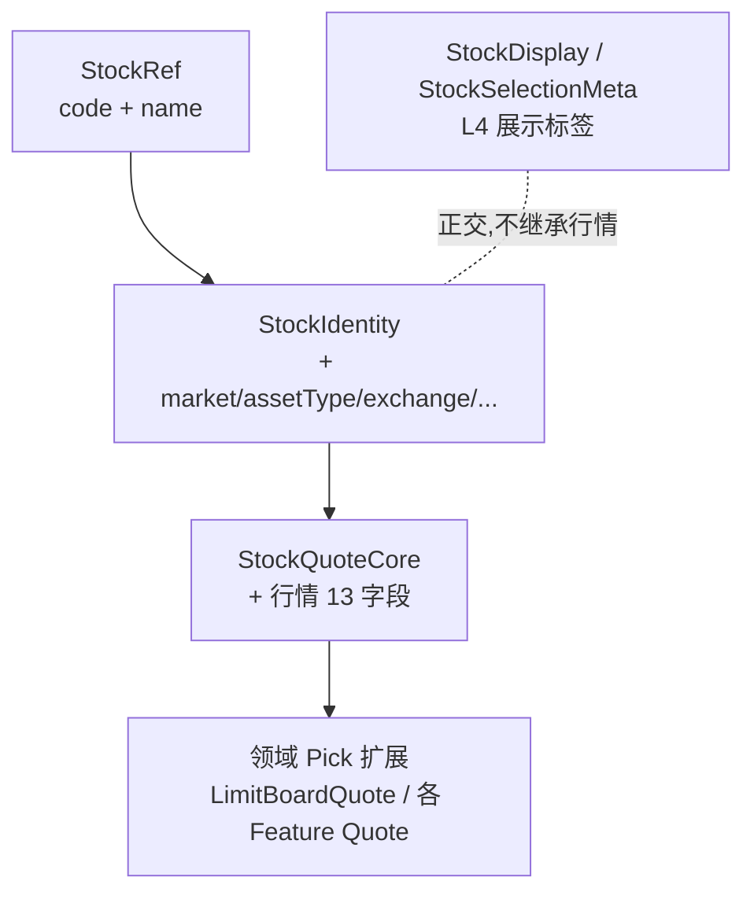
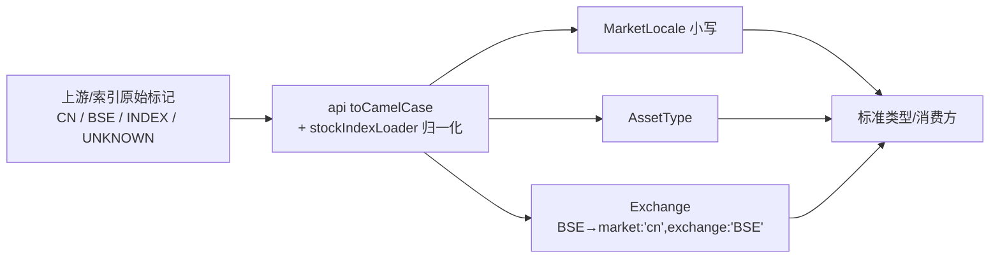

# <a id="stock-type"></a>股票基础信息类型统一方案

> 📝 **方案简述**：统一 HermesX 前端（apps/hrs-web）中约 48 个"股票基础信息"重复类型，消除命名/单位/可空协议/蛇形字段四类漂移；落地 `types/stock.ts` 三层模型（`StockRef` / `StockIdentity` / `StockQuoteCore` + 领域 `Pick` 扩展）+ L4 展示层，并前置完成市场语义正交拆分（地域 `MarketLocale` × 资产 `AssetType` × 交易所 `Exchange`），后端契约不动、差异由前端边界适配层消化。本文件描述已落地设计，实现以 `apps/hrs-web/src/types/stock.ts` 为准。
>
> 👤 **方案作者**：Lensgcx (GaoCangxiong) - ArcSeek-X
>
> 🕒 **更新时间**：2026-11-12

## 目录

- [一、设计总览](#sec-overview)
  - [1.1 设计基准](#sec-overview-baseline)
  - [1.2 设计准则](#sec-overview-principles)
  - [1.3 设计方案](#sec-overview-scheme)
  - [1.4 具体目标](#sec-overview-goals)
- [二、背景与问题](#sec-1)
  - [2.1 现存类型规模与分布](#sec-2-1)
  - [2.2 四类漂移](#sec-2-2)
  - [2.3 根因：前端字段名源于后端 snake_case](#sec-2-3)
  - [2.4 关键风险证据：单位歧义](#sec-2-4)
- [三、总体目标与红线](#sec-3)
  - [3.1 目标](#sec-3-1)
  - [3.2 红线（明确不做）](#sec-3-2)
  - [3.3 权威性](#sec-3-3)
  - [3.4 引用方向与字段数量不一致的处置](#sec-3-4)
- [四、已确认决策基线](#sec-4)
- [五、目标模型：三层结构 + L4 展示层](#sec-5)
  - [5.1 L1 标识层：StockRef + StockIdentity](#sec-5-1)
  - [5.2 L2 行情核心层：StockQuoteCore](#sec-5-2)
  - [5.3 L3 领域扩展层：Pick 组合](#sec-5-3)
  - [5.4 L4 展示层：StockDisplay / StockSelectionMeta](#sec-5-4)
  - [5.5 适配层放置规则](#sec-5-5)
  - [5.6 totalMarketCap 与单位归一](#sec-5-6)
- [六、P0：市场语义正交拆分](#sec-6)
  - [6.1 问题：扁平 market 字符串混装四义](#sec-6-1)
  - [6.2 目标类型定义](#sec-6-2)
  - [6.3 边界归一化](#sec-6-3)
  - [6.4 Extract 子集策略](#sec-6-4)
  - [6.5 BSE 方案 A：并入 cn + 独立 Exchange](#sec-6-5)
- [七、落地状态](#sec-7)
- [八、风险与约束](#sec-8)

<a id="sec-overview"></a>

## 一、设计总览

> 评审速览：以下四项为本方案的提炼结论，详细依据见后续各章（§2–§8）。

<a id="sec-overview-baseline"></a>

### 1.1 设计基准

- **命名基准（字段词典）**：`code` / `name` / `price` / `changePct` / `amount` / `turnoverRate`（沿用现有 `LimitUpItem`，100% 一致、零改名）。
- **后端契约不动**：字段差异一律由前端适配层消化（§4 决策 2）。
- **规范最高权威**：本方案凌驾 `TYPE_NAMING.md §6` 等既有约定（§3.3）。
- **单位不在类型层表达**：一律 `number`，亿/元换算交渲染层 `format.ts`（§3.1）。
- **枚举规范形态 = 小写**：第三方大小写不统一由边界归一化，标准类型不接收原始大小写/词汇（§3.1）。

<a id="sec-overview-principles"></a>

### 1.2 设计准则

- 【强制】**单一真源**：`src/types/stock.ts` 收口标识 / 市场 / 资产 / 行情基础字段与枚举。
- 【强制】**三层模型 + L4 展示层**：L1 `StockRef`/`StockIdentity`、L2 `StockQuoteCore`、L3 `Pick` 组合、L4 `StockDisplay`；不做穷举式 god type。
- 【强制】**领域类型用 `Pick` 组合**，不 `extends` 全量（不谎称后端返回了未提供字段）。
- 【强制】**引用方向**：标准字段从 `stock.ts` 取；`stockIndex.ts` 复用 `StockIdentity`，不得重定义身份字段（§3.4）。
- 【强制】**字段数宽松**：标准类型 = 约束下限 + 字段词典；数据源字段少于标准→缺失须可选或边界补默认；多于标准→忽略或用 `Pick`/`extends` 扩展，不硬塞核心层（§3.4）。
- 【强制】**适配层不进 `types/`**：放 api 层或 `src/api/quoteAdapter.ts`。
- 【强制】**枚举/大小写统一小写 + 边界归一化**：标准类型绝不接收原始大小写/词汇。
- 【红线】不建 barrel；不穷举 god type；不动后端契约；不掩盖单位歧义（§3.2）。

<a id="sec-overview-scheme"></a>

### 1.3 设计方案

- **单文件收口** `src/types/stock.ts`：`StockRef`/`StockIdentity`/`StockQuoteCore` + 领域 `Pick` 扩展（`LimitBoardQuote`/`StockLimitUpQuote`/`StockLimitDownQuote`…）+ L4 `StockDisplay`/`StockSelectionMeta`。
- **市场语义正交拆分（P0）**：`MarketLocale`（地域·小写）＋`AssetType`＋`Exchange`＋`StockIndexMarketTag`（原始标记）；`BSE → { market:'cn', exchange:'BSE' }`（方案 A，§6.5）。
- **边界归一化**：api `toCamelCase` 与 `stockIndexLoader` 把大写 / 原始标记收敛为小写规范值。
- **收口合并**：`market.ts` 并入 `stock.ts` 并**删除旧名 `Market`**；`stockIndex.ts` 去重身份字段（`nameZh→name`）。

<a id="sec-overview-goals"></a>

### 1.4 具体目标

- 消除四类漂移：命名 / 单位 / 可空协议 / 蛇形孤岛。
- 约 48 个重复类型统一到单一真源，引用方向收敛。
- 字段名 / 枚举值 / 大小写全仓一致；标准类型纯净（可选成员可选，多余字段不进核心）。
- 编译期可验证迁移，规避 `BoardlistPage` 式字符串 key 静默失效。
- 不引入新 i18n 假支持（`Extract` 子集表达各 feature 支持范围）。

<a id="sec-1"></a>

## 二、背景与问题

用户在实现 `/emotion/boardlist`（涨跌榜）时发现：`LimitUpItem`（`apps/hrs-web/src/api/limitPoolData.ts`）承载的"代码/名称/现价/涨幅/封单额/成交额/换手率/连板/所属行业"等字段，与项目中大量其它股票类型高度同源。核心立场：**方向正确（应统一），但"穷举式 god type"不可取**。正确做法是"三层模型 + 渐进迁移 + 适配层"，在消除漂移的同时不掩盖单位歧义、不触发大规模静默回归。

<a id="sec-2-1"></a>

### 2.1 现存类型规模与分布

- 全仓约 **48 个** stock-ish 类型，散布于 `src/api/*`（约 30 个）与 `src/types/*`（18 个）。
- 既有 `src/types/` 下无 `index.ts` barrel（符合 `TYPE_NAMING.md §6`），各文件为叶子模块。
- 重复程度极高的字段簇：`code/name/price/changePercent/amount/turnoverRate/prevClose/industry` 在 `LimitUpItem`、`WatchlistQuote`、`StockQuote`、`StockItem`、`EodPickerStock`、`AlphaSiftHotspotStock`、`MarketIndexItem` 等多处手工重复。

<a id="sec-2-2"></a>

### 2.2 四类漂移

| 漂移类型 | 实例 |
| --- | --- |
| **命名**（最普遍） | 涨跌幅：`changePct` / `changePercent` / `change_percent` 三种；代码：`code` / `stockCode` / `symbol` / `stock_code` / `canonicalCode` 五种 |
| **单位**（最危险） | `totalMarketCap` 同名字段，`sectorData.ts` 的 `BoardListItem` 是**亿**、`StockItem` 是**元** |
| **可空协议** | `LimitUpItem`/`WatchlistQuote` 用 `T \| null`（三态）；`StockQuote`/`StockItem` 用 `T?`（二态） |
| **蛇形孤岛** | `api/kline.ts` 刻意不走 `toCamelCase`，由 `klineApi.contract.test.ts` 护栏保留 |

<a id="sec-2-3"></a>

### 2.3 根因：前端字段名源于后端 snake_case

前端字段名是**后端 snake_case 经 `toCamelCase` 自动生成**的。例如 `LimitUpItem.changePct` 之所以叫 `changePct`，是因为后端返回 `change_pct`。因此"统一前端类型"实质上等于**要统一后端响应字段名**，否则需在 api 层加映射。这是"先加适配层、不动后端"的根本原因。

<a id="sec-2-4"></a>

### 2.4 关键风险证据：单位歧义

`sectorData.ts` 中同名字段两种单位并存：`BoardListItem.totalMarketCap` 为**亿**，`StockItem.totalMarketCap` 为**元**。若把字段合并进一个 god type，类型系统将**永久掩盖**该歧义。此外全仓 `amount` 的"元"单位靠**多处方散的渲染层 `/1e8`** 维持。

> **策略修正（见 §3.1 / §5.6）**：单位不再在类型层表达。核心类型一律 `number`（单位无关），具体"亿/元/万"换算交由渲染层 `format.ts` 与各列表头定义决定，统一收口到 `format.ts` 的 `formatAmount` 单一 helper。

<a id="sec-3"></a>

## 三、总体目标与红线

<a id="sec-3-1"></a>

### 3.1 目标

【强制】建立 `src/types/stock.ts` 作为股票标识、市场/资产枚举与行情基础字段的**单一真源**，统一字段名与可空协议（`T | null` 三态）。

【强制】**单位不在类型层表达**：所有金额/数量字段类型均为 `number`（单位无关）；"亿/元/万"展示换算一律交由渲染层 `format.ts` 与各列表头定义负责。比率字段亦为 `number`（百分数值，如 `1.23` 表示 1.23%）。

【强制】**枚举值与大小写统一为小写标准形态，且由边界归一化保障**：`MarketLocale` 等所有枚举规范形态一律**小写**。第三方/上游返回的大小写不统一（如 `CN`/`Cn`/`cn` 混用、`BSE`/`INDEX`/`ETF`/`UNKNOWN` 等原始标记）是**预期内**情况，一律在 **api/loader 边界适配层**收敛为规范小写与固定枚举值；**标准类型绝不接收原始大小写或原始词汇**。

【推荐】领域专属字段保留在各 api 模块，通过 `Pick<StockQuoteCore, ...>` 组合，不污染核心层。

<a id="sec-3-2"></a>

### 3.2 红线（明确不做）

| 项 | 理由 |
| --- | --- |
| 不动 `api/kline.ts` 蛇形孤岛 | 刻意绕过 `toCamelCase`，且有 `klineApi.contract.test.ts` 护栏 |
| 不做任何单位换算 | 改动会令渲染层 `/1e8` 静默差 1e8 倍 |
| 不改后端任何字段 | 已确认决策（兼容桌面端等其它消费方） |
| 不建 `types/index.ts` barrel | `TYPE_NAMING.md §6` 明令禁止 |

<a id="sec-3-3"></a>

### 3.3 权威性

【强制】本方案文档是项目内"股票信息 / 字段 / 枚举值"的**最高权威规范**；当本规范与既有约定（如 `TYPE_NAMING.md §6`、`各 api 模块的历史内联类型`）冲突时，**以本规范为准**。

【强制】代码（`src/types/stock.ts` 及其在 `src/api/*` 的消费方）必须可逐字段追溯至本规范的字段表、命名与枚举值；任何新增或修改股票相关类型，**先改本规范、再改代码**，禁止在代码层"就地发明"等价类型。

【推荐】所有改名须保证编译期可验证（避免 `BoardlistPage.tsx` 式字符串 key 静默失效）。

<a id="sec-3-4"></a>

### 3.4 引用方向与字段数量不一致的处置

【强制】**引用方向**：所有股票身份 / 行情基础字段，必须从 `src/types/stock.ts` 引用。`src/types/stockIndex.ts` 只承载搜索索引专属类型，且**自身必须 `import type` 复用 `stock.ts` 的 `StockIdentity`**，不得重新定义身份字段。若某引用方只需身份 / 行情字段，应直接 `import type { StockIdentity } from 'stock'`。

【强制】**标准类型字段数 ≠ 数据源字段数，二者允许不一致**：
- **数据源字段少于标准**：允许，前提是缺失字段在标准里为可选（`?`）。若源缺失的是必填字段，则属契约不符——要么将其在标准里降为可选，要么在边界适配层补默认值。
- **数据源字段多于标准**：一律允许；若消费方确实需要多余字段，按 L3 模式用 `extends` / `Pick<StockQuoteCore, ...>` 组合标准 + 追加领域专属字段，**不得把多余字段硬塞进核心层**。

> 结论：`stock.ts` 是"约束下限"（必填项）与"字段词典"（可选全集），不是"数据源的精确镜像"。多退少补都在边界处理，标准类型自身保持纯净。

<a id="sec-4"></a>

## 四、已确认决策基线

| # | 决策 | 结论 |
| --- | --- | --- |
| 1 | 字段命名基准 | `code` / `name` / `price` / `changePct` / `amount` / `turnoverRate` |
| 2 | 后端 | **不动**；字段名差异一律由前端适配层消化 |
| 3 | 节奏 | 分期：P0（市场拆分）→ P1（涨停榜）→ P2（自选股）→ P3（其余）；无历史包袱已一气呵成落地 |
| 4 | 单位策略 | 类型层一律 `number`（单位无关），亿/元换算交由渲染层 `format.ts` 与列定义 |
| 5 | 规范权重 | 本方案为最高权威，凌驾 `TYPE_NAMING.md §6` 等既有约定 |
| 6 | BSE 方案 | 方案 A：`BSE → { market:'cn', exchange:'BSE' }`，新增独立 `Exchange` 维度 |
| 7 | 市场枚举形态 | 统一小写；大小写/词汇归一化在边界适配层，标准类型不接收原始值 |
| 8 | 旧名 `Market` | 直接删除，不留兼容别名；`market.ts` 一并删除 |

<a id="sec-5"></a>

## 五、目标模型：三层结构 + L4 展示层

落地于 `apps/hrs-web/src/types/stock.ts`，文件头含 `@file` / `@description` / `@author`，每个字段一句话中文注释。



<a id="sec-5-1"></a>

### 5.1 L1 标识层：StockRef + StockIdentity

```ts
/** ①-a 最小标识：必填项不能再多（现有 7 个双字段 pair 类型正好满足） */
export interface StockRef {
  code: string;   // 股票代码（如 600519）
  name: string;   // 股票名称（中文）
}

/**
 * ①-b 完整身份标识：市场 / 资产 / 交易所 / 代码展示形态 / 英文名 / 行业 / 概念。
 * 除 code / name 外全部可选；market / assetType / exchange 由 P0 统一后的正交类型引入。
 */
export interface StockIdentity extends StockRef {
  market?: MarketLocale;      // 市场地域（cn/hk/us/jp/kr/tw）
  assetType?: AssetType;      // 资产类型（stock/index/etf）
  exchange?: Exchange;        // 交易所（SSE/SZSE/BSE），北交所呈现为 { market:'cn', exchange:'BSE' }
  canonicalCode?: string;     // 带交易所后缀的规范代码（如 600519.SH）
  nameEn?: string;            // 英文名（如 Kweichow Moutai）
  industry?: string;          // 所属行业（如 白酒 / 半导体）
  concepts?: string[];        // 所属概念（如 白酒 / 国企改革 / 基金重仓）
}
```

> 注：展示用代码 `displayCode`（不带交易所后缀）已移出标识层，收口至 L4 `StockDisplay`（见 §5.4），避免与 `canonicalCode` 语义混淆。

<a id="sec-5-2"></a>

### 5.2 L2 行情核心层：StockQuoteCore

```ts
/**
 * ② 行情核心层：字段清单 + 含义的唯一真源。
 * 类型层不约束单位：字段均为 number，注释中的（元）/（%）仅标注常见来源单位；
 * 实际"亿/元"等展示换算交由渲染层 format.ts 与各列定义负责。
 */
export interface StockQuoteCore extends StockIdentity {
  price: number | null;          // 最新价（元）
  change: number | null;         // 涨跌额（元）
  changePct: number | null;      // 涨跌幅（%，1.23 表示 1.23%）
  amount: number | null;         // 成交额（元）
  volume: number | null;         // 成交量（股）
  turnoverRate: number | null;   // 换手率（%）
  prevClose: number | null;      // 昨收价（元）
  open: number | null;           // 今开（元）
  high: number | null;           // 最高（元）
  low: number | null;            // 最低（元）
  amplitude: number | null;      // 振幅（%）
  peRatioTTM: number | null;     // 市盈率 TTM（倍）
  totalMarketCap: number | null; // 总市值（单位由来源决定，渲染层换算）
}
```

| 字段 | 类型 | 常见单位 | 说明 |
| --- | --- | --- | --- |
| `price` | `number \| null` | 元 | 最新价 |
| `change` | `number \| null` | 元 | 涨跌额 |
| `changePct` | `number \| null` | % | 1.23 表示 1.23% |
| `amount` | `number \| null` | 元 | 成交额 |
| `volume` | `number \| null` | 股 | 成交量 |
| `turnoverRate` | `number \| null` | % | 换手率 |
| `prevClose` / `open` / `high` / `low` | `number \| null` | 元 | 价格序列 |
| `amplitude` | `number \| null` | % | 振幅 |
| `peRatioTTM` | `number \| null` | 倍 | 市盈率 TTM |
| `totalMarketCap` | `number \| null` | 来源决定 | 展示换算在渲染层 |

<a id="sec-5-3"></a>

### 5.3 L3 领域扩展层：Pick 组合

【强制】领域类型**必须用 `Pick<StockQuoteCore, ...>` 组合**，不得 `extends` 全量——核心层是"字段字典"而非"数据模板"，`extends` 会谎称后端返回了未提供字段。

```ts
/**
 * 涨跌停榜单通用行情字段：后端返回 7 个通用字段，用 Pick 精确挑选。
 * 涨停池与跌停池字段完全同构（东财双接口经后端归一为同一 schema）。
 */
export interface LimitBoardQuote
  extends Pick<StockQuoteCore, 'code' | 'name' | 'price' | 'changePct' | 'amount' | 'turnoverRate' | 'industry'> {
  sealAmount: number | null;     // 封板资金 / 封单额（元）
  firstLimitTime: string;        // 首次封板时间 HHMMSS，无值返回空串
  lastLimitTime: string;         // 最后封板时间 HHMMSS
  breakCount: number | null;     // 炸板次数（跌停榜为开板次数）
  limitStat: string;             // 涨停统计（如 '3/2'）；跌停池不提供，为空串
  consecutiveBoards: number | null; // 连板数（1 = 首板；跌停榜表示连续跌停次数）
}

/** 涨停榜单语义别名 */
export type StockLimitUpQuote = LimitBoardQuote;
/** 跌停榜单语义别名 */
export type StockLimitDownQuote = LimitBoardQuote;
```

<a id="sec-5-4"></a>

### 5.4 L4 展示层：StockDisplay / StockSelectionMeta

展示层与标识层 / 行情层**正交**，回答"在界面上怎么把它展示给用户看"，不继承行情字段。

```ts
/**
 * 股票展示信息：UI 直接呈现给用户所需的派生展示字段。
 * displayCode 对应搜索索引项的展示用代码（如 600519，不带后缀），
 * 跨系统存储 / 检索改用 canonicalCode（如 600519.SH）。展示名直接用 name。
 */
export interface StockDisplay {
  displayCode?: string;    // 展示用代码（如 600519），不带交易所后缀
  displayLabel?: string;   // 组合标签（如「中科曙光（603019.SH）」），原则上由 name + canonicalCode 派生
}

/** 股票选择元信息：StockSearch.onSubmit 回调的 metadata 形状 */
export type StockSelectionMeta = StockDisplay & {
  marketTag?: StockIndexMarketTag; // 来自搜索索引项的未归一化原始市场标签
};
```

| 类型 | 字段 | 用途 |
| --- | --- | --- |
| `StockDisplay` | `displayCode?` / `displayLabel?` | 输入框回填、列表单行"一眼识别"展示 |
| `StockSelectionMeta` | `StockDisplay` + `marketTag?` | `StockSearch.onSubmit` 回调 payload |

<a id="sec-5-5"></a>

### 5.5 适配层放置规则

【强制】`TYPE_NAMING.md §4` 规定 `types/` 不得依赖 `utils`/`stores`/`components`。适配函数是运行时代码，**禁止放进 `types/stock.ts`**。

- 仅单模块使用 → 就地放在该 `*Api.ts`（如既有 `useWatchlistManager.ts` 的 `quoteFromStockQuote`）。
- 被 ≥2 模块复用 → 新建 `src/api/quoteAdapter.ts`（仍属叶子层，只 `import type` from `types/stock`）。

<a id="sec-5-6"></a>

### 5.6 关于 totalMarketCap 与单位归一

`totalMarketCap` 历史上存在"亿 vs 元"混用，但本规范已确立 **"类型层不表达单位"** 原则（§3.1）：核心字段一律 `number`，单位由渲染层决定。因此 `totalMarketCap` **纳入核心层**，类型为 `number | null`，其展示单位由各消费表在列定义中通过 `format.ts` 的 `formatAmount` 转换——统一收口到单一 helper，避免散落。

<a id="sec-6"></a>

## 六、P0：市场语义正交拆分

<a id="sec-6-1"></a>

### 6.1 问题：扁平 market 字符串混装四义

引入 `market?` 前，`types/market.ts` 的 `Market` 与 `portfolio.ts`、`decisionSignals.ts`、`alerts.ts`、`analysis.ts` 的联合**不是同一概念，而是 4 种语义共用 `market` 一名**：

| 实际语义 | 混淆取值 | 正确处理 |
| --- | --- | --- |
| 地域 | CN/HK/US/JP/KR/TW | 统一成地域联合 `MarketLocale` |
| 资产类别 | `INDEX` / `ETF` | 已有 `AssetType` 承接，从 market 剔除 |
| 交易所（北交所） | `BSE` | 隶属 `cn` 之下，独立 `Exchange` 维度 |
| 缺省哨兵 | `UNKNOWN` | 应为 `undefined`，不是取值 |

运行时确有 `TW`、`UNKNOWN` 而声明中缺漏——即现有 `Market` 类型在说谎，编译器无法兜住漏项。三处穷举 `Record<X, ...>` 既是风险也是安全网：扩值会立即编译报错。

<a id="sec-6-2"></a>

### 6.2 目标类型定义

```ts
// src/types/stock.ts —— 市场 / 资产 / 交易所唯一真源（原 types/market.ts 收口于此）

/** 市场地域（唯一真源），小写以对齐后端契约与 i18n label 后缀 */
export type MarketLocale = 'cn' | 'hk' | 'us' | 'jp' | 'kr' | 'tw';

/** 资产类型：承接原 Market 被污染的 INDEX / ETF 语义 */
export type AssetType = 'stock' | 'index' | 'etf';

/** 交易所：隶属于地域之下的细分维度（当前主要用于区分北交所） */
export type Exchange = 'SSE' | 'SZSE' | 'BSE';

/**
 * 搜索索引源数据的原始 market 标记：如实反映上游大小写与取值。
 * 这不是"地域"，而是后端/索引用一个扁平字符串承载的"国别 + 交易所 + 资产类别 + 哨兵"；
 * 消费前必须经边界适配层归一化为 MarketLocale / AssetType / Exchange。
 */
export type StockIndexMarketTag =
  | 'CN' | 'HK' | 'US' | 'JP' | 'KR' | 'TW'
  | 'INDEX' | 'ETF' | 'BSE' | 'UNKNOWN';

/** 各 Feature 支持范围用 Extract 表达：既单一真源，又不为不支持的市场补假 i18n */
export type AlertSupportedMarket = Extract<MarketLocale, 'cn' | 'hk' | 'us'>;
export type MarketReviewSupportedMarket = Extract<MarketLocale, 'cn' | 'hk' | 'us' | 'jp' | 'kr'>;
export type StockMetricViewSupportedMarket = Extract<MarketLocale, 'cn' | 'hk' | 'us'>;
```

> **收口说明**：`MarketLocale` / `AssetType` / `Exchange` / `StockIndexMarketTag` 原分散于 `types/market.ts`，现统一收口至 `src/types/stock.ts`（单一真源）。迁移方式：在 `stock.ts` 定义权威枚举，并**直接删除 `types/market.ts` 的 `Market` 类型与整个文件**（不留 `type Market = MarketLocale` 兼容别名）；全仓消费方改为引用 `stock.ts` 新类型。该合并刻意覆盖 `TYPE_NAMING.md §6` 的"按域分文件"约定，以本规范最高权威为准。

<a id="sec-6-3"></a>

### 6.3 边界归一化



- **大小写统一小写**：`MarketLocale` 等枚举规范形态统一为小写。搜索索引侧（大写）仅在 `stockIndexLoader` 一处归一化；选小写省去 portfolio/decisions/alerts/analysis 四处边界适配。
- **BSE 归一**：`BSE → { market:'cn', exchange:'BSE' }`，北交所并入 `cn` 桶，`groupStocksByMarket` / `normalizeDecisionSignalMarket` 不再特判 BSE。
- **`UNKNOWN` 哨兵**：归一为 `undefined`，不是取值。

<a id="sec-6-4"></a>

### 6.4 Extract 子集策略

【强制】各 Feature 的 market 联合一律 `Extract<MarketLocale, ...>`，**不得**直接全量引用 `MarketLocale`。理由：alerts 真实只支持 cn/hk/us，强扩到 6 值会迫使为其补 jp/kr/tw 三语标签（假支持）。`Extract` 同时满足单一真源与"不多承诺"，**且本方案因此不产生任何 i18n 新增**。

<a id="sec-6-5"></a>

### 6.5 BSE 方案 A：并入 cn + 独立 Exchange

**结论：本质是类型设计 / 数据建模问题，并催生了代码层 workaround，二者都在 P0 一并修正。**

- **根因（设计）**：`Market` 联合把 4 种正交语义压进同一个字段（地域/资产类别/交易所/哨兵），源头是后端/索引用一个扁平 `market` 字符串承载多维信息，前端 `types/market.ts` 直接 1:1 镜像、未做维度正交拆分。北交所（BSE，代码后缀 `.BJ`）因此被当成与 `CN` 平级的"地域"。
- **代码层已暴露的自相矛盾（证据）**：
  - `DecisionSignalsPage` 的运行时归一化 `if (market === 'CN' || market === 'BSE') return 'cn'` —— 运行时早已知道 BSE 就是中国，却仍在类型里把它列为独立地域值。
  - `stockIndexLoader` `groupStocksByMarket` 直接以 `item.market` 字符串分组：若存在 `market:'BSE'` 会生成独立 `'BSE'` 桶，脱离 A 股（cn）桶。
  - 三处 `Record<X, ...>` 标签映射均不含 `BSE` 键，未归一化的 BSE 会静默渲染成 `'-'`。
- **方案 A 根治**：把 `market` 限定为纯地域（`cn`/`hk`/…），`BSE` 在边界归一化为 `{ market:'cn', exchange:'BSE' }`。于是 `groupStocksByMarket` 天然把北交所并入 `cn` 桶、`normalizeDecisionSignalMarket` 不再需特判 BSE、标签映射也不再遗漏。

<a id="sec-7"></a>

## 七、落地状态

P0→P3 已落地（无历史包袱，一气呵成）。各阶段落地情况：

| 阶段 | 内容 | 落地状态 | 关键产出 |
| --- | --- | --- | --- |
| P0 市场拆分 | `MarketLocale`/`AssetType`/`Exchange`/`StockIndexMarketTag` 收口至 `stock.ts`；删 `market.ts`；BSE 归一 | 已落地 | `stock.ts` 正交枚举；`stockIndexLoader`/`groupStocksByMarket` 边界归一 |
| P1 涨停榜单 | `StockLimitUpQuote`（`LimitBoardQuote`）落地；删 `LimitUpItem` 别名；`id` 外移至 `BoardlistPage` 行类型 | 已落地 | `BoardlistPage` 以 `code` 为 key，`id` 不进标准类型 |
| P2 自选股 | `WatchlistQuote` `Pick` 化；`StockQuote` 不动，由 `quoteFromStockQuote` 适配（`currentPrice→price` 等） | 已落地 | `api/watchlist.ts`、`useWatchlistManager.ts` 适配层 |
| P3 其余类型 | `EodPickerStock`/`AlphaSiftHotspotStock` `Pick` 化；`StockItem`/`MarketIndexItem` 改名；pair 类型→`StockRef`；`stockIndex.ts` 去重（`nameZh→name`） | 已落地 | 全仓引用方向收敛至 `stock.ts` |
| L4 展示层 | `StockDisplay`/`StockSelectionMeta` 新增，`displayCode` 移出 `StockIdentity` | 已落地 | 输入框回填 / `StockSearch.onSubmit` payload |

> 迁移约束：所有改名（如 `changePercent→changePct`、`turnover→amount`、`nameZh→name`）须保证编译期可验证，并连带更新测试（`stockIndexLoader.test.ts` / `searchStocks.test.ts` / `StockSearch.test.tsx`）。

<a id="sec-8"></a>

## 八、风险与约束

| # | 风险 | 影响 | 缓解 |
| --- | --- | --- | --- |
| 1 | 字符串 key 动态排序（`key:'changePct'`、`Record<string, unknown>[column]`） | 后续改名**编译器拦不住**，静默失效 | 每次改名必须同步 grep 字符串 key（含 `ScannerPage` 的 key→i18n 映射表） |
| 2 | 改名（如 `currentPrice→price`） | 触碰多文件 | 类型系统报全部漏改点，可兜底（异于风险 1） |
| 3 | `totalMarketCap` 单位歧义 | 数值差 1e8 倍 | 类型层不表达单位（§3.1）：核心层收口为 `number`，亿/元换算统一在渲染层 `format.ts`（§5.6） |
| 4 | 可空协议不统一（三态 vs 二态） | UI 的 `--` 判断失效 | 核心层统一 `T \| null`，消费方用 `Partial<Pick<>>` 表达可选 |
| 5 | 蛇形孤岛 `api/kline.ts` | 不进标准类型，需独立适配 | 由 `klineApi.contract.test.ts` 护栏保留，不在本规范收口范围（§3.2 红线） |
