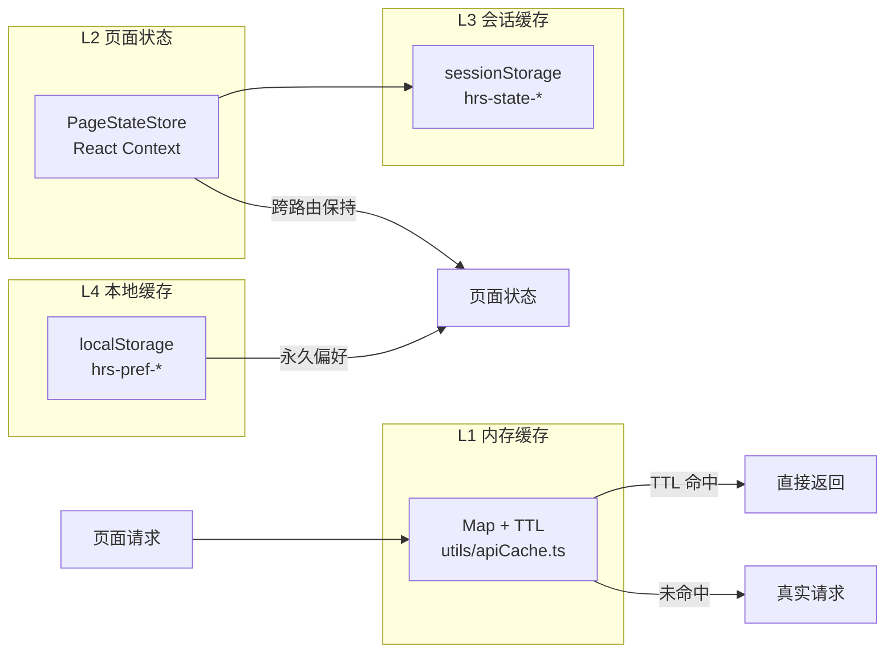

# <a id="前端缓存方案设计"></a>前端缓存方案设计

> 📝 **方案简述**：本方案为 HermesX 前端设计四级缓存体系——L1 内存缓存承载 API 响应、L2 页面状态缓存实现跨路由保持、L3 会话缓存支持刷新恢复、L4 本地缓存存放用户偏好。给出各层级实现、11 个页面的缓存落地、API 缓存拦截器、页面状态 Provider、通用缓存 Hook、键名规范、清除与失效策略与风险注意。当前实现状态以代码（`utils/apiCache.ts`、`stores/PageStateStore.tsx`、`hooks/useCachedState.ts`、`hooks/usePreference.ts`、`constants/cacheConfig.ts`）为准。
>
> 👤 **方案作者**：Lensgcx (GaoCangxiong) - ArcSeek-X
>
> 🕒 **更新时间**：2026-11-12

## 目录

- [一、背景与分层架构](#sec-1)
  - [1.1 应用架构与路由概览](#sec-1-1)
  - [1.2 现有状态管理](#sec-1-2)
  - [1.3 解决的核心问题](#sec-1-3)
- [二、缓存层级设计](#sec-2)
  - [2.1 L1 内存缓存（API 响应）](#sec-2-1)
  - [2.2 L2 页面状态缓存（跨路由保持）](#sec-2-2)
  - [2.3 L3 会话缓存（刷新恢复）](#sec-2-3)
  - [2.4 L4 本地缓存（用户偏好）](#sec-2-4)
- [三、各页面缓存方案](#sec-3)
- [四、技术实现](#sec-4)
  - [4.1 文件结构](#sec-4-1)
  - [4.2 API 缓存拦截器（L1）](#sec-4-2)
  - [4.3 页面状态 Provider（L2）](#sec-4-3)
  - [4.4 通用缓存 Hook（L2+L3）](#sec-4-4)
  - [4.5 用户偏好 Hook（L4）](#sec-4-5)
  - [4.6 窗口宽度 Hook](#sec-4-6)
- [五、缓存键名规范](#sec-5)
- [六、缓存清除策略](#sec-6)
- [七、性能预估](#sec-7)
- [八、风险与注意事项](#sec-8)

<a id="sec-1"></a>

## 一、背景与分层架构

### <a id="sec-1-1"></a>1.1 应用架构与路由概览

HermesX 前端（`apps/hrs-web`）以 React Router v7 数据路由为底座（详见《前端异步数据路由方案》），路由真源 `MENU_MANIFEST` 经 `RouterStore` 加工、登录后动态注入。缓存方案面向以下核心页面：

| 路由 | 页面 | 数据特征 |
| --- | --- | --- |
| `/home` | HomePage | 实时数据，需频繁刷新 |
| `/market/index` | StockDashboardPage | 实时行情，30s 轮询 |
| `/market/sector-analysis` | SectorAnalysisPage | 半实时，30s 自动刷新 |
| `/stock/kline` | StockKLinePage | 实时行情 + 历史 K 线 |
| `/choose/chat` | ChatPage | 会话状态，流式响应 |
| `/discover/screening` | StockScreeningPage | 筛选条件 + 结果集 |
| `/trading/portfolio` | PortfolioPage | 持仓数据，用户私有 |
| `/choose/decision-signals` | DecisionSignalsPage | 分析结果，图表展示 |
| `/backtest` | BacktestPage | 回测配置 + 结果 |
| `/alerts` | AlertsPage | 规则 CRUD，用户私有 |
| `/usage` | TokenUsagePage | 统计数据 |
| `/settings` | SettingsPage | 语言、主题等用户偏好 |

### <a id="sec-1-2"></a>1.2 现有状态管理

| 机制 | 用途 | 存储位置 |
| --- | --- | --- |
| `AuthProvider` | 用户认证状态 | React Context |
| `UiLanguageProvider` | 语言切换（中/英） | React Context + localStorage |
| `ThemeProvider` | 主题切换（深色/浅色） | React Context + CSS class |
| `agentChatStore`（zustand） | AI 聊天状态、路由追踪 | Zustand store |
| `PageStateStore`（React Context） | 跨路由页面状态保持（L2） | React Context + sessionStorage |
| 各页面内部 `useState` | 页面级临时状态 | 组件内存（路由切换即丢失） |

### <a id="sec-1-3"></a>1.3 解决的核心问题

| 问题 | 表现 | 解决方案 |
| --- | --- | --- |
| 路由切换导致页面状态丢失 | 切换路由时组件卸载，`useState` 销毁，返回需重新操作（重搜股票、重置筛选条件） | `PageStateStore`（L2）+ `useCachedState`（L2+L3） |
| API 重复请求 | 每次进入页面重新请求，高频操作（搜索、K 线）无去重 | `apiCache`（L1）+ axios 拦截器自动缓存 |
| 用户偏好分散 | 语言/主题/默认周期等无统一管理 | `usePreference` Hook 统一管理 L4 偏好 |

<a id="sec-2"></a>

## 二、缓存层级设计



| 层级 | 用途 | 生命周期 | 实现 |
| --- | --- | --- | --- |
| L1 内存缓存 | API 响应缓存，减少重复请求 | 应用运行期间，TTL 过期自动失效 | `utils/apiCache.ts` + axios 拦截器 |
| L2 页面状态缓存 | 跨路由保持页面状态 | 会话期间（切换路由不丢失，刷新页面丢失） | `stores/PageStateStore.tsx` |
| L3 会话缓存 | 页面状态持久化，刷新后恢复 | 浏览器标签页关闭前 | `hooks/useCachedState.ts`（与 L2 联动） |
| L4 本地缓存 | 用户偏好设置，永久保存 | 永久（用户手动清除） | `hooks/usePreference.ts` |

<a id="sec-2-1"></a>

### 2.1 L1 内存缓存（API 响应）

`utils/apiCache.ts` 提供 `ApiCache` 类（`Map<string, CacheEntry>`），支持 `get`/`set`/`invalidate(pattern)`（通配符清除）/`clear`；`MAX_CACHE_ENTRIES = 200`（LRU 淘汰）。TTL 由 `constants/cacheConfig.ts` 的 `CACHE_TTL_MAP` 按路径精确/前缀匹配决定，默认 `DEFAULT_CACHE_TTL = 60`。

**各 API 缓存策略**（取自 `cacheConfig.ts`）：

| API 路径 | TTL | 策略说明 |
| --- | --- | --- |
| `/api/v1/kline/`（含 info 与 kline） | 30s | 实时行情与 K 线数据，价格实时性优先 |
| `/api/v1/kline/search` | 300s | 股票搜索变化不频繁 |
| `/api/v1/sector/market-overview` `/indices` | 30s | 与大盘刷新同步 |
| `/api/v1/sector/concept-scale` `/etf-scale` | 300s | 板块变化慢 |
| `/api/v1/sector/market-cards` | 0 | 页面 30s 轮询，避免短路成旧数据 |
| `/api/v1/portfolio` `/alerts` | 0 | 用户私有数据，实时获取 |
| `/api/v1/recent-search/` | 0 | 用户私有 + 需清空后立即反映 |
| `/api/v1/intelligence/live-news` `/live-calendar` | 0 | 轮询需拿最新 |
| `/api/v1/auth` | 0 | 登录/登出状态即时生效 |
| `/api/v1/agent/chat` | 0 | 流式响应 |
| `/api/v1/backtest` | 600s | 计算结果变化不频繁 |
| `/api/v1/decision-signals` | 300s | 分析结果变化不频繁 |
| `/api/v1/screening` | 60s | 相同条件不重复请求 |
| `/api/v1/usage` | 60s | 统计数据 |

> 说明：批量接口 `batch-quote` / `batch-timeline` 为 POST，axios 缓存拦截器仅作用于 GET，故不进入 L1。

<a id="sec-2-2"></a>

### 2.2 L2 页面状态缓存（跨路由保持）

`stores/PageStateStore.tsx` 经 React Context 在 `App.tsx` 顶层提供，跨路由共享；状态变更同步写入 sessionStorage（L3）。**设计原则**：只缓存"用户操作产生的状态"，不缓存原始 API 数据（原始数据经 L1 获取）。

**K 线页状态形状**（当前实现，已收敛为两键）：

```ts
interface KLinePageState {
  stockInfo: StockQuoteCore | null;     // 个股行情快照（StockQuoteCore）
  klineInfo: {
    period: KLinePeriod;                // 当前周期
    klineData: KLinePoint[];            // K 线数据点
    klineSource: string | null;         // 数据来源
  };
}
```

其余页面切片（sector / screening / portfolio / decisionSignals / backtest / alerts）仍为各自的扁平字段结构（详见 PageStateStore 定义），消费方按 `usePageState()` 读取。

<a id="sec-2-3"></a>

### 2.3 L3 会话缓存（刷新恢复）

`hooks/useCachedState.ts` 在 L2 基础上同步写入/读取 sessionStorage，刷新页面时从 sessionStorage 恢复 L2 状态，标签页关闭后自动清除。

<a id="sec-2-4"></a>

### 2.4 L4 本地缓存（用户偏好）

`hooks/usePreference.ts` 管理永久偏好，统一前缀 `hrs-pref-`。已落地偏好项：语言、主题、K 线默认周期、板块分析默认 Tab、各页面默认筛选/配置。

<a id="sec-3"></a>

## 三、各页面缓存方案

页面缓存落地状态（状态标记汇总，避免逐节重复标注）：

| 页面 | 路由 | 落地状态 |
| --- | --- | --- |
| HomePage | `/home` | 待实施 |
| SectorAnalysisPage | `/market/sector-analysis` | 已实施 |
| StockKLinePage | `/stock/kline` | 已实施 |
| ChatPage | `/choose/chat` | 待实施（消息历史未持久化） |
| StockScreeningPage | `/discover/screening` | 已实施 |
| PortfolioPage | `/trading/portfolio` | 已实施 |
| DecisionSignalsPage | `/choose/decision-signals` | 已实施 |
| BacktestPage | `/backtest` | 已实施 |
| AlertsPage | `/alerts` | 已实施 |
| TokenUsagePage | `/usage` | 待实施 |
| SettingsPage | `/settings` | 待实施 |

**各页缓存项明细**：

| 页面 | 缓存项 | 层级 | 说明 |
| --- | --- | --- | --- |
| SectorAnalysisPage | 当前 Tab（概念/ETF） | L2 + L4 | 跨路由保持 + 永久偏好 |
| | 概念/ETF 数量限制 | L2 | 切换路由后恢复 |
| | 市场概览/云图数据 | L1（30s / 300s） | 轮询 + 缓存去重 |
| StockKLinePage | 选中的股票代码 | L2 + L3 | 跨路由保持 + 刷新恢复（派生自 `stockInfo.code`） |
| | 当前周期 | L2 + L3（session） | 跨路由保持 + 刷新恢复；关标签页重置为 `daily` |
| | 股票实时信息 / K 线数据 | L1（30s） | kline 前缀统一 30s |
| | 最近搜索列表 | 后端 DB（`stock_recent_search`） | 落库持久化，非 sessionStorage（见《个股最近搜索》） |
| StockScreeningPage | 筛选条件（市场/策略/最大结果数） | L2 + L4 | 跨路由保持 + 永久偏好 |
| | 排序方式 | L2 | 切换路由后恢复 |
| | 筛选结果 | L1（60s） | 相同条件不重复请求 |
| PortfolioPage | 视图模式（列表/图表） | L2 + L4 | 跨路由保持 + 永久偏好 |
| | 持仓数据 | 不缓存（TTL=0） | 用户私有，实时获取 |
| | 选中的股票 | L2 | 切换路由后恢复 |
| DecisionSignalsPage | 选中的信号类型 / 日期范围 | L2 | 切换路由后恢复 |
| | 分析结果 | L1（300s） | 变化不频繁 |
| BacktestPage | 策略配置 | L2 + L3 | 跨路由保持 + 刷新恢复 |
| | 回测结果 | L1（600s） | 计算结果，长缓存 |
| AlertsPage | 编辑中的规则 / 筛选状态 | L2 | 切换路由后恢复 |
| | 警报规则列表 | 不缓存（TTL=0） | 用户私有，实时获取 |

<a id="sec-4"></a>

## 四、技术实现

### <a id="sec-4-1"></a>4.1 文件结构

| 文件 | 职责 |
| --- | --- |
| `stores/PageStateStore.tsx` | 页面状态缓存 Provider（L2） |
| `utils/apiCache.ts` | API 响应缓存（L1） |
| `utils/storage.ts` | 存储工具（封装 localStorage/sessionStorage） |
| `hooks/useCachedState.ts` | 通用缓存状态 Hook（L2 + L3） |
| `hooks/usePreference.ts` | 用户偏好 Hook（L4） |
| `hooks/useWindowWidth.ts` | 窗口宽度监听 Hook（响应式布局） |
| `constants/cacheConfig.ts` | 缓存配置（TTL、键名前缀、最大条目） |
| `api/index.ts` | 集成 L1 缓存拦截器 |
| `components/StockAutocomplete/StockAutocomplete.tsx` | 支持 `displayValue` + `onClear` |
| `pages/StockKLinePage.tsx` 等 | 各页缓存实施 |

### <a id="sec-4-2"></a>4.2 API 缓存拦截器（L1）

在 axios 拦截器层面统一处理缓存，业务代码无感知：请求拦截器按 `buildCacheKey` 查 `apiCache`，命中则经 `adapter` 短路返回；响应拦截器按 `getCacheTTL(url)` 写入（仅 GET 且 TTL>0）。

### <a id="sec-4-3"></a>4.3 页面状态 Provider（L2）

`PageStateProvider` 在 `App.tsx` 顶层挂载，初始化时从 sessionStorage 恢复状态，状态变化时 `useEffect` 写回 sessionStorage，经 `PageStateContext.Provider` 下发。

### <a id="sec-4-4"></a>4.4 通用缓存 Hook（L2+L3）

`useCachedState(key, defaultValue, options?)`：优先读 `PageStateStore`（`null`/`undefined` 视为无值，回落默认值），必要时从 sessionStorage 恢复；更新时同时写 L2 与浏览器存储。

### <a id="sec-4-5"></a>4.5 用户偏好 Hook（L4）

`usePreference(key, defaultValue)`：读写 `localStorage`（前缀 `hrs-pref-`），用于语言、主题等永久偏好。

### <a id="sec-4-6"></a>4.6 窗口宽度 Hook

`useWindowWidth(debounceMs = 150)`：监听 `resize` 防抖 150ms 返回宽度，供响应式布局与图表适配使用（小屏隐藏刻度、调整间距）。

<a id="sec-5"></a>

## 五、缓存键名规范

**API 缓存键**：`METHOD:URL:PARAMS`（`buildCacheKey` 拼接），相同请求参数生成相同键。

**存储键前缀**：

| 存储 | 前缀 | 用途 |
| --- | --- | --- |
| localStorage | `hrs-pref-` | 用户偏好（L4） |
| sessionStorage | `hrs-state-` | 页面状态（L3） |

<a id="sec-6"></a>

## 六、缓存清除策略

| 触发条件 | 清除范围 | 说明 |
| --- | --- | --- |
| TTL 过期 | 对应 L1 缓存项 | 自动失效，下次请求重新获取 |
| 标签页关闭 | L3 sessionStorage | 浏览器自动清除 |
| 用户登出 | 全部 L1/L2/L3 | 清除所有会话数据 |
| 手动刷新 | 对应 L1 缓存项 | 清除后重新请求 |

**手动清除入口**（设置页）：清除全部 API 缓存（L1）、清除页面状态（L2/L3）、清除用户偏好（L4）、清除全部。

**智能失效**：写操作（POST/PUT/DELETE）或用户私有数据变更后，经 `apiCache.invalidate(pattern)` 按通配符清除相关 L1 项（如 `entity:*:id`、`entity:list`），避免展示过期数据。

<a id="sec-7"></a>

## 七、性能预估

| 指标 | 优化前 | 优化后 | 提升 |
| --- | --- | --- | --- |
| 切换路由返回时间 | 2~5 秒（重新加载） | < 100ms（状态恢复） | 20~50x |
| API 请求次数（典型会话） | ~50 次/小时 | ~15 次/小时 | 减少 70% |
| 页面刷新恢复时间 | 3~8 秒（全部重新加载） | 1~2 秒（从缓存恢复） | 3~4x |
| 内存占用增加 | - | ~5~10 MB | 可接受 |

<a id="sec-8"></a>

## 八、风险与注意事项

- **内存泄漏**：L1 `Map` 设 `MAX_CACHE_ENTRIES = 200`，超出 LRU 淘汰；组件卸载需清理订阅。
- **数据一致性**：用户私有数据（portfolio/alerts）TTL=0 或不缓存；写操作后自动清除相关 L1 缓存。
- **存储空间**：sessionStorage 限制约 5~10 MB；大对象（如 K 线数据）只存 L1 内存，不写入 sessionStorage，sessionStorage 仅存轻量状态（股票代码、周期、筛选条件）。
- **兼容性**：所有缓存取放需 try-catch，防止私有模式 localStorage 不可用。
- **空值语义**：`useCachedState` 将 `null` 与 `undefined` 均视为无值并回落默认值；清除操作字段值须与 `defaultValue` 一致（如 `stockCode: ''` 而非 `null`），且避免在同一操作中混用两种 setState 设置同一字段，防止闭包旧值覆盖。
